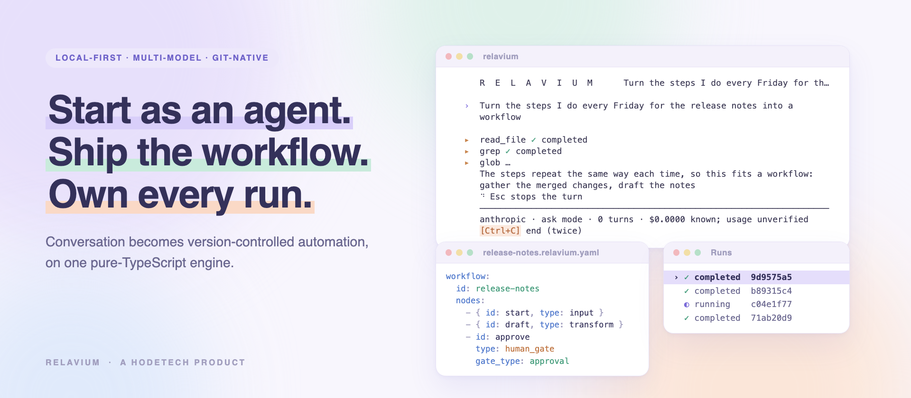
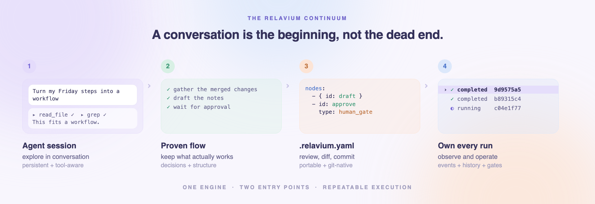
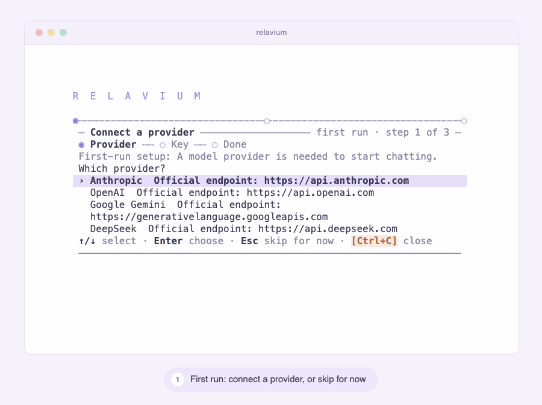
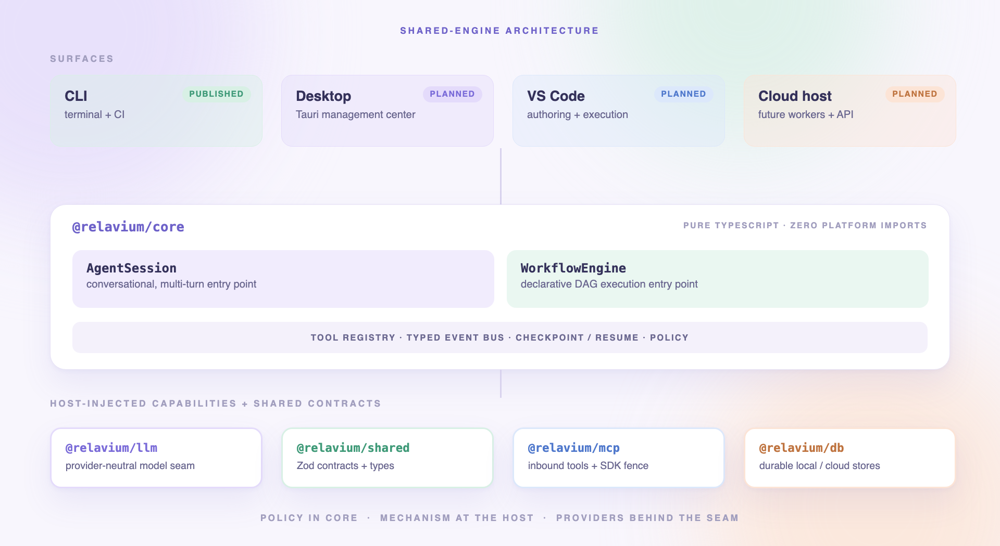

# Relavium

<p align="center">
  
</p>

<p align="center">
  <strong>Start as an agent. Ship the workflow. Own every run.</strong>
</p>

<p align="center">
  A local-first AI agent platform that turns productive conversations into<br>
  version-controlled, multi-agent workflows — on one pure-TypeScript engine.<br>
  A product of <a href="https://github.com/HodeTech">HodeTech</a>.
</p>

<p align="center">
  <a href="https://www.npmjs.com/package/relavium"></a>
  <a href="https://github.com/HodeTech/Relavium/actions/workflows/ci.yml"></a>
  
  
  
  
</p>

<p align="center">
  <a href="#get-started">Get started</a> ·
  <a href="#why-relavium">Why Relavium</a> ·
  <a href="#architecture">Architecture</a> ·
  <a href="#where-things-stand">Status</a> ·
  <a href="docs/README.md">Documentation</a>
</p>

Relavium begins where agent work naturally begins: in conversation. Explore a task in a
persistent session, keep the flow that proves useful, and graduate it into a reviewable
`.relavium.yaml` workflow. The conversation and the workflow are not separate products —
they are two entry points into the same engine, tool registry, model seam, and event stream.

> **Right now:** the CLI is on npm as `relavium@0.1.1`. The next release, v0.2.0, is built
> and held back on purpose; the work that makes the terminal feel like one product is in review.
> Desktop, VS Code, and cloud execution are planned. [Where things stand](#where-things-stand)
> says exactly what is in which state.

## From conversation to infrastructure

<p align="center">
  
</p>

Most agent tools make you choose between a flexible chat and an operable workflow. Relavium
treats them as a continuum:

1. **Explore in an agent session.** Work conversationally with streaming output, tools,
   model controls, persistent history, and human approval.
2. **Promote what works.** Export the proven flow into git-native YAML that can be reviewed,
   changed in a PR, and shared without embedding provider keys.
3. **Run it deliberately.** Execute locally or in CI with typed events, durable history,
   human gates, checkpoints, and cost controls.

You can also author the workflow directly; conversation is an on-ramp, not a requirement.

## Get started

The published CLI is the fastest way to use Relavium. It requires **Node.js 22 or newer**.

```bash
npm install -g relavium
```

**Try a workflow in a minute — no API key needed.** A workflow is a plain file, so save this
as `hello.relavium.yaml`:

```yaml
schema_version: '1.0'
workflow:
  id: hello-pipeline
  name: Hello pipeline
  inputs:
    - { name: who, type: string }
    - { name: times, type: number }
  nodes:
    - { id: start, type: input }
    - { id: greet, type: transform, transform: "({ greeting: 'Hello, ' + inputs.who + '!', count: inputs.times * 2 })" }
    - { id: out, type: output }
  edges:
    - { from: start, to: greet }
    - { from: greet, to: out }
```

```bash
relavium run ./hello.relavium.yaml --input who=Ada --input times=3
```

Now the real thing — an agent.

1. Connect a provider. The key is read from stdin and stored in the OS keychain —
   never passed through argv.

```bash
relavium provider add anthropic
printf '%s\n' "$ANTHROPIC_API_KEY" | relavium provider set-key anthropic
```

2. Start as an agent.

```bash
relavium chat
```

3. Run `/export` inside the session to create a git-committable workflow. Execute it
   interactively, or stream NDJSON for CI with `--json`.

```bash
relavium run ./my-workflow.relavium.yaml --json
```

Prefer to author first? `relavium create` scaffolds an agent or a minimal workflow;
`relavium import` and `relavium export` move validated artifacts between projects. See the
[CLI command reference](docs/reference/cli/commands.md) for the complete surface and the
[local development runbook](docs/runbooks/local-dev-setup.md) to build from source.

## A look at the next release

<p align="center">
  
</p>

<p align="center">
  <sub>The development build's Home. v0.2.0 is not published, so <code>npm install</code> still gives <code>0.1.1</code>.<br>
  Real frames of the application, restyled. <a href="assets/readme/README.md">What is real in these images</a>.</sub>
</p>

Type `relavium` and the Home opens: start an agent, press `/` for every command, run a workflow
(`/run` asks for its inputs and for your confirmation before anything starts), and open any past
run from the Runs screen. The answer to a question the system asks is always yours to give; a
held key cannot give it for you.

## Why Relavium

| Principle | What it means |
|---|---|
| **Conversation becomes infrastructure** | A useful session can graduate into a durable workflow instead of disappearing into chat history. |
| **Git-native by construction** | Workflows are diffable `.relavium.yaml` files — reviewable in pull requests and owned by the team that runs them. |
| **Multi-model without framework lock-in** | Relavium owns its `LLMProvider` seam and routes across Anthropic, OpenAI-compatible providers, and Gemini without LangChain or the Vercel AI SDK. |
| **Local-first control** | Local BYOK is the default, no Relavium account is required, and provider keys are stored in the OS keychain rather than workflow files. |
| **Execution you can inspect** | Typed event streams, local run history, human gates, checkpoints, retries, fallback chains, and cost controls make a run observable. |
| **One engine, multiple surfaces** | `AgentSession` and `WorkflowEngine` share one platform-pure core designed for the CLI, desktop, VS Code, and future cloud workers. |

## Architecture

<p align="center">
  
</p>

The center of Relavium is `@relavium/core`, a strict TypeScript engine with **zero
platform-specific imports**. It exposes two co-equal entry points:

- **`AgentSession`** for conversational, multi-turn work.
- **`WorkflowEngine`** for declarative `.relavium.yaml` execution.

Both reuse the same `ToolRegistry`, typed event substrate, and Relavium-owned
`@relavium/llm` abstraction. Official provider SDKs are confined to thin adapters; no
vendor SDK type crosses the seam. Host packages supply persistence, MCP connections,
keychain access, files, processes, and network I/O without making the engine
platform-specific. Read the [architecture overview](docs/architecture/) or the
[decision records](docs/decisions/) for the reasoning behind those boundaries.

> The CLI is the only product surface so far. Desktop and VS Code integrations, plus
> managed inference and cloud execution, are under development or planned. The diagram
> shows the shared-engine topology, not equal release availability.

## Where things stand

Relavium is under active development, and the CLI comes first. Three states, kept apart on
purpose, because "built" and "published" are not the same thing:

| State | What it is |
|---|---|
| **Published** — `relavium@0.1.1` on npm | The workflow runtime, the chat, authoring, and the inbound MCP client, listed in full [below](#whats-in-relavium011). |
| **Built on `main`, not published** — on the way to v0.2.0 | `relavium` opens a full-screen **Home** where you do everything ([ADR-0122](docs/decisions/0122-the-home-is-the-interactive-product.md)): connect a provider, start a project, chat, run a workflow, answer its gates, browse and resume past work. The chat can read, search and edit files and run commands, under four honest modes (`ask`, `plan`, `accept-edits`, `auto`) with a docked approval card and remembered command permissions. |
| **In review** — [PR #103](https://github.com/HodeTech/Relavium/pull/103) | **One surface language** for the whole CLI (MVP-11): reports, settings and flows as centred popups, the questions the system asks as bottom sheets, an ordered slash palette, a calm two-page Home, and a transcript with a margin the host draws, so the product's own marks and the words a model writes stay apart. Its [close-out evidence](docs/roadmap/phases/mvp-11/closeout-evidence.md) lists what is still owed. |
| **Planned** | A Tauri desktop app (the agent-management center, not an IDE), a VS Code extension, managed inference, and cloud execution. |

Publication of v0.2.0 is held by a release guard until the pre-1.0 release path is decided,
so `npm install` still gives you `0.1.1`. To try what is on `main`, build from source with
the [local development runbook](docs/runbooks/local-dev-setup.md).

Status changes quickly, so this README intentionally stays high-level. The canonical source
for the exact active work, what shipped when, and the open obligations is
[docs/roadmap/current.md](docs/roadmap/current.md).

### What's in `relavium@0.1.1`

| Capability | In the published CLI |
|---|---|
| Conversational agents | `relavium chat`: a streaming multi-turn session with tool-call annotations, `chat-list` / `chat-resume` / `chat-export`, and `/export` to turn a session into a workflow scaffold; a one-shot `agent run` with an offline fixture replay |
| Workflow runtime | YAML parse and validation, DAG execution, parallel branches, retries, model fallback, checkpoints, and typed live events |
| Human control | Interactive human gates that can pause a run and resume it from another process with `relavium gate` |
| Operations | `run`, `list`, `logs`, `status` over durable local history, a live terminal view, deterministic exit codes, and NDJSON output (`--json`) for CI |
| Authoring | `create`, `import`, and `export` — validated, share-safe YAML with no provider key in it |
| Providers and tools | Anthropic, OpenAI-compatible and Gemini behind one seam, an inbound MCP client with an SSRF floor, and media output with a contained `save_to` |
| Local ownership | BYOK, OS-keychain storage, project-local git artifacts, and local run history |

For exact command behavior and contracts, use the [reference documentation](docs/reference/)
and the [CHANGELOG](apps/cli/CHANGELOG.md) rather than this overview.

## Local-first, precisely

- **No account is required for local BYOK.** The CLI runs the engine and stores history on
  your machine.
- **Provider keys do not belong in workflows or committed configuration.** Interactive
  setup stores them in the OS keychain; a documented environment fallback exists for
  automation.
- **Workflows remain ordinary files.** They can be reviewed, branched, reverted, and moved
  without exporting from a proprietary database.
- **Network use is explicit.** LLM requests go to the provider you configure; optional
  catalog refreshes and future managed/cloud modes are not hidden prerequisites for local
  execution.

The binding guarantees live in the [product constraints](docs/product-constraints.md) and
[security standard](docs/standards/security-review.md).

## Repository map

| Path | Responsibility |
|---|---|
| [`packages/core`](packages/core/) | Platform-pure agent-session and workflow engine |
| [`packages/llm`](packages/llm/) | Relavium model seam, adapters, fallback, usage, and cost logic |
| [`packages/shared`](packages/shared/) | Zod schemas and inferred types — the contract source of truth |
| [`packages/db`](packages/db/) | Local SQLite persistence with a Postgres-compatible schema and migrations |
| [`packages/mcp`](packages/mcp/) | SDK-confined inbound MCP client and schema validation |
| [`apps/cli`](apps/cli/) | Published terminal product and integration harness |
| [`apps/desktop`](apps/desktop/) | Tauri desktop surface — a placeholder, built in Phase 3 |
| [`apps/vscode-extension`](apps/vscode-extension/) | VS Code surface — a placeholder, built in Phase 4 |

The full dependency graph and ownership rules live in
[docs/project-structure.md](docs/project-structure.md).

## Development

Relavium is a pnpm + Turborepo monorepo. For a first local verification:

```bash
corepack enable
pnpm install --frozen-lockfile
pnpm run ci
```

Use pnpm only — never npm or yarn for workspace development. Start with the
[local development setup](docs/runbooks/local-dev-setup.md), then read
[`CLAUDE.md`](CLAUDE.md) or [`AGENTS.md`](AGENTS.md) before making changes.

## Documentation

The canonical documentation is organized by the question you are trying to answer:

| Start here | Answers |
|---|---|
| [Vision](docs/vision.md) · [Product constraints](docs/product-constraints.md) · [UVP](docs/uvp.md) | What is Relavium, and why does it exist? |
| [Architecture](docs/architecture/) · [ADRs](docs/decisions/) | How is it built, and why these boundaries? |
| [Reference](docs/reference/) | What are the exact YAML, event, CLI, database, and integration contracts? |
| [Tutorials](docs/tutorials/) | How do I start a chat session, or run a workflow in CI? |
| [Roadmap](docs/roadmap/README.md) · [Current state](docs/roadmap/current.md) | What is shipped, active, and next? |
| [Standards](docs/standards/) · [Runbooks](docs/runbooks/) | How should the project be changed and operated? |

## License

Relavium is **proprietary software** — © 2026 HodeTech, all rights reserved. It is
not open source and grants no rights except as expressly stated. See [LICENSE](LICENSE)
for the full terms. For licensing inquiries or commercial-use agreements, contact
[HodeTech](https://github.com/HodeTech).
