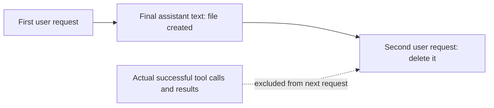

# Chat action history, environment awareness and latency investigation

- **Date**: 2026-11-15
- **Status**: Investigation and recommended plan; no new runtime or roadmap decision is approved by this report.
- **Local source**: `development` at `b60bb1e5`; unrelated user-owned pnpm workspace/lock changes were left untouched.
- **Related**: [current roadmap](../roadmap/current.md#next-work--the-cli-mvp), [ADR-0095](../decisions/0095-what-an-agent-session-remembers-across-turns.md), [CR-70 deferral](../roadmap/deferred-tasks.md), [ADR-0116](../decisions/0116-the-built-in-chat-agent-can-edit-and-the-starting-mode-is-configurable.md), [ADR-0118](../decisions/0118-a-command-outside-the-allowlist-asks-instead-of-failing.md), [chat contract](../reference/cli/chat-session.md), [tool contract](../reference/shared-core/built-in-tools.md)

## Finding and evidence boundary

The supplied conversation shows a successful `write_file`, followed by a
successful `read_file`, then a later assistant statement denying that the
earlier turn called tools. The local session's durable structural rows confirm
the first turn's `list_directory`, `find_files`, `write_file` and `read_file`
outcomes are all `ok`. The second turn records successful find/read calls.
The statement that no earlier tool ran contradicts this evidence.

The relevant session snapshot names `claude-haiku-5-5`, provider `anthropic`,
and authored reasoning effort `max`. A later in-memory `/effort` override is not
proved or excluded by that snapshot. Across the two completed exchanges, its cost row
records seven model calls, 45,592 input tokens and 14,896 output tokens. The
supplied first-turn footer reports 32,519 input, 10,362 output and 47.3 seconds.
These totals do not provide per-call latency or the first turn's exact model
round boundaries. No paid provider replay was made, and no user configuration
was changed. Inspection used read-only database queries and reported structural
facts rather than raw private tool content or unrelated conversations.

This investigation separates a deterministic context omission from model
behavior. The code proves which evidence is missing from the next request; it
does not prove that this omission alone deterministically produces the quoted
sentence. Previous user and final assistant text can still be present. A more
faithful request reduces this failure mode but cannot guarantee every model's
natural-language answer.

## Successful tool history is lost at every turn boundary

In [AgentSession](../../packages/core/src/engine/agent-session.ts), the successful
`sendMessage` path appends only `result.text` to `#messages`. It sends
`result.toolHistory` to the completion observer for persistence, but does not
append tool rounds to the next model request. The comment at the append
explicitly describes text-only cross-turn history.

[buildTurnMessages](../../packages/core/src/engine/turn-messages.ts) then applies
the authored memory policy to that text transcript. Resume also rebuilds
[text-only messages](../../packages/core/src/engine/session-resume.ts). The
[persister](../../apps/cli/src/chat/persister.ts) stores content-free tool
structure for history/export: resolved name, engine call identity, argument and
result byte sizes, and outcome. It does not store raw arguments or results.
Consequently, the UI and database can know a tool ran while the next model
request contains no corresponding tool evidence.

For the reported case the next request is approximately:

This occurs even without `/models`, compaction or a process restart.
`memory: none` would intentionally remove more history, but that is not required
to reproduce this omission. The built-in agent does not author `memory: none`.
Its [system prompt](../../apps/cli/src/chat/default-agent.ts) asks it to inspect
tool results and avoid claiming an edit without evidence. That instruction
does not restore missing earlier tool results and does not require the false
claim that no previous tool ran.

The omission is already recorded as **CR-70, High (product)** under ADR-0095 §2.
The current approved sequence schedules it for **v0.2.1, after the v0.2.0 CLI
MVP**, together with in-turn overflow continuation. MVP-4's pending
ADR-0117/0119 cover denial feedback and content-free interrupted-turn markers;
they do not, by themselves, repair successful cross-turn tool history.

The original boundary has a concrete privacy reason: CLI history is unencrypted,
and tool arguments/results can contain credentials, file contents or command
output. Copying every raw tool result into `history.db`, replaying signatures
across providers, or promoting results into system instructions would introduce
different defects. Past evidence also must not authorize a fresh write or be
treated as proof that a file has not changed since it was read.

## What the 47.3-second turn establishes

| Observation | Assessment |
|---|---|
| Four tools for one small create request | Directory listing and file finding may duplicate discovery; a readback adds work after the write. The exact necessity depends on available path/existence evidence. |
| Seven model calls across two exchanges | A tool-driven turn can require several provider requests; tool count is not necessarily request count because a response can contain multiple calls. |
| Authored `max` reasoning; 10,362 first-turn output tokens | High reasoning effort is a plausible substantial latency/cost contributor, subject to an unrecorded live override and the model's capability gate. Output usage includes more than the visible final poem: tool-call generation and potentially thinking also count. The persisted aggregates do not establish the exact thinking share. |
| 32,519 first-turn input tokens | This is cumulative billed input across model requests, not proof that one request held a 32,519-token conversation. Repeated instructions, tool schemas and within-turn history contribute. |
| Existing corrected host-path benchmarks | Ordinary and metadata-dense writes are usually tens of milliseconds in those measurements. They do not measure this particular user turn or its provider/network time. They provide no basis for attributing the full 47.3 seconds to metadata preparation. |
| No persisted per-phase timing for this session | The exact split among provider queueing, first-token wait, generation, tool work, retries and persistence cannot be recovered from the current rows. |

The native evidence and historical timing tails are scoped in the
[ADR-0127 checkpoint](../roadmap/phases/phase-2.6-conversational-authoring.md#adr-0127-final-local-source-acceptance-2026-11-15).
Do not convert its 64-KiB local fixture timings into an end-to-end SLA for an
arbitrary hosted model or the small poem example.

An immediately available user-controlled comparison is `/effort low` or
`/effort medium`, followed by an equivalent simple task at the same model and
mode. `/effort` displays the active selection. `/thinking` and Ctrl+T only
change panel visibility; hiding the panel does not lower reasoning effort.
This investigation does not change the user's selected `max` setting.

The built-in request path does not enable Anthropic `cache_control`; prompt
caching remains an MVP-5 item. Anthropic documents prefix caching as a way to
reduce repeated input processing, cost and latency, and documents thinking as
part of output generation. This is a candidate improvement, not a measured
explanation of the reported delay. See the official
[prompt caching](https://platform.claude.com/docs/en/build-with-claude/prompt-caching)
and [thinking](https://platform.claude.com/docs/en/build-with-claude/thinking)
documentation.

## Commands: current capability and scheduled product access

The current built-in agent grants exactly seven tools: `read_file`,
`list_directory`, `git_status`, `search_files`, `find_files`, `write_file`,
and `edit_file`. It has no deletion tool and no `run_command`. The inability to
delete through that toolset is accurate; the subsequent denial of its earlier
successful creation is not.

The process capability and `run_command` already exist for explicitly authored
agents/workflows with the relevant grant and admitted command policy. The
interactive `!` escape uses the same boundary, with an empty default allowlist.
It is not an unrestricted terminal.

**MVP-4 / D63 / ADR-0118** is the planned default-agent command increment:
typed command/cwd approval, Once/Session/Remember, operator-owned remembered
grants, permission management, and fail-closed headless behavior. ADR-0118 is
still Proposed. Installing `gh` does not itself grant the default agent access.
An admitted `gh` or `git` executable can run through this capability; command
arguments, external effects, authentication and approval remain material.

The [process host](../../apps/cli/src/engine/tool-host/process.ts) uses
`spawn(..., { shell: false })`. Executable-plus-argv invocation works without
a shell. Pipes, `&&`, redirects, globbing and variable expansion do not acquire
Bash semantics automatically. A deliberately authorized `bash -lc`/`zsh -lc`
is a different authority choice; the existing MVP-4 plan should explicitly
decide whether and how to expose it rather than promise arbitrary shell syntax.
Running a subprocess is not OS filesystem/network isolation: file-tool root
checks do not jail an admitted program's ambient access.

The existing [MVP-4 plan](../roadmap/current.md#next-work--the-cli-mvp) also
includes interrupt-key consistency, denial-to-model behavior, interrupted-turn
markers and finite turn ceilings. It does not currently move CR-70 forward.

## Host facts are not model context today

The default system prompt is static. The CLI knows the workspace and platform
for execution, but that knowledge is not automatically visible to the model.
The current model-facing prompt does not provide the basic OS/shell/timezone
block requested here. A host probe during this investigation reports `darwin`,
`arm64`, `Europe/Istanbul`, UTC+03:00; it does not establish that the earlier
model request contained these facts.

**MVP-5 / MVP-A16** currently owns project instructions and an environment block
under explicit provenance rules, requiring a new ADR. This explains the missing
product integration; it does not make generic three-OS instructions desirable
when the actual host is already known to the application.

The proposed minimal environment should distinguish execution host facts from
preferences: OS/architecture, working/project root, actual command-runner kind,
observed login shell if available, IANA timezone and current offset/date, and
the session's granted capabilities/current mode. Use `unknown` when unproved.
Do not infer physical location or response language from timezone. WSL,
containers, SSH and future remote runners require the execution environment to
be named explicitly; the client desktop may differ.

Collect these through host-owned typed inputs, keeping core platform-pure.
Never inject all of `process.env`, usernames, credentials or unrelated machine
inventory. An environment string remains data, not shell code or repository
authority. Keep stable context stable for caching; send changing clock/date
facts as a bounded trailing observation when needed, rather than changing a
large system prefix every second. The application can then prefer macOS-specific
guidance for this session unless the user asks for another platform.

## Pinned upstream comparison

These are read-only source observations at upstream HEADs resolved on
2026-11-15, not installed-binary or comparative latency tests. No upstream code
was executed, no account was configured, and no universal security or correctness
claim follows. Current source layouts differ from older online examples.

| Project / commit | Action-history mechanism inspected | Host-context mechanism inspected |
|---|---|---|
| OpenCode `d432a06b9c07bab0be4e8d642173b1cb14137f11` | Its [history lowering](https://github.com/anomalyco/opencode/blob/d432a06b9c07bab0be4e8d642173b1cb14137f11/packages/core/src/session/runner/to-llm-message.ts#L145) constructs assistant calls and matching tool-result messages from projected stored history; error cuts and model/provider metadata are handled explicitly. | [Built-in instructions](https://github.com/anomalyco/opencode/blob/d432a06b9c07bab0be4e8d642173b1cb14137f11/packages/core/src/instructions/builtins.ts#L24) include cwd/workspace/git/platform and a separate date instruction, with distinct initial/changed rendering. The inspected block does not prove explicit IANA timezone injection. |
| Octomind `ccaa3d32ce25bb1881569c25d31d6d2b1e60415d` | [Tool-result processing](https://github.com/Muvon/octomind/blob/ccaa3d32ce25bb1881569c25d31d6d2b1e60415d/src/session/chat/response/tool_result_processor.rs#L354) caps output before adding paired tool messages. Its [session messages](https://github.com/Muvon/octomind/blob/ccaa3d32ce25bb1881569c25d31d6d2b1e60415d/src/session/chat/session/messages.rs#L468) persist tool messages before the in-memory append. Compression/archive is a separate mechanism. | [Placeholder construction](https://github.com/Muvon/octomind/blob/ccaa3d32ce25bb1881569c25d31d6d2b1e60415d/src/session/helper_functions.rs#L133) gathers date/time with timezone, shell and OS; requested prompt placeholders consume that context. It also probes developer binaries. Relavium need not copy that broader probing cost. |
| Cline `72b3d7140553a733242126e51a7c2e87efe75c64` | The inspected SDK [agent runtime](https://github.com/cline/cline/blob/72b3d7140553a733242126e51a7c2e87efe75c64/sdk/packages/agents/src/agent-runtime.ts#L988) appends tool-result messages to runtime state, snapshots it, and clones state messages into the next model request. Separate compaction can transform history. | The CLI [prompt resolver](https://github.com/cline/cline/blob/72b3d7140553a733242126e51a7c2e87efe75c64/apps/cli/src/runtime/prompt.ts#L25) passes cwd and platform; the shared [prompt builder](https://github.com/cline/cline/blob/72b3d7140553a733242126e51a7c2e87efe75c64/sdk/packages/shared/src/prompt/cline.ts#L198) supplies the current date. Explicit IANA timezone delivery is not established by this path. |
| Aider `5dc9490bb35f9729ef2c95d00a19ccd30c26339c` | [Completed messages](https://github.com/Aider-AI/aider/blob/5dc9490bb35f9729ef2c95d00a19ccd30c26339c/aider/coders/base_coder.py#L1036) move into retained history; request construction combines that history with repository and current chat-file context. Its editing/message architecture differs from a generic paired-tool loop. | [Platform information](https://github.com/Aider-AI/aider/blob/5dc9490bb35f9729ef2c95d00a19ccd30c26339c/aider/coders/base_coder.py#L1127) includes platform, `SHELL`/`COMSPEC`, language and local date. Using local time to compute a date does not establish explicit timezone injection. |

The useful common pattern is an explicit action-history projection plus
host-supplied facts, with deliberate truncation/compaction. There is no evidence
here that copying another product's prompt, raw persistence policy or shell
exposure would provide its entire behavior or meet Relavium's existing privacy
and effect guarantees.

## Recommended implementation plan and decisions

Use three cohesive increments, each with the already requested commit/review
cycle. Do not split every history field or terminal string into its own step.
The sequence below is a recommendation, not an amendment to accepted scheduling.

| Increment | Deliverable and acceptance | Decisions before implementation |
|---|---|---|
| 1. Grounded conversational context | Preserve bounded successful action evidence in subsequent requests; retain matched live call/result context where permitted; distinguish past observations from current file validity. Project existing durable structural receipts on resume, with explicit missing-content disclosure. Include the planned denial/interruption behavior. Add a small typed host-environment observation so answers use the actual OS/timezone/capabilities. | Bring CR-70 forward from v0.2.1, and the minimal environment slice forward from MVP-5. A new ADR must settle live versus durable content, model reseat/provider boundaries, defaults/toggle, bounds and host provenance; append forward notes to affected accepted decisions. |
| 2. Usable command execution | Deliver MVP-4's default `run_command` grant, full command/cwd inspection, Once/Session/Remember, revocation and interruption semantics. Test real `git`/`gh`-class argv execution with controlled fixtures and refusal paths. | Review/accept existing ADR-0115/0117/0118/0119 as applicable. Explicitly decide the shell-interpreter boundary; do not equate `run_command` availability with arbitrary Bash syntax or OS sandboxing. |
| 3. Measured latency reduction | Content-free per-call timing for admission, provider wait/generation, tool execution, native join and persistence. Attribute token classes when provider evidence exists. Reduce redundant discovery/readback and repeated prompt work; measure caching and effort levels with matched tasks, retaining correctness checks. | Approve caching/API refinements if they alter the public seam or accepted policy. Preserve user-chosen effort; choose any new default from measurements. Agree a benchmark methodology before promising an SLA. |

Recommended history policy for design review: keep raw arguments/results off
unencrypted disk, use the existing durable structural receipts for historical
action evidence, and allow bounded paired live tool context within explicitly
defined provider/session boundaries. This delivers useful continuity with a
smaller privacy change than raw transcript persistence. It must disclose that
resume/reseat can recover the fact of an action without its old raw result.
If full raw-content continuity across restart/model reseat is required, choose
and review protected persistence now; an in-memory-only design cannot honestly
promise it. These are alternatives the maintainer should resolve in the ADR,
not an implementation detail to hide in code.

Required acceptance scenarios include:

- Create/read in turn one; next-turn requests contain grounded successful action
  evidence. Multi-file and partial-success sequences retain correct associations.
- Same instance, model switch, resume, empty final, manual/automatic compaction,
  bounded memory, overflow, denied/aborted/failed turns and provider fallback.
  Paired calls/results remain protocol-valid; lost/truncated evidence is explicit.
- Old file reads are recognizable as past observations; a fresh edit still
  requires current read/version evidence. Historical actions are never rerun
  merely because they appear in context, and session effect rows never replay.
- Hostile tool output stays untrusted; provider signatures do not cross invalid
  model/provider boundaries; credentials and raw results do not leak into
  history, diagnostic timings, project instructions or system authority.
- macOS/Linux/Windows plus remote/container/unknown host facts; timezone/date
  transitions and cache stability; actual capabilities remain authoritative.
- Approved/unapproved `git`/`gh`-class arguments, denied destructive commands,
  stale approval, headless execution, bounded output, cancellation and producer
  join. A successful command permission is not a wider filesystem grant.
- Matched simple-create, read/edit, multi-turn implementation and test-command
  workloads; report p50/p95, request counts, first-token/complete latency and
  token classes, comparing equal correctness and approval behavior. Separate
  provider latency from local tool cost; do not weaken native publication proof.

The current v0.2.0 plan does not provide all of these context guarantees.
For a development-focused product, moving the context work ahead of sustained
complex coding use is recommended. This report authorizes no implementation,
silent feature activation, changed memory persistence or command grant.
