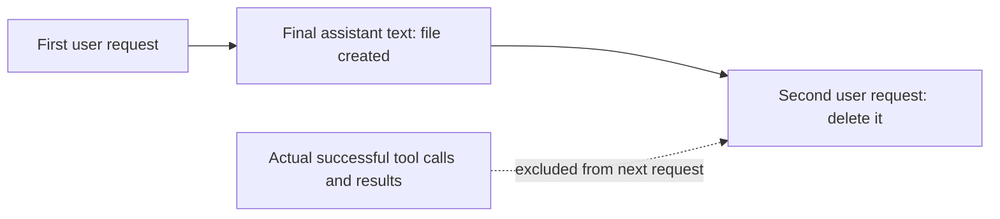

# Chat action history, environment awareness and latency investigation

- **Date**: 2026-11-15
- **Status**: Investigation with maintainer scope direction recorded 2026-11-15. The context correction it proposed is [ADR-0128](../decisions/0128-content-free-tool-receipts-ground-later-chat-turns.md), Accepted 2026-11-15; latency work still starts from a measurement.
- **Local source**: `development` at `b60bb1e5`; unrelated user-owned pnpm workspace/lock changes were left untouched.
- **Related**: [current roadmap](../roadmap/current.md#next-work--the-cli-mvp), [ADR-0095](../decisions/0095-what-an-agent-session-remembers-across-turns.md), [CR-70 deferral](../roadmap/deferred-tasks.md), [ADR-0116](../decisions/0116-the-built-in-chat-agent-can-edit-and-the-starting-mode-is-configurable.md), [ADR-0118](../decisions/0118-a-command-outside-the-allowlist-asks-instead-of-failing.md), [chat contract](../reference/cli/chat-session.md), [tool contract](../reference/shared-core/built-in-tools.md)

## Finding and evidence boundary

The supplied conversation shows a successful `write_file`, followed by a
successful `read_file`, then a later assistant statement denying that the
earlier turn called tools. The local session's durable structural rows confirm
the first turn's `list_directory`, `find_files`, `write_file` and `read_file`
outcomes are all `ok`. The second turn records successful find/read calls.
The statement that no earlier tool ran contradicts this evidence.

The relevant session snapshot names `claude-haiku-5-5`, provider `anthropic`,
and authored reasoning effort `max`. A later in-memory `/effort` override is not
proved or excluded by that snapshot. Across the two completed exchanges, its cost row
records seven model calls, 45,592 input tokens and 14,896 output tokens. The
supplied first-turn footer reports 32,519 input, 10,362 output and 47.3 seconds.
These totals do not provide per-call latency or the first turn's exact model
round boundaries. No paid provider replay was made, and no user configuration
was changed. Inspection used read-only database queries and reported structural
facts rather than raw private tool content or unrelated conversations.

This investigation separates a deterministic context omission from model
behavior. The code proves which evidence is missing from the next request; it
does not prove that this omission alone deterministically produces the quoted
sentence. Previous user and final assistant text can still be present. A more
faithful request reduces this failure mode but cannot guarantee every model's
natural-language answer.

## Successful tool history is lost at every turn boundary

In [AgentSession](../../packages/core/src/engine/agent-session.ts), the successful
`sendMessage` path appends only `result.text` to `#messages`. It sends
`result.toolHistory` to the completion observer for persistence, but does not
append tool rounds to the next model request. The comment at the append
explicitly describes text-only cross-turn history.

[buildTurnMessages](../../packages/core/src/engine/turn-messages.ts) then applies
the authored memory policy to that text transcript. Resume also rebuilds
[text-only messages](../../packages/core/src/engine/session-resume.ts). The
[persister](../../apps/cli/src/chat/persister.ts) stores content-free tool
structure for history/export: resolved name, engine call identity, argument and
result byte sizes, and outcome. It does not store raw arguments or results.
Consequently, the UI and database can know a tool ran while the next model
request contains no corresponding tool evidence.

For the reported case the next request is approximately:

This occurs even without `/models`, compaction or a process restart.
`memory: none` would intentionally remove more history, but that is not required
to reproduce this omission. The built-in agent does not author `memory: none`.
Its [system prompt](../../apps/cli/src/chat/default-agent.ts) asks it to inspect
tool results and avoid claiming an edit without evidence. That instruction
does not restore missing earlier tool results and does not require the false
claim that no previous tool ran.

The omission is already recorded as **CR-70, High (product)** under ADR-0095 §2.
The current approved sequence schedules it for **v0.2.1, after the v0.2.0 CLI
MVP**, together with in-turn overflow continuation. MVP-4's pending
ADR-0117/0119 cover denial feedback and content-free interrupted-turn markers;
they do not, by themselves, repair successful cross-turn tool history.

The original boundary has a concrete privacy reason: CLI history is unencrypted,
and tool arguments/results can contain credentials, file contents or command
output. Copying every raw tool result into `history.db`, replaying signatures
across providers, or promoting results into system instructions would introduce
different defects. Past evidence also must not authorize a fresh write or be
treated as proof that a file has not changed since it was read.

## What the 47.3-second turn establishes

| Observation | Assessment |
|---|---|
| Four tools for one small create request | Directory listing and file finding may duplicate discovery; a readback adds work after the write. The exact necessity depends on available path/existence evidence. |
| Seven model calls across two exchanges | A tool-driven turn can require several provider requests; tool count is not necessarily request count because a response can contain multiple calls. |
| Authored `max` reasoning; 10,362 first-turn output tokens | High reasoning effort is a plausible substantial latency/cost contributor, subject to an unrecorded live override and the model's capability gate. Output usage includes more than the visible final poem: tool-call generation and potentially thinking also count. The persisted aggregates do not establish the exact thinking share. |
| 32,519 first-turn input tokens | This is cumulative billed input across model requests, not proof that one request held a 32,519-token conversation. Repeated instructions, tool schemas and within-turn history contribute. |
| Existing corrected host-path benchmarks | Ordinary and metadata-dense writes are usually tens of milliseconds in those measurements. They do not measure this particular user turn or its provider/network time. They provide no basis for attributing the full 47.3 seconds to metadata preparation. |
| No persisted per-phase timing for this session | The exact split among provider queueing, first-token wait, generation, tool work, retries and persistence cannot be recovered from the current rows. |

The native evidence and historical timing tails are scoped in the
[ADR-0127 checkpoint](../roadmap/phases/phase-2.6-conversational-authoring.md#adr-0127-final-local-source-acceptance-2026-11-15).
Do not convert its 64-KiB local fixture timings into an end-to-end SLA for an
arbitrary hosted model or the small poem example.

An immediately available user-controlled comparison is `/effort low` or
`/effort medium`, followed by an equivalent simple task at the same model and
mode. `/effort` displays the active selection. `/thinking` and Ctrl+T only
change panel visibility; hiding the panel does not lower reasoning effort.
This investigation does not change the user's selected `max` setting.

The built-in request path does not enable Anthropic `cache_control`; prompt
caching remains an MVP-5 item. Anthropic documents prefix caching as a way to
reduce repeated input processing, cost and latency, and documents thinking as
part of output generation. This is a candidate improvement, not a measured
explanation of the reported delay. See the official
[prompt caching](https://platform.claude.com/docs/en/build-with-claude/prompt-caching)
and [thinking](https://platform.claude.com/docs/en/build-with-claude/thinking)
documentation.

## Commands: current capability and scheduled product access

The current built-in agent grants exactly seven tools: `read_file`,
`list_directory`, `git_status`, `search_files`, `find_files`, `write_file`,
and `edit_file`. It has no deletion tool and no `run_command`. The inability to
delete through that toolset is accurate; the subsequent denial of its earlier
successful creation is not.

The process capability and `run_command` already exist for explicitly authored
agents/workflows with the relevant grant and admitted command policy. The
interactive `!` escape uses the same boundary, with an empty default allowlist.
It is not an unrestricted terminal.

**MVP-4 / D63 / ADR-0118** is the planned default-agent command increment:
typed command/cwd approval, Once/Session/Remember, operator-owned remembered
grants, permission management, and fail-closed headless behavior. ADR-0118 is
still Proposed. Installing `gh` does not itself grant the default agent access.
An admitted `gh` or `git` executable can run through this capability; command
arguments, external effects, authentication and approval remain material.

The [process host](../../apps/cli/src/engine/tool-host/process.ts) uses
`spawn(..., { shell: false })`. Executable-plus-argv invocation works without
a shell. Pipes, `&&`, redirects, globbing and variable expansion do not acquire
Bash semantics automatically. A deliberately authorized `bash -lc`/`zsh -lc`
is a different authority choice; the existing MVP-4 plan should explicitly
decide whether and how to expose it rather than promise arbitrary shell syntax.
Running a subprocess is not OS filesystem/network isolation: file-tool root
checks do not jail an admitted program's ambient access.

The existing [MVP-4 plan](../roadmap/current.md#next-work--the-cli-mvp) also
includes interrupt-key consistency, denial-to-model behavior, interrupted-turn
markers and finite turn ceilings. It does not currently move CR-70 forward.

## Host facts are not model context today

The default system prompt is static. The CLI knows the workspace and platform
for execution, but that knowledge is not automatically visible to the model.
The current model-facing prompt does not provide the basic OS/shell/timezone
block requested here. A host probe during this investigation reports `darwin`,
`arm64`, `Europe/Istanbul`, UTC+03:00; it does not establish that the earlier
model request contained these facts.

**MVP-5 / MVP-A16** currently owns project instructions and an environment block
under explicit provenance rules, requiring a new ADR. This explains the missing
product integration; it does not make generic three-OS instructions desirable
when the actual host is already known to the application.

The proposed minimal environment should distinguish execution host facts from
preferences: OS/architecture, working/project root, actual command-runner kind,
observed login shell if available, IANA timezone and current offset/date, and
the session's granted capabilities/current mode. Use `unknown` when unproved.
Do not infer physical location or response language from timezone. WSL,
containers, SSH and future remote runners require the execution environment to
be named explicitly; the client desktop may differ.

Collect these through host-owned typed inputs, keeping core platform-pure.
Never inject all of `process.env`, usernames, credentials or unrelated machine
inventory. An environment string remains data, not shell code or repository
authority. Keep stable context stable for caching; send changing clock/date
facts as a bounded trailing observation when needed, rather than changing a
large system prefix every second. The application can then prefer macOS-specific
guidance for this session unless the user asks for another platform.

## Implementation lessons retained from the investigation

The useful design lessons are an explicit action-history projection, matched
call/result boundaries when full carrying is implemented, bounded output and
compaction, and typed host-owned facts. These are requirements to assess against
Relavium's own contracts. They do not establish another application's guarantees
or justify adopting a different persistence or shell policy.

At the maintainer's request, product names, source pins and product links have
been removed from this document. This retains the technical conclusions without
presenting external implementations as Relavium's design authority.

## Maintainer scope direction — 2026-11-15

Keep scheduled capabilities in their existing milestones. Command permissions,
command-runner versus shell-interpreter semantics and interruption/denial
behavior remain MVP-4. Project instructions, OS/timezone environment facts and
prompt caching remain MVP-5. Full raw cross-turn tool carrying remains CR-70,
with its approved v0.2.1 timing and ADR-0096 overflow-continuation dependency.
The earlier recommendation to advance these capabilities is withdrawn.

The immediate context correction proposed in
[ADR-0128](../decisions/0128-content-free-tool-receipts-ground-later-chat-turns.md)
is narrower: show the model bounded, content-free records of prior completed
turns' tool calls and outcomes, substituting a fixed label for custom/MCP names.
The existing store already records that structure; restored records remain
unverified local claims, not authenticated execution evidence.
Do not add raw arguments, file paths, results, reasoning or signatures to this
projection. A successful record establishes a recorded successful outcome, not
the bytes or current state of a file. A failed call may have been refused before
execution. This reduces unsupported claims that no previous call occurred; it
cannot guarantee every model response or replace full tool-content memory.

This design was Accepted as ADR-0128 on 2026-11-15; its runtime has not landed, and the stable text-only request still ships until it does.
The session contract owns its
[receipt projection](../reference/contracts/agent-session-spec.md#content-free-action-receipts--adr-0128).
The separate future carrying design must still settle live content, provider
boundaries, model reseat, process restart, user controls and conformance. A
same-process volatile handoff does not inherently require disk persistence;
raw-content continuity after a process restart does require separately reviewed
protected persistence. Neither is part of this correction.

## Performance findings and necessary actions

A second source inspection found no deterministic redundant host call, effort
selection regression or metadata-path defect explaining this delay. The default
prompt does not require both listing and finding a file or a post-write readback.
Effort resolves live override, then authored value, then unset; provider/model
capability admission still determines the wire setting. Do not silently lower
the user's selection or treat its authored snapshot as proof of the wire.

The shared turn core captures and measures each owned request after tool results;
admission, usage accounting and persistence acknowledgements are correctness
barriers. Removing them to shorten a turn is not an established optimization.
The footer derives whole-turn duration from lifecycle wall clocks. Existing
rows cannot reconstruct provider wait, first content, thinking, tool time or
persistence for the reported turn.

Before selecting a runtime optimization:

1. Establish a contributor-only, offline baseline using scripted providers and
   controlled temporary tool fixtures through the real session/registry path.
   Record monotonic durations and request/attempt counts separately. Synthetic
   provider delay calibrates the measurement; it is not a hosted-model latency
   estimate. Compare equivalent outcomes and approval behavior.
2. Distinguish provider start, first stream frame, first visible text, completion,
   tool dispatch and persistence. A first reasoning frame is not visible-text
   first-token latency. Nested/overlapping phases must not be summed as disjoint
   wall time. Unknown usage or missing phase data stays unknown, never zero.
3. If actual-provider attribution is needed, define the narrow typed local
   observation boundary before adding it. Do not log prompts, results, paths,
   command arguments, provider error bodies or keys; no telemetry or paid
   provider replay follows from this report. Public API/event changes require
   their normal design approval.
4. Optimize only a measured bottleneck and compare matched p50/p95, calls,
   attempts, complete latency and available token classes. Include cancellation,
   fallback, failure and durability behavior; do not weaken fresh-read,
   approval, native publication proof or producer-join guarantees.

MVP-5's caching work should reuse these measurements and test stable prefixes,
cache hits/misses and changing host facts. It stays in MVP-5. The immediately
available `/effort` comparison remains explicit user control. No speedup,
47.3-second phase attribution, new effort default or end-to-end SLA is claimed.

## Acceptance scope for the context correction

The acceptance cases are owned by
[ADR-0128](../decisions/0128-content-free-tool-receipts-ground-later-chat-turns.md#acceptance-and-landing-obligations)
and are not restated here, so the two cannot drift. In outline they cover the
reported create/read case, every recorded outcome, resume/reseat parity,
all memory policies, bounds and eviction, forged or legacy rows, compaction and
trim, and the absence of any raw content on disk, in events or in export. The
MVP-4 denial/interruption design remains separately gated; the correction
invents no record for an uncommitted failed turn.

One cohesive implementation step covers the receipt projection with its full
review and security cycle. Measured latency work is a separate, conditional
follow-up that begins only where the baseline identifies a justified change,
stays in its scheduled milestone, and must not be used to pull caching or
environment capabilities forward.
