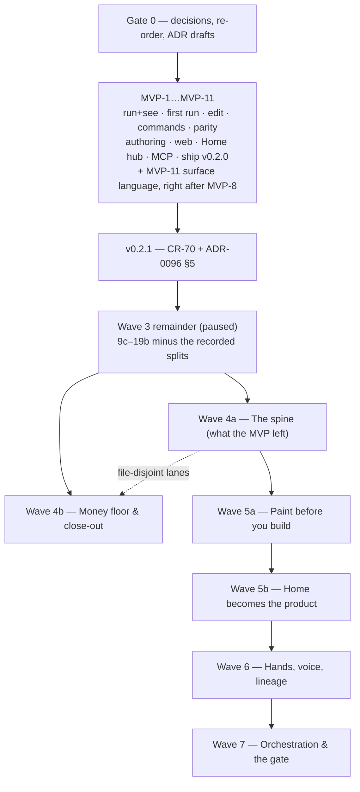

# Current state

> Status: Living
> Last updated: 2026-11-24

- **Related**: [README.md](README.md), [phases/phase-2.6-conversational-authoring.md](phases/phase-2.6-conversational-authoring.md), [phases/mvp-11.md](phases/mvp-11.md), [phases/phase-2.5.5-hardening-and-remediation.md](phases/phase-2.5.5-hardening-and-remediation.md), [phases/phase-2.6.5-core-reliability-remediation.md](phases/phase-2.6.5-core-reliability-remediation.md), [deferred-tasks.md](deferred-tasks.md), [../project-structure.md](../project-structure.md), [../tech-stack.md](../tech-stack.md)

> **Authority (until Phase 2.5.5 and Phase 2.6 close):** This file is canonical for
> live progress and execution order; the phase documents stay canonical for scope and acceptance. Ordering
> differences between the two are deliberate. `current.md` may override recommended ordering — it may **not**
> redefine a security boundary, a scope line, or a milestone acceptance criterion.

This page tracks what is active **right now** and the order of the next work. The full phase plan and the global
milestone spine are in [README.md](README.md). Finished work keeps its record in the phase registers; this page
links to those records instead of restating them ([History](#history)).

## Now — the CLI MVP comes first

On **2026-10-26** the maintainer paused Wave 3 of Phase 2.5.5 after Step 9b.2 (accepted at `563402e6`) and moved
the work that a CLI user feels to the front: features and bugfixes in `apps/cli` and `packages/core` that
directly affect an MVP. **Paused means pending, not declined:** every paused item keeps its phase-file home,
its recorded acceptance rules and its security sittings, and the [after-MVP queue](#pending-after-the-mvp-not-declined)
keeps its internal order. On **2026-11-04** the maintainer ruled D58–D72 ([decision table](#wave-gating-decisions))
from a multi-agent review of the roadmap documents and the code at `5a328bca`; the
[priority reset record](phases/phase-2.5.5-hardening-and-remediation.md#mvp-priority-reset--2026-11-04) holds the
evidence summary, the recorded Wave 3 splits and the process amendments.

### Status at a glance

| Area | State |
|---|---|
| Phase 1 — Engine and LLM | Complete (M2, 2026-06-21) |
| Phase 2 — CLI | Feature-complete; `relavium@0.1.1` published on npm 2026-06-28 (M3) |
| Phase 2.5 — CLI Consolidation | Complete (M2.5-4, PR #69, 2026-07-08) |
| Phase 2.6.5 — Core reliability | Complete with approved deferrals, 49/51 (PR #92, 2026-10-11; [merge checkpoint](phases/phase-2.6.5-core-reliability-remediation.md#w8-merge-checkpoint--2026-10-11)). CR-70, CR-93 and CR-95's long half stay deferred in [deferred-tasks.md](deferred-tasks.md) |
| Phase 2.5.5 — Hardening | Waves 0–2 merged (Wave 2: PR #94, 2026-10-15). Wave 3 Steps 1–8 merged (PR #95, 2026-10-18); PR95, 9a.1, 9a.2a, 9a.2b, NI, 9b.1 and 9b.2 accepted and merged to `main` with the D61 checkpoint (PR #96, 2026-11-04). **Steps 9c–19 paused** (25 of 32 increments). NI's Windows clause closed on 2026-10-26 |
| Phase 2.6 — Conversational authoring | 2.6.C done; 2.6.F done except its release clause; 2.6.Q P1–P5 landed. **MVP-1, MVP-2 and MVP-3 (with MVP-3b, MVP-3c and MVP-3d) are complete on `main`** (PR #97, PR #98 and PR #99, merged 2026-11-18). Between MVP-3 and MVP-4 the native adapter's first increment (concurrent processes on one operator home, [ADR-0135](../decisions/0135-concurrent-processes-on-one-operator-home-wait-for-the-allocation-claim.md)) and two CI decisions also landed on `main` (PR #100, 2026-11-18). **MVP-4 (steps 1–7) is complete on `main`** (PR #101, merged 2026-11-21; two review rounds each, three for step 5; steps 1–4 on 2026-11-19, step 5 — the `/permissions` sheet — on 2026-11-20 and 21, steps 6 and 7 — `Esc` out of the full view and the Home entry points — on 2026-11-21; [ADR-0137](../decisions/0137-permissions-is-a-sheet-and-esc-steps-back-out-of-the-full-view.md), Accepted 2026-11-20, added steps 5, 6 and 7, all implemented before the pull request; **[PR #101](https://github.com/HodeTech/Relavium/pull/101) (`development`→`main`) was opened and merged on 2026-11-21 as `0a599a36`**, after its review (three reports) was answered on the same day by corrections, listed in [PR #101 review corrections](phases/phase-2.6-conversational-authoring.md#pr-101-review-corrections--2026-11-21) with what was fixed, refuted, deferred and what needs a human; the [PR #101 merge checkpoint](phases/phase-2.6-conversational-authoring.md#pr-101-merge-checkpoint-2026-11-21) records the evidence and what is still owed, above all the Windows runbook rows 1–16; the [implementation record](phases/phase-2.6-conversational-authoring.md#mvp-4-implementation-record) owns progress). **MVP-8 (the Home as hub, steps 1 to 5) is complete on `main`** (PR #102, merged 2026-11-24 as `c17e9763`; [ADR-0139](../decisions/0139-a-workflow-run-is-hosted-inside-the-home.md) and [ADR-0140](../decisions/0140-management-browsers-the-run-drill-down-and-the-durable-run-detail.md) accepted 2026-11-22; three external review reports and three security sittings answered before the merge; the [PR #102 merge checkpoint](phases/phase-2.6-conversational-authoring.md#pr-102-merge-checkpoint-2026-11-24) records the evidence and what is still owed, above all the Windows runbook rows 1–38 on real terminals). **MVP-11** (one surface language for the CLI: popups, sheets, the palette order, the Home and the chat; [plan](phases/mvp-11.md)) is next, planned and not started (D79); the remaining workstreams and whole-phase exit stay open (D73, [ADR-0122](../decisions/0122-the-home-is-the-interactive-product.md)) |
| Phases 3–7 | Not started — desktop, VS Code, then Product Phase 2 (managed inference, cloud) |
| Publication | npm serves `0.1.1`. Nothing newer can be published yet: Step 9a.1's interim guard, on `main` since PR #96, refuses every artifact until D59's superseding release ADR is Accepted |
| Branches | `main` is at `0a599a36`: the sixth `development`→`main` checkpoint, [PR #101](https://github.com/HodeTech/Relavium/pull/101), merged 2026-11-21 at 20:22Z (106 commits, 221 files; MVP-4 and its review corrections). Its tree is identical to `development`'s head `9e77ff04`, and `development` was fast-forwarded to the merge commit, so the two branches have the same content. The previous checkpoint, [PR #100](https://github.com/HodeTech/Relavium/pull/100), had been merged 2026-11-18 at 23:54Z (2026-11-19 in the maintainer's time zone) as `1e71f652`. It carried the native adapter's Inc 1 ([ADR-0135](../decisions/0135-concurrent-processes-on-one-operator-home-wait-for-the-allocation-claim.md)), the CI decisions C4 (CI runs once per commit: `push` on `main` and `development`, no `pull_request` trigger) and Y2/C3 (the enforced coverage run covers `packages/` only), the CI failure review's fixes and the MVP-4 preparation analyses. At that merge its tree was identical to `development`'s head `639134b2`. The [PR #101 merge checkpoint](phases/phase-2.6-conversational-authoring.md#pr-101-merge-checkpoint-2026-11-21) records the newest merge; the [PR #100 merge checkpoint](phases/phase-2.6-conversational-authoring.md#pr-100-merge-checkpoint-2026-11-18) records the evidence and what is still owed; the [MVP-3 merge checkpoint](phases/phase-2.6-conversational-authoring.md#mvp-3-merge-checkpoint-2026-11-18) and the earlier PR #98, PR #97 and PR #96 records remain under [History](#history). |
| Open CI observations | PR #101's final-head run `44941661476` (`9e77ff04`) passed all 29 jobs before the merge, and SonarCloud's gate on the pull request went from red (`new_reliability_rating` C, one S7727 bug on `60b65954`) to OK on `9e77ff04`; the merge commit's own `push` run (`44945900314`) and Sonar's analysis of `main` had not finished when this was written, and a Sonar status is per branch. PR #100's final-head run `44402914088` (`2ce6a252`) passed all 29 jobs, and the narrowed `coverage` job took 10–12 minutes (it took 26–45+ before), so PR #99's limit observation is closed (the `coverage` job had stopped at the 45-minute limit on PR #99's final head in both runs; the merge commit's identical tree passed it in 41 min 10 s). The completed runs that were missing exist and passed: `44424575691` on `639134b2` (the docs-only final head of PR #100, `push`, success), `44424607930` on the merge commit `1e71f652` (`push`, success) and `44895457644` on `9c5985ac` (the head of PR #101 when it was opened, `push`, success). Open: one acceptance-tool test timed out once in a secrets-control shard on `main`'s PR #99 merge run (its case bound is 30 s now, the cause is not measured); a scheduled `model-catalog` live effort test hit its five-second default on 2026-11-18. See [deferred-tasks.md](deferred-tasks.md#pr-99-merge-ci-observations-2026-11-18); none is classified as flaky without a measured rate |

### What a CLI user meets today

The published npm package remains `0.1.1`; the following describes the current
`main` checkout after PR #101. MVP-1 supplies visible run outputs, run ids, liveness
and useful missing-key handling. MVP-2 adds readable Markdown and wrapping, native
provider setup and key management, safe project initialization, and searchable
session discovery/resume with visible history. MVP-3 makes the chat agent able to edit. Several `relavium` processes on one operator home can now write at the same time: each
waits its turn for the staging inventory instead of failing a write (PR #100, ADR-0135).

The built-in chat agent starts in `ask`: it asks before an effect, `plan` only reads,
`accept-edits` accepts file edits and `auto` is unchanged
([ADR-0130](../decisions/0130-chat-modes-ask-prompts-plan-reads-accept-edits-accepts.md)).
It reads, searches, edits and writes files under a docked approval card; the card's
full view (`[v]`) and `/details` show the change on one scrollable screen
([ADR-0129](../decisions/0129-the-approval-card-is-docked-bounded-and-says-only-what-matters.md),
[ADR-0134](../decisions/0134-the-full-view-and-the-tool-details-are-one-readable-inspection-screen.md)),
every approval answer is a Ctrl chord, and file writes keep their security metadata.
It can ask you a structured question (`ask_user`), and a refused or failed turn stays
in the session as a content-free marker. With MVP-4 (PR #101) it also runs commands: a command outside
the allowlist asks on a card (Once, Session, Remember or Deny; `auto` runs only what you remembered or approved for
the session, and asks again after a file write the chat applied), `/permissions` and `relavium permissions` list and
withdraw what you remembered, one interrupt keymap rules `Ctrl+C` and `Esc`, and a turn asks to continue at a limit
instead of dying at it. The Home covers first-run, project and session
journeys. With MVP-8 (PR #102) the Home is the hub: it runs a workflow and answers its
gates and budget questions inside it, browses and resumes runs, looks at agents, reads help, and
imports a workflow or sets a model price in a form; broader provider/MCP
management is MVP-9. The
[MVP-3 merge checkpoint](phases/phase-2.6-conversational-authoring.md#mvp-3-merge-checkpoint-2026-11-18)
owns delivered scope and acceptance evidence; the
[MVP-2 merge checkpoint](phases/phase-2.6-conversational-authoring.md#mvp-2-merge-checkpoint-2026-11-11)
owns MVP-2's.

## Next work — the CLI MVP

**PR #102 merged (2026-11-24, `c17e9763`): MVP-8 is complete on `main`, and MVP-11 (one surface language for the CLI) is next.** The
[PR #102 merge checkpoint](phases/phase-2.6-conversational-authoring.md#pr-102-merge-checkpoint-2026-11-24) records what the PR carried (MVP-8's five steps, ADR-0139 and ADR-0140, the markdown, table and code
rendering ADRs 0141 to 0144, the answers to three external review reports and three security sittings, and the Sonar fixes), its final-head evidence (all 29 CI jobs green on `f9cf2627`, the pull
request's Sonar gate OK, the whole local gate green on a still tree at the code head `ae0326d9`) and what is still owed: rows 1–38 of the Windows interrupt-evidence runbook on real terminals, the
analysis and the merge commit's CI run on `main`, the maintainer decisions the register's [PR #102 review](deferred-tasks.md#pr-102-review-2026-11-24--findings-answered-refuted-and-deferred) section lists, and
the registered lows. npm still serves `0.1.1`. The dated blocks below keep the wording they had when written.

**MVP-11 (2026-11-24): the CLI's surface language is planned right after MVP-8, and MVP-8's pull request is now merged.** On 2026-11-24 the maintainer asked for most of the CLI's remaining UI/UX work in one MVP, to start once MVP-8's pull request ([PR #102](https://github.com/HodeTech/Relavium/pull/102)) was merged (it was, the same day): popups for what the user starts (`/doctor` and every command like it, closed with `Esc`), settings that do not stay in the chat, and a sensibly ordered slash palette (D79–D82); the plan proposes bottom sheets for what the system asks, a popup for the approval's `[v]` preview, a speaker marker instead of the `you`/`agent` labels, a reviewed first run, and `/exit` last. On 2026-11-24 the maintainer accepted the recommendation of each of the plan's twenty-three decisions ([§7.2](phases/mvp-11.md#72-decisions-od-1-to-od-23)); two sub-questions stay open (the populated Home's title, and whether the three default-model paths should agree). The plan, the design, the steps, the decisions and the acceptance criteria are in [phases/mvp-11.md](phases/mvp-11.md); its real-terminal check comes before the popup is built and has been run in part (2026-11-24: an automated check in tmux and a by-hand check in the VS Code terminal and Terminal.app came out clean, and the inline form showed a rule the design now carries: the whole live region stays at most `rows − 1` lines, or Ink wipes the user's scrollback); the Windows Terminal, iTerm2 and SSH rows are still owed and the four ADRs of Step 1 are not yet written (the state and the kit are in [phases/mvp-11.md](phases/mvp-11.md#step-1--decisions-adrs-spike-and-baseline) and [phases/mvp-11/spike/](phases/mvp-11/spike/README.md)); the execution order below includes it.

**PR #101 merged (2026-11-21, `0a599a36`): MVP-4 is complete on `main`, and MVP-8 (the Home as hub) is next.** The
[PR #101 merge checkpoint](phases/phase-2.6-conversational-authoring.md#pr-101-merge-checkpoint-2026-11-21) records what the PR carried (MVP-4's seven steps, ADRs 0115, 0118, 0136, 0137 and 0138, the review corrections and a
SonarCloud fix), its final-head evidence (all 29 CI jobs green on `9e77ff04`; the pull request's Sonar gate OK) and what is still owed: rows 1–16 of the Windows interrupt-evidence runbook on real terminals, the Sonar
analysis and the merge commit's CI run on `main`, and the registered lows. MVP-8 starts with its run-hosting ADR ([ADR-0122](../decisions/0122-the-home-is-the-interactive-product.md) §10), written and accepted first. The dated blocks below
keep the wording they had when written.

**Cleanup before MVP-8 (2026-11-22, on `development`):** `main`'s merge-commit CI run finished 29 of 29 green and its Sonar gate is OK (886 open smells, 149 false positives marked). The 38 smells PR #101's own lines introduced became named helpers with no change of behaviour (`c27a350c`), reviewed four times (one a security sitting) and pinned by permanent tests; see the [Sonar cleanup before MVP-8](phases/phase-2.6-conversational-authoring.md#sonar-cleanup-before-mvp-8-2026-11-22). MVP-8 is still next and still starts with its run-hosting ADR.

**MVP-8 steps 1 to 5 (2026-11-22 to 2026-11-23, on `development`):** step 1 (the durable run record and its reads) is closed at `022e182d`; step 2 (one run core for `run`, `gate` and budget resume, and the stale-gate-card fence) is closed on `49c64940`; step 3 (the Home hosts a run: the run host, the native cards, `/run`, the run view, the exit guard and the Attention rows) is closed on `91effdbb`, with its full local gate green. Step 4, the browsers, is closed on `eabb4849`, with its full local gate green (33 minutes, `GATE-EXIT=0`). Step 5, the rest of the hub (the actionable strip, `/agents`, chat with an agent, `/agent`, `/help` and the typed words, `/import` and `/pricing`), is implemented and reviewed, with three security sittings and an external review whose verified findings were fixed or registered; the whole local gate passed on a still tree at the code head `ae0326d9` (the step-5 record's "The gate" and the PR #102 corrections have the detail), and the pull request ([PR #102](https://github.com/HodeTech/Relavium/pull/102), opened 2026-11-24) was merged the same day as `c17e9763`, with the independent review's findings (three external reports and three security sittings) fixed, refuted, deferred or left to the maintainer in the phase record's "PR #102 review corrections" and the evidence in its "PR #102 merge checkpoint". The records are in the [phase record](phases/phase-2.6-conversational-authoring.md).

**MVP-8 pre-flight (2026-11-22, on `development`):** every document MVP-8 rests on was reviewed against the code (five read-only reports) and the findings are recorded in the phase record's [MVP-8 pre-flight review and plan](phases/phase-2.6-conversational-authoring.md#mvp-8-pre-flight-review-and-plan-2026-11-22): stale entries struck, the scope reconciled, five steps planned. Both were accepted by the maintainer on 2026-11-22 after a review round, recorded in the phase record: [ADR-0139](../decisions/0139-a-workflow-run-is-hosted-inside-the-home.md) (a workflow run is hosted inside the Home) and [ADR-0140](../decisions/0140-management-browsers-the-run-drill-down-and-the-durable-run-detail.md) (the management browsers, the run drill-down and the durable run detail). The maintainer ruled on 2026-11-22: a hosted run lives in the background; `Ctrl+C` on a running leg takes two presses; a run parked at a gate has no cancel in MVP-8; pins, the durable tool trace, the `/import` form and the `models pricing` form are in scope.

**PR #100 merged (2026-11-18, `1e71f652`): the native adapter's Inc 1, CI once per commit and the narrowed coverage run are on `main`; MVP-4 started on `development` on 2026-11-19 (see its entry under [Next work](#next-work--the-cli-mvp)).** The
[PR #100 merge checkpoint](phases/phase-2.6-conversational-authoring.md#pr-100-merge-checkpoint-2026-11-18) records what it carried, the final-head evidence (29 of 29 jobs green on `2ce6a252`;
the docs-only final head `639134b2` was merged before its own run finished; that run, `44424575691`, did complete and passed, as did the merge commit's, `44424607930`) and what is still owed: a separate security sitting on the `capture_parent` change and the delta since round 4, the maintainer's reading of ADR-0135,
and Inc 2 and Inc 3 of the native adapter.

**PR #99 merged (2026-11-18): MVP-3, MVP-3b, MVP-3c and MVP-3d are complete on `main`.** The
[merge checkpoint](phases/phase-2.6-conversational-authoring.md#mvp-3-merge-checkpoint-2026-11-18) records what the PR carried, its
final-head evidence and its two CI observations: the required `coverage` job stopped at GitHub's 45-minute limit in both
final-head runs, so no green final-head coverage run exists (the other 28 jobs of each run passed; the merge commit's identical
tree passed `coverage` in 41 min 10 s); and one acceptance-tool test hit its 10-second limit in the first attempt of the merge
commit's push run, which a re-run cleared. SonarCloud's gate is OK on the PR and on `main`. The dated blocks below keep the wording they had when written; where they say
final-head CI, scanner or maintainer acceptance is owed, the checkpoint supersedes them. **MVP-4 steps 1–7 are implemented on `development`** (2026-11-19 to 21; two review rounds each, three for step 5; [ADR-0137](../decisions/0137-permissions-is-a-sheet-and-esc-steps-back-out-of-the-full-view.md) steps 5 to 7 are in): [ADR-0115](../decisions/0115-one-interrupt-keymap-for-the-interactive-cli.md),
[ADR-0118](../decisions/0118-a-command-outside-the-allowlist-asks-instead-of-failing.md) and
[ADR-0136](../decisions/0136-a-turn-asks-to-continue-at-a-checkpoint-instead-of-dying-at-a-ceiling.md) were revised or written and accepted on 2026-11-19, and its seven steps (four at the start; [ADR-0137](../decisions/0137-permissions-is-a-sheet-and-esc-steps-back-out-of-the-full-view.md) added three) are recorded in the
[implementation record](phases/phase-2.6-conversational-authoring.md#mvp-4-implementation-record).

**Manual-test correction (2026-11-15): implementation and local review complete.**
The reported pre-correction code rejected the observed project parent's
`com.apple.macl` and ordinary test files' `com.apple.lastuseddate#PS` during
read-only metadata preparation. The generic chat denial hint incorrectly
attributed that refusal to mode/policy. The maintainer requested a planned
correction after reviewing the analysis. Historical MVP-3 acceptance does not
cover these newly observed scenarios.

One cohesive increment covers these items, avoiding separate review cycles for
each attribute or UI string. Source commits `4dab2d28` and `b7ce337b` are locally
accepted; the [final source checkpoint](phases/phase-2.6-conversational-authoring.md#adr-0127-final-local-source-acceptance-2026-11-15)
records both review rounds, verified corrections and the separate security
sitting. Final-head CI/scanner, platform/consumer checks and maintainer merge
remain required.

1. **Design accepted 2026-11-15:** the supplied review findings have been checked
   against code and primary sources and reconciled in
   [ADR-0127](../decisions/0127-macos-write-metadata-has-distinct-parent-and-file-profiles.md),
   its [native profile](../reference/cli/native-filesystem-metadata.md#macos-parent-and-file-attribute-profiles--adr-0127)
   and [chat guidance](../reference/cli/chat-session.md#denial-guidance-design--adr-0127).
   The maintainer subsequently granted the separately reserved implementation
   approval on 2026-11-15. Source work and its local acceptance cycle are complete;
   design acceptance alone does not certify product/platform behavior.
   The [supplied-review disposition](phases/phase-2.6-conversational-authoring.md#adr-0127-supplied-review-and-design-acceptance-2026-11-15)
   records confirmed findings and corrected review assumptions individually.
   The [further-review disposition](phases/phase-2.6-conversational-authoring.md#adr-0127-further-supplied-review-reconciliation-2026-11-15)
   adds the generic file-attribute suffix guard, diagnostic trust policy and
   completed-payload size expectation without granting implementation authority.
   The [publication tradeoff analysis](../analysis/macos-file-write-compatibility-2026-11-15.md)
   distinguishes in-place writes from private-stage replacement. Ordinary write
   compatibility is not proof of Relavium's atomic replacement/metadata guarantee; no in-place fallback is authorized.
   The [implementation author checkpoint](phases/phase-2.6-conversational-authoring.md#adr-0127-implementation-author-verification-2026-11-15)
   records current source, local verification, real operator interactions and
   the controlled performance comparison. Independent source reviews and the
   separate final security sitting are complete at the checkpoint above.
2. Add distinct parent/file inspection roles in the macOS adapter; retain
   bounded parent MACL evidence without transferring it; preserve exact
   last-used file values, without adding that name to the parent profile. Require
   the canonical file-role suffix guard; parent-only evidence is never copied.
   Require
   joined runtime post-publication target/parent proof before successful
   settlement; failed proof keeps the existing durable uncertainty path. Correct
   generic denial guidance and the missing plain explanation, applying the
   canonical user-diagnostic redaction/output policy without adding an error
   code or exposing native state; include the linked troubleshooting guide and
   satisfy its public-URL delivery check.
   Add native and actual host regressions,
   including attributed-parent create/overwrite/append/edit, create/use/edit,
   metadata races, unsupported/refused cases, approval parity and journal state.
   Require all four host write operations under a real OS-managed MACL parent
   and a separate actual-user-interaction create/use/edit case; synthetic probes
   alone cannot close those acceptance gates. Record supported before/after
   p50/p95 host-path measurements under the
   [performance evidence requirements](../reference/cli/native-filesystem-metadata.md#performance-evidence-before-implementation-acceptance).
   The
   [verification runbook](../runbooks/verify-macos-write-metadata.md)
   owns reproduction commands and the evidence procedure.
3. Run affected native/host/UI checks and the required workspace/build checks;
   regenerate source-bound native assets. Commit the correction, verify/fix
   findings from two fresh review rounds and a separate native security
   sitting, then update the canonical acceptance record. Current-head platform,
   artifact/consumer and PR checks remain required; local APFS success alone
   does not certify the declared target matrix.

This correction did not activate the denied-tool feedback or interrupted-turn history decisions
(ADR-0117 landed in MVP-3b; ADR-0119 is MVP-3c). File-level MACL and
unlisted metadata remain explicit unsupported cases under the accepted design;
no attribute deletion, broad OS permission change, in-place write or automatic
retry is part of the correction.

**Checkpoint: MVP-3 was implemented on `development` (merged 2026-11-18, PR #99); MVP-3b/3c/3d were placed ahead of MVP-4.**
MVP-1 and MVP-2 are complete on `main`. The
[MVP-3 implementation checkpoint](phases/phase-2.6-conversational-authoring.md#mvp-3-development-implementation-checkpoint-2026-11-12)
closes all three development steps and their review/security corrections;
combined CI on the checkpoint PR and maintainer review govern its merge.
The maintainer accepted the corrected
[ADR-0116](../decisions/0116-the-built-in-chat-agent-can-edit-and-the-starting-mode-is-configurable.md)
and [ADR-0120](../decisions/0120-the-toolbelt-grows-and-a-tool-call-shows-what-it-does.md)
with their linked designs and three-step plan on 2026-11-11.
The editing/default-grant and approval-preview increments keep their mandatory
security review and D64 acceptance bar.

**MVP-3 progress (2026-11-12):** the
[accepted three-step plan](phases/phase-2.6-conversational-authoring.md#mvp-3-plan--editing-search-and-reviewable-effects-2026-11-11)
records the documentation/code findings, corrected ADR refinements, public-contract
changes and two independent review rounds plus a separate security sitting per
step. [Step 1 is accepted](phases/phase-2.6-conversational-authoring.md#mvp-3-step-1-local-acceptance-2026-11-12),
including a clean final cumulative round and separate final-source security
sitting. Its [source checkpoint CI passed all 18 jobs](phases/phase-2.6-conversational-authoring.md#mvp-3-step-1-source-checkpoint-ci-2026-11-12);
the [Windows validation extension](phases/phase-2.6-conversational-authoring.md#mvp-3-step-1-windows-validation-extension-2026-11-12)
also passed its actual native run on the unchanged production source. The
pre-build security design sitting is complete.
[ADR-0124](../decisions/0124-inspect-retained-run-effects-before-file-preparation.md)
and its expanded replay/evidence contracts are accepted after verifying the
supplied reviews; the [design acceptance record](phases/phase-2.6-conversational-authoring.md#adr-0124-review-and-design-acceptance-2026-11-12)
captures their disposition. [Step 2 is accepted on development](phases/phase-2.6-conversational-authoring.md#mvp-3-step-2-acceptance-2026-11-12)
after its independent reviews, separate security sittings and all 26 checkpoint
CI jobs passed. [Step 3 is accepted on development](phases/phase-2.6-conversational-authoring.md#mvp-3-step-3-acceptance-2026-11-12)
at `f6b61474`: the built-in grant, strict startup-mode configuration and shared
mode/default UX. Verified reader/writer and credential-bootstrap observation
gaps are fixed; fresh complete cumulative and separate final-source security
reviews are clean. Its external-review correction at `7af8e05a` passes full local
verification with 18,541 cases and 24 conditional skips. The checkpoint PR carries
current-head combined CI and maintainer review;
at that checkpoint, no additional MVP-3 design approval or confirmed deferred
finding remained. The 2026-11-13 correction increment below is now active.

**External review follow-up (2026-11-12):** both `4e337553` GitHub Actions runs
pass 26/26 jobs. The two verified quadratic preprocessing stalls are corrected.
The authenticated SonarCloud follow-up individually addresses all 207 remaining
baseline reports: 131 implemented source corrections, 36 verified False Positive
transitions and 40 documented Accepted intentional patterns. Corrections through
`9f7811ae` pass 18,543 workspace cases and 1,093 acceptance-tool cases; fresh
cumulative reviews and a separate security sitting are clean. The
[follow-up record](phases/phase-2.6-conversational-authoring.md#mvp-3-sonarcloud-follow-up-2026-11-12)
distinguishes historical evidence, code corrections and remote classifications.
The fresh `372e5488` scan closes all 131 source keys; six new records receive
four verified dispositions and two small corrections at `3240fb88`. Repeated
workspace/build verification, a new clean complete cumulative review and a
clean focused corrective security sitting bind that final implementation.
PR #99's final-head scanner and combined platform checks remain the merge gate;
the local macOS profile does not replace eight native targets or four installed
consumers. That Sonar-only increment needed no new ADR; maintainer review and
merge remained separate.

**Additional PR #99 review (2026-11-13): implementation and local review complete.**
The supplied reports at `80e8cd88` are individually reconciled against actual
code, contracts and focused probes. Runtime/UX, native lifetime, delivery and
scanner corrections through `e61ae0fa` pass 18,651 workspace cases and 1,129
acceptance-tool cases. Requested review/fix rounds, a fresh complete cumulative
round and separate final-source security sitting are clean. The
[final development source checkpoint](phases/phase-2.6-conversational-authoring.md#correction-final-development-source-acceptance-2026-11-13)
owns exact review/test evidence and limits. All 45 additional scanner records
have source fixes or verified remote dispositions, including the two rescan
follow-ups; final-head source/disposition verification,
quality gate and complete native/consumer/combined CI must pass in current PR
checks before maintainer merge.
[ADR-0126](../decisions/0126-native-write-admission-and-recovery-keep-explicit-lifetime-proof.md)
is accepted after the supplied reviews and maintainer instruction; the native
source-admission and recovery-lifetime implementation is complete.
A subsequent [controlled-publication fixture correction](phases/phase-2.6-conversational-authoring.md#controlled-publication-fixture-follow-up-2026-11-13)
removes an unsupported scheduler-dependent success assumption while preserving
the real publication/no-clobber proof and unchanged runtime contracts.
ADR-0121 and other pending MVP-4/release
decisions are not implicitly accepted by this correction work.

**PR #99 independent review (2026-11-17): corrections implemented, local gate passed.**
Three pasted reports (about 150 claims) were verified claim by claim; about a third
were refuted or are behaviour an Accepted ADR chose. The real findings are fixed on
`development` on top of `a15c8f8e`: a repository config layer can no longer choose
`accept-edits`; the approval card opens on the first changed line and offers no `[a]`
when a change is not drawn; every approval answer key is a Ctrl chord (`Ctrl+Y`,
`Ctrl+G` then Enter, `Ctrl+N`, `Ctrl+R` — a bare letter answers nothing, so typing can never resolve a card) behind a layered guard; `list_directory` no longer resolves a link's target. One new
four-reviewer D64 round (one high, three mediums, all fixed) and three separate security
sittings (every finding fixed) ran; the last medium's fix was verified by the third
sitting's own reproductions, not by a fourth sitting. The 21-step gate on the final
source passes (19,834 tests: 19,809 passed, 25 conditional skips; 1,129 acceptance-tool
cases; usage cohort 487; the enforced coverage run) after one stale-test correction the
first run exposed; the chord change was verified afterwards (19,945 tests: 19,920 passed,
25 skips, the affected gate steps re-run) and by a further separate security sitting with no
blocker, high or medium finding. The [record](phases/phase-2.6-conversational-authoring.md#pr-99-independent-review-corrections-2026-11-17)
owns the details and what is not claimed. The native adapter findings are their own
increment after this round (its first part, concurrent processes on one operator home, was
done on 2026-11-18 ahead of MVP-4 and merged in PR #100 under
[ADR-0135](../decisions/0135-concurrent-processes-on-one-operator-home-wait-for-the-allocation-claim.md);
the [register](deferred-tasks.md) owns the evidence and what is still owed); the PR's final-head checks and the maintainer's acceptance
are recorded in the merge checkpoint.

**The full view and the tool details (2026-11-17): implemented on `development`; merged in PR #99 (2026-11-18).**
[ADR-0134](../decisions/0134-the-full-view-and-the-tool-details-are-one-readable-inspection-screen.md)
(Accepted 2026-11-17) rebuilt the approval card's `[v]` full view and `/details` as one readable
screen: it opens on the first change, lists each unchanged line once, scrolls by line and page,
jumps between changes with `Tab`/`Shift+Tab`, and says which changed lines are off the page; details
open on the newest call and show `tool · target · +a −r`. The maintainer kept the Ctrl-chord answer
keys. Four review rounds and four separate security sittings found one high (a row the renderer cut
after the projection counted it as shown) and several mediums (quadratic row fitting, an O(document)
`Tab`); all are fixed and the last round's fixes were verified with the reviewers' own reproductions,
not a fifth round. The
[record](phases/phase-2.6-conversational-authoring.md#the-full-view-and-the-tool-details--adr-0134-2026-11-17)
owns the details and what is not claimed. The full gate on the final source passes (20,740 tests:
20,715 passed, 25 skips; 1,129 acceptance-tool cases; the mutation controls; the enforced coverage run
after one environment-caused retry the record names). Merged with PR #99 on 2026-11-18; the merge checkpoint records the final-head evidence.

**Step 2 metadata design accepted:** source review and reproducible macOS
OS/algorithm probes established the mode/uid/gid-only replacement hazard.
[ADR-0125](../decisions/0125-file-writes-preserve-security-metadata-through-a-native-host-adapter.md)
is accepted under the maintainer's instruction after verifying the supplied
reviews: all model file writes require tier-3 durability; new-file policy,
staging recovery/model isolation and the narrow native host/build exception
are specified in its canonical contract. The
[author checkpoint and first review corrections](phases/phase-2.6-conversational-authoring.md#mvp-3-step-2-first-implementation-review-corrections-2026-11-12)
record bounded local native/workflow evidence and the actual CI limitations;
the [final affected validation record](phases/phase-2.6-conversational-authoring.md#mvp-3-step-2-final-affected-validation-2026-11-12)
records the clean final UI review/security sitting, native ownership/cleanup
corrections and the runtime-loader refusal fix. Final affected reviews and
separate UI/backend/native/delivery security sittings are clean. The verified
integration findings are closed at `bc8c34b2`: all eight native targets,
Windows integration, all four installed consumers, both filesystem and secrets
control shards, coverage and final toolchain checks pass. The acceptance record
owns exact source bindings, review scope and retained-evidence counts. The
built-in editing/search grant is accepted by Step 3 after this acceptance.

**The MVP (D58) is `relavium` v0.2.0 on npm** — new global milestone **M3.5** ([README.md](README.md#global-milestone-spine)):
`apps/cli` plus the core engine (`packages/llm`, `shared`, `db` and `mcp` where they decide user-visible
behaviour). A new user installs it, onboards with any of the four providers, chats with an agent that reads,
searches, edits and runs commands under approval with diffs, authors a workflow conversationally or by export,
runs it and sees its outputs, browses and inspects past runs and sessions from the Home, manages providers and MCP
servers there, reaches the web under the chat egress authority, cancels chats, resumes chats and gated runs *(read so on 2026-11-22: a run parked at a gate has no cancel, because a `rejected` decision continues the run; [ADR-0139](../decisions/0139-a-workflow-run-is-hosted-inside-the-home.md) §8)*, and reads
docs that describe what ships. English only (the `en`+`tr` bar binds Phase 2.6, not the MVP). There is no npm
pre-release before v0.2.0 (D70).

**Scope lines kept** (this page may not move them): media input, file-snapshot undo and the workflow-run
`egress`/`os` arms stay out ([phase 2.6 scope](phases/phase-2.6-conversational-authoring.md#explicitly-out-of-scope--phase-3--later));
the MVP only adds a pre-flight refusal for the latter. Local models stay out by product constraint.

**How increments are accepted (D64, tiered):** an increment that touches an approval or consent path, egress,
keys or secrets, filesystem writes, a new terminal sink for untrusted content, the lease or resume paths, or
release and publication keeps the 2026-10-23 bar (rigor pass, one NEW complete cumulative round with no blocker,
high or medium finding, and a separate security sitting). Other UX, rendering and command increments are reviewed
per milestone: author self-review, `pnpm run ci` plus `pnpm coverage:enforced`, and one independent scoped round
with no high or medium finding; lows go to [deferred-tasks.md](deferred-tasks.md).

Each milestone ends green on `development` with its canonical docs updated. Items cite their one home: a phase
2.6 bullet as `<workstream> · <lead-in>`, a new item as `MVP-A<n>` in phase 2.6's
[CLI MVP additions](phases/phase-2.6-conversational-authoring.md#cli-mvp-additions--2026-11-04), or a recorded
Wave 3 split as `row <n>` in the [increment table](phases/phase-2.5.5-hardening-and-remediation.md#proposed-implementation-increments).

0. **Gate 0 — decide and re-order (no product code).** This reset and the `development`→`main` checkpoint (D61) —
   **both done:** PR #96 merged on 2026-11-04 ([checkpoint record](phases/phase-2.5.5-hardening-and-remediation.md#d61-checkpoint--pr-96-merged-2026-11-04)); its review
   correction's D64 rounds 1–4 found five, one, one and one medium findings, all fixed since; by the maintainer's
   ruling of 2026-11-05 one careful pass closed it instead of a fifth round (the `,`/`/` URL reading removed, A4 a
   recorded limit again);
   drafts for the new ADRs: the pre-1.0 release path (D59), the toolbelt plus tool-render/approval-preview contract
   (phase 2.6 ADR row 9, split so `ask_user` comes later), the in-house markdown architecture (ADR row 11, part 1;
   no dependency), the ADR-0057 amendments (default grant and `default_mode`, D62; denial feedback, D67), the
   keymap (D68), the `run_command` approval card (D63) and the ADR-0095 amendment for the CR-71 residual (D67). **Drafted 2026-11-05, initially all Proposed; ADR-0114 accepted 2026-11-08; ADR-0116/0120 accepted 2026-11-11; ADR-0117 and ADR-0119 accepted 2026-11-16; ADRs 0115/0118/0121 still awaiting the maintainer:** [ADR-0114](../decisions/0114-in-house-markdown-rendering-for-the-chat-transcript.md) (markdown), [ADR-0115](../decisions/0115-one-interrupt-keymap-for-the-interactive-cli.md) (keymap), [ADR-0116](../decisions/0116-the-built-in-chat-agent-can-edit-and-the-starting-mode-is-configurable.md) (D62), [ADR-0117](../decisions/0117-a-denied-tool-call-returns-to-the-model.md) (D67 denials), [ADR-0118](../decisions/0118-a-command-outside-the-allowlist-asks-instead-of-failing.md) (D63), [ADR-0119](../decisions/0119-an-interrupted-turn-stays-as-a-content-free-marker.md) (the CR-71 residual), [ADR-0120](../decisions/0120-the-toolbelt-grows-and-a-tool-call-shows-what-it-does.md) (row 9, part 1) and [ADR-0121](../decisions/0121-pre-1-0-releases-publish-the-smoke-verified-package-test-tarball.md) (D59). Maintainer
   gates: CI provider keys for the live-nightly lane (D37), provider spend for a manual three-provider turn and a
   Windows machine for MVP-10. A stale-entry sweep of [deferred-tasks.md](deferred-tasks.md) and the phase 2.6
   bullets that 2.6.5 and Wave 2–3 work already satisfied.
1. **MVP-1 — Run it and see it.** Human run output and the run id (MVP-A1, MVP-A2); 2.6.G · Non-interactive
   parity (`list --runs`, `status <runId>`); 2.6.G · **Liveness** (`engine.reconcile()` on Home open and at
   `run`/`gate` start; `status` stays read-only); 2.6.K · **Validate the gate decision shape against `gateType`
   before resume**; 2.6.A · **Run-path tool pre-flight for the unwired egress/os arms** (and no `web_search` in
   the `create` placeholder); `/export` into `.relavium/workflows/` (MVP-A3); the default model follows the stored
   key (MVP-A4); the interactive output budget (MVP-A7). **Sliced 2026-11-05 (maintainer):** **1a** (UX tier, reviewed
   per milestone) — the run id, `list --runs` and `status <runId>`, the run-path pre-flight, the output budget; **1b**
   (security tier under D64) — human run output, the gate decision check, `/export`, the default model and missing-key
   error, and liveness. **Progress 2026-11-05:** 1a is on `development`. **1b is accepted** and on `development`.
   Wiring liveness exposed a second-terminal race, so the run store now refuses a second terminal. After the rigor
   pass, D64 rounds 1 (at `5f2a0eb8`), 2 (at `60bc9727`), 3 (at `224b8f69`) and 4 (at `b70f9def`) were not accepted,
   with nine, two, two and one medium findings, all fixed. Round 5 (at `df685a52`) found no blocker, high or medium
   finding, and the separate security sitting (at `ab5e46e1`) passed. Every round's lows and the sitting's are fixed
   or recorded in [deferred-tasks.md](deferred-tasks.md); one of them, a 0.1.x run settled by a newer reconcile,
   needs a ruling before the v0.2.0 release. The MVP-1 milestone review of 1a (at `624bb2e7`, which includes a
   `relavium list` sink fix for round 5's export-1) was not accepted: it found four medium findings, all fixed. They
   were a budget pause pointed at `relavium gate`, a finished run's open gate shown as pending, an unbounded tool
   pre-flight, and the chat's catalog-ceiling cap running into the 120-second attempt deadline. The maintainer chose
   a chat deadline that scales with the cap, recorded as ADR-0101's 2026-11-06 note. Round 2 (at `d8762a23`) was not
   accepted either: the round-1 run-id latch let a resumed run's summary point a gate restored from its checkpoint at
   `relavium gate`, and the summary now points such a gate at `relavium status`. Round 3 (at `32d1a8a7`) was not
   accepted either: `status` printed the command that continues a gate only for a budget gate, so that pointer
   promised a command it did not print for a human one; `status` now prints one for every pending gate. Round 4 (at
   `8e7f41f2`) was not accepted either: `status <runId>` printed an approved gate's step as `stopped` under its
   completed run, because no `node:completed` closes a gate's step row; it now prints `completed`. **Round 5 (at
   `3354dda1`) found no blocker, high or medium finding, so 1a is accepted and MVP-1 is done (2026-11-06).** Every
   round's lows are fixed or recorded in [deferred-tasks.md](deferred-tasks.md), round 1's `officialEndpointOf` half
   of budget-5 included. **On `main` since PR #97 (merged 2026-11-07).**
2. **MVP-2 — First run, resume and a readable chat, in the Home — complete.**
   All four approved steps and their verified review corrections are on `main`
   through [PR #98](https://github.com/HodeTech/Relavium/pull/98), merged
   2026-11-11 as `0db4c940`: readable replies/feedback, native provider setup,
   safe project initialization, and safe visible history/session discovery/resume.
   The [Home-first scope and approved four-step plan](phases/phase-2.6-conversational-authoring.md#mvp-2-plan--home-first-2026-11-08)
   retain the decisions; the [merge checkpoint](phases/phase-2.6-conversational-authoring.md#mvp-2-merge-checkpoint-2026-11-11)
   closes cumulative reviews, separate security sittings, final source-bound CI
   and maintainer acceptance. No verified MVP-2 finding is deferred.
3. **MVP-3 — The agent can edit — complete on `main` (PR #99, 2026-11-18).**
   All three steps and their independent review/security gates are complete;
   the [merge checkpoint](phases/phase-2.6-conversational-authoring.md#mvp-3-merge-checkpoint-2026-11-18)
   records the merge gates and the final-head evidence. Delivered scope: ADR row 9; 2.6.M · **`edit_file`**,
   **`search_files`**, **`find_files`** (with `list_directory`'s silent 200-entry cap made visible); `read_file`
   ranges and the spill store (MVP-A9); 2.6.M · `write_file`'s approval diff (#305) and **Tool-call rendering
   v2** (sanitized target kept after the turn; assistant text between tool calls kept); 2.6.M · **Default chat
   agent grant review** as amended by D62 (MVP-A14) with `[chat].default_mode` (MVP-A13); the 80×24 guard on
   both chat surfaces and the Home strip row budget (#63, row 15c split) — MVP-3 owns the strip's geometry
   and its no-hidden-input rule, MVP-8 its content.
   **MVP-3b — Approval card v2, honest modes and refusals that return (2026-11-16, ahead of MVP-4).**
   Added by the maintainer after a real session showed the approval screen replacing the conversation, the
   default mode refusing instead of asking, and a long turn dying on its fourth unrelated slip. Delivered on
   `development`; its D64 round and separate security sittings ran on 2026-11-17 (the PR #99 correction record below):
   [ADR-0129](../decisions/0129-the-approval-card-is-docked-bounded-and-says-only-what-matters.md) (a docked,
   bounded card that says only what matters), [ADR-0130](../decisions/0130-chat-modes-ask-prompts-plan-reads-accept-edits-accepts.md)
   (`ask` asks and is the default, `plan` is read-only, `accept-edits` accepts file edits, `auto` unchanged),
   [ADR-0117](../decisions/0117-a-denied-tool-call-returns-to-the-model.md) (user, mode and headless refusals
   return to the model; protected-path and allowlist classes follow with MVP-4's command card) and
   [ADR-0131](../decisions/0131-a-round-that-made-progress-resets-the-correction-budget.md) (the correction budget counts
   consecutive no-progress rounds, a line range past the end of a file is clipped, `tool_failed` names the failed tools).
   Analysis: [the approval card and chat modes](../analysis/approval-card-and-chat-modes-2026-11-16.md).
   The type-ahead message queue stays in MVP-5.
   **MVP-3c — The failed turn stays (2026-11-16, ahead of MVP-4).** [ADR-0119](../decisions/0119-an-interrupted-turn-stays-as-a-content-free-marker.md),
   **Accepted 2026-11-16** after a twelve-finding design review, moved out of MVP-4 into its own increment: a
   retained, aborted, failed, denied or `turn_limit` turn is stored as the user's message, the content-free tool
   structure and one typed *interruption row* (one migration), and the model sees it as ADR-0128's receipts block
   plus one fixed sentence. It needs its full durable shape at once — the persister maps message indices to durable
   sequence numbers, so a live-only change would break resume parity. Scope: shared schema and event field, the
   migration and store, the turn core's error channel and `cancelled` entry for an in-flight call, retention and
   request rendering, resume, compaction/trim/window/reseat, the restored transcript and export, with live-versus-
   restored parity tests. **Implemented on `development` (2026-11-16)** with unit, session-level, persister, restored-
   transcript, export and real-SQLite parity tests. D64 rounds 1–4 and four separate security sittings found no
   blocker/high finding and their fixes are in; the gates pass on the final source (`56c63ab0`; the two
   platform-owned steps stay `INCOMPLETE` locally). **The maintainer's acceptance is owed** — no fifth round was run on
   round 4's fixes — see the phase register. *(Merged with PR #99, 2026-11-18.)* ADR-0115 is not a
   dependency. Session-ending cancellation and process death keep today's rollback (ADR-0098's disclosure at resume).
   **MVP-3d — `ask_user` (2026-11-16, after MVP-3c, ahead of MVP-4).** Decided by the maintainer: the model's
   structured mid-turn question moves up from "after v0.2.1" into its own increment. It starts with an ADR that
   also covers what the earlier design omitted — **multiple choice with free text and multi-select** — on the
   engine's existing pause machine and a docked, keyboard-owning card that is a sibling of ADR-0129's approval card (the native prompt
   host was weighed and rejected in the ADR); a new terminal sink for untrusted content, so D64's rigor tier applies. **[ADR-0132](../decisions/0132-the-model-can-ask-the-user-a-structured-question.md)
   is Accepted (2026-11-16) after four design reviews:** a delegate-backed, ungoverned tool; no timeout; `Esc` stops the turn and `Ctrl+S` skips (typing starts your own answer; several questions are tabs with a Review tab; no per-turn card ceiling); an answer is never consent. **The question and the answer ARE stored with the session — [ADR-0133](../decisions/0133-an-ask-user-question-and-its-answer-are-kept-with-the-session.md)
   (2026-11-16) reversed ADR-0132's "not stored" after the first manual test:** an optional `ask` record on the tool-result row (no migration),
   carried by the ADR-0128 receipt so a later turn, a resumed session and a `/compact` summary all see it, and rebuilt in the restored
   transcript; implemented and locally tested, its cumulative round, separate security sitting and focused corrective sitting done (the
   model-authored question text now rides a user-role message — the named residual; results below). **Implemented on `development` (2026-11-16)** — the core tool, delegate and per-turn state, the
   docked card in the standalone chat and the Home, both advertise gates — with unit, session, real-ink and command-level wiring tests.
   **One four-reviewer round and a separate security sitting are done; their findings (one medium and several lows from each) are fixed**,
   including a forged option row the sitting drew at a wrap boundary. **ADR-0133's cumulative round and its separate security sitting then ran
   (2026-11-16):** the round's findings are fixed; the sitting found one medium — a skipped multi-question call stored the text of questions the
   person never saw and replayed it in a user-role message — fixed so a skip stores headers only, and three lows, deferred with notes
   ([ADR-0133 amendments](../decisions/0133-an-ask-user-question-and-its-answer-are-kept-with-the-session.md), [deferred-tasks.md](deferred-tasks.md));
   a focused corrective sitting on that fix found no blocker, high or medium. **The full gate passes on the final source** (the tree at
   `ebe8b361` plus the corrections committed as `a15c8f8e`: 21 steps, 19,365 tests plus 25 skipped, 1,129 acceptance-tool cases, the 487-case usage cohort,
   the fs/secrets/wire mutation controls and the enforced coverage run). No fresh general round ran on the last fixes, and the installed-CLI
   smoke and the map-controls check are CI-owned; whether the corrective sitting and these gates satisfy D64's "one new complete round", and
   the final-head platform checks, are the maintainer's call; the maintainer merged PR #99 on 2026-11-18. The acceptance wording above is historical
   (see [the phase register](phases/phase-2.6-conversational-authoring.md#mvp-3c--the-failed-turn-stays-and-mvp-3d--ask_user-2026-11-16)).
4. **MVP-4 — The agent runs commands and keeps its footing.** *(Started 2026-11-19, implemented on `development` through 2026-11-21 (steps 1–7) and merged to `main` with [PR #101](https://github.com/HodeTech/Relavium/pull/101) on 2026-11-21 (the [merge checkpoint](phases/phase-2.6-conversational-authoring.md#pr-101-merge-checkpoint-2026-11-21)); [ADR-0115](../decisions/0115-one-interrupt-keymap-for-the-interactive-cli.md), [ADR-0118](../decisions/0118-a-command-outside-the-allowlist-asks-instead-of-failing.md) and [ADR-0136](../decisions/0136-a-turn-asks-to-continue-at-a-checkpoint-instead-of-dying-at-a-ceiling.md) revised and accepted first; seven steps in the [implementation record](phases/phase-2.6-conversational-authoring.md#mvp-4-implementation-record), and the [PR #101 review corrections](phases/phase-2.6-conversational-authoring.md#pr-101-review-corrections--2026-11-21).)* 2.6.G · **Permission management** as ruled by D63
   (MVP-A15; `!` uses the same card; Once, Session, Remember and Deny, with `relavium permissions` and the chat's `/permissions`, a keyboard-owning sheet since [ADR-0137](../decisions/0137-permissions-is-a-sheet-and-esc-steps-back-out-of-the-full-view.md); the Home's tab bar and composed pane are MVP-8's); the default agent gains `run_command`; the keymap, including Ctrl-C at a
   pending approval rejecting it (MVP-A12; row 11b split); the rest of the denials returned to the model
   (MVP-A10: the protected-path class, and the allowlist miss as a card or a fixed refusal; the user, mode and headless classes landed in MVP-3b); the
   failed-turn marker is **no longer here** — it is MVP-3c (the CR-71 residual, D67; CR-71 itself closed in W7);
   configurable, finite turn limits (MVP-A11, refined by ADR-0136: a continue checkpoint on surfaces with a person).
   The [2026-11-15 context/latency investigation](../analysis/chat-context-command-and-latency-2026-11-15.md)
   supplies [implementation notes](phases/phase-2.6-conversational-authoring.md#chat-investigation-follow-ups--2026-11-15)
   for the command/shell boundary and truthful tool outcomes. The maintainer
   confirmed on 2026-11-15 that scheduled capabilities stay in their existing
   milestones. [ADR-0128](../decisions/0128-content-free-tool-receipts-ground-later-chat-turns.md)
   separately adds bounded content-free historical receipts as a narrow
   context correction (Accepted 2026-11-15, implemented on `development` the same
   day; independent reviews and a security sitting are owed); it does not
   advance CR-70.
   **Steps 5–7 (2026-11-20, [ADR-0137](../decisions/0137-permissions-is-a-sheet-and-esc-steps-back-out-of-the-full-view.md), Accepted).** The maintainer asked for a first-class `/permissions` and a full view that
   leaves like the rest of the card's screens. **Step 5:** the sheet (a docked, keyboard-owning overlay; a permission is withdrawn by
   identity with `d`/`Delete` then `Enter`; the typed `--revoke` forms are removed), a small shared frame and legend builder, the scrub
   function exported from the core, the references. **Step 6 (implemented 2026-11-21; two review rounds and two security sittings done):** `Esc` returns from the full view to the card
   (`Ctrl+C` stops; the legends, including the confirm question the ADR had not named; the Home needed no new routing; an approval never shows the call list). **Step 7 (implemented 2026-11-21; two review rounds done):** the bare Home
   `/permissions` and a bare `relavium permissions` on a TTY open the same sheet (project section only). Steps 5 and 6 carry the D64 tier; step 7 (reviewed per milestone) was also run with an independent security sitting in each of its two rounds, because it reaches the grant store and the keychain from a new place.

5. **MVP-5 — Context and parity (D71).** Anthropic prompt caching (2.5.5.B · #172); a project instructions file
   and environment block (MVP-A16); 2.6.E · **Type-ahead message queue**; `chat --model/--provider` and a one-shot
   prompt mode (MVP-A17).
   The same [implementation notes](phases/phase-2.6-conversational-authoring.md#chat-investigation-follow-ups--2026-11-15)
   retain OS/timezone provenance, remote-host distinctions, stable cache prefixes
   and measured latency acceptance for this milestone; no environment or caching
   work is moved forward.
6. **MVP-6 — Conversational authoring.** Accept ADR-0058 and ADR-0060 with their reviews; 2.6.A ·
   `validateAuthoredWorkflow` back-port and **`nodeCatalogIssue` never resolves the agent's own model**; `$ref`
   agent resolution; 2.6.B's wizard and conversational authoring loop, its import gate and the UVP hint
   (**Discoverability of the UVP**); 2.6.D `{{ctx.*}}` and `agent run --input`; starter workflows (MVP-A19).
7. **MVP-7 — Web.** G30 (rows 13a–13c, pulled forward; 13c is re-scoped when it starts because Step 12b is
   paused); 2.6.M · **`web_search` activation**; web fetch through `http_request` under the chat authority.
8. **MVP-8 — The Home as hub.** *(**Complete on `main`: [PR #102](https://github.com/HodeTech/Relavium/pull/102), merged 2026-11-24 as `c17e9763`; the [merge checkpoint](phases/phase-2.6-conversational-authoring.md#pr-102-merge-checkpoint-2026-11-24) has the evidence.** Pre-flight 2026-11-22; [ADR-0139](../decisions/0139-a-workflow-run-is-hosted-inside-the-home.md) and [ADR-0140](../decisions/0140-management-browsers-the-run-drill-down-and-the-durable-run-detail.md) Accepted on 2026-11-22; five steps in the [plan](phases/phase-2.6-conversational-authoring.md#mvp-8-pre-flight-review-and-plan-2026-11-22).)* Phase 2.6 ADR row 6; 2.6.H's history data layer as far as G needs it (one additive migration, pins, the durable tool trace); 2.6.K's
   shared resume core; 2.6.G's `/agents` and its detail, the actionable strip's content (within MVP-3's row budget) with an idle refresh,
   `/workflows` (defined, active, history, run detail, node detail) and the bound-agent view (`/agent`); Home `/help`; `logs --follow/--failed`; the `/import` and `models pricing` forms.
   - **Runs right after MVP-4 (D75, 2026-11-08).** Under [ADR-0122](../decisions/0122-the-home-is-the-interactive-product.md)
     it also brings running a workflow and answering gates and budget gates inside the Home. Its run-hosting ADR
     (ADR-0122 §10) is written and accepted before it starts.
   - It also gives `import` and `models pricing` their in-TUI forms or a recorded milestone.
   - **Carried in from [ADR-0137](../decisions/0137-permissions-is-a-sheet-and-esc-steps-back-out-of-the-full-view.md) (2026-11-20).** The command-grant **sheet and the Home's `/permissions` entry exist after MVP-4
     steps 5 and 7**; this milestone adds the **tab**, which *composes* that sheet (withdraw-only for command grants: a grant can only be
     made on a command card) with the sections the stores support now (remembered commands, and the repository allowlist, read-only); the domain, MCP and egress sections arrive with MVP-7 and MVP-9, which own add and remove then ([ADR-0140](../decisions/0140-management-browsers-the-run-drill-down-and-the-durable-run-detail.md) §3). It does
     not build a second permissions screen. *(Corrected 2026-11-22: a workflow run is unattended and shows no per-tool approval card, [ADR-0118](../decisions/0118-a-command-outside-the-allowlist-asks-instead-of-failing.md) §2; the cards a hosted run shows are the human gate, the budget gate, the MCP consent and masked secret fields, none of which has a full view, and `Esc` on them leaves the card and decides nothing, [ADR-0139](../decisions/0139-a-workflow-run-is-hosted-inside-the-home.md) §4. The tab ships the two sections that exist, remembered commands and the repository allowlist (read-only); the network, MCP and egress sections arrive with MVP-7 and MVP-9, whose stores they need, [ADR-0140](../decisions/0140-management-browsers-the-run-drill-down-and-the-durable-run-detail.md) §3.)* The older overlays (`/models`, `/effort`, the palette, the session picker) move onto the shared frame and legend
     builder in the common-language increment ([MVP-11](phases/mvp-11.md)), not here; if that has not landed, the tab uses the frame as it is.
9. **MVP-9 — MCP and provider management.** Phase 2.6 ADR row 7; MCP servers attached to the default agent under
   ADR-0084 consent (MVP-A21); 2.6.I · **`/providers`**, `/mcp`, **`relavium mcp list/add/remove/test`** and MCP
   header auth; the masked `provider set-key` prompt (MVP-A20).
10. **MVP-10 — Ship v0.2.0.** The D59 release path (superseding ADR, guard change, security sitting); the final
    `development`→`main` checkpoint; release prerequisites and checks (MVP-A22, MVP-A23); v0.2.0 closes 2.6.F's
    release clause and M2.6-1.
11. **MVP-11 — One surface language for the CLI.** *(Planned 2026-11-24, D79–D82; its product work may start now that [PR #102](https://github.com/HodeTech/Relavium/pull/102) (MVP-8) is merged, 2026-11-24; the plan, design and acceptance are in [phases/mvp-11.md](phases/mvp-11.md).)* The CLI's UI/UX in one MVP: centred **popups** for every user-started report, setting, form and picker (`/doctor` first: its checks and controls open in a popup closed by `Esc`, not in the Home notice or the conversation); **bottom sheets** for system-started questions, with the wait clock in the rule; an **intentionally ordered slash palette** (the default row is never destructive, `/exit` is last, a command that cannot act is shown dim with its reason); the approval's `[v]` full view as a large **inspection popup** that stays part of the approval; a **speaker marker** that replaces the `you`/`agent` labels; a **reviewed first run** (the setup as a popup over the Home, a keyless Home that keeps your draft, no shell command suggested inside the TUI); the chosen Home (a calm rail, an example prompt, a status line, a prompt-first populated layout); the chat header, status line and `back to Home` hint; one hint grammar, one glyph table with an ASCII fallback and one host-glyph security set. Eight steps (several in lettered increments); four ADRs (the surface language, the Home's presentation, the sheet frame with the wait clock, the popup) are accepted before their implementation, and a real-terminal spike precedes the popup's ADR. Step 1 (decisions, ADRs, spike, baseline; no product code) comes first; the product work follows it (PR #102 merged on 2026-11-24, so nothing waits on it). It runs **right after MVP-8 and before MVP-5** (D79), is part of v0.2.0 and leaves MVP-10 last. It adds no dependency and changes no machine output.

   **Live progress (2026-11-27):** units 1 to 7 are built and on `development` (unit 7, the Home and the chat's presentation, after two review rounds and three focused security sittings; the log is [phases/mvp-11/implementation-log.md](phases/mvp-11/implementation-log.md)); **next is unit 8** — sheets with the wait clock (ADR-0147), the sheet-owned inspection popup, the Home's `/workflows`, `/agents`, `/permissions` and `/help` as popups with the run browser narrowed to a Runs screen (D83), and the `/mode` redesign (D84) — as one increment with one review cycle: [phases/mvp-11/unit-8-plan.md](phases/mvp-11/unit-8-plan.md) is its resume point; then unit 9 (the transcript grid) and unit 10 (close-out and the pull request).

**Execution order (D75, 2026-11-08; amended 2026-11-24 by D79):** MVP-1, MVP-2, MVP-3, MVP-4, **MVP-8**, **MVP-11**, MVP-5, MVP-6, MVP-7, MVP-9,
MVP-10. The milestones keep their numbers, which are cited across the documents.
MVP-1, MVP-2, MVP-3 (with MVP-3b/3c/3d), MVP-4 and MVP-8 are complete on `main`. The next implementation queue is
**MVP-11 → MVP-5 → MVP-6 → MVP-7 → MVP-9 → MVP-10**.

**Owed before v0.2.0 (recorded rulings):** the liveness-1 ruling (a 0.1.x run settled by a newer reconcile, MVP-1
1b); the superset-safe URL-password reading (A4); the ReDoS vector in a cloned repository's workflow defaults (M8);
and Proposed ADRs 0121
(and 0058 and 0060 for MVP-6), each accepted before its implementation (ADR-0115, ADR-0117, ADR-0118, ADR-0119 and ADR-0136 are accepted). ADR-0116/0120 are accepted; MVP-3
keeps their pre-build design and post-implementation security gates. All open
obligations are in [deferred-tasks.md](deferred-tasks.md). MVP-11 adds four ADRs of its own (the surface language, the Home's presentation, the sheet frame with the wait clock, and the popup, written after its spike), each accepted before its implementation.

**After v0.2.0, first:** v0.2.1 — cross-turn tool memory (CR-70, on its recorded trigger) designed together with
ADR-0096 §5's in-turn overflow continuation (D67).

**Recorded risks (maintainer rulings):** the published package grants no usage right under `LICENSE` §2 and
stays so (D60); the published `0.1.1` still prints unsanitized model output in `relavium run` (#56, fixed on
`development`) and is left as is because the product has no users yet (D72).

## Pending after the MVP (not declined)

> **Temporary section — delete it when Phase 2.5.5 and Phase 2.6 close.** It owns **ordering only**; every
> item's definition, size, file list and finding ids live in its phase file, and items are cited as
> `<sub-stream> · <the bullet's bold lead-in> (<finding ids>)`. The waves below keep the order derived on
> 2026-07-26; since 2026-11-04 they run **after** the MVP above. The original plan's baseline, axes, Waves 0–1
> and the PR #81 closing list (the only definition of `#W15-1`…`#W15-24`, which code comments cite) are preserved
> verbatim in the [Phase 2.5.5 register](phases/phase-2.5.5-hardening-and-remediation.md#execution-record-moved-from-currentmd--2026-11-04),
> and so, since the [PR #96 review correction](phases/phase-2.5.5-hardening-and-remediation.md#moved-by-the-pr-96-review-correction--2026-11-04),
> are this page's other records: the Wave 2 and Wave 3 sections, its status blocks, and the W7, W8 and Phase 2.6.5
> records in [Phase 2.6.5's](phases/phase-2.6.5-core-reliability-remediation.md#execution-record-moved-from-currentmd--2026-11-04).

**Pulled forward into the MVP (the waves below keep the rest):** the `engine.reconcile()` wiring (#229), the
gate-decision/`gateType` check (#0) and the run-path tool pre-flight (#37/G29) (Wave 4a → MVP-1); 2.6.A's
back-port and catalog pre-flights, 2.6.B and 2.6.D (Wave 4a/6 → MVP-6); the toolbelt's edit/search/find tools, render v2 slices, the default grant and
`web_search` (Wave 6 → MVP-3/7); 2.6.G, 2.6.H and 2.6.K as far as the Home hub needs them (Waves 4a/5b → MVP-8);
2.6.I (Wave 5b → MVP-9); #61 word-wrap (Wave 5a → MVP-2); #172 prompt caching (Wave 4b → MVP-5); the v0.2.0
release (Wave 4b → MVP-10). After the MVP, a wave takes up whatever of its items the MVP did not finish.

**Remaining product lanes after v0.2.1 (phase 2.6, ordered):** sub-agents and the rest of orchestration
(2.6.N → 2.6.O/2.6.P, Waves 6–7); `/rewind`/`/fork` and persisted input history (2.6.E); `todo` and `ask_user`
(2.6.M, ADR row 9 part 2; **`ask_user` moved up to MVP-3d** — [ADR-0132](../decisions/0132-the-model-can-ask-the-user-a-structured-question.md), implemented, awaiting acceptance); syntax highlighting (ADR row 11 part 2: **implemented 2026-11-23 on `development`** as an in-house scanner, [ADR-0144](../decisions/0144-fenced-code-is-highlighted-by-an-in-house-lexical-scanner.md) Accepted; a setting and a palette chosen by the terminal's background remain); settings, themes and `en`+`tr` (2.6.L,
Wave 5a/5b); onboarding v2's account stub (2.6.J); history retention and delete (D33, Wave 4b); scope-line items
only after a phase amendment and an ADR.

### Wave 2 — Shut the doors

✅ **Merged to `main` on 2026-10-15 as [PR #94](https://github.com/HodeTech/Relavium/pull/94) (`ab08209e`).**
The [merge checkpoint](phases/phase-2.5.5-hardening-and-remediation.md#wave-2-merge-checkpoint--2026-10-15) joins
the forty item dispositions, the security sittings and the final evidence. Phase 2.5.5 exit criteria 1–3 and
sub-stream D are satisfied on `main`; M2.5.5-2's I half stays open.

### Wave 3 — Clear the ground

**Paused on 2026-10-26 after Step 9b.2; 25 of 32 increments pending behind the MVP.** Steps 1–8 merged to `main`
as [PR #95](https://github.com/HodeTech/Relavium/pull/95) on 2026-10-18 ([merge checkpoint](phases/phase-2.5.5-hardening-and-remediation.md#wave-3-steps-18-merge-checkpoint--2026-10-18));
PR95, 9a.1, 9a.2a, 9a.2b, NI, 9b.1 and 9b.2 are accepted and on `main` since the D61 checkpoint (PR #96, 2026-11-04),
each with its acceptance record in the
[register](phases/phase-2.5.5-hardening-and-remediation.md). The
[increment table](phases/phase-2.5.5-hardening-and-remediation.md#proposed-implementation-increments) owns the
remaining increments' scope and order. Whole-wave acceptance stays Step 19.

**Recorded splits moved into the MVP (D65, ID coverage unchanged):** row 10b's excess-argument refusal and
row 15a's #65 (MVP-2), row 15c's #63 (MVP-3), row 11b's Ctrl-C at a pending approval (MVP-4, now under the
keymap ADR), row 16b's #51 and row 17a's #24 (MVP-2), and G30's rows 13a–13c (MVP-7). Each keeps its recorded ADR
amendment and security sitting; the [priority reset record](phases/phase-2.5.5-hardening-and-remediation.md#mvp-priority-reset--2026-11-04)
records the within-row order amendments. 9c and 9d (with Wave 4b's production recipient) stay here under release
path B (D59), until 1.0 or until they land.

Two serializations survive the pause: **E before I** on `home-controller.ts`/`chat-ink.tsx` and **C before E** on
`packages/db/src/client.ts`, as [2.5.5 records under Positioning](phases/phase-2.5.5-hardening-and-remediation.md#positioning).
Experience code from the MVP lands on the undecomposed `chat.ts` and `home-controller.ts`; Steps 12 and 14 rebase
over it when they resume (accepted cost, D65).

### Wave 4a — The spine

The four Day-1-independent 2.6 workstreams everything downstream sits on — and nothing else.

1. **ADR-0058** and **ADR-0060** flipped Proposed → Accepted (0060 with its mandatory security review);
   **ADR row 6 drafted when 2.6.H starts, not when 2.6.G starts** as the doc says — H must land before G.
2. 2.6.A · **`nodeCatalogIssue` never resolves the agent's own model** (#88) — ungated pre-existing bug, first.
3. **2.6.K** — the shared resume core (security review) → the gate-decision/`gateType`
   cross-check (#0) → **2.6.G's `engine.reconcile()` wiring (#229), pulled forward** to where its only
   dependency resolves → secret re-provide (**mandatory security review** — it relaxes a fail-closed
   guarantee) → ~~gate-timeout re-arm~~ (closed early in 2.6.5 `CR-22`) → the `run:paused` park distinction.
4. **2.6.H** — the `applyDerived` exhaustiveness guard (#114) co-landed with resilient per-row parse
   (#277, #282) → step attribution → exact per-node cost + failed/cancelled totals (#118, #232) →
   batched `loadRunEvents` (G12, #273) → the bounded tool trace → gate uniqueness → idempotency.
   **Its chat-persister atomicity sub-part is STRUCK** — already owned by Wave 1 (#228).
   Then 2.5.5.C · per-row isolation (#117) as pure propagation of H's skip-and-report ruling.
5. **2.6.A** (package extraction, `validateAuthoredWorkflow` back-port, the run-path tool pre-flight
   #37/G29, direct unit tests #6) and **2.6.D**. *2.6.A's `max_tokens` pre-flight moves to Wave 4b — it has
   a hard dependency on 2.6.Q's `limit.output`.* **Closes M2.6-2.** (M2.6-3 also needs 2.6.B, which lands in Wave 6.)

### Wave 4b — Money floor and close-out

A lane genuinely file-disjoint from the spine. Drain Phase 2.5.5 to its acceptance paragraphs, harden the
adapter/catalog money floor, cut the release 2.6.Q P6 is gated on.

- **Lane 1 (`packages/llm`)** — wire the **live-nightly conformance lane** *before* 2.5.5.B's seven-gap
  **adapter-parity sweep** (#168, #170, #173, #174, #175, #186, #192), which is where those gaps came from →
  **2.6.Q's capability matrix + clamp**, landing on the parity floor → 2.6.A's `max_tokens` pre-flight →
  the four money-guard blind spots (G6, #177, #178, #181) → Anthropic prompt caching (#172) → the rest of
  2.5.5.B. `CATALOG_SHA256` (G6) strictly after Wave 0's snapshot regen. **The Sora 2 shutdown (2026-09-24)
  is a hard external date** — pull it out of wave order if the calendar demands.
- **Lane 2 (`packages/db`, CI, docs)** — 2.5.5.C's remaining 12 bullets (retention after decision D33;
  session-resume liveness #227; pagination #272; enum CHECKs #101; DDL coverage #102/#103; the
  seeded-then-migrated harness #291; …) · 2.5.5.H's remainder (engine-deps allowlist #313/#318/#285; the
  docs-style checker #316; the logging-standard ruling #266/#267/#270; `fast-check` pilot #299) ·
  2.5.5.F's 20-site not-yet-built hedge sweep (#122 …) **rebased onto Wave 0's edits, not reverting them**.
- **Sub-stream B, C and H acceptance sign-offs. Closes M2.5.5-4.** *(Moved 2026-11-04: v0.2.0 is cut by the CLI
  MVP's MVP-10, not here; M2.5.5-4's acceptance never contained it.)*

### Wave 5a — Paint before you build

Restructure the render layer and settle the theme/config substrate **once**, before ~24 new screens and a
an `en`+`tr` string catalog land on it.

1. **ADR row 10 (i18n + theming) is this wave's first gate** — ahead of rows 7 and 8. 2.6.L's palette work
   is a render-layer freeze and must not open against an undecided contract.
2. **2.6.M's render-v2 leads**, before 2.6.L's palette sweep — including the pull-in row *approval-consent-line
   zero-width hardening · shared `[c]` reducer*, which **no 2.6.M task bullet currently covers** and would
   otherwise be silently dropped. Its security review reverses the 2.5 never-render-args posture and cites
   Wave 1's sanitization and redaction work as its own technical preconditions.
3. 2.6.L theme system → **one** ADR-0063 amendment covering both 2.6.I's structured `[[mcp_servers]]` writes
   and 2.6.L's preference keys → the `models_in_use` ruling (owned by I, consumed by L) → `/settings` →
   the ADR-0072 `/settings` → `/models` visibility toggle → 2.5.5.I's picker truncation indicator (#60).
4. **Sub-stream I acceptance sign-off** — completes **M2.5.5-2**.

### Wave 5b — The Home becomes the product

Exit criterion 2: no routine task requires a shell subcommand.

1. **ADR rows 7 and 8** drafted and Accepted; confirm rows 4, 5 and 15 are already discharged by
   ADR-0067/0068/0069 and ADR-0071/0072 and close them in the table.
2. **2.6.G** end to end — tab bar → the three browsers → run detail → node detail. Its config-writing
   permissions step lands **last in G**, behind a security review.
3. **2.6.I** and **2.6.J**. I's durable tool-list cache **must not precede Wave 2's tool-definition fix**,
   or a poisoned description becomes persistent. 2.6.M's `web_search` follows I's search-provider config surface.
4. **2.6.L's locale catalog lands LAST**, after the ~24 new screens exist — landing it earlier makes its own
   acceptance uncertifiable at its landing point and guarantees a second sweep. **Closes M2.6-4.**

### Wave 6 — Hands, voice and lineage

Phase-2.6 go/no-go criteria 3 and 4, plus the child-session foundation — so the riskiest wave does not also carry its
lineage work.

1. **ADR row 9** (toolbelt + tool-render/approval-preview contract + `ask_user`'s mid-turn engine pause)
   with its mandatory security review → **2.6.M** end to end. Settle the `curl`/`wget` default-grant question
   (D49) before the default grant is finalized.
2. **2.6.B** — the `AgentParseError` design ruling first (its self-correct loop depends on those diagnostics
   being visible), then the wizard/authoring loop, the import consent gate, the `/export` hint.
3. **2.6.E** — its cheat sheet lands last in E, enumerating every command and keybinding the phase added.
   `/rewind`-vs-child-sessions moves to Wave 7 (it gates on 2.6.N).
4. **ADR row 12** (child-session foundation) → **2.6.N's foundation**: lineage, standardized I/O, the
   injected artifact-store port, catalog spawn, the depth-3/concurrency-5 guardrails.
5. **Certify Phase-2.6 go/no-go criteria 3 and 4 here**, not in Wave 7 — `invoke_agent` gates only on 2.6.N, which lands here.

### Wave 7 — Orchestration and the gate

Ship the riskiest surface last, on a fully reviewed codebase.

1. **One pass over `packages/shared/src/run-event.ts`** settling 2.6.N's `childRunId` and 2.6.P's nested-run
   namespace together — recommend an additive `parentRunId` discriminator over a new namespace that would
   change every existing `--json` consumer's shape.
2. 2.6.N's remainder → **ADR row 14** → **2.6.P** (`subworkflow` + `schema_version` 1.1; dynamic
   `invoke_workflow` **formally deferred past the phase**) → **ADR row 13 + its dedicated generation security
   review as a hard ship-gate** → **2.6.O**.
3. **2.6.Q P6** after v0.2.0 has been on `main` through one release.
4. The **`deferred-tasks.md` + traceability recording pass** for every re-deferral and decline this plan makes
   — it is the only thing that makes 2.5.5 exit criterion 5 certifiable — then 2.5.5's last docs items and the
   **sub-stream F sign-off**.
5. **Certify 2.5.5 exit criteria 4–8, and Phase-2.6 go/no-go criteria 1, 2, 5, 6, 7 and 8.**
   Criteria **3 and 4 were certified in Wave 6** and are only **re-verified** here as a release
   prerequisite, not certified again — each go/no-go criterion has exactly one certifying wave.
   **Closes M2.5.5-5, M2.6-5, M2.6-6, M2.6-7 → Phase 3 may open.**

### Wave-gating decisions

Roughly 60 open decisions sit across both phases: the ~14 that 2.5.5 flags **blocked** inline
([Dependencies](phases/phase-2.5.5-hardening-and-remediation.md#dependencies)), the nine unwritten 2.6 ADRs
([Required ADRs](phases/phase-2.6-conversational-authoring.md#required-adrs)), and a long tail that is
decision-shaped without being labelled. The table below is only the subset that **stalls a wave if
unanswered**; the remainder sit inline in their own phase-file bullet.

| # | Wave | Decision | Recommendation |
|---|------|----------|----------------|
| D1 | 0 | Mark the `ci` job a **required** check (open since Phase 0) | Yes — every CI item here is advisory until it flips |
| D2 | 0 | Coverage floor: promote to required, or soften `testing.md`? | Promote, **and implement in the same PR** — a checked-in run already shows 92–97% margin |
| D3 | 0 | Accept the upstream price changes the ADR-0071 §9 guard is refusing? | ✅ **Ruled + executed 2026-07-26: take current prices.** Verified: `gemini-flash-latest` moved $0.30→$1.50 in / $2.50→$9.00 out (the shipped floor under-priced by 5×) and `gemini-flash-lite-latest` $0.10→$0.25 / $0.40→$1.50. The nine upstream retirements were accepted in the same ruling; snapshot regenerated and merged in **PR #79**. Nothing outstanding |
| D4 | 0 | Confirm the number reservation (`0013`–`0017`, ADR-0073+) | As listed — one item per number, in landing order |
| D5 | 0 | The binding locale bar | ✅ **Ruled + propagated 2026-07-26: ship `en` + `tr`**, catalog architected for n locales, `es`/`fr`/`de` staged. Amended at all seven sites |
| D7 | 0 | Publish v0.1.1 as-is, or supersede with v0.2.0? | v0.2.0 — ADR-0067's Node `>=22` bump is breaking for 0.x · **Refined 2026-11-04 by D58/D59** |
| D8 | 1 | Do already-persisted approval previews need a scrub? | ✅ **Ruled 2026-07-30: NO scrub migration.** The recommendation had been "yes, migration 0013, same PR"; the ruling went the other way, so `0013` was left free by this ruling and is now taken by ADR-0074 §4's conservative money columns; the reservation ledger above shifts nothing — `0014` (#101) keeps its number. The forward fix shipped (#91: `previewFor` scrubs the display copy, `unredactedPreview` carries the in-process classification copy), so no NEW row can carry an unscrubbed preview; historical rows in a local `history.db` keep theirs. Recorded here because the shipped state contradicted this table for four days |
| D10 | 1 | `BudgetExceededError`/`BudgetPauseError`: adopt `.code`? | ✅ **Ruled + executed 2026-07-30: adopt.** Both carry a stable `code` (`budget_exceeded` / `budget_paused`), with exported `isBudgetExceededError` / `isBudgetPauseError` guards — because `instanceof` is unsafe from a surface (the CLI bundles the engine, so two realizations of a class coexist and `instanceof` answers `false` at the boundary that must catch it). Same shape as `isCorruptRunEventError`. Precedes Wave 3's `RelaviumError` migration as required |
| D12 | 2 | `~/.relavium/tmp/`: `tmp`-specific rule or the general home-anchored predicate? | General predicate accepted in [ADR-0105](../decisions/0105-filesystem-roots-are-invocation-grants-not-project-authority.md), with invocation authority and removal of unused tmp provisioning; approved 2026-10-12; implementation accepted in [Step 2](phases/phase-2.5.5-hardening-and-remediation.md#step-2-acceptance--2026-10-12). Full child/scratch lifecycle remains with Phase 2.6.N. |
| D13 | 2 | `default_headers`: keychain-ref indirection vs shape check? | [ADR-0108](../decisions/0108-provider-headers-stay-gated-until-keychain-custody.md) accepts keychain custody plus an interim nonempty-map refusal. Live header activation remains outside this phase and prohibited pending its custody/migration prerequisites; approved 2026-10-12; interim gate accepted in [Step 7](phases/phase-2.5.5-hardening-and-remediation.md#step-7-acceptance--2026-10-13). |
| D14 | 2 | chat-export `tool_result`: warn vs redact vs full discipline? | **Reconciled 2026-10-12:** Accepted ADR-0095 requires content-free structure, superseding the old raw-result opt-in recommendation. No `--include-tool-results`. Continuity/slug residuals and retained user text are recorded in the Wave 2 plan. |
| D15 | 2 | What masking guarantee does the session fixture (#115) certify? | **Reconciled 2026-10-12:** ADR-0095/0098 supply structural refusal, not universal masking. Certify the actual producer/SQLite/export fixtures and retained-content limits. This repairs the missing Wave 2 decision row; it is unrelated to historical media D15. |
| D17 | 2 | Book security reviews **by threat class**, not per PR? | **Accepted 2026-10-13:** four new sittings (filesystem, secret input, secrets at rest, config trust), plus W4 hostile-MCP sitting/current regression revalidation. [Closing evidence](phases/phase-2.5.5-hardening-and-remediation.md#wave-2-closing-register--2026-10-13). |
| D18 | 3 | `chat-ink.tsx` (1,795 lines, in neither doc): decompose or decline? | **Decline** — hand it to 2.6.M's render-v2 in Wave 5a, where the palette sweep then runs once |
| D19 | 3 | `--quiet`/`--verbose`/`RELAVIUM_DEBUG` precedence | **Approved ADR-0110, 2026-10-16:** quiet+verbose remains a conflict; either explicit flag overrides exact DEBUG=1. This replaces the old precedence ladder. JSON remains independent; implementation is staged. |
| D20 | 3 | `--input`'s four-way collision: rename or document? | **Approved ADR-0110, 2026-10-16:** rename pricing flags to `--input-price`/`--output-price`, retaining deprecated aliases and refusing conflicting spellings before normalization. Other command-scoped input meanings stay documented. |
| D22 | 3 | Read EXIT:4 as "no **breaking** change"? | **Approved ADR-0110, 2026-10-16:** its enumerated compatibility scope replaces the old two-exception recommendation. Phase exit criterion 4/E wording and ADR-0049/0056 forward notes are reconciled before dependent code. |
| D26 | 3 | Which session would bare Home's `showCost` target? | **Approved disposition, 2026-10-16:** keep `/cost` chat-only; certify both live chat surfaces. Bare Home currently cannot invoke the no-op. Past-session selection remains 2.6.G; no implicit cost release. See the [Wave 3 plan](phases/phase-2.5.5-hardening-and-remediation.md#wave-3-preflight-and-proposed-execution-plan--2026-10-15). |
| D28/D29 | 4a | Flip ADR-0058 and ADR-0060 to Accepted | Yes; 0060's taint model is the cited precedent for Wave 7's generation-security ADR |
| D31 | 4a | Strike 2.6.H's chat-persister atomicity sub-part as a duplicate? | Yes — owned by Wave 1; record the closure |
| D33 | 4b | Retention policy (the phase's largest single item) | Default bound 50 + `--limit`/`--tail`; ship `chat delete` writing the dead `deleted_at` columns; never auto-hard-delete |
| D34 | 4b | Logging standard: build the injected-logger seam, or amend the standard? | **Amend** — building it adds a port to `packages/core`, needs its own ADR, breaks 2.5.5 exit criterion 8, and collides with 2.6.N's artifact-store port |
| D37 | 4b | Provision CI provider keys for the live-nightly lane? | Yes, nightly-only, wired **before** the parity sweep |
| D50 | 6 | ADR row 11: adopt `ink-syntax-highlight`, or build in-house? | **Decline the dependency** per CLAUDE.md rule 2 — the markdown renderer is already in-house and untrimmed `highlight.js` is the phase's own named bundle risk · **Corrected 2026-11-04:** no markdown renderer exists yet; MVP-2 builds a minimal in-house one (ADR row 11, part 1) |
| D52 | 6 | Draft ADR row 12 in Wave 6, not Wave 7 | Yes — settle the lineage event shape once, covering both 2.6.N and 2.6.P |
| D57 | 7 | Dynamic runtime sub-workflow selection? | **Defer past the phase** — it is exactly the unauthored composition the *authored surface == executable surface* invariant exists to prevent |
| D58 | MVP | MVP scope | ✅ **Ruled 2026-11-04 — the larger MVP:** v0.2.0 on npm (milestone M3.5) after MVP-1…MVP-10, including conversational authoring, web, the Home hub and MCP/provider management; refines D7 · **Amended 2026-11-24 by D79:** MVP-11 (one surface language for the CLI) joins the scope |
| D59 | MVP | Release path under the interim guard | ✅ **Ruled 2026-11-04 — option B:** a superseding pre-1.0 release ADR publishes the smoke-verified package-test tarball from a trusted `v*` tag on `main` with a green `ci` at that commit; no archived encrypted maps for those releases; custody becomes mandatory again at 1.0 or when 9c/9d land. The guard stays in force until that ADR is Accepted and its guard change passes a security sitting |
| D60 | MVP | `LICENSE` §2 grants no usage right without a written agreement | ✅ **Ruled 2026-11-04 — unchanged.** Recorded risk for the published package |
| D61 | Gate 0 | `development`→`main` checkpoint before the MVP | ✅ **Ruled 2026-11-04 — yes,** a scoped checkpoint PR right after this reset; merging is the maintainer's action · **Done 2026-11-04:** PR #96 merged as `b3cf117e` ([checkpoint](phases/phase-2.5.5-hardening-and-remediation.md#d61-checkpoint--pr-96-merged-2026-11-04)) |
| D62 | MVP-3 | Default chat agent posture | ✅ **Ruled 2026-11-04:** read/search/find plus `write_file`/`edit_file` (hidden in ask/plan, per-call diff approval in accept-edits) plus `run_command` under D63; egress stays opt-in; the default mode stays `ask` with a `[chat].default_mode` setting and a one-time hint. Needs an ADR-0057 amendment and a security review. *(Updated 2026-11-16 by [ADR-0130](../decisions/0130-chat-modes-ask-prompts-plan-reads-accept-edits-accepts.md): the edit tools are offered in `ask` with a card on every call; `accept-edits` applies workspace file edits without a card; a repository config layer cannot choose `accept-edits`.)* |
| D63 | MVP-4 | `run_command` approval semantics | ✅ **Ruled 2026-11-04:** a typed card for any non-allowlisted command — once, session or remember; remembered grants live outside the repository in operator-owned config keyed by project root; accept-edits keeps prompting; headless stays fail-closed. New ADR (amends ADR-0029(a)/0061/0063) and a security sitting · **Refined 2026-11-19 ([ADR-0118](../decisions/0118-a-command-outside-the-allowlist-asks-instead-of-failing.md)):** remembered grants are an operator-owned append-only file with a keyed digest, not a `config.toml` write (ADR-0063 is not amended); the session answer is the exact argv; `ask` and `accept-edits` keep a card for pre-approved commands, and only `auto` runs them silently |
| D64 | MVP | Acceptance bar for MVP increments | ✅ **Ruled 2026-11-04 — tiered** (see [Next work](#next-work--the-cli-mvp)) |
| D65 | MVP | Paused Wave 3 increments' user-visible pieces | ✅ **Ruled 2026-11-04:** six recorded splits (10b, 15a, 15c, 11b, 16b, 17a) and #61 move into the MVP; Steps 12/14 stay paused |
| D66 | Gate 0 | `current.md`'s history | ✅ **Ruled 2026-11-04:** relocate the unique records, delete the duplicated history, keep every inbound anchor |
| D67 | MVP-4 | Context fidelity and "a user deny is final" | ✅ **Ruled 2026-11-04:** the CR-71 residual un-deferred into MVP-4 (content-free marker; CR-71 itself closed in W7), denials returned to the model, finite configurable ceilings; CR-70 with ADR-0096 §5 in v0.2.1 · **Amended 2026-11-16:** the interruption marker moves to its own increment ahead of MVP-4 (MVP-3c, ADR-0119 Accepted); user/mode/headless denials returned in MVP-3b · **Refined 2026-11-19 ([ADR-0136](../decisions/0136-a-turn-asks-to-continue-at-a-checkpoint-instead-of-dying-at-a-ceiling.md)):** "finite configurable ceilings" becomes a continue checkpoint on surfaces with a person plus an absolute backstop, with a conservative hard stop elsewhere |
| D68 | MVP-1/2/4 | First-run defaults and the keymap | ✅ **Ruled 2026-11-04:** env-var key fallback, the interactive output budget, the default model following the stored key, a minimal `init`, and one keymap ADR (Ctrl+C interrupts the turn, a second press ends the session, Ctrl+C at a pending approval rejects it first) superseding the 2026-10-19 `/cancel` wording |
| D69 | MVP | Order of the added lanes | ✅ **Ruled 2026-11-04:** authoring → web → Home → MCP · **Amended 2026-11-08 by D75:** the Home (MVP-8) moves ahead of authoring, right after MVP-4 |
| D70 | MVP | npm pre-release before v0.2.0 | ✅ **Ruled 2026-11-04 — none** |
| D71 | MVP-5 | Parity items (caching, project instructions, type-ahead, `--model`, one-shot) | ✅ **Ruled 2026-11-04 — in the MVP** |
| D72 | — | The published `0.1.1`'s unsanitized `relavium run` output (#56) | ✅ **Ruled 2026-11-04 — no action;** the product has no users yet |
| D73 | MVP | The CLI's interaction model | ✅ **Ruled 2026-11-08 (maintainer):** the user types `relavium` and does everything in the full-screen Home through slash commands and in-TUI affordances; subcommands stay for scripting. Recorded as [ADR-0122](../decisions/0122-the-home-is-the-interactive-product.md), which replaces ADR-0056's shell-only clause and ADR-0054's read-only strip |
| D74 | MVP-2 | MVP-2 under D73 | ✅ **Settled 2026-11-08 under the maintainer's delegation:** every MVP-2 item gets an in-TUI form; MVP-A24…A30 added; slices 2a, 2b and 2c; the decisions in the [MVP-2 plan](phases/phase-2.6-conversational-authoring.md#mvp-2-plan--home-first-2026-11-08) |
| D75 | MVP | When the rest of the Home hub lands (MVP-8: workflows, runs, gates, agents and status in the Home, with the run-hosting ADR) | ✅ **Ruled 2026-11-08 (maintainer):** right after MVP-4, ahead of MVP-5, authoring and web; the order is under [Next work](#next-work--the-cli-mvp) · **Amended 2026-11-24 by D79:** MVP-11 runs between MVP-8 and MVP-5 |
| D76 | MVP-2 | Acceptance tier for MVP-2a's markdown renderer | ✅ **Ruled 2026-11-08 (maintainer):** D64's milestone review plus a scoped security sitting on the parser's bounds, link display and sanitize order; ADR-0114 accepted the same day |
| D77 | MVP-4 | `Esc` and `Ctrl+C` at a card, and `Esc` in a card's text box | ✅ **Ruled 2026-11-19 (maintainer):** both reject first and stop the turn at a card, only `Ctrl+C` starts the 2 s exit window; `Esc` in the reason box, the full view's search box and the `ask_user` own-answer field closes the box first (supersedes one sentence of ADR-0132 §3). [ADR-0115](../decisions/0115-one-interrupt-keymap-for-the-interactive-cli.md) |
| D78 | MVP-4 | Tool-round ceilings, and Remember with its management commands | ✅ **Ruled 2026-11-19 (maintainer):** a productive turn does not die at a fixed number of tool rounds: a surface with a person asks to continue every N rounds under an absolute backstop; the full D63 answer set (Once, Session, Remember, Deny) ships in MVP-4 with `relavium permissions list\|revoke` and the chat's `/permissions`. [ADR-0136](../decisions/0136-a-turn-asks-to-continue-at-a-checkpoint-instead-of-dying-at-a-ceiling.md), [ADR-0118](../decisions/0118-a-command-outside-the-allowlist-asks-instead-of-failing.md) |
| D79 | MVP-11 | When and how the CLI's UI/UX work lands | ✅ **Ruled 2026-11-24 (maintainer):** one MVP phase, [MVP-11](phases/mvp-11.md), for the CLI part of the UI/UX work, started after MVP-8's pull request is merged and part of the v0.2.0 scope (amends D58 and D75). The desktop and VS Code mappings are not part of it · **Still proposed, not ruled:** it runs before MVP-5, MVP-6, MVP-7 and MVP-9, MVP-10 stays last, and its Step 1 (no product code) may start before the merge |
| D80 | MVP-11 | What a slash command opens | ✅ **Ruled 2026-11-24 (maintainer):** a command that produces a report (`/doctor` first) opens a popup that `Esc` closes and that carries the controls that make sense there; the same for every similar command · **Accepted 2026-11-24 (maintainer, [MVP-11 §7.2](phases/mvp-11.md#72-decisions-od-1-to-od-23)):** the approval's `[v]` view is a sheet-owned inspection popup (OD-17), `/doctor`'s deep tier asks first (OD-11), and `/workflows`, `/permissions` and `/help` stay screens on the Home (OD-21) · **Still proposed, not ruled:** questions the system asks (approvals, the agent's question, checkpoints, gates) are bottom sheets; a new popup ADR supersedes the rejection of a popup in [ADR-0137](../decisions/0137-permissions-is-a-sheet-and-esc-steps-back-out-of-the-full-view.md) §1 and amends [ADR-0122](../decisions/0122-the-home-is-the-interactive-product.md) §7.4, and a sheet-frame ADR amends [ADR-0129](../decisions/0129-the-approval-card-is-docked-bounded-and-says-only-what-matters.md) §6; the popup ADR is written after a real-terminal check |
| D81 | MVP-11 | Settings and configuration in the chat | ✅ **Ruled 2026-11-24 (maintainer):** settings and configuration work does not come to the chat menu and stay there · **Accepted 2026-11-24 (maintainer, [MVP-11 §7.2](phases/mvp-11.md#72-decisions-od-1-to-od-23)):** such flows open as popups, return to where they were opened and leave nothing in the conversation, with the model-switch marker as the single exception (OD-1); a chat's palette lists the commands that act on the live conversation or the session's own settings, and project and environment configuration is Home-only (OD-2; the strict reading is not taken) |
| D82 | MVP-11 | The order of the slash palette | ✅ **Ruled 2026-11-24 (maintainer):** the slash options on the Home and in a chat get a sensible order; `/exit` is not at the top and may be at the bottom · **Accepted 2026-11-24 (maintainer, [MVP-11 §7.2](phases/mvp-11.md#72-decisions-od-1-to-od-23)):** a command that cannot act is shown dim with its reason and never hidden, and `/providers` leads when there is no key (OD-13) · **Still proposed, not ruled:** an intentional, grouped order declared in the command registry per surface; the first row is never destructive and never ends the session; `/exit` is last. The orders are in [MVP-11 Appendix B](phases/mvp-11.md#appendix-b--palette-orders) |
| D83 | MVP-11 | The Home's management commands | ✅ **Ruled 2026-11-26 (maintainer, "öneriler ile ilerleyelim" on the popup study; OD-24, amends OD-21 and D80's Home exception):** on the Home `/workflows`, `/agents`, `/permissions` and `/help` are **popups**; only the run browser (the tab host narrowed to Active | History, the "Runs" screen, default this directory, `[a] all`) and the run view stay screens · **Decisions:** D1 `/workflows` is a catalogue popup (detail step, stacked `/run`, `[x]`, `[p]`, `[h]` to Runs; the one-big-tabbed-popup alternative rejected), D2 the tab host keeps Active and History, D3 no `/runs` command for now, D4 this directory by default, D5 `/agents` is a list and detail popup with `[c] chat` and no Sessions tab, D6 `/help` is Keys and Commands on one page · Built in **MVP-11 unit 8**, one increment, one review cycle ([plan](phases/mvp-11/unit-8-plan.md)) |
| D84 | MVP-11 | `/mode`: no confirmation for a choice that changes nothing | ✅ **Ruled 2026-11-27 (maintainer, "proceed with the recommendations" after reviewing the mock-ups; OD-25):** in a chat one screen with two actions (`Enter` uses the highlighted mode in this chat at once, `Enter` on the mode in force just closes, `[s]` saves the startup default behind the existing `Ctrl+Y` confirmation; the *Apply to* screen goes; "New chats" becomes "startup default"); on the Home the same list without `this chat`, `Enter` on the saved value closes with a one-line notification and any other mode opens the one confirmation; the rule joins `/models` (a step in which nothing changed closes) · The legend and state-word fit rules are in [unit-8-plan.md](phases/mvp-11/unit-8-plan.md) §6 · Built in MVP-11 unit 8 |

### Departures from the phase files' own sequencing

This ordering is compatible with both phase files' stated dependencies. It departs from their prose in seven
places, each deliberate:

1. **A baseline step neither file has.** Both treated `f88b0e8` as the working tree while it was not yet on
   `main`. Discharged 2026-07-26; kept here because it is why Wave 0 exists at all.
2. **2.5.5's recommended order is A+C → D+I → E → B+H → F+G.** This keeps its risk instinct but re-cuts the
   batches by **file**, because ~40 files are edited by both a 2.5.5 item and a 2.6 item. Sub-stream letters
   are filing conventions, not batching units — every split above is declared.
3. **Eleven items are pulled across the phase line** (2.6.M's `extraRoots` and `allowedDomains`, 2.6.N's
   fs-floor anchoring, 2.6.G's `engine.reconcile`, 2.6.Q's cost-cap halves, …) because they edit the exact
   function or file a 2.5.5 item is restructuring.
4. **2.6's ADR row 6 is drafted when 2.6.H starts**, not when 2.6.G starts as the table says — H must land first.
5. **2.5.5's own eight exit criteria are certified nowhere in either file.** Criteria 1–3 are attached to
   Wave 2 and 4–8 to Wave 7; per-sub-stream acceptance sign-offs are attached to the last wave touching each.
6. **`chat-ink.tsx` is decomposed by neither file** despite being the largest TUI file. Raised as decision D18.
7. **The MVP reorder (2026-11-04)** puts Gate 0, MVP-1…MVP-10 and v0.2.1 ahead of the Wave 3 remainder and
   Waves 4a–7, moves v0.2.0 out of Wave 4b (M2.5.5-4's acceptance never contained it) and pulls the items listed
   under [Pending after the MVP](#pending-after-the-mvp-not-declined) forward. The waves' internal order is
   unchanged.

## Standing rules

> **Work on `development` itself** ([AGENTS.md](../../AGENTS.md)); create another branch only when the
> maintainer asks, and then cut it from `origin/development`, never from a local `main`. A long-lived
> `development` merged into `main` by merge commit leaves a stale local `main` behind after every PR, silently
> and without conflict. Run `git fetch` first.

- The gate is `pnpm run ci` plus `pnpm coverage:enforced`; `development` is pushed after each accepted increment
  and its push CI is observed.
- `main` carries branch protection (PR required; `lint · typecheck · test`, the coverage floor and, since
  2026-11-04, the Windows job required; no approval count, since GitHub refuses a self-approval — see
  [code-review.md](../standards/code-review.md); force-push and deletion blocked; administrators not enforced) and a `v*` tag ruleset
  limited to the maintain/admin roles; `release.yml` asserts its ref is reachable from `main`, and its publish
  job names the `release` deployment environment; MVP-A23 either gives it `NPM_TOKEN` under a protection policy or
  replaces the token with npm trusted publishing, chosen in the D59 release ADR (until then the token is a
  repository secret).

## History

Finished work is recorded in its register; this page no longer restates it.

- **Phase 2.6.5 (W0–W8)** — the [phase register](phases/phase-2.6.5-core-reliability-remediation.md), including
  the W7 and W8 closing registers and merge checkpoints and the W4 start-gate ruling.
- **Phase 2.5.5** — the [phase register](phases/phase-2.5.5-hardening-and-remediation.md): the 2026-07-19 review
  triage under Positioning and the traceability appendix, Waves 0–1 and the PR #81 closing list in the
  [moved execution record](phases/phase-2.5.5-hardening-and-remediation.md#execution-record-moved-from-currentmd--2026-11-04),
  the Wave 2 and Wave 3 Steps 1–8 merge checkpoints, the [D61 checkpoint](phases/phase-2.5.5-hardening-and-remediation.md#d61-checkpoint--pr-96-merged-2026-11-04) (PR #96), and every
  Wave 3 increment's checkpoint and acceptance.
- **Phase 2.6** — the 2.6.F and 2.6.C implementation records and open obligations, in their
  [workstream sections](phases/phase-2.6-conversational-authoring.md).
- **The CLI MVP** — MVP-1's acceptance in [Next work](#next-work--the-cli-mvp) item 1, and the PR #97 checkpoint
  (merged 2026-11-07) with its review correction in
  [deferred-tasks-parked.md](deferred-tasks-parked.md#pr-97-review--fixed-findings-and-recorded-lows-2026-11-06). On 2026-11-08
  the maintainer set the Home-first direction (D73, [ADR-0122](../decisions/0122-the-home-is-the-interactive-product.md)),
  and MVP-2 was re-planned around it after the [UX benchmark](../analysis/cli-ux-benchmark-2026-11-08.md). MVP-2
  merged 2026-11-11 in PR #98; its [merge checkpoint](phases/phase-2.6-conversational-authoring.md#mvp-2-merge-checkpoint-2026-11-11)
  closes the four-step implementation and correction records. MVP-3, with MVP-3b, MVP-3c and MVP-3d, merged
  2026-11-18 in PR #99; its [merge checkpoint](phases/phase-2.6-conversational-authoring.md#mvp-3-merge-checkpoint-2026-11-18)
  closes the implementation, review, security and maintainer gates and records its two CI observations. PR #100
  (merged 2026-11-18) carried the native adapter's Inc 1 (ADR-0135) and the CI decisions C4 and Y2/C3 between MVP-3 and MVP-4; its
  [merge checkpoint](phases/phase-2.6-conversational-authoring.md#pr-100-merge-checkpoint-2026-11-18) records the evidence and what is still owed.
- **Phases 1, 2 and 2.5** — [phase 1](phases/phase-1-engine-and-llm.md), [phase 2](phases/phase-2-cli.md) and
  [phase 2.5](phases/phase-2.5-cli-consolidation.md).
- **Repository checkpoint (recorded 2026-07-26; publication status corrected 2026-10-13):** the
  [npm registry](https://registry.npmjs.org/relavium) records `relavium@0.1.1` published on 2026-06-28. The release
  procedure is [ADR-0051](../decisions/0051-cli-distribution-thin-bundle-private-engine.md) /
  [release-a-surface.md](../runbooks/release-a-surface.md).
