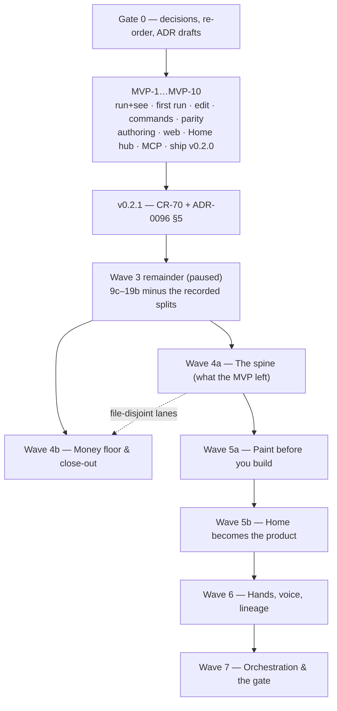

# Current state

> Status: Living
> Last updated: 2026-11-05

- **Related**: [README.md](README.md), [phases/phase-2.6-conversational-authoring.md](phases/phase-2.6-conversational-authoring.md), [phases/phase-2.5.5-hardening-and-remediation.md](phases/phase-2.5.5-hardening-and-remediation.md), [phases/phase-2.6.5-core-reliability-remediation.md](phases/phase-2.6.5-core-reliability-remediation.md), [deferred-tasks.md](deferred-tasks.md), [../project-structure.md](../project-structure.md), [../tech-stack.md](../tech-stack.md)

> **Authority (until Phase 2.5.5 and Phase 2.6 close):** This file is canonical for
> live progress and execution order; the phase documents stay canonical for scope and acceptance. Ordering
> differences between the two are deliberate. `current.md` may override recommended ordering — it may **not**
> redefine a security boundary, a scope line, or a milestone acceptance criterion.

This page tracks what is active **right now** and the order of the next work. The full phase plan and the global
milestone spine are in [README.md](README.md). Finished work keeps its record in the phase registers; this page
links to those records instead of restating them ([History](#history)).

## Now — the CLI MVP comes first

On **2026-10-26** the maintainer paused Wave 3 of Phase 2.5.5 after Step 9b.2 (accepted at `563402e6`) and moved
the work that a CLI user feels to the front: features and bugfixes in `apps/cli` and `packages/core` that
directly affect an MVP. **Paused means pending, not declined:** every paused item keeps its phase-file home,
its recorded acceptance rules and its security sittings, and the [after-MVP queue](#pending-after-the-mvp-not-declined)
keeps its internal order. On **2026-11-04** the maintainer ruled D58–D72 ([decision table](#wave-gating-decisions))
from a multi-agent review of the roadmap documents and the code at `5a328bca`; the
[priority reset record](phases/phase-2.5.5-hardening-and-remediation.md#mvp-priority-reset--2026-11-04) holds the
evidence summary, the recorded Wave 3 splits and the process amendments.

### Status at a glance

| Area | State |
|---|---|
| Phase 1 — Engine and LLM | Complete (M2, 2026-06-21) |
| Phase 2 — CLI | Feature-complete; `relavium@0.1.1` published on npm 2026-06-28 (M3) |
| Phase 2.5 — CLI Consolidation | Complete (M2.5-4, PR #69, 2026-07-08) |
| Phase 2.6.5 — Core reliability | Complete with approved deferrals, 49/51 (PR #92, 2026-10-11; [merge checkpoint](phases/phase-2.6.5-core-reliability-remediation.md#w8-merge-checkpoint--2026-10-11)). CR-70, CR-93 and CR-95's long half stay deferred in [deferred-tasks.md](deferred-tasks.md) |
| Phase 2.5.5 — Hardening | Waves 0–2 merged (Wave 2: PR #94, 2026-10-15). Wave 3 Steps 1–8 merged (PR #95, 2026-10-18); PR95, 9a.1, 9a.2a, 9a.2b, NI, 9b.1 and 9b.2 accepted and merged to `main` with the D61 checkpoint (PR #96, 2026-11-04). **Steps 9c–19 paused** (25 of 32 increments). NI's Windows clause closed on 2026-10-26 |
| Phase 2.6 — Conversational authoring | 2.6.C done; 2.6.F done except its release clause; 2.6.Q P1–P5 landed; the other fourteen workstreams have not started in their core. The MVP takes its first slices (below) |
| Phases 3–7 | Not started — desktop, VS Code, then Product Phase 2 (managed inference, cloud) |
| Publication | npm serves `0.1.1`. Nothing newer can be published yet: Step 9a.1's interim guard, on `main` since PR #96, refuses every artifact until D59's superseding release ADR is Accepted |
| Branches | `main` is at `b3cf117e`: the D61 `development`→`main` checkpoint ([PR #96](https://github.com/HodeTech/Relavium/pull/96), merged 2026-11-04; [checkpoint record](phases/phase-2.5.5-hardening-and-remediation.md#d61-checkpoint--pr-96-merged-2026-11-04)) brought the PR95 scrubber fixes, NI, the interim guard, this reset and its review correction to `main`, and `development` was fast-forwarded to the merge commit. `development` is ahead of `main` again with the D64 fixes to that correction (from `5a1006ea`); `main` keeps the redaction regressions they fix (a credential flag after a boolean flag, a credential key in a `,`/`/` URL password's userinfo or a nested URL after it, a masked name in a last-word `--flag=value` spelling) until the next checkpoint, MVP-10's unless the maintainer schedules one earlier |

### What a CLI user meets today

The engine is not the bottleneck: workflows author, run, gate, resume and retry well. The agent and presentation
layers are. The built-in chat agent can only read (`read_file`, `list_directory`, `git_status`) and starts in
`ask`; there is no edit, search or find tool; `run_command` is refused before any approval unless pre-allowlisted;
`relavium run` never prints the workflow's outputs or the run id; replies render as raw markdown; a resumed chat
opens on an empty viewport; a non-Anthropic first key leads to an opaque credential error. The
[priority reset record](phases/phase-2.5.5-hardening-and-remediation.md#mvp-priority-reset--2026-11-04) cites the
code for each.

## Next work — the CLI MVP

**The MVP (D58) is `relavium` v0.2.0 on npm** — new global milestone **M3.5** ([README.md](README.md#global-milestone-spine)):
`apps/cli` plus the core engine (`packages/llm`, `shared`, `db` and `mcp` where they decide user-visible
behaviour). A new user installs it, onboards with any of the four providers, chats with an agent that reads,
searches, edits and runs commands under approval with diffs, authors a workflow conversationally or by export,
runs it and sees its outputs, browses and inspects past runs and sessions from the Home, manages providers and MCP
servers there, reaches the web under the chat egress authority, cancels and resumes chats and gated runs, and reads
docs that describe what ships. English only (the `en`+`tr` bar binds Phase 2.6, not the MVP). There is no npm
pre-release before v0.2.0 (D70).

**Scope lines kept** (this page may not move them): media input, file-snapshot undo and the workflow-run
`egress`/`os` arms stay out ([phase 2.6 scope](phases/phase-2.6-conversational-authoring.md#explicitly-out-of-scope--phase-3--later));
the MVP only adds a pre-flight refusal for the latter. Local models stay out by product constraint.

**How increments are accepted (D64, tiered):** an increment that touches an approval or consent path, egress,
keys or secrets, filesystem writes, a new terminal sink for untrusted content, the lease or resume paths, or
release and publication keeps the 2026-10-23 bar (rigor pass, one NEW complete cumulative round with no blocker,
high or medium finding, and a separate security sitting). Other UX, rendering and command increments are reviewed
per milestone: author self-review, `pnpm run ci` plus `pnpm coverage:enforced`, and one independent scoped round
with no high or medium finding; lows go to [deferred-tasks.md](deferred-tasks.md).

Each milestone ends green on `development` with its canonical docs updated. Items cite their one home: a phase
2.6 bullet as `<workstream> · <lead-in>`, a new item as `MVP-A<n>` in phase 2.6's
[CLI MVP additions](phases/phase-2.6-conversational-authoring.md#cli-mvp-additions--2026-11-04), or a recorded
Wave 3 split as `row <n>` in the [increment table](phases/phase-2.5.5-hardening-and-remediation.md#proposed-implementation-increments).

0. **Gate 0 — decide and re-order (no product code).** This reset and the `development`→`main` checkpoint (D61) —
   **both done:** PR #96 merged on 2026-11-04 ([checkpoint record](phases/phase-2.5.5-hardening-and-remediation.md#d61-checkpoint--pr-96-merged-2026-11-04)); its review
   correction's D64 rounds 1–4 found five, one, one and one medium findings, all fixed since; by the maintainer's
   ruling of 2026-11-05 one careful pass closed it instead of a fifth round (the `,`/`/` URL reading removed, A4 a
   recorded limit again);
   drafts for the new ADRs: the pre-1.0 release path (D59), the toolbelt plus tool-render/approval-preview contract
   (phase 2.6 ADR row 9, split so `ask_user` comes later), the in-house markdown architecture (ADR row 11, part 1;
   no dependency), the ADR-0057 amendments (default grant and `default_mode`, D62; denial feedback, D67), the
   keymap (D68), the `run_command` approval card (D63) and the ADR-0095 amendment for the CR-71 residual (D67). **Drafted 2026-11-05, all Proposed and awaiting the maintainer:** [ADR-0114](../decisions/0114-in-house-markdown-rendering-for-the-chat-transcript.md) (markdown), [ADR-0115](../decisions/0115-one-interrupt-keymap-for-the-interactive-cli.md) (keymap), [ADR-0116](../decisions/0116-the-built-in-chat-agent-can-edit-and-the-starting-mode-is-configurable.md) (D62), [ADR-0117](../decisions/0117-a-denied-tool-call-returns-to-the-model.md) (D67 denials), [ADR-0118](../decisions/0118-a-command-outside-the-allowlist-asks-instead-of-failing.md) (D63), [ADR-0119](../decisions/0119-an-interrupted-turn-stays-as-a-content-free-marker.md) (the CR-71 residual), [ADR-0120](../decisions/0120-the-toolbelt-grows-and-a-tool-call-shows-what-it-does.md) (row 9, part 1) and [ADR-0121](../decisions/0121-pre-1-0-releases-publish-the-smoke-verified-package-test-tarball.md) (D59). Maintainer
   gates: CI provider keys for the live-nightly lane (D37), provider spend for a manual three-provider turn and a
   Windows machine for MVP-10. A stale-entry sweep of [deferred-tasks.md](deferred-tasks.md) and the phase 2.6
   bullets that 2.6.5 and Wave 2–3 work already satisfied.
1. **MVP-1 — Run it and see it.** Human run output and the run id (MVP-A1, MVP-A2); 2.6.G · Non-interactive
   parity (`list --runs`, `status <runId>`); 2.6.G · **Liveness** (`engine.reconcile()` on Home open and at
   `run`/`gate` start; `status` stays read-only); 2.6.K · **Validate the gate decision shape against `gateType`
   before resume**; 2.6.A · **Run-path tool pre-flight for the unwired egress/os arms** (and no `web_search` in
   the `create` placeholder); `/export` into `.relavium/workflows/` (MVP-A3); the default model follows the stored
   key (MVP-A4); the interactive output budget (MVP-A7). **Sliced 2026-11-05 (maintainer):** **1a** (UX tier, reviewed
   per milestone) — the run id, `list --runs` and `status <runId>`, the run-path pre-flight, the output budget; **1b**
   (security tier under D64) — human run output, the gate decision check, `/export`, the default model and missing-key
   error, and liveness. **Progress 2026-11-05:** 1a is on `development`. **1b is accepted** and on `development`.
   Wiring liveness exposed a second-terminal race, so the run store now refuses a second terminal. After the rigor
   pass, D64 rounds 1 (at `5f2a0eb8`), 2 (at `60bc9727`), 3 (at `224b8f69`) and 4 (at `b70f9def`) were not accepted,
   with nine, two, two and one medium findings, all fixed. Round 5 (at `df685a52`) found no blocker, high or medium
   finding, and the separate security sitting (at `ab5e46e1`) passed. Every round's lows and the sitting's are fixed
   or recorded in [deferred-tasks.md](deferred-tasks.md); one of them, a 0.1.x run settled by a newer reconcile,
   needs a ruling before the v0.2.0 release. The MVP-1 milestone review of 1a (at `624bb2e7`, which includes a
   `relavium list` sink fix for round 5's export-1) was not accepted: it found four medium findings, all fixed. They
   were a budget pause pointed at `relavium gate`, a finished run's open gate shown as pending, an unbounded tool
   pre-flight, and the chat's catalog-ceiling cap running into the 120-second attempt deadline. The maintainer chose
   a chat deadline that scales with the cap, recorded as ADR-0101's 2026-11-06 note. Round 2 (at `d8762a23`) was not
   accepted either: the round-1 run-id latch let a resumed run's summary point a gate restored from its checkpoint at
   `relavium gate`, and the summary now points such a gate at `relavium status`. Both rounds' lows are fixed or
   recorded in [deferred-tasks.md](deferred-tasks.md), round 1's `officialEndpointOf` half of budget-5 included.
   Still owed for MVP-1: a new milestone review round with no medium or higher finding.
2. **MVP-2 — First run, resume and a readable chat.** Onboarding offered by `relavium chat` (MVP-A5); standard
   provider env-var fallback (MVP-A6); 2.6.G's resume-in-place **with the prior transcript repainted** (the
   [deferred `chat-resume` entry](deferred-tasks.md)); picker-on-omitted-id and `chat --continue`; excess
   positional arguments refused (row 10b split); 2.6.E · **Markdown + code-block rendering** (in-house, part 1 —
   highlighting stays after the MVP); full-screen word-wrap (#61, moved from Wave 5a); tab expansion (#65, row 15a
   split); a failure mark for failed tool calls (MVP-A8); the persistent keyless nudge (#51, row 16b split); the
   `agent run` stdin hint (#24, row 17a split); a minimal `relavium init` (MVP-A18).
3. **MVP-3 — The agent can edit.** ADR row 9 and its mandatory security review; 2.6.M · **`edit_file`**,
   **`search_files`**, **`find_files`** (with `list_directory`'s silent 200-entry cap made visible); `read_file`
   ranges and the spill store (MVP-A9); 2.6.M · `write_file`'s approval diff (#305) and **Tool-call rendering
   v2** (sanitized target kept after the turn; assistant text between tool calls kept); 2.6.M · **Default chat
   agent grant review** as amended by D62 (MVP-A14) with `[chat].default_mode` (MVP-A13); the 80×24 guard on
   both chat surfaces and the Home strip row budget (#63, row 15c split) — MVP-3 owns the strip's geometry
   and its no-hidden-input rule, MVP-8 its content.
4. **MVP-4 — The agent runs commands and keeps its footing.** 2.6.G · **Permission management** as ruled by D63
   (MVP-A15; `!` uses the same card); the default agent gains `run_command`; the keymap, including Ctrl-C at a
   pending approval rejecting it (MVP-A12; row 11b split); denials returned to the model (MVP-A10); a failed,
   denied or aborted turn kept in context as a content-free interruption marker (the CR-71 residual,
   un-deferred, D67; CR-71 itself closed in W7); configurable, finite turn ceilings with conservative
   defaults (MVP-A11).
5. **MVP-5 — Context and parity (D71).** Anthropic prompt caching (2.5.5.B · #172); a project instructions file
   and environment block (MVP-A16); 2.6.E · **Type-ahead message queue**; `chat --model/--provider` and a one-shot
   prompt mode (MVP-A17).
6. **MVP-6 — Conversational authoring.** Accept ADR-0058 and ADR-0060 with their reviews; 2.6.A ·
   `validateAuthoredWorkflow` back-port and **`nodeCatalogIssue` never resolves the agent's own model**; `$ref`
   agent resolution; 2.6.B's wizard and conversational authoring loop, its import gate and the UVP hint
   (**Discoverability of the UVP**); 2.6.D `{{ctx.*}}` and `agent run --input`; starter workflows (MVP-A19).
7. **MVP-7 — Web.** G30 (rows 13a–13c, pulled forward; 13c is re-scoped when it starts because Step 12b is
   paused); 2.6.M · **`web_search` activation**; web fetch through `http_request` under the chat authority.
8. **MVP-8 — The Home as hub.** Phase 2.6 ADR row 6; 2.6.H's history data layer as far as G needs it; 2.6.K's
   shared resume core; 2.6.G's `/agents`, the actionable strip's content (within MVP-3's row budget),
   `/workflows` (defined, history, run detail) and the bound-agent view; Home `/help`; `logs --follow/--failed`.
9. **MVP-9 — MCP and provider management.** Phase 2.6 ADR row 7; MCP servers attached to the default agent under
   ADR-0084 consent (MVP-A21); 2.6.I · **`/providers`**, `/mcp`, **`relavium mcp list/add/remove/test`** and MCP
   header auth; the masked `provider set-key` prompt (MVP-A20).
10. **MVP-10 — Ship v0.2.0.** The D59 release path (superseding ADR, guard change, security sitting); the final
    `development`→`main` checkpoint; release prerequisites and checks (MVP-A22, MVP-A23); v0.2.0 closes 2.6.F's
    release clause and M2.6-1.

**After v0.2.0, first:** v0.2.1 — cross-turn tool memory (CR-70, on its recorded trigger) designed together with
ADR-0096 §5's in-turn overflow continuation (D67).

**Recorded risks (maintainer rulings):** the published package grants no usage right under `LICENSE` §2 and
stays so (D60); the published `0.1.1` still prints unsanitized model output in `relavium run` (#56, fixed on
`development`) and is left as is because the product has no users yet (D72).

## Pending after the MVP (not declined)

> **Temporary section — delete it when Phase 2.5.5 and Phase 2.6 close.** It owns **ordering only**; every
> item's definition, size, file list and finding ids live in its phase file, and items are cited as
> `<sub-stream> · <the bullet's bold lead-in> (<finding ids>)`. The waves below keep the order derived on
> 2026-07-26; since 2026-11-04 they run **after** the MVP above. The original plan's baseline, axes, Waves 0–1
> and the PR #81 closing list (the only definition of `#W15-1`…`#W15-24`, which code comments cite) are preserved
> verbatim in the [Phase 2.5.5 register](phases/phase-2.5.5-hardening-and-remediation.md#execution-record-moved-from-currentmd--2026-11-04),
> and so, since the [PR #96 review correction](phases/phase-2.5.5-hardening-and-remediation.md#moved-by-the-pr-96-review-correction--2026-11-04),
> are this page's other records: the Wave 2 and Wave 3 sections, its status blocks, and the W7, W8 and Phase 2.6.5
> records in [Phase 2.6.5's](phases/phase-2.6.5-core-reliability-remediation.md#execution-record-moved-from-currentmd--2026-11-04).

**Pulled forward into the MVP (the waves below keep the rest):** the `engine.reconcile()` wiring (#229), the
gate-decision/`gateType` check (#0) and the run-path tool pre-flight (#37/G29) (Wave 4a → MVP-1); 2.6.A's
back-port and catalog pre-flights, 2.6.B and 2.6.D (Wave 4a/6 → MVP-6); the toolbelt's edit/search/find tools, render v2 slices, the default grant and
`web_search` (Wave 6 → MVP-3/7); 2.6.G, 2.6.H and 2.6.K as far as the Home hub needs them (Waves 4a/5b → MVP-8);
2.6.I (Wave 5b → MVP-9); #61 word-wrap (Wave 5a → MVP-2); #172 prompt caching (Wave 4b → MVP-5); the v0.2.0
release (Wave 4b → MVP-10). After the MVP, a wave takes up whatever of its items the MVP did not finish.

**Remaining product lanes after v0.2.1 (phase 2.6, ordered):** sub-agents and the rest of orchestration
(2.6.N → 2.6.O/2.6.P, Waves 6–7); `/rewind`/`/fork` and persisted input history (2.6.E); `todo` and `ask_user`
(2.6.M, ADR row 9 part 2); syntax highlighting (ADR row 11 part 2); settings, themes and `en`+`tr` (2.6.L,
Wave 5a/5b); onboarding v2's account stub (2.6.J); history retention and delete (D33, Wave 4b); scope-line items
only after a phase amendment and an ADR.

### Wave 2 — Shut the doors

✅ **Merged to `main` on 2026-10-15 as [PR #94](https://github.com/HodeTech/Relavium/pull/94) (`ab08209e`).**
The [merge checkpoint](phases/phase-2.5.5-hardening-and-remediation.md#wave-2-merge-checkpoint--2026-10-15) joins
the forty item dispositions, the security sittings and the final evidence. Phase 2.5.5 exit criteria 1–3 and
sub-stream D are satisfied on `main`; M2.5.5-2's I half stays open.

### Wave 3 — Clear the ground

**Paused on 2026-10-26 after Step 9b.2; 25 of 32 increments pending behind the MVP.** Steps 1–8 merged to `main`
as [PR #95](https://github.com/HodeTech/Relavium/pull/95) on 2026-10-18 ([merge checkpoint](phases/phase-2.5.5-hardening-and-remediation.md#wave-3-steps-18-merge-checkpoint--2026-10-18));
PR95, 9a.1, 9a.2a, 9a.2b, NI, 9b.1 and 9b.2 are accepted and on `main` since the D61 checkpoint (PR #96, 2026-11-04),
each with its acceptance record in the
[register](phases/phase-2.5.5-hardening-and-remediation.md). The
[increment table](phases/phase-2.5.5-hardening-and-remediation.md#proposed-implementation-increments) owns the
remaining increments' scope and order. Whole-wave acceptance stays Step 19.

**Recorded splits moved into the MVP (D65, ID coverage unchanged):** row 10b's excess-argument refusal and
row 15a's #65 (MVP-2), row 15c's #63 (MVP-3), row 11b's Ctrl-C at a pending approval (MVP-4, now under the
keymap ADR), row 16b's #51 and row 17a's #24 (MVP-2), and G30's rows 13a–13c (MVP-7). Each keeps its recorded ADR
amendment and security sitting; the [priority reset record](phases/phase-2.5.5-hardening-and-remediation.md#mvp-priority-reset--2026-11-04)
records the within-row order amendments. 9c and 9d (with Wave 4b's production recipient) stay here under release
path B (D59), until 1.0 or until they land.

Two serializations survive the pause: **E before I** on `home-controller.ts`/`chat-ink.tsx` and **C before E** on
`packages/db/src/client.ts`, as [2.5.5 records under Positioning](phases/phase-2.5.5-hardening-and-remediation.md#positioning).
Experience code from the MVP lands on the undecomposed `chat.ts` and `home-controller.ts`; Steps 12 and 14 rebase
over it when they resume (accepted cost, D65).

### Wave 4a — The spine

The four Day-1-independent 2.6 workstreams everything downstream sits on — and nothing else.

1. **ADR-0058** and **ADR-0060** flipped Proposed → Accepted (0060 with its mandatory security review);
   **ADR row 6 drafted when 2.6.H starts, not when 2.6.G starts** as the doc says — H must land before G.
2. 2.6.A · **`nodeCatalogIssue` never resolves the agent's own model** (#88) — ungated pre-existing bug, first.
3. **2.6.K** — the shared resume core (security review) → the gate-decision/`gateType`
   cross-check (#0) → **2.6.G's `engine.reconcile()` wiring (#229), pulled forward** to where its only
   dependency resolves → secret re-provide (**mandatory security review** — it relaxes a fail-closed
   guarantee) → ~~gate-timeout re-arm~~ (closed early in 2.6.5 `CR-22`) → the `run:paused` park distinction.
4. **2.6.H** — the `applyDerived` exhaustiveness guard (#114) co-landed with resilient per-row parse
   (#277, #282) → step attribution → exact per-node cost + failed/cancelled totals (#118, #232) →
   batched `loadRunEvents` (G12, #273) → the bounded tool trace → gate uniqueness → idempotency.
   **Its chat-persister atomicity sub-part is STRUCK** — already owned by Wave 1 (#228).
   Then 2.5.5.C · per-row isolation (#117) as pure propagation of H's skip-and-report ruling.
5. **2.6.A** (package extraction, `validateAuthoredWorkflow` back-port, the run-path tool pre-flight
   #37/G29, direct unit tests #6) and **2.6.D**. *2.6.A's `max_tokens` pre-flight moves to Wave 4b — it has
   a hard dependency on 2.6.Q's `limit.output`.* **Closes M2.6-2.** (M2.6-3 also needs 2.6.B, which lands in Wave 6.)

### Wave 4b — Money floor and close-out

A lane genuinely file-disjoint from the spine. Drain Phase 2.5.5 to its acceptance paragraphs, harden the
adapter/catalog money floor, cut the release 2.6.Q P6 is gated on.

- **Lane 1 (`packages/llm`)** — wire the **live-nightly conformance lane** *before* 2.5.5.B's seven-gap
  **adapter-parity sweep** (#168, #170, #173, #174, #175, #186, #192), which is where those gaps came from →
  **2.6.Q's capability matrix + clamp**, landing on the parity floor → 2.6.A's `max_tokens` pre-flight →
  the four money-guard blind spots (G6, #177, #178, #181) → Anthropic prompt caching (#172) → the rest of
  2.5.5.B. `CATALOG_SHA256` (G6) strictly after Wave 0's snapshot regen. **The Sora 2 shutdown (2026-09-24)
  is a hard external date** — pull it out of wave order if the calendar demands.
- **Lane 2 (`packages/db`, CI, docs)** — 2.5.5.C's remaining 12 bullets (retention after decision D33;
  session-resume liveness #227; pagination #272; enum CHECKs #101; DDL coverage #102/#103; the
  seeded-then-migrated harness #291; …) · 2.5.5.H's remainder (engine-deps allowlist #313/#318/#285; the
  docs-style checker #316; the logging-standard ruling #266/#267/#270; `fast-check` pilot #299) ·
  2.5.5.F's 20-site not-yet-built hedge sweep (#122 …) **rebased onto Wave 0's edits, not reverting them**.
- **Sub-stream B, C and H acceptance sign-offs. Closes M2.5.5-4.** *(Moved 2026-11-04: v0.2.0 is cut by the CLI
  MVP's MVP-10, not here; M2.5.5-4's acceptance never contained it.)*

### Wave 5a — Paint before you build

Restructure the render layer and settle the theme/config substrate **once**, before ~24 new screens and a
an `en`+`tr` string catalog land on it.

1. **ADR row 10 (i18n + theming) is this wave's first gate** — ahead of rows 7 and 8. 2.6.L's palette work
   is a render-layer freeze and must not open against an undecided contract.
2. **2.6.M's render-v2 leads**, before 2.6.L's palette sweep — including the pull-in row *approval-consent-line
   zero-width hardening · shared `[c]` reducer*, which **no 2.6.M task bullet currently covers** and would
   otherwise be silently dropped. Its security review reverses the 2.5 never-render-args posture and cites
   Wave 1's sanitization and redaction work as its own technical preconditions.
3. 2.6.L theme system → **one** ADR-0063 amendment covering both 2.6.I's structured `[[mcp_servers]]` writes
   and 2.6.L's preference keys → the `models_in_use` ruling (owned by I, consumed by L) → `/settings` →
   the ADR-0072 `/settings` → `/models` visibility toggle → 2.5.5.I's picker truncation indicator (#60).
4. **Sub-stream I acceptance sign-off** — completes **M2.5.5-2**.

### Wave 5b — The Home becomes the product

Exit criterion 2: no routine task requires a shell subcommand.

1. **ADR rows 7 and 8** drafted and Accepted; confirm rows 4, 5 and 15 are already discharged by
   ADR-0067/0068/0069 and ADR-0071/0072 and close them in the table.
2. **2.6.G** end to end — tab bar → the three browsers → run detail → node detail. Its config-writing
   permissions step lands **last in G**, behind a security review.
3. **2.6.I** and **2.6.J**. I's durable tool-list cache **must not precede Wave 2's tool-definition fix**,
   or a poisoned description becomes persistent. 2.6.M's `web_search` follows I's search-provider config surface.
4. **2.6.L's locale catalog lands LAST**, after the ~24 new screens exist — landing it earlier makes its own
   acceptance uncertifiable at its landing point and guarantees a second sweep. **Closes M2.6-4.**

### Wave 6 — Hands, voice and lineage

Phase-2.6 go/no-go criteria 3 and 4, plus the child-session foundation — so the riskiest wave does not also carry its
lineage work.

1. **ADR row 9** (toolbelt + tool-render/approval-preview contract + `ask_user`'s mid-turn engine pause)
   with its mandatory security review → **2.6.M** end to end. Settle the `curl`/`wget` default-grant question
   (D49) before the default grant is finalized.
2. **2.6.B** — the `AgentParseError` design ruling first (its self-correct loop depends on those diagnostics
   being visible), then the wizard/authoring loop, the import consent gate, the `/export` hint.
3. **2.6.E** — its cheat sheet lands last in E, enumerating every command and keybinding the phase added.
   `/rewind`-vs-child-sessions moves to Wave 7 (it gates on 2.6.N).
4. **ADR row 12** (child-session foundation) → **2.6.N's foundation**: lineage, standardized I/O, the
   injected artifact-store port, catalog spawn, the depth-3/concurrency-5 guardrails.
5. **Certify Phase-2.6 go/no-go criteria 3 and 4 here**, not in Wave 7 — `invoke_agent` gates only on 2.6.N, which lands here.

### Wave 7 — Orchestration and the gate

Ship the riskiest surface last, on a fully reviewed codebase.

1. **One pass over `packages/shared/src/run-event.ts`** settling 2.6.N's `childRunId` and 2.6.P's nested-run
   namespace together — recommend an additive `parentRunId` discriminator over a new namespace that would
   change every existing `--json` consumer's shape.
2. 2.6.N's remainder → **ADR row 14** → **2.6.P** (`subworkflow` + `schema_version` 1.1; dynamic
   `invoke_workflow` **formally deferred past the phase**) → **ADR row 13 + its dedicated generation security
   review as a hard ship-gate** → **2.6.O**.
3. **2.6.Q P6** after v0.2.0 has been on `main` through one release.
4. The **`deferred-tasks.md` + traceability recording pass** for every re-deferral and decline this plan makes
   — it is the only thing that makes 2.5.5 exit criterion 5 certifiable — then 2.5.5's last docs items and the
   **sub-stream F sign-off**.
5. **Certify 2.5.5 exit criteria 4–8, and Phase-2.6 go/no-go criteria 1, 2, 5, 6, 7 and 8.**
   Criteria **3 and 4 were certified in Wave 6** and are only **re-verified** here as a release
   prerequisite, not certified again — each go/no-go criterion has exactly one certifying wave.
   **Closes M2.5.5-5, M2.6-5, M2.6-6, M2.6-7 → Phase 3 may open.**

### Wave-gating decisions

Roughly 60 open decisions sit across both phases: the ~14 that 2.5.5 flags **blocked** inline
([Dependencies](phases/phase-2.5.5-hardening-and-remediation.md#dependencies)), the nine unwritten 2.6 ADRs
([Required ADRs](phases/phase-2.6-conversational-authoring.md#required-adrs)), and a long tail that is
decision-shaped without being labelled. The table below is only the subset that **stalls a wave if
unanswered**; the remainder sit inline in their own phase-file bullet.

| # | Wave | Decision | Recommendation |
|---|------|----------|----------------|
| D1 | 0 | Mark the `ci` job a **required** check (open since Phase 0) | Yes — every CI item here is advisory until it flips |
| D2 | 0 | Coverage floor: promote to required, or soften `testing.md`? | Promote, **and implement in the same PR** — a checked-in run already shows 92–97% margin |
| D3 | 0 | Accept the upstream price changes the ADR-0071 §9 guard is refusing? | ✅ **Ruled + executed 2026-07-26: take current prices.** Verified: `gemini-flash-latest` moved $0.30→$1.50 in / $2.50→$9.00 out (the shipped floor under-priced by 5×) and `gemini-flash-lite-latest` $0.10→$0.25 / $0.40→$1.50. The nine upstream retirements were accepted in the same ruling; snapshot regenerated and merged in **PR #79**. Nothing outstanding |
| D4 | 0 | Confirm the number reservation (`0013`–`0017`, ADR-0073+) | As listed — one item per number, in landing order |
| D5 | 0 | The binding locale bar | ✅ **Ruled + propagated 2026-07-26: ship `en` + `tr`**, catalog architected for n locales, `es`/`fr`/`de` staged. Amended at all seven sites |
| D7 | 0 | Publish v0.1.1 as-is, or supersede with v0.2.0? | v0.2.0 — ADR-0067's Node `>=22` bump is breaking for 0.x · **Refined 2026-11-04 by D58/D59** |
| D8 | 1 | Do already-persisted approval previews need a scrub? | ✅ **Ruled 2026-07-30: NO scrub migration.** The recommendation had been "yes, migration 0013, same PR"; the ruling went the other way, so `0013` was left free by this ruling and is now taken by ADR-0074 §4's conservative money columns; the reservation ledger above shifts nothing — `0014` (#101) keeps its number. The forward fix shipped (#91: `previewFor` scrubs the display copy, `unredactedPreview` carries the in-process classification copy), so no NEW row can carry an unscrubbed preview; historical rows in a local `history.db` keep theirs. Recorded here because the shipped state contradicted this table for four days |
| D10 | 1 | `BudgetExceededError`/`BudgetPauseError`: adopt `.code`? | ✅ **Ruled + executed 2026-07-30: adopt.** Both carry a stable `code` (`budget_exceeded` / `budget_paused`), with exported `isBudgetExceededError` / `isBudgetPauseError` guards — because `instanceof` is unsafe from a surface (the CLI bundles the engine, so two realizations of a class coexist and `instanceof` answers `false` at the boundary that must catch it). Same shape as `isCorruptRunEventError`. Precedes Wave 3's `RelaviumError` migration as required |
| D12 | 2 | `~/.relavium/tmp/`: `tmp`-specific rule or the general home-anchored predicate? | General predicate accepted in [ADR-0105](../decisions/0105-filesystem-roots-are-invocation-grants-not-project-authority.md), with invocation authority and removal of unused tmp provisioning; approved 2026-10-12; implementation accepted in [Step 2](phases/phase-2.5.5-hardening-and-remediation.md#step-2-acceptance--2026-10-12). Full child/scratch lifecycle remains with Phase 2.6.N. |
| D13 | 2 | `default_headers`: keychain-ref indirection vs shape check? | [ADR-0108](../decisions/0108-provider-headers-stay-gated-until-keychain-custody.md) accepts keychain custody plus an interim nonempty-map refusal. Live header activation remains outside this phase and prohibited pending its custody/migration prerequisites; approved 2026-10-12; interim gate accepted in [Step 7](phases/phase-2.5.5-hardening-and-remediation.md#step-7-acceptance--2026-10-13). |
| D14 | 2 | chat-export `tool_result`: warn vs redact vs full discipline? | **Reconciled 2026-10-12:** Accepted ADR-0095 requires content-free structure, superseding the old raw-result opt-in recommendation. No `--include-tool-results`. Continuity/slug residuals and retained user text are recorded in the Wave 2 plan. |
| D15 | 2 | What masking guarantee does the session fixture (#115) certify? | **Reconciled 2026-10-12:** ADR-0095/0098 supply structural refusal, not universal masking. Certify the actual producer/SQLite/export fixtures and retained-content limits. This repairs the missing Wave 2 decision row; it is unrelated to historical media D15. |
| D17 | 2 | Book security reviews **by threat class**, not per PR? | **Accepted 2026-10-13:** four new sittings (filesystem, secret input, secrets at rest, config trust), plus W4 hostile-MCP sitting/current regression revalidation. [Closing evidence](phases/phase-2.5.5-hardening-and-remediation.md#wave-2-closing-register--2026-10-13). |
| D18 | 3 | `chat-ink.tsx` (1,795 lines, in neither doc): decompose or decline? | **Decline** — hand it to 2.6.M's render-v2 in Wave 5a, where the palette sweep then runs once |
| D19 | 3 | `--quiet`/`--verbose`/`RELAVIUM_DEBUG` precedence | **Approved ADR-0110, 2026-10-16:** quiet+verbose remains a conflict; either explicit flag overrides exact DEBUG=1. This replaces the old precedence ladder. JSON remains independent; implementation is staged. |
| D20 | 3 | `--input`'s four-way collision: rename or document? | **Approved ADR-0110, 2026-10-16:** rename pricing flags to `--input-price`/`--output-price`, retaining deprecated aliases and refusing conflicting spellings before normalization. Other command-scoped input meanings stay documented. |
| D22 | 3 | Read EXIT:4 as "no **breaking** change"? | **Approved ADR-0110, 2026-10-16:** its enumerated compatibility scope replaces the old two-exception recommendation. Phase exit criterion 4/E wording and ADR-0049/0056 forward notes are reconciled before dependent code. |
| D26 | 3 | Which session would bare Home's `showCost` target? | **Approved disposition, 2026-10-16:** keep `/cost` chat-only; certify both live chat surfaces. Bare Home currently cannot invoke the no-op. Past-session selection remains 2.6.G; no implicit cost release. See the [Wave 3 plan](phases/phase-2.5.5-hardening-and-remediation.md#wave-3-preflight-and-proposed-execution-plan--2026-10-15). |
| D28/D29 | 4a | Flip ADR-0058 and ADR-0060 to Accepted | Yes; 0060's taint model is the cited precedent for Wave 7's generation-security ADR |
| D31 | 4a | Strike 2.6.H's chat-persister atomicity sub-part as a duplicate? | Yes — owned by Wave 1; record the closure |
| D33 | 4b | Retention policy (the phase's largest single item) | Default bound 50 + `--limit`/`--tail`; ship `chat delete` writing the dead `deleted_at` columns; never auto-hard-delete |
| D34 | 4b | Logging standard: build the injected-logger seam, or amend the standard? | **Amend** — building it adds a port to `packages/core`, needs its own ADR, breaks 2.5.5 exit criterion 8, and collides with 2.6.N's artifact-store port |
| D37 | 4b | Provision CI provider keys for the live-nightly lane? | Yes, nightly-only, wired **before** the parity sweep |
| D50 | 6 | ADR row 11: adopt `ink-syntax-highlight`, or build in-house? | **Decline the dependency** per CLAUDE.md rule 2 — the markdown renderer is already in-house and untrimmed `highlight.js` is the phase's own named bundle risk · **Corrected 2026-11-04:** no markdown renderer exists yet; MVP-2 builds a minimal in-house one (ADR row 11, part 1) |
| D52 | 6 | Draft ADR row 12 in Wave 6, not Wave 7 | Yes — settle the lineage event shape once, covering both 2.6.N and 2.6.P |
| D57 | 7 | Dynamic runtime sub-workflow selection? | **Defer past the phase** — it is exactly the unauthored composition the *authored surface == executable surface* invariant exists to prevent |
| D58 | MVP | MVP scope | ✅ **Ruled 2026-11-04 — the larger MVP:** v0.2.0 on npm (milestone M3.5) after MVP-1…MVP-10, including conversational authoring, web, the Home hub and MCP/provider management; refines D7 |
| D59 | MVP | Release path under the interim guard | ✅ **Ruled 2026-11-04 — option B:** a superseding pre-1.0 release ADR publishes the smoke-verified package-test tarball from a trusted `v*` tag on `main` with a green `ci` at that commit; no archived encrypted maps for those releases; custody becomes mandatory again at 1.0 or when 9c/9d land. The guard stays in force until that ADR is Accepted and its guard change passes a security sitting |
| D60 | MVP | `LICENSE` §2 grants no usage right without a written agreement | ✅ **Ruled 2026-11-04 — unchanged.** Recorded risk for the published package |
| D61 | Gate 0 | `development`→`main` checkpoint before the MVP | ✅ **Ruled 2026-11-04 — yes,** a scoped checkpoint PR right after this reset; merging is the maintainer's action · **Done 2026-11-04:** PR #96 merged as `b3cf117e` ([checkpoint](phases/phase-2.5.5-hardening-and-remediation.md#d61-checkpoint--pr-96-merged-2026-11-04)) |
| D62 | MVP-3 | Default chat agent posture | ✅ **Ruled 2026-11-04:** read/search/find plus `write_file`/`edit_file` (hidden in ask/plan, per-call diff approval in accept-edits) plus `run_command` under D63; egress stays opt-in; the default mode stays `ask` with a `[chat].default_mode` setting and a one-time hint. Needs an ADR-0057 amendment and a security review |
| D63 | MVP-4 | `run_command` approval semantics | ✅ **Ruled 2026-11-04:** a typed card for any non-allowlisted command — once, session or remember; remembered grants live outside the repository in operator-owned config keyed by project root; accept-edits keeps prompting; headless stays fail-closed. New ADR (amends ADR-0029(a)/0061/0063) and a security sitting |
| D64 | MVP | Acceptance bar for MVP increments | ✅ **Ruled 2026-11-04 — tiered** (see [Next work](#next-work--the-cli-mvp)) |
| D65 | MVP | Paused Wave 3 increments' user-visible pieces | ✅ **Ruled 2026-11-04:** six recorded splits (10b, 15a, 15c, 11b, 16b, 17a) and #61 move into the MVP; Steps 12/14 stay paused |
| D66 | Gate 0 | `current.md`'s history | ✅ **Ruled 2026-11-04:** relocate the unique records, delete the duplicated history, keep every inbound anchor |
| D67 | MVP-4 | Context fidelity and "a user deny is final" | ✅ **Ruled 2026-11-04:** the CR-71 residual un-deferred into MVP-4 (content-free marker; CR-71 itself closed in W7), denials returned to the model, finite configurable ceilings; CR-70 with ADR-0096 §5 in v0.2.1 |
| D68 | MVP-1/2/4 | First-run defaults and the keymap | ✅ **Ruled 2026-11-04:** env-var key fallback, the interactive output budget, the default model following the stored key, a minimal `init`, and one keymap ADR (Ctrl+C interrupts the turn, a second press ends the session, Ctrl+C at a pending approval rejects it first) superseding the 2026-10-19 `/cancel` wording |
| D69 | MVP | Order of the added lanes | ✅ **Ruled 2026-11-04:** authoring → web → Home → MCP |
| D70 | MVP | npm pre-release before v0.2.0 | ✅ **Ruled 2026-11-04 — none** |
| D71 | MVP-5 | Parity items (caching, project instructions, type-ahead, `--model`, one-shot) | ✅ **Ruled 2026-11-04 — in the MVP** |
| D72 | — | The published `0.1.1`'s unsanitized `relavium run` output (#56) | ✅ **Ruled 2026-11-04 — no action;** the product has no users yet |

### Departures from the phase files' own sequencing

This ordering is compatible with both phase files' stated dependencies. It departs from their prose in seven
places, each deliberate:

1. **A baseline step neither file has.** Both treated `f88b0e8` as the working tree while it was not yet on
   `main`. Discharged 2026-07-26; kept here because it is why Wave 0 exists at all.
2. **2.5.5's recommended order is A+C → D+I → E → B+H → F+G.** This keeps its risk instinct but re-cuts the
   batches by **file**, because ~40 files are edited by both a 2.5.5 item and a 2.6 item. Sub-stream letters
   are filing conventions, not batching units — every split above is declared.
3. **Eleven items are pulled across the phase line** (2.6.M's `extraRoots` and `allowedDomains`, 2.6.N's
   fs-floor anchoring, 2.6.G's `engine.reconcile`, 2.6.Q's cost-cap halves, …) because they edit the exact
   function or file a 2.5.5 item is restructuring.
4. **2.6's ADR row 6 is drafted when 2.6.H starts**, not when 2.6.G starts as the table says — H must land first.
5. **2.5.5's own eight exit criteria are certified nowhere in either file.** Criteria 1–3 are attached to
   Wave 2 and 4–8 to Wave 7; per-sub-stream acceptance sign-offs are attached to the last wave touching each.
6. **`chat-ink.tsx` is decomposed by neither file** despite being the largest TUI file. Raised as decision D18.
7. **The MVP reorder (2026-11-04)** puts Gate 0, MVP-1…MVP-10 and v0.2.1 ahead of the Wave 3 remainder and
   Waves 4a–7, moves v0.2.0 out of Wave 4b (M2.5.5-4's acceptance never contained it) and pulls the items listed
   under [Pending after the MVP](#pending-after-the-mvp-not-declined) forward. The waves' internal order is
   unchanged.

## Standing rules

> **Work on `development` itself** ([AGENTS.md](../../AGENTS.md)); create another branch only when the
> maintainer asks, and then cut it from `origin/development`, never from a local `main`. A long-lived
> `development` merged into `main` by merge commit leaves a stale local `main` behind after every PR, silently
> and without conflict. Run `git fetch` first.

- The gate is `pnpm run ci` plus `pnpm coverage:enforced`; `development` is pushed after each accepted increment
  and its push CI is observed.
- `main` carries branch protection (PR required; `lint · typecheck · test`, the coverage floor and, since
  2026-11-04, the Windows job required; no approval count, since GitHub refuses a self-approval — see
  [code-review.md](../standards/code-review.md); force-push and deletion blocked; administrators not enforced) and a `v*` tag ruleset
  limited to the maintain/admin roles; `release.yml` asserts its ref is reachable from `main`, and its publish
  job names the `release` deployment environment; MVP-A23 either gives it `NPM_TOKEN` under a protection policy or
  replaces the token with npm trusted publishing, chosen in the D59 release ADR (until then the token is a
  repository secret).

## History

Finished work is recorded in its register; this page no longer restates it.

- **Phase 2.6.5 (W0–W8)** — the [phase register](phases/phase-2.6.5-core-reliability-remediation.md), including
  the W7 and W8 closing registers and merge checkpoints and the W4 start-gate ruling.
- **Phase 2.5.5** — the [phase register](phases/phase-2.5.5-hardening-and-remediation.md): the 2026-07-19 review
  triage under Positioning and the traceability appendix, Waves 0–1 and the PR #81 closing list in the
  [moved execution record](phases/phase-2.5.5-hardening-and-remediation.md#execution-record-moved-from-currentmd--2026-11-04),
  the Wave 2 and Wave 3 Steps 1–8 merge checkpoints, the [D61 checkpoint](phases/phase-2.5.5-hardening-and-remediation.md#d61-checkpoint--pr-96-merged-2026-11-04) (PR #96), and every
  Wave 3 increment's checkpoint and acceptance.
- **Phase 2.6** — the 2.6.F and 2.6.C implementation records and open obligations, in their
  [workstream sections](phases/phase-2.6-conversational-authoring.md).
- **Phases 1, 2 and 2.5** — [phase 1](phases/phase-1-engine-and-llm.md), [phase 2](phases/phase-2-cli.md) and
  [phase 2.5](phases/phase-2.5-cli-consolidation.md).
- **Repository checkpoint (recorded 2026-07-26; publication status corrected 2026-10-13):** the
  [npm registry](https://registry.npmjs.org/relavium) records `relavium@0.1.1` published on 2026-06-28. The release
  procedure is [ADR-0051](../decisions/0051-cli-distribution-thin-bundle-private-engine.md) /
  [release-a-surface.md](../runbooks/release-a-surface.md).
