# MVP-11 — One surface language for the CLI: Home, chat, sheets, popups and the palette

> Status: **Planned** (2026-11-24). MVP-11's product work was to start when the MVP-8 pull request ([PR #102](https://github.com/HodeTech/Relavium/pull/102)) was merged to `main`; it was merged on 2026-11-24 as `c17e9763`, so nothing waits on it. **Step 1 (decisions, ADRs and a spike, no product code) is done:** the four ADRs it asks for are written and were **accepted by the maintainer on 2026-11-24** ([ADR-0145](../../decisions/0145-the-cli-has-one-surface-language.md), [ADR-0146](../../decisions/0146-the-home-and-the-chat-share-one-calm-layout-and-the-first-run-has-no-dead-end.md), [ADR-0147](../../decisions/0147-a-system-started-question-is-a-sheet-with-a-frame-and-a-wait-clock.md), [ADR-0148](../../decisions/0148-a-user-started-report-setting-or-flow-is-a-centred-popup.md)), the real-terminal spike and a sandboxed first-run baseline are in [mvp-11/step-1-evidence.md](mvp-11/step-1-evidence.md), and the two open sub-questions of OD-8 and OD-23 are ruled (the spaced wordmark; one starter table of current models, Haiku 5.5 for Anthropic). Nothing in this file is built. **The ADRs refine this plan in places (their refinements are listed in [the evidence file's section E](mvp-11/step-1-evidence.md#e-corrections-owed-to-the-plan-made-in-the-end-of-mvp-documents-pass)); where this file and an ADR differ, the ADR wins until the close-out step brings this file into line.**
>
> Last updated: 2026-11-24

- **Related**: [current.md](../current.md) (order and live progress), [phase-2.6-conversational-authoring.md](phase-2.6-conversational-authoring.md) (the MVP-1…MVP-10 scope and acceptance this MVP extends), [ADR-0122](../../decisions/0122-the-home-is-the-interactive-product.md), [ADR-0129](../../decisions/0129-the-approval-card-is-docked-bounded-and-says-only-what-matters.md), [ADR-0134](../../decisions/0134-the-full-view-and-the-tool-details-are-one-readable-inspection-screen.md), [ADR-0137](../../decisions/0137-permissions-is-a-sheet-and-esc-steps-back-out-of-the-full-view.md), [ADR-0139](../../decisions/0139-a-workflow-run-is-hosted-inside-the-home.md), [ADR-0140](../../decisions/0140-management-browsers-the-run-drill-down-and-the-durable-run-detail.md), [accessibility.md](../../reference/cli/accessibility.md), [home.md](../../reference/cli/home.md), [chat-session.md](../../reference/cli/chat-session.md), [glossary.md](../../glossary.md)

> **The ten units (2026-11-24).** The maintainer chose to run the plan as ten review units instead of the fourteen increments of [§6](#6-work-breakdown): 1 decisions (done), 2 registry, defects and first-run basics, 3 the language (3a and 3b together, with the surface matrix harness first), 4 popup host and reports (4a and 4b), 5 settings (4c, with the authority record), 6 flows and the first run (4d), 7 Home and chat presentation (6 and 7a, ahead of the sheets so their row budget is derived once), 8 sheets and the inspection popup (5 and 5b), 9 the transcript grid (7b, **in** v0.2.0), 10 close-out. The tiers and sittings of §6 apply to the unit that contains each increment.

> **Authority.** This file is canonical for MVP-11's scope, design and acceptance. [current.md](../current.md) is canonical for where MVP-11 sits in the execution order and for its live progress. Where a rule below changes an Accepted ADR, the change is made by a new ADR that this MVP writes first (Step 1); until that ADR is Accepted, the old ADR stands. MVP-11 may **not** weaken a security boundary: [§5.5](#55-security-invariants-the-floor-that-does-not-move) is its floor. When Step 8 lands, the reference pages own the rules (key grammar, glyph table, `Esc` classes, palette orders); this file then keeps scope, order and acceptance and links to them.

> **Terms used before they are drawn.** *Sheet*: a bottom panel for a question the system asks. *Popup*: a centred panel for a command you started. *Screen*: a surface that takes the whole body. *Instant*: a command with no surface of its own. *Palette*: the `/` list next to the prompt. *Strip*: the Home's rows of runs, sessions and agents. *Rail*: the three-node line of the empty Home and of a popup's steps. *Wordmark*: `R  E  L  A  V  I  U  M`. *Host glyph*: a glyph the host draws that model text must not be able to forge. *Measured-frame acknowledgement*: the check that the frame drawn is the frame the user answered. *Exit guard*: the card shown when you leave the Home while a run is hosted. *Wait clock*: the elapsed time of a waiting sheet ([§4.5](#45-sheets)). *Residue*: a line a command leaves in the conversation or in a Home notice. *Rigor* and *milestone*: the D64 review tiers ([§2.6](#26-release-and-ordering)). *Chord*: a Ctrl-key answer such as `Ctrl+Y`. *Armed*: waiting for a second key inside a short window. *Settle time*, *dwell*, *quiet gap* and *lockout*: the input guards listed in [§5.5](#55-security-invariants-the-floor-that-does-not-move) rule 3. *Tab host*: the Home's management screen for workflows, agents and permissions. *Pin*: a test that asserts an exact string. *ADR-A, ADR-B, ADR-C1, ADR-C2*: the four ADRs this MVP writes ([§5.7](#57-adrs-and-documentation)). *Phase 2.6.L*: the later theme, token and locale work ([§10](#10-out-of-scope)).

## Contents

1. [Summary](#1-summary)
2. [Business context](#2-business-context)
3. [What the maintainer asked for, and where each ask lands](#3-what-the-maintainer-asked-for-and-where-each-ask-lands)
4. [The target experience](#4-the-target-experience)
5. [Technical design](#5-technical-design)
6. [Work breakdown](#6-work-breakdown)
7. [Decisions](#7-decisions)
8. [Risks](#8-risks)
9. [Acceptance and exit criteria](#9-acceptance-and-exit-criteria)
10. [Out of scope](#10-out-of-scope)
11. [Limits of this plan](#11-limits-of-this-plan)
12. [Appendices](#12-appendices) (A command classification, B palette orders, C frame index, D measured baseline)

---

## 1. Summary

**The problem.** The CLI is Relavium's first and, for v0.2.0, only interactive surface. It already has a strong safety floor (Ctrl-chord answers, input guards, a card that never approves by accident), but it was built one screen at a time. The same intent has different keys, the same state has different glyphs, the same approval has different words, and slash commands open whatever surface the author of that command found convenient: a note in the conversation, a picker that replaces the screen, a docked sheet, a block under the Home strip. Each new surface adds another dialect, and every dialect is pinned by tests, so the cost of fixing it grows with every merge.

**What MVP-11 delivers.** One surface language for the whole CLI, in eight steps ([§6](#6-work-breakdown)). The list gives the outcomes; the step that builds each is in brackets.

1. **Popups for user-started work** (Step 4). Every slash command that produces a report, a setting, a form or a picker opens a **centred popup** that you close with `Esc`. `/doctor` is the model case: typed on the Home or in a chat it opens a popup with the checks, and the popup carries its own controls (run again, a deep check that asks before it uses the network, details with the fix), instead of printing a block into the Home or a note into the conversation. The same rule applies to every command like it.
2. **Settings and configuration leave nothing behind in the chat** (Steps 2 and 4c). A settings flow opens as a popup, applies, closes and returns you to exactly where you were. It does not take over the chat screen and it does not leave a line in the conversation, with one named exception ([OD-1](#72-decisions-od-1-to-od-23)).
3. **Sheets for system-started questions** (Step 5). An approval, a question from the agent, a continue checkpoint or a run gate is a **bottom sheet** under the conversation, which stays visible. The sheet's rule line carries the wait clock. The approval's **full view (`[v]`) opens as a large inspection popup** that belongs to the sheet and keeps the approval answerable (Step 5b).
4. **A palette with an intentional order** (Step 2; placement in Step 7). The `/` list is grouped by what you are trying to do, always reads top to bottom, the default row is never destructive, a command that cannot act is shown dim with the reason, and **`/exit` is the last row**.
5. **A calm Home** (Step 6). The chosen empty Home (a left-hung rail, a box-less prompt, one status line), a populated Home where the prompt stays put and the strip sits below it, and a status line that always says which provider, model and mode you are on. **First-run onboarding is part of it** ([§4.12](#412-onboarding-the-first-run)).
6. **A chat that matches** (Step 7). A header line, the same status line and prompt block as the Home, a hint that names the way back (`back to Home`), and a **speaker marker that needs no role labels**: your turns start with `›` and are bold, the reply is plain ([§4.8](#48-the-chat)).
7. **One language underneath** (Step 3). One key grammar, one glyph table with an ASCII fallback, one host-glyph set, one set of words for approvals, money and time, and no shell command suggested inside the TUI.
8. **Evidence** (Steps 1 and 8). A surface matrix test (every screen × alternate screen and inline × colour and `NO_COLOR` × 80×24 and 100×30), real-terminal checks on the surfaces that depend on cursor and width behaviour, and the documentation that makes this the canonical reference.

**What does not change.** The approval floor ([§5.5](#55-security-invariants-the-floor-that-does-not-move)), the machine contracts (`--json`, NDJSON, exit codes), the shell subcommands, the engine, the data model. MVP-11 is presentation, wording, command registry data and surface plumbing; it adds no runtime dependency.

**Order.** MVP-11 runs **right after MVP-8** and before MVP-5, MVP-6, MVP-7 and MVP-9; MVP-10 (ship v0.2.0) stays last ([D79](../current.md#wave-gating-decisions)). It is part of the v0.2.0 scope. A cut line ([§6](#the-cut-line)) says which steps v0.2.0 cannot do without.

**The decisions** ([§7.2](#72-decisions-od-1-to-od-23)): twenty-three, taken in three rounds, each accepted as recommended on 2026-11-24 apart from two sub-questions. The ones that shape the most work are the transcript-residue exception (OD-1), the chat palette contents (OD-2), the popup versus docked-panel fallback if the real-terminal check fails (OD-3), the `Esc` classes and key grammar (OD-4), the Home presentation (OD-8) and the inspection popup (OD-17).

---

## 2. Business context

### 2.1 Why now

- **The cost of inconsistency compounds.** Measured on the repository at `a8b48018` against the state a week earlier (`13a79431`, 266 commits before): CLI source grew from about 81k to about 110k lines, test files from 510 to 681, and the pins that spell a key or a label word for word from 13 files / 130 lines to 51 files / 334 lines. Source growth is not the same as inconsistency; the pin count and the number of parallel tables are the direct evidence. The CLI now carries six hint dialects and at least nine separate status-to-glyph tables, and the security set of host glyphs is defined twice. Every merge into the Home or the chat adds to that, and each addition is pinned.
- **The first wide release is the cheapest moment to change keys and words.** `relavium` is pre-1.0 (`0.1.1` on npm) and v0.2.0 is the first release the maintainer intends to put in front of people ([D58](../current.md#wave-gating-decisions)). A key or label change after that costs a changelog, a migration note and support time. (The claim that the product has no users yet is D72; "cheapest moment" is this plan's inference, a hypothesis.)
- **The work is already owed.** [ADR-0137](../../decisions/0137-permissions-is-a-sheet-and-esc-steps-back-out-of-the-full-view.md) recorded the family's four hint dialects and six meanings of `Esc`, and parked the cleanup for "the common-language increment". This is that increment.
- **The maintainer set the direction.** The Home look is chosen (the "calm rail" design, [§4.7](#47-the-home)), and on 2026-11-24 the maintainer asked for popups for slash commands, an ordered palette, a first-class onboarding and a single MVP that does most of the UI/UX work ([§3](#3-what-the-maintainer-asked-for-and-where-each-ask-lands)).
- **Trust is the product's currency (hypothesis).** The product's posture is a fail-closed approval floor, OS-keychain-only secrets and artifacts you can commit ([vision.md](../../vision.md), [product-constraints.md](../../product-constraints.md)). A screen that calls one thing by two names, or an `Esc` that means different things without saying so, weakens that posture. The size of the effect is not measured.

### 2.2 How the UX supports the product promise

The tagline is *Start as an agent. Ship the workflow. Own every run.* Each part is a UX contract:

| Promise | What the UX must do | Today | What MVP-11 adds |
|---|---|---|---|
| **Start as an agent** | Type `relavium`, start talking; the first minute loses nothing and never ends in a dead end | The Home is the interactive product ([ADR-0122](../../decisions/0122-the-home-is-the-interactive-product.md)); a first-run setup card exists. Observed in manual use before this plan (no tracked record yet) and re-checked first in Step 2: without a key, Enter still tried to build a chat, the failure line was cut where the remedy begins, and the first message was not kept | The chosen empty Home, the first-run flow as one popup ([§4.12](#412-onboarding-the-first-run)), the keyless call to action in the status line, no lost first message, no shell command suggested inside the TUI |
| **Ship the workflow** | Turn a session into a YAML file and run it | `/export` and `/run` exist; `/export` writes without a card | Popup steps that show what will happen before it happens (`/run`'s step rail ends in Confirm; `/export` previews its target, see [OD-10](#72-decisions-od-1-to-od-23)). The moment of saving a session as a workflow stays MVP-6's |
| **Own every run** | History, cost, resume, debugging | Run view, gate and budget cards, tabs (MVP-8) | A consistent state vocabulary, the wait clock in the sheet rule, reports (`/cost`, `/doctor`, `/agent`) as popups that never pollute the conversation |

### 2.3 Users and journeys

**Gap.** The repository defines customer segments ([deployment-models.md](../../deployment-models.md)) but no UX persona, no task-level user research and no usage measurement; the product has no users yet (D72). Everything below that reads like a persona is a **hypothesis** for the maintainer to confirm.

- **Hypothesis H1 (primary):** the individual developer on local BYOK ("install, paste a provider key, run — no account, no server"). The Home and the chat are designed for their first twenty minutes.
- **Hypothesis H2 (secondary):** the teammate who runs a committed workflow unchanged, and the reviewer who needs to see exactly what an agent asked to do. The sheet and the approval words are designed for them.

| Stage | What happens | UX surface | MVP-11 role |
|---|---|---|---|
| 1. Install and key | `npm i -g relavium`; a provider key goes into the OS keychain | Home: the first-run setup flow; shell: `provider set-key` with the key on stdin | The setup popup ([§4.12](#412-onboarding-the-first-run)); a README quick start that starts at the Home; no remedy that tells a TUI user to leave for the shell |
| 2. First open | `relavium` opens the Home | Empty Home | The calm Home, status line, keyless variant |
| 3. First conversation | Chat, tool calls, a first file edit | Chat, approval card | Chat header, speaker marker and status line; sheet frame |
| 4. Moments of trust | Approve, ask, continue, gate | Cards in five families | **Sheets**: one anatomy, the clock in the rule, `Esc` always names what it does; the full view as an inspection popup |
| 5. Management | Models, mode, permissions, sessions, import, pricing | Pickers, overlays, tab host | **Popups** with a step rail and a named way back |
| 6. First workflow run | `/run`, gate, budget, cancel | Run view, cards | Run view stays a screen; gate cards keep their slot and take the sheet frame |
| 7. Daily use and CI | Palette, history, `--json`, scripts | Palette, subcommands | Ordered palette; machine output untouched |

### 2.4 Constraints this work must respect

| Constraint | Source | Consequence for MVP-11 |
|---|---|---|
| Local-first, no account | [product-constraints.md](../../product-constraints.md) | No popup adds a network call on open (`/models` keeps its existing non-blocking catalogue refresh, [ADR-0064](../../decisions/0064-live-model-catalog.md) §5(c), and says so on screen) |
| No telemetry without explicit, informed, opt-in consent | [logging-and-observability.md](../../standards/logging-and-observability.md) | Success cannot be measured in the product; [§2.5](#25-success-criteria) uses repository measures and a manual protocol |
| Keys live in the OS keychain only | [ADR-0006](../../decisions/0006-os-keychain-for-api-keys.md) | The provider popup keeps the masked-field rules unchanged |
| Approval is fail-closed and never widened by one key | [security-review.md](../../standards/security-review.md), ADR-0129, ADR-0115 | The security floor in [§5.5](#55-security-invariants-the-floor-that-does-not-move) |
| Terminal output is untrusted data | ADR-0122 §7.5 | Every new string (status line, popup title, anything from a config file or a cloned project) is sanitised |
| Every new screen answers ADR-0122 §7 | [ADR-0122](../../decisions/0122-the-home-is-the-interactive-product.md) | Inline parity, readable without colour, 80×24, overlay keys, bounded work, secret-safe: checked per surface in the matrix test |
| Full-screen mode is not screen-reader accessible; the inline renderer is the accessible mode | [accessibility.md](../../reference/cli/accessibility.md) | A popup has an inline form with the same content and keys; nothing is reachable only in full-screen |
| English only for the MVP; the `en` + `tr` bar binds Phase 2.6's exit, not the MVP | D5, [current.md](../current.md) | New strings live in the registries and tables this MVP builds, so 2.6.L's catalogue work starts from them |
| `--json`, NDJSON and non-TTY output are byte-stable | [ADR-0122](../../decisions/0122-the-home-is-the-interactive-product.md) §2 | Only human text changes; no machine stream changes |
| Proprietary licence | `LICENSE`, D60 | A public design-language page is a separate decision |

### 2.5 Success criteria

There is no product analytics and none may be added without opt-in, so success is measured in three places that need no telemetry.

**A. Repository measures** (automated; baselines measured 2026-11-24, see [Appendix D](#appendix-d--measured-baseline))

| Measure | Today | Target | How it is checked |
|---|---|---|---|
| Hint dialects (how a legend is written) | 6 | 1 builder plus its fallback table | Hand-written hint strings outside the builder: about 25 places → 0; an equivalence test (old string = new string) before any wording changes |
| Status-to-glyph tables | at least 9 | 1 source | Each table imports it |
| Host-glyph security sets | 2 (core and CLI); the Home rail glyph is in neither | a minimal base in the shared package and one CLI set that contains the base and every table glyph | A test that adds a glyph to the table and fails if the CLI set does not follow |
| Meanings of `Esc` | 6 recorded in ADR-0137, most unlabelled | 4 classes (decide, step, close, leave), each named on screen | A required `exitLabel` on every legend, tested |
| Commands that open a surface of their own kind | mixed (note, overlay, sheet, notice, replaced screen) | popup, screen or instant, by one rule (the palette is how a command is chosen, not a class) | A registry test: every command declares its class; the surface matrix runs them |
| Shell commands suggested inside the TUI | at least 8 | 0 | A pattern test over user-visible strings |
| Wrong remedies (a command or flag that does not exist, is deprecated, is named differently from the command table, or does not exist on the surface that shows it) | 3 known (and one wording problem), plus the surface check is new | 0 | A surface-aware test: every suggested action exists on the surface that shows it |
| Cursor visible under `NO_COLOR` | no | yes | Frame test |
| Money notations | at least 9 | at most 3 (a USD amount, a per-million price, and raw micro-cents in machine output only) | Helper tests and a sweep |
| Screens that fit 80×24 with the exit key visible | tested per screen | all, in one matrix | The surface matrix |

**B. Usability protocol** (manual; the maintainer plus three to five volunteer developers; the results are design input, not statistics; run once on the current build as a baseline in Step 1 and once at close-out)

1. *Time to first value*: a clean machine, from install to the first useful answer, with the key ready, and a second run with no key (the onboarding path). Target: under three minutes with the key ready. (The only stated install-to-value target in the repository is the VS Code one, [vision.md](../../vision.md), generalised to the individual developer in [deployment-models.md](../../deployment-models.md); it is borrowed here, not a CLI commitment.)
2. *Task success*: five tasks (add a key; switch the model and say where it applies; reject a file edit with a reason; resume a conversation; run a workflow and approve its gate). Measure unaided completion, errors, and whether the person can say what happens next.
3. *Esc prediction*: on each surface, "what happens if you press `Esc`?" Approval surfaces, sheets and popups are scored separately, because `Esc` stops a turn on a sheet and does nothing harmful on a popup.
4. *Terminal matrix*: macOS Terminal and iTerm2, Windows Terminal, the VS Code integrated terminal, and tmux/SSH; for each, the width of the rail glyphs, popup opacity and a resize. These rows join the Windows evidence runbook that MVP-10 already owes.

**C. Per-increment acceptance** (the existing D64 process): a surface-by-surface ADR-0122 §7 checklist in every pull request, `pnpm gate`, `pnpm coverage:enforced`, and the tier's review. Every pull request also lists which pins it broke on purpose.

**Nine first-class criteria and their targets.** The thresholds are *targets* the maintainer may tighten or relax; with three to five volunteers they cannot be statistics. The baseline from B is taken before Step 2.

| # | Criterion | Check | Target |
|---|---|---|---|
| 1 | First minute | B1, B2 tasks 1–2 | first useful answer in under 3 min with the key ready; the keyless path completed unaided |
| 2 | No lost input | Frame test: a failed chat build restores the draft; a message typed while no key exists is kept through setup | lost drafts: 0 |
| 3 | Discoverable | Palette tests, B3 | every available command is listed (an unavailable one is dim with its reason; `/help` is typed only); `/` then Enter never leaves the application (the first enabled row is safe) |
| 4 | Visible state | Test: outside a sheet, provider, model and mode are always on screen; `auto` is spelled out | 100% |
| 5 | Recoverable errors | Pattern and message tests | no shell command in the TUI; no wrong remedy |
| 6 | Small and plain terminals | Surface matrix | every screen within `rows − 1`, exit key visible |
| 7 | Trust and approval | Security pins, B3 | all floor pins green; `Esc` predicted correctly by at least 90% of volunteers on approval surfaces |
| 8 | Consistent | Table A | one hint builder, one glyph table, one host-glyph definition |
| 9 | Feedback | Test over the enumerated waits (a turn, a tool run, the doctor's deep check, a compaction, a model switch, a resume): each shows its elapsed time once past 5 s and its cancel key | 100% of the enumerated waits |

### 2.6 Release and ordering

- **Where MVP-11 sits.** The order ruled in D75 was MVP-1 → 2 → 3 → 4 → **8** → 5 → 6 → 7 → 9 → 10. With D79 it becomes MVP-1 → 2 → 3 → 4 → 8 → **11** → 5 → 6 → 7 → 9 → 10 ([current.md](../current.md#next-work--the-cli-mvp)).
- **Why before MVP-5, MVP-9 and the rest.** MVP-9 adds `/providers` and `/mcp` surfaces; building them after the popup host exists avoids writing them twice. MVP-5's type-ahead touches the approval guards and the prompt's place; it is safer on the finished sheet frame. MVP-6 adds authoring forms that are popups by the same rule.
- **Part of v0.2.0.** MVP-11 joins the milestone M3.5 scope ([D58](../current.md#wave-gating-decisions) is amended by D79). MVP-10 remains the release increment and carries MVP-11's real-terminal rows and the README's first-read update ([§4.12](#412-onboarding-the-first-run)).
- **Acceptance tier.** D64's tiers apply per step ([§6](#6-work-breakdown)): a step that touches an approval or consent path, a secret, a filesystem write, egress, a new terminal sink for untrusted content, the lease or resume paths or release is a **rigor** step (a new complete cumulative round with no blocker, high or medium finding, plus a separate security sitting). Other steps are reviewed per milestone.
- **Owed before v0.2.0, unchanged.** The liveness ruling, the superset-safe URL-password reading, the ReDoS vector in a cloned repository's defaults, and ADR-0121 ([current.md](../current.md#next-work--the-cli-mvp)). MVP-11 adds: the ADRs of Step 1 Accepted before their implementation.
- **The cost of the tier is not estimated here.** The roadmap is phase-relative and carries no calendar dates. Sizes in [§6](#6-work-breakdown) are relative (S, M, L, XL); for scale, MVP-4's seven steps were 106 commits and 221 files in [PR #101](https://github.com/HodeTech/Relavium/pull/101). How much the rigor increments lengthen the path to v0.2.0 is the maintainer's call, and [§8](#8-risks) lists it as a risk; the cut line in [§6](#the-cut-line) is how it can be shortened.

---

## 3. What the maintainer asked for, and where each ask lands

On 2026-11-24 the maintainer asked for these, summarised in their own words:

| # | Ask | Design answer | Step |
|---|---|---|---|
| R1 | Typing `/doctor` on the Home must show the result in a **popup**, not in the chat screen; `Esc` closes it; any controls that make sense there work on the popup itself | `/doctor` is a *report popup* with controls: `[r]` run again, `[d]` arm the deep check (it names what leaves the machine and is confirmed with a Ctrl-chord), `Enter` on a row for details and the fix (which opens the relevant popup where one exists), `Esc` closes. Nothing is written to the Home or the conversation ([§4.4](#44-reports-and-settings-as-popups)) | 4b |
| R2 | The same for **every similar job** | A rule, not a list: a command that produces a report, a setting, a form or a picker is a popup. [Appendix A](#appendix-a--command-classification) classifies every command (27 names; `/permissions`, `/workflows` and `/help` have a Home and a chat variant) | 2, 4 |
| R3 | **Settings and configuration** must not come to the chat menu and stay there | Settings flows open as popups and return to where they were opened; they leave no line in the conversation, apart from one named exception ([OD-1](#72-decisions-od-1-to-od-23)). The chat palette lists only commands that act on the live conversation or the live session's own settings; project and environment configuration (`/providers`, `/init`, `/import`, `/pricing`) is a Home concern ([OD-2](#72-decisions-od-1-to-od-23), which also states the strict reading) | 2, 4c, 4d |
| R4 | The **slash palette's order** must be sensible; `/exit` is not first, perhaps last | Commands are grouped by intent, the group order is declared per surface, the list always reads top to bottom, the default row is never destructive or session-ending, and `/exit` is the last row on every surface ([§4.6](#46-the-palette), [Appendix B](#appendix-b--palette-orders)) | 2 |
| R5 | A first-class Home and chat | The chosen Home design, a populated Home with the prompt first, the chat header, status line and grid ([§4.7](#47-the-home), [§4.8](#48-the-chat)) | 6, 7 |
| R6 | Do **most of the UI/UX work in one MVP**, starting after MVP-8's pull request | MVP-11, eight steps ([§6](#6-work-breakdown)), CLI only; the desktop and VS Code mapping is recorded as out of scope ([§10](#10-out-of-scope)) | all |
| R7 | Show **who wrote a message** without `you` / `agent` labels, for example with bold or a different tone | Your turn starts with `›` in the margin and is bold; the reply is plain and unlabelled; the text forms (copy, editor, scrollback) keep the `> ` prefix on your turn ([§4.8](#48-the-chat)) | 7a, 7b |
| R8 | The **`[v]` preview of an approval** should be a proper, polished popup | The full view becomes a large *inspection popup* that belongs to the approval sheet: same content and locks, same answer keys, `Esc` steps back to the approval ([§4.5](#45-sheets)) | 5b |
| R9 | Review the **onboarding** against the new UI/UX | One first-run flow, a keyless Home that tells you what to press, a draft that survives setup, a next step named after it (`/init` is named, not offered), no shell command inside the TUI, and a README that starts at the Home ([§4.12](#412-onboarding-the-first-run)) | 2, 4d, 6, 8 |

Two readings of R3 are possible, and this plan takes both: the *flow* of a configuration command does not take over or stay in the chat, and the *palette* of a chat does not list project-level configuration. OD-2 asks the maintainer to confirm the second and offers a stricter third.

---

## 4. The target experience

This section is the specification. The frames are **concept drawings** at 80×24 (and one at 100×30 and one at 120×36), drawn on the real grid with the real key labels where they exist; they were not rendered by the application. Where a frame and the text differ, the text governs; the known differences are listed in [Appendix C](#appendix-c--frame-index).

### 4.1 Principles

1. **Meaning is shared; chords are not.** The same intent has the same label, verb, state words and safety rules on every surface; keys are bound per surface.
2. **Who started it?** If the *system* needs something from you, you see a **sheet** and the conversation stays visible. If *you* ask the app to do something, you get a **popup** and the work happens there. If you are choosing a command while typing, you get the **palette**. If it is one action with a one-line result, it is **instant**.
3. **`Esc` says what it does.** Every key line names the effect of `Esc` in words, and the effect is one of four classes ([§4.9](#49-the-key-language)). `Esc` never approves anything.
4. **Every surface names the way back** (`Esc back to chat`), and that part of the line is never the part that gets cut.
5. **The safety floor does not move** ([§5.5](#55-security-invariants-the-floor-that-does-not-move)).
6. **Calm.** No boxes where a rule will do, left-hung, three tones (accent, strong, dim), and colour is never the only carrier of meaning.
7. **Inline parity.** Every surface exists in the inline renderer with the same content and keys; only its position may differ.
8. **Nothing stays that should not.** Reports and settings do not leave residue in the conversation or in the Home.

### 4.2 The surface model

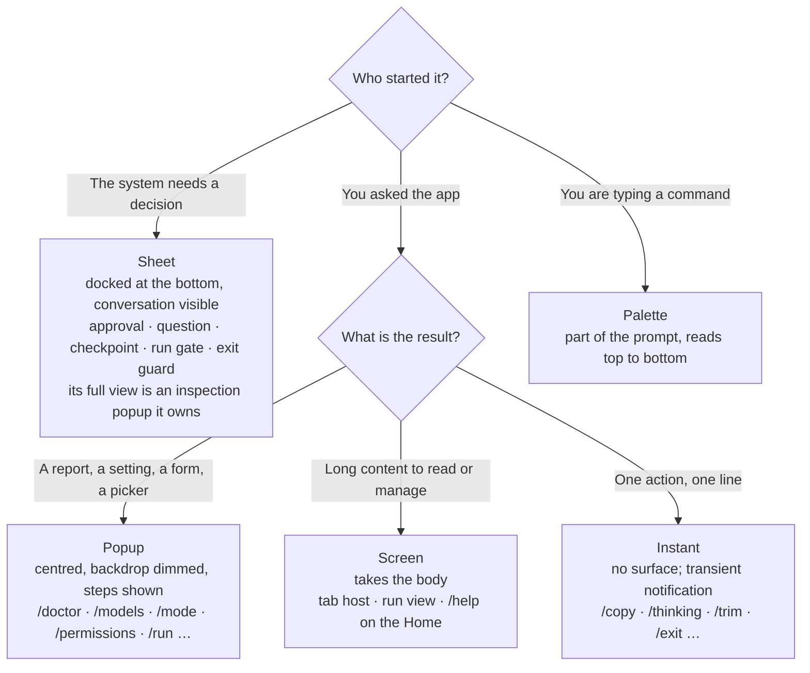

| Surface | When | Where | Conversation | Closes with |
|---|---|---|---|---|
| **Sheet** | The system waits for a decision or an opinion | Bottom, in the prompt's place; at most 12 rows at 80×24 so at least 8 transcript rows stay. On the Home the run gate, budget and MCP consent cards keep their slot ([ADR-0139](../../decisions/0139-a-workflow-run-is-hosted-inside-the-home.md), [ADR-0140](../../decisions/0140-management-browsers-the-run-drill-down-and-the-durable-run-detail.md)) and wear the sheet frame inside it | Visible, scrollable (on the Home the card takes the body, as today) | The decision chord. `Esc` and `Ctrl+C` never approve: on an approval, a question or a checkpoint they stop the turn; on a run gate `Esc` leaves it pending ([§4.9](#49-the-key-language)) |
| **Popup** | You started a command | Centred; 68 columns at 80×24 (the content column, at most 76), at most 21 rows. The inspection popup is large ([§4.5](#45-sheets)) | Dimmed behind, inert | `Esc` (a step back, or close on the first step) |
| **Screen** | Long content you work in | The whole body | Hidden | `Esc` back to the previous surface |
| **Palette** | You are choosing a command | Next to the prompt: under it on the Home, above it in a chat | Visible | `Esc` |
| **Instant** | One action with a one-line result | None | Visible | (nothing to close) |

*Notification* is the output channel of an instant command or of a closed popup, not a class: a transient line (the clipboard confirmation is the existing example), never in the transcript.

**One rule decides the class**, and the command registry stores it ([§5.3](#53-the-command-registry-becomes-the-source-of-surface-order-and-wording)): *a command that produces a report, a setting, a form or a picker is a popup; a command whose result is one line is instant; long browsable content you work in is a screen; a system-started question is a sheet.* A new command cannot be added without declaring its class, and the surface matrix test opens every one.

### 4.3 Popups

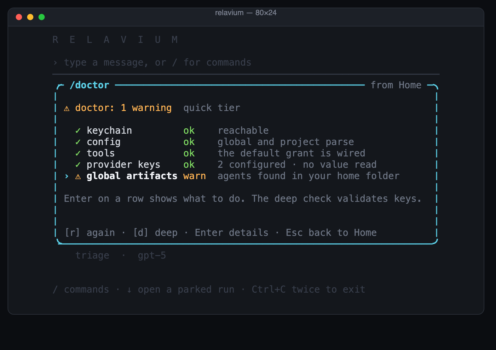

**Anatomy** (four parts, always in this order):

1. **The top edge** carries the command name on the left and the **origin** on the right (`from Home`, `from chat`).
2. **The step rail**, for commands with more than one step, in the same visual language as the Home rail: `✓ Workflow ╌╌ ◉ Inputs ╌╌ ○ Confirm` (done, current, to come; `/models` has two nodes, `Model` and `Effort & scope`). A one-step command has no rail. The rail is also the way back: `Esc` goes back one step.
3. **The body**: a list, a form, or a report. A filter line sits first when the list is long.
4. **The legend**, which always ends with the way back (`Esc back to chat`) and is the last thing truncated.

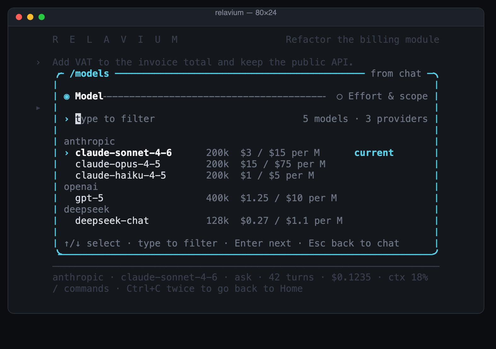

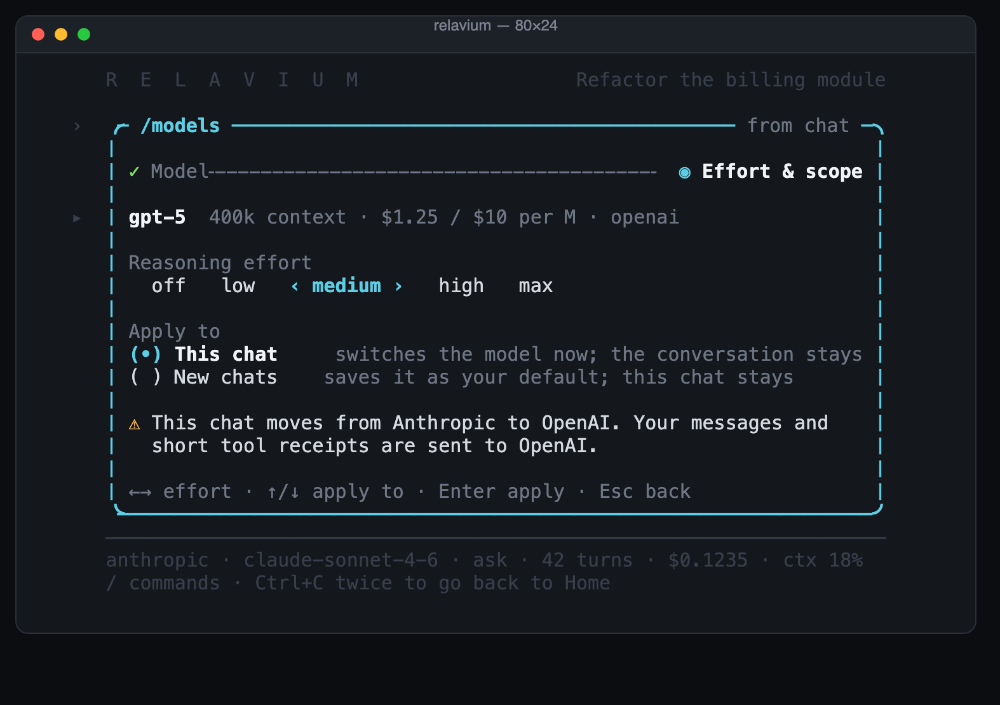

**Rules**

- **When a popup opens.** Only when no turn is running, no card or sheet is open and no two-step is armed; a refused open says so in one notification. This is today's rule for overlays ([ADR-0137](../../decisions/0137-permissions-is-a-sheet-and-esc-steps-back-out-of-the-full-view.md) §1) and it is kept. A system event never opens a popup, with one exception: the first-run offer of [§4.12](#412-onboarding-the-first-run).
- **A sheet over a popup.** If a system sheet arrives anyway, the sheet wins: a popup with a chord, a secret or an armed step closes **unanswered** (a secret buffer is cleared and the acknowledgement is invalidated); only a read-only report may be restored. A popup is never drawn over a sheet, with one exception: a sheet's own inspection popup ([§4.5](#45-sheets)). Notifications queue while a popup that holds a chord or a secret is open, so nothing paints over its rows.
- **Keys.** `↑/↓` select; `Enter` goes to the next step or applies; `Esc` goes back one step and closes on the first step; `Ctrl+C` closes the popup (or first disarms an armed confirmation line, [§4.4](#44-reports-and-settings-as-popups)) and arms no exit window ([ADR-0139](../../decisions/0139-a-workflow-run-is-hosted-inside-the-home.md) §5 is the precedent); neither confirms anything. Typed text goes only into a text field.
- **How a step is answered.** A settings step applies with `Enter` because it is not an approval, and the step first states its effect. A step that writes a project file, consents or spends keeps its **Ctrl-chord** answer and its guards. The table below is the inventory.
- **Opacity.** In colour the surface behind is dimmed. Without colour there is no dimming: the popup is made opaque by filling every row with spaces to the frame's width, which Step 1's real-terminal check must prove.
- **Size.** The popup is as wide as the content column (`min(columns − 2 × margin, 76)`, margin 6 for 80–99 columns and 8 from 100) and centred; on a larger terminal it keeps that width (the Home rail's 96-column cap does not apply to it):

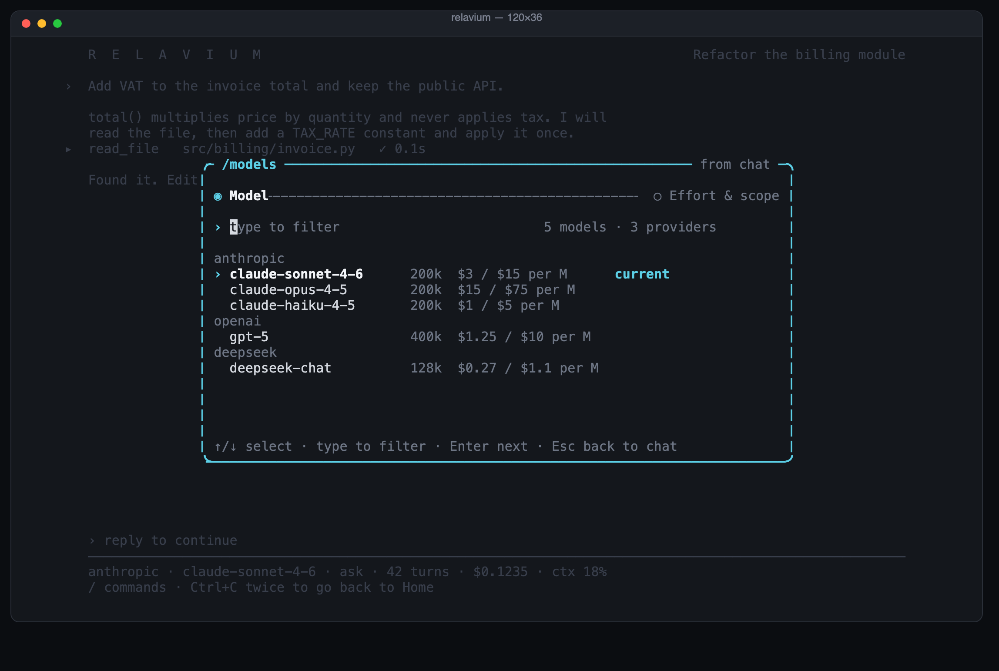

- **States** (all must be drawn and tested, none is drawn yet): *loading* (a spinner, the elapsed time once past 5 s, and the cancel key), *empty* (what is empty and what to do), *error* (what failed and the next action **inside** the TUI), *overflow* (a windowed list with `▲ N more` / `▼ N more`, the highlighted row always in the window), and *resize* (below 80×24 the popup is replaced by a notice with the way back, as the existing sheets already do in their own wording).
- **Stacking.** A popup may open one other popup (the doctor's remedy opens the provider popup where that popup exists) and `Esc` returns to its opener; the depth is two.
- **Inline.** The inline renderer cannot draw over text that is already in the terminal's scrollback, so the popup becomes a **framed block in the live region** with the same content, keys and way back:

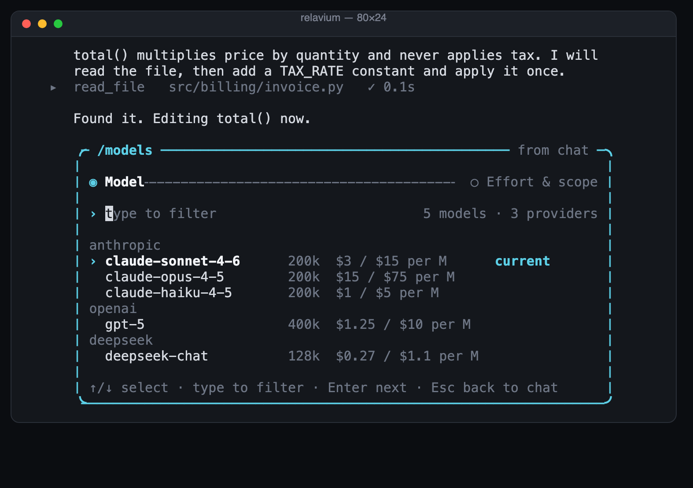

- **Screens that stay screens.** On the Home, the management tab host (`/workflows`, `/agents`, `/permissions`), the run view and `/help` are screens in the Home's slot: they are longer than a popup's 21 rows and they are places you work in, not steps you pass through. This is a deliberate exception to "the same rule on the Home and in chat" for the three commands that exist in both places (`/workflows`, `/permissions`, `/help`) and is recorded as [OD-21](#72-decisions-od-1-to-od-23). The approval's full view and `/details` become the large inspection popup ([§4.5](#45-sheets), [OD-17](#72-decisions-od-1-to-od-23)).

**Which step is answered how** (the guards named here are the existing ones; a popup adds none and removes none):

| Popup and step | Answer | Guards |
|---|---|---|
| `/mode`, `/effort`: apply | `Enter` on the last step, after the step states the effect (the risk text of `auto`) | The step's frame was acknowledged; ignored if a non-navigation key arrived since the step opened |
| `/models`: apply | `Enter` on step 2, after the step states where it applies and, when the provider changes, that the conversation goes there | Same; the popup opens on the *current* model, so a bare Enter changes nothing |
| `/permissions`: withdraw | `[d]` then `Enter`, 0.8–10 s after the `d` | [ADR-0137](../../decisions/0137-permissions-is-a-sheet-and-esc-steps-back-out-of-the-full-view.md) as is |
| `/providers`: key | A masked field, validation, an explicit *save anyway* | The existing secret rules; the buffer is cleared on close and on resize |
| `/init`, `/import`, `/pricing`, `/export`: write | `Ctrl+Y` | The existing chord guard and measured frame |
| `/run`: confirm | `Ctrl+Y` | [ADR-0139](../../decisions/0139-a-workflow-run-is-hosted-inside-the-home.md) §4 as is |
| `/doctor`: deep check | `[d]` arms, `Ctrl+Y` confirms | Chord guard; at least 800 ms after the line was shown; ignored if a non-navigation key arrived since the popup opened or since arming |
| `/cost --release`: release held estimates | A confirmation step in the report popup | The existing release flow's guard, checked in Step 4b |
| First-run setup: environment-key consent | `Enter` on the chosen row, after the step says it is saved and which model will be used | Selection plus the config-write confirmation; the one popup step answered by `Enter` that writes configuration, hence the exception to rule 3 of [§4.6](#46-the-palette) and the rigor tier of 4d |
| `/resume`, pickers | `Enter` selects | Selection only |

### 4.4 Reports and settings as popups

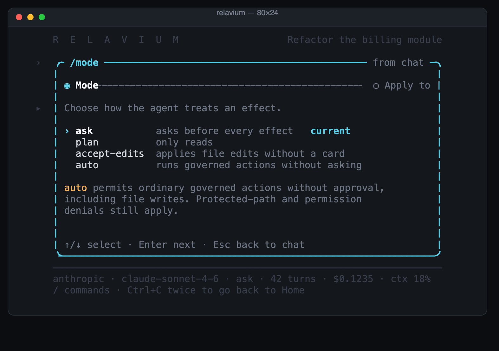

**The residue rule.** A report or settings popup writes **nothing** into the conversation transcript and **nothing** into a Home notice. Confirmations are the status line (which shows the new value) plus a transient notification; errors stay in the popup. Two things follow:

- **The one exception**, which the maintainer is asked to confirm ([OD-1](#72-decisions-od-1-to-od-23)), is the **model switch marker** (`⇄ model changed old → new`, and its notice of unresolved external effects) that [ADR-0059](../../decisions/0059-cli-mid-session-model-reseat.md) puts under the conversation when a live session is moved to another model: it records where the conversation changed hands, so it describes the conversation, not a setting.
- **The durable record stays.** Not drawing a line is not the same as keeping no record. A change that widens authority (the mode moving to `accept-edits` or `auto`) keeps a content-free record in the session even though nothing is drawn; what is recorded today is checked in Step 4c before this is built. A flow that **writes** (`/providers`, `/init`, `/import`, `/pricing`, `/export`) ends in a persistent *Done* step that names the target (project-relative) and closes with `Esc`: a timed notification is not enough evidence of a write.

**Typed arguments and key entry points** (`/mode plan`, `/effort high`, `/trim 20`, `/cost --release`, `Shift+Tab`, `Ctrl+T`) apply directly with the same result as a popup (the status line and a notification); they do not open a popup. A command typed on a surface that does not offer it (for example `/providers` in a chat, under [OD-2](#72-decisions-od-1-to-od-23)) answers with a one-line notification that names the surface that has it, and opens nothing.

**`/doctor`** (the model case, R1)

- **Opens** from the Home palette, from a chat's palette and when typed; it never prints into the Home's notice area or the transcript.
- **Body:** a heading with the dominant outcome (`✓ doctor: all checks passed`, `⚠ doctor: 1 warning`, `✗ doctor: 1 check failed`) and one row per check with a glyph, the check's name, a status word (`ok`, `warn`, `fail`) and a short detail. The quick tier checks the keychain, the configuration, the tool host and global artifacts today; MVP-11 adds one row, **provider keys** (how many are configured; a presence check that reads no value and uses no network; `warn` at zero), because without it the first-minute remedy exists only behind the network tier. The deep tier adds one row per provider whose key resolves; in a chat it also reports the session's MCP servers. Every label and detail is sanitised, and a detail that can echo a provider's answer is secret-scrubbed as well (the provider check's redaction is reused, with a test that a key-echoing error stays out of the row).
- **Controls:** `↑/↓` select a row; `Enter` shows the row's full detail and what to do, and for a row with a remedy on this surface offers it as one more step (the table below); **`[r]`** runs the quick tier again; **`[d]`** arms the deep tier; `Esc` closes.
- **The deep tier is the only control that leaves the machine, so it is a consent and not a keystroke.** `[d]` opens a confirmation line that says what leaves: `Sends one small request with your key to: <providers>. MCP servers are only reported, never contacted.` The line is answered with **`Ctrl+Y`**, which counts only after the line was drawn, measured and flushed, at least 800 ms after it appeared, and only if no non-navigation key arrived since the popup opened or since arming. `Esc`, `Ctrl+C` and any other key disarm it; a paste answers nothing. The `[d]` key is ignored during the popup's settle time. A typed `/doctor --deep` opens the popup with the line already open and still needs the chord. The deep tier uses the existing provider seam and its custom-endpoint policy: there is **no new egress path**. Its MCP rows only report the live session's already-connected servers and skipped tools; it never connects, spawns or contacts a server, and a test asserts that no MCP client method is called. The Home has no session, so there are no MCP rows there. **On the Home the deep tier is new behaviour** (today the Home runs only the quick tier and `/doctor --deep` answers that it takes no arguments there).

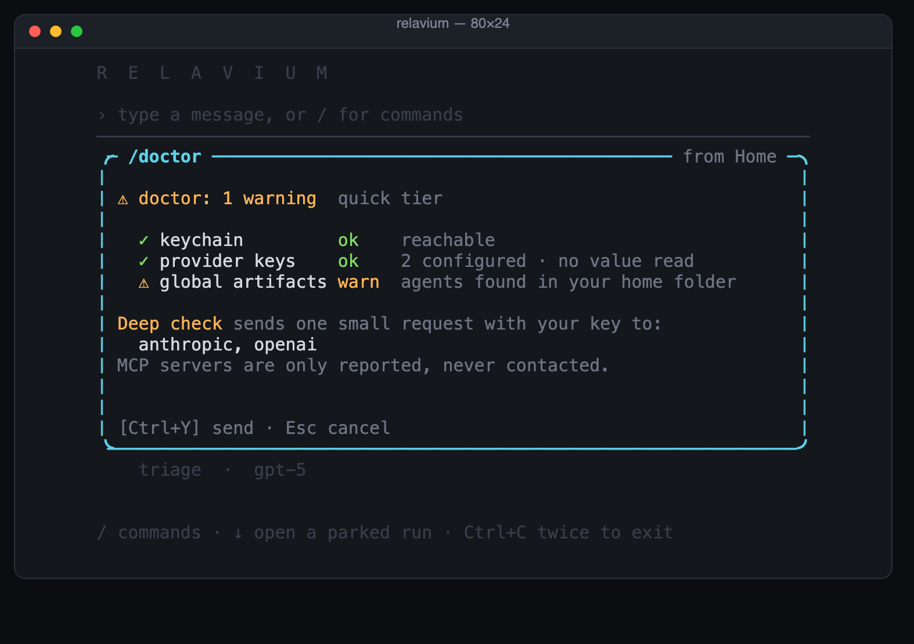

- **States.** idle (the quick tier is done) → armed → confirming → running (deep) → done, and `[r]` from idle or done. `[r]` after a deep result replaces the deep rows with the quick rows. One deep run can be in flight: reopening and pressing `[d]` again does not stack a second. `Esc` during a run closes the popup; the work stays owned and bounded by the provider check's own time limit, and its result carries a run id and lands nowhere (the Home controller has such a guard today; the chat needs a new one).
- **Remedies by surface** (a remedy must exist on the surface that shows it; the shell is never named inside the TUI except where [OD-20](#72-decisions-od-1-to-od-23) allows):

| Row | Status | `Enter` offers |
|---|---|---|
| keychain | fail | Text only (an operating-system problem), no shell command |
| config | fail | Text only: the file (project-relative or from `~`) and the error position |
| provider keys | warn | The provider popup on the Home; in any chat, text that says to go back to the Home and use `/providers` (a chat's palette does not list it, [OD-2](#72-decisions-od-1-to-od-23)) |
| provider: *id* | fail | The same |
| MCP: *name* | warn | Text only |
| global artifacts | warn | Text only |

- **Inline:** the same rows as a framed block; `[r]`, `[d]`, `Enter`, `Ctrl+Y` and `Esc` behave the same.

**Every other command**, by class ([Appendix A](#appendix-a--command-classification) has the full table):

| Kind | Commands | Behaviour |
|---|---|---|
| **Reports** (no setting changes) | `/doctor`, `/agent`, `/cost` (per-model breakdown; the release of held estimates is a confirmed control), `/workflows` in a chat, `/help` in a chat (the commands and the keys of the surface) | Open, show, `Esc` closes. Nothing is written anywhere |
| **Settings** | `/mode`, `/effort`, `/models` (two steps: the model, then *Effort & scope*: the reasoning effort, the same control as `/effort`, and where the change applies, this chat or new chats), `/permissions` in a chat (the content of [ADR-0137](../../decisions/0137-permissions-is-a-sheet-and-esc-steps-back-out-of-the-full-view.md): withdraw is two steps) | Apply through the existing writers; close on apply; status line and a notification confirm |
| **Flows** (Home) | `/providers` (masked key field), `/init`, `/import`, `/pricing`, `/resume`, `/run` (Workflow → Inputs → Confirm; nothing runs until the last step) | Steps in the popup; the final write or run step keeps its chord confirmation and ends in a persistent *Done* step; the run itself continues in the run view |
| **Take away** | `/export` | If [OD-10](#72-decisions-od-1-to-od-23) is accepted, a one-step popup that shows the target path and whether a file would be overwritten and confirms the write; otherwise instant, as today |
| **Inspection** | `/details` (the call list and a call's details) | The large inspection popup ([§4.5](#45-sheets)) |
| **Screens** | the tab host, run view, `/help` on the Home | Unchanged, see [§4.3](#43-popups) |
| **Instant** | `/clear`, `/cancel`, `/exit`, `/trim`, `/thinking`, `/copy`, `/edit`, `/scrollback`; and `/compact` unless [OD-22](#72-decisions-od-1-to-od-23) gives it a confirmation | No surface; a notification where a result needs saying. `/clear` and `/trim` keep a content-free conversation marker, because they change the conversation |

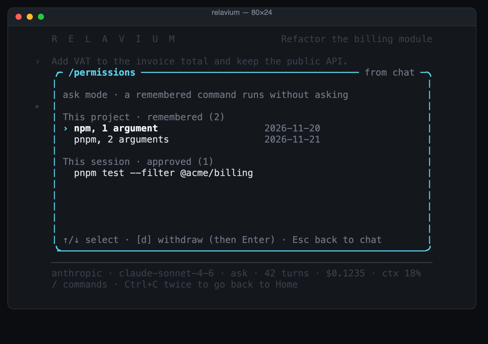

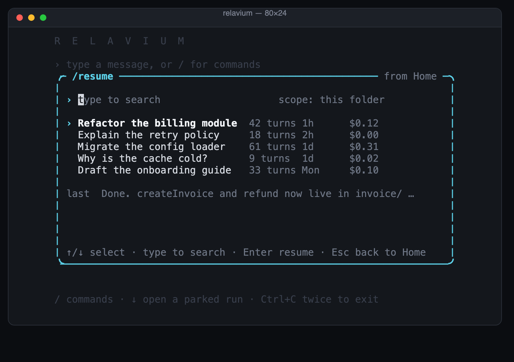

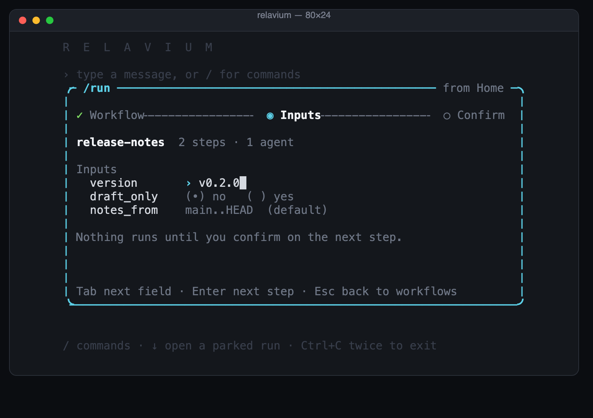

### 4.5 Sheets

The sheets are the approval card (file edits and commands), the question the agent asks, the continue checkpoint, the run gate and budget gate cards, the MCP consent card and the exit guard. They keep their content and their keys. What changes is a shared **frame**:

1. **A heavy rule** (`━━`) carries the label on the left and the **wait clock** on the right: `━━ Approval needed ━━━━━ waiting 0:41 ━━`. The rule is amber when the sheet asks for a decision and cyan for the agent's question. The sides are open (a tray, not a box), which costs no width and needs no extra work inline.
2. **A title line**: what it is on the left, the numbers on the right (`+3 −1 · 214 bytes`).
3. **The body**: the diff, the command, the question and its options; line numbers and signs sit in the margin column, the text in the content column.
4. **Two key lines** with the real labels, coloured by the existing scheme (allow green, deny red, the rest cyan, `Esc` amber, words dim). `Esc`'s effect is always written.

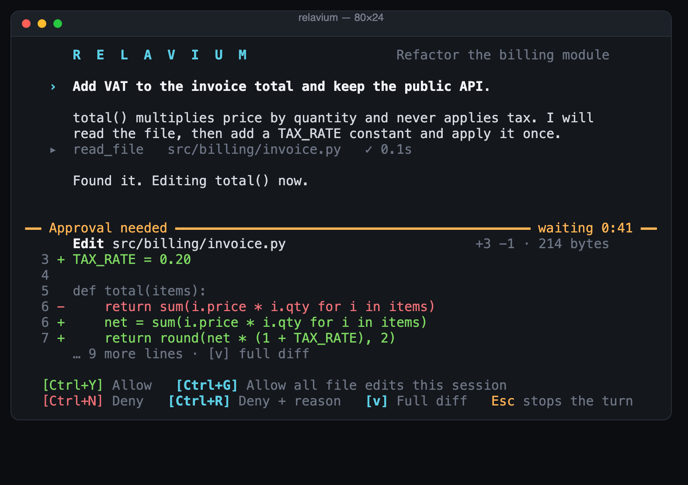

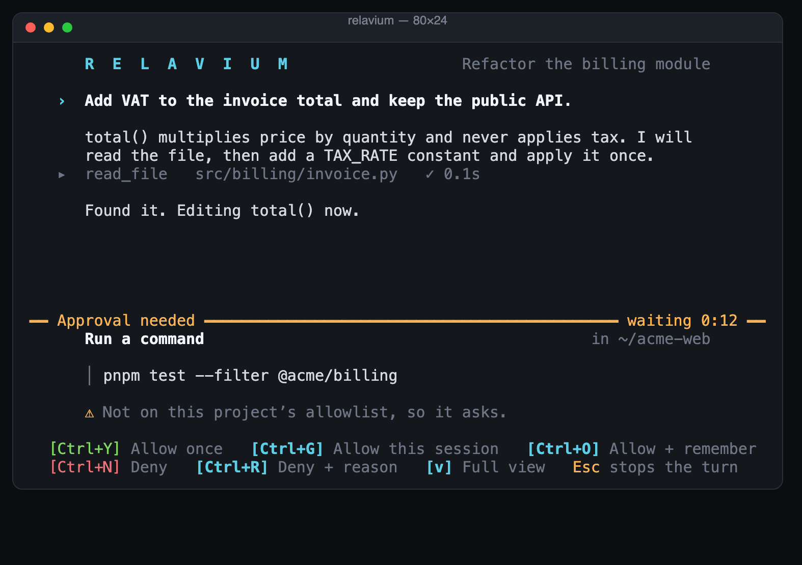

**Safety content that must survive the new frame, word for word.** The agent's question carries the label `Question from the agent · not an approval` in its rule, and every row of model-written text (the question and the highlighted option's description) starts with the host gutter `│ `, so a line the model writes can never pass as host text ([ADR-0132](../../decisions/0132-the-model-can-ask-the-user-a-structured-question.md)). The approval card keeps the words that explain a locked answer: `(Allow is locked until you inspect the change)`, `(Allow is locked until you read the whole command)`, `Allow stays locked until you do.` and `⚠ Allow is locked until the required content has been inspected ([v]).` ([ADR-0129](../../decisions/0129-the-approval-card-is-docked-bounded-and-says-only-what-matters.md)).

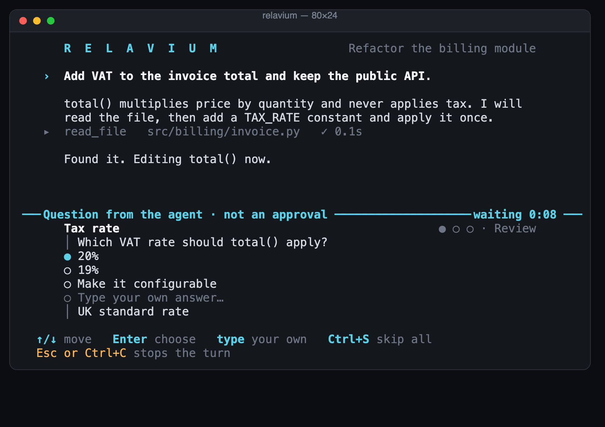

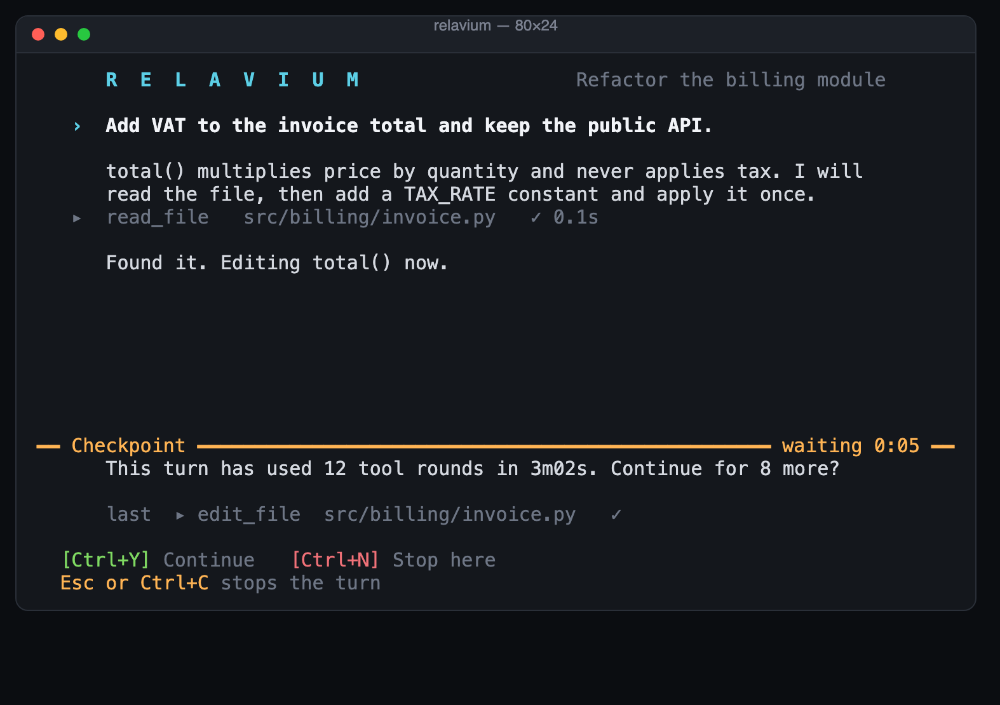

**On the Home** the run gate, budget and MCP consent cards stay screens of the Home's slot, as [ADR-0139](../../decisions/0139-a-workflow-run-is-hosted-inside-the-home.md) and [ADR-0140](../../decisions/0140-management-browsers-the-run-drill-down-and-the-durable-run-detail.md) place them (they take the body and `Esc` leaves the card and decides nothing). They take the sheet's **frame** (the heavy rule with its clock, the title line, the two key lines) inside the slot. Docking them over the strip instead would change those two ADRs and the exit guard's measured frame; it is not proposed.

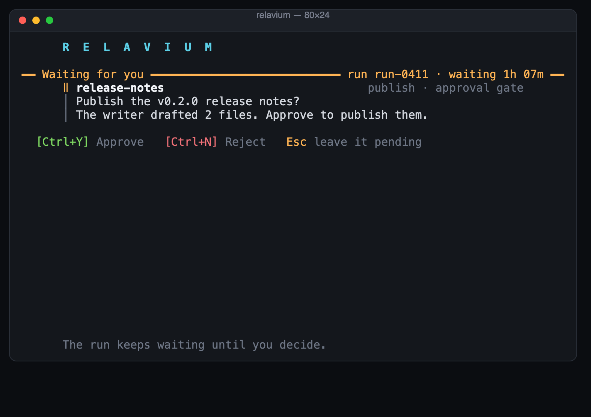

**The wait clock replaces the busy line.** Today the chat view draws a busy row (`Waiting for your answer <time> · Esc stops the turn`) and the session footer, and the card is drawn below them; the card's budget reserves three live-region rows (busy line, footer, hint) beside the card's 12 and keeps at least 8 transcript rows. With the clock in the rule the busy row goes and one row is gained. The clock is **display state only**: it never feeds a guard. Every guard keeps its existing origin (the dwell counts from the first frame that was measured and flushed, never from publication; the quiet gap from the last foreign key), so a gate that was parked an hour ago shows `waiting 1h 07m` and still waits out its dwell from its first acknowledged frame. In the inline renderer the rule carries a static `waiting since HH:MM` rather than a ticking clock, because a rewrite of the live region every second is hostile to assistive tools. The wait is still excluded from the turn's time. This changes the layout that [ADR-0129](../../decisions/0129-the-approval-card-is-docked-bounded-and-says-only-what-matters.md) §6 sets, so a new ADR amends it first (Step 1, ADR-C1).

#### 4.5.1 The inspection popup (the full view and `/details`)

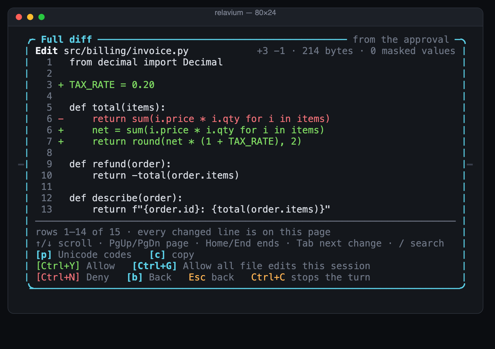

**What it is.** Pressing `[v]` on an approval opens its full view. Today that is a screen that replaces the body ([ADR-0134](../../decisions/0134-the-full-view-and-the-tool-details-are-one-readable-inspection-screen.md)). MVP-11 proposes to draw it as a **large popup that belongs to the sheet**: the same content, the same locks, the same answer keys, in the popup frame ([OD-17](#72-decisions-od-1-to-od-23)). `/details` (the call list and a call's details) uses the same container, started by the user from a chat.

**Why large, and what it keeps.**

| | Screen today | Standard popup (68 × 21) | Large inspection popup (78 × 23 at 80×24) |
|---|---|---|---|
| Body rows at 80×24 | 14–17 | about 8 | 14 |
| Text width | about 78 | 64 | 74 |
| Frame, title, origin, legend, way back | its own | the language's | the language's |

A standard popup would give back the reading ADR-0134 won (the body was 9 rows before it, 14–17 after), so the inspection popup is as tall as the terminal allows (`rows − 1`) and two columns narrower than it. At 80×24 it keeps the body at 14 rows by putting the screen's name and origin on the popup's top edge, the identity and counts on one row, the closing note into the legend and the status and message rows as they are. The page is already projected from the geometry it is given (`fullChrome` and the row limit), so the popup changes the numbers, not the model.

**Rules**

- **Owner.** The approval sheet owns it. It is not an independent popup: opening it does not suspend the sheet, and no other popup may be drawn over it. The sheet stays pending underneath and its guards keep running from their existing origins.
- **Keys.** The keys of ADR-0134 §5 are unchanged (`↑/↓`, `PgUp/PgDn`, `Home/End`, `Tab` next change, `/` search, `[p]` Unicode codes, `[r]` reveal when something is masked, `[c]` copy). **`Esc` and `[b]` step back to the approval; they never reject** ([ADR-0137](../../decisions/0137-permissions-is-a-sheet-and-esc-steps-back-out-of-the-full-view.md) §4); `Ctrl+C` stops the turn. The approval's answers stay Ctrl-chords in the popup's two answer rows, with the card's guards; while a session-wide or remember question waits, the rows read as ADR-0137 §4 specifies.
- **The locks are unchanged.** Allow stays locked until the whole target has been on screen and every masked value has been revealed, and the lock names its cause; a hidden changed line earns no session-wide grant. Every row is fitted by the whole-row width measure; copy stays the masked companion of the exact page drawn.
- **The measured-frame acknowledgement covers the popup's frame**, so an answer counts only for the frame the user saw.
- **`/details`** opens on the newest call; `Enter` opens a call (the same container), `Esc` steps back to the list and then closes; no approval is pending there, so no answer rows are drawn.

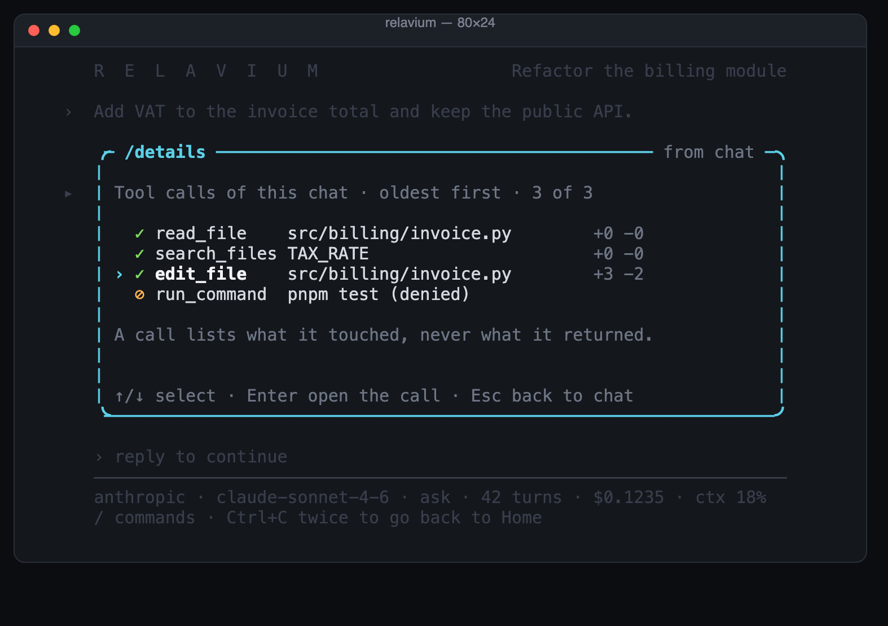

- **Inline.** The inline renderer draws the same page as a framed block in the live region, which is what its full view is today with the popup frame.

**The options considered.** (A) Keep the screen and give it the popup's anatomy (frame, title, origin, legend): the least risk, no overlay. (C) A standard-size popup: rejected for reading. Option B, the large popup described above, is the one chosen (OD-17, accepted 2026-11-24) because it is what was asked and it keeps the reading; it is a rigor increment (Step 5b) because it reframes the approval path.

---

### 4.6 The palette

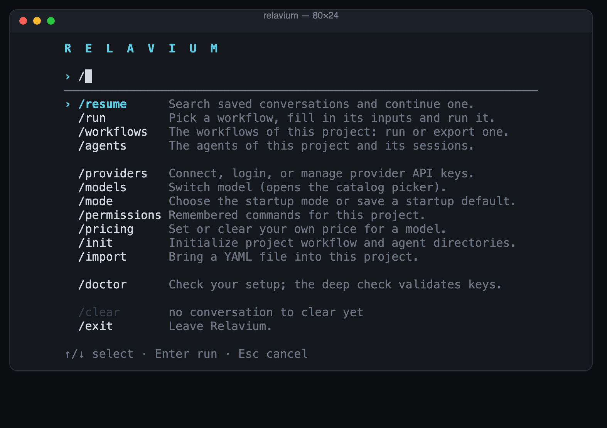

**The ordering contract** (R4). Today the order is the registry's declaration order: `exit` is first in both the Home and the chat, so `/` then Enter leaves the application on the Home and in a stand-alone chat (in a Home-hosted chat it leaves the chat). The new rules:

1. **Every command declares a `group` and a `rank`;** the order of groups is declared per surface. Nothing is sorted by name.
2. **The list always reads top to bottom in the declared order, on every surface.** On the Home it opens under the prompt. In a chat it opens **above** the prompt (the prompt is at the bottom) but keeps the same reading order, so **`/exit` is the bottom row of the list on both screens** and the highlighted default row is the first row.
3. **The default row is never destructive and never ends the session**, because `/` then Enter must be safe. The default is the first *enabled* row. A popup's default selection never pre-selects a change (the model popup opens on the current model), so a bare `Enter` chain changes nothing. One named exception: the first-run environment-key consent, whose first row `Use it` is today's behaviour ([§4.12](#412-onboarding-the-first-run); [OD-23](#72-decisions-od-1-to-od-23) offers starting on `Not now` instead).
4. **Intent order, not alphabet.** On the Home: *Work*, then *Set up*, then *Check*, then *End*. In a chat: *Model and behaviour*, then *Context*, then *Inspect*, then *Take away*, then *End*.
5. **`/exit` is always last,** and the commands that end something (`/clear`, `/cancel`, and `/resume` where it replaces the conversation) sit just above it.
6. **A command that cannot run in the current state is shown dim with the reason**, as [ADR-0122](../../decisions/0122-the-home-is-the-interactive-product.md) §9 already requires and the palette does not yet do: `/clear` on the bare Home says there is no conversation to clear, `/resume` says there is nothing to resume, `/run` says the project has no workflow. The default row skips dim rows.
7. **State-aware lead.** With no provider key, `/providers` leads the Home's list, because connecting a provider is the Home's primary action in that state.
8. **Typed queries keep today's ranking** (an exact name first, then a name prefix, then a name containing the text, then a description containing it) and inside each tier the declared order holds; within a tier, commands that end a session or spend tokens come after the others, so a short query does not land on `/clear`, `/cancel` or `/compact` first. The default-row rule of 3 is about the bare `/` list.
9. **Groups are separated by a blank row when the rows allow** (the Home's 14 entries need 17 rows) and run together when the window is short. The window (`▲ N more` / `▼ N more`) and the `rows − 1` bound stay.
10. **Descriptions are surface-aware.** `/exit` reads "End the chat session." in both places today; on the Home it leaves Relavium, and the description says so.
11. **Non-interactive output keeps today's order.** The plain and `--json` chat, and the one-shot paths, derive their help text from the registry; the reordering changes that text, which is accepted and recorded, and no machine output changes.

The two orders are in [Appendix B](#appendix-b--palette-orders). Both follow OD-2 and OD-13, accepted on 2026-11-24; the row-by-row order is the plan's, is pinned by Step 2's registry tests and changes only with a recorded reason.

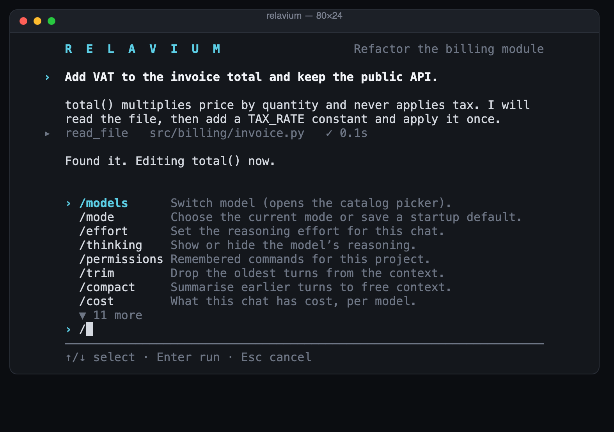

### 4.7 The Home

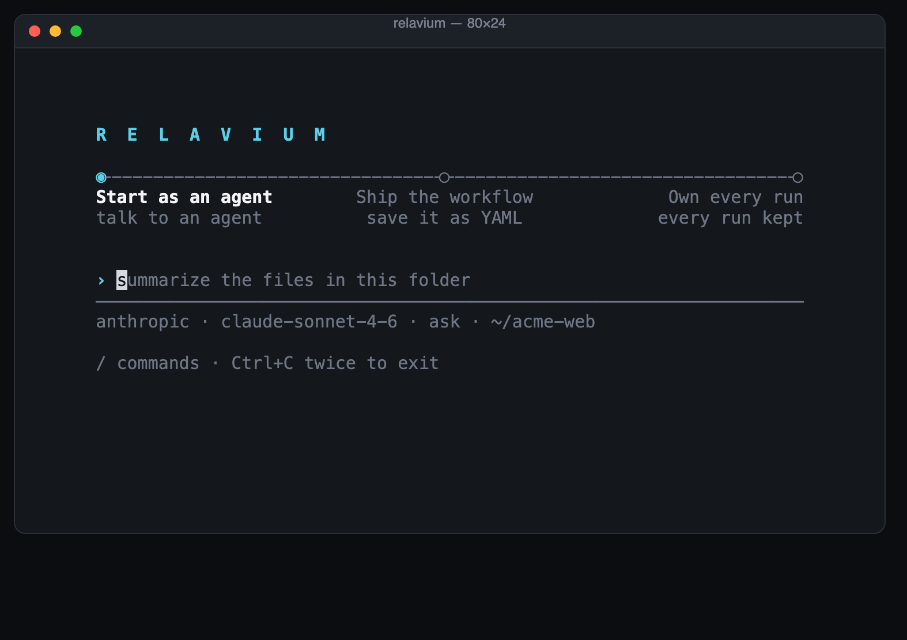

**Empty Home** (nothing to continue): six things only: the wordmark, the rail, the prompt, the status line, one hint line, and space. It replaces today's plaque banner, the "Welcome to Relavium." block and the example line under the prompt.

| Element | Specification |
|---|---|
| Layout | Everything left-hung, no centring. Left margin 6 columns for 80–99 columns and 8 from 100; the rail is `columns − 2 × margin` wide (68 at 80), capped at 96 ([OD-8](#72-decisions-od-1-to-od-23)) |
| Vertical | One 12-row block, a little above the middle: a top gap of about a quarter of the free rows (3 rows at 24, 6 at 30, as drawn; the exact formula is fixed in Step 6); not pinned to the bottom. **Inline: no vertical gap** (nothing blank is pushed into the scrollback) |
| Wordmark | `R  E  L  A  V  I  U  M`, two spaces between letters (22 columns), bold accent. It keeps the existing choice of letter-spacing over a block font, which would take a fifth of an 80×24 screen (the reasoning in the banner's own source comment) |
| Rail | `◉` then `╌`, `○`, `╌`, `○`: three nodes (left end, the middle column `⌊(rail − 1)/2⌋`, right end). With nothing to continue only the first node is filled. The tagline is split across the nodes: `Start as an agent` (strong), `Ship the workflow`, `Own every run`; under each, a dim note (`talk to an agent`, `save it as YAML`, `every run kept`; the last is a promise about the local history, which is stored unencrypted and cannot yet be deleted, so the wording is revisited when retention lands) |
| Prompt | Box-less. `›` in the accent, a dim example (`summarize the files in this folder`) **inside the prompt row**, the cursor on its first letter, one thin rule under it. The example is **never sent**, and the first keystroke replaces it. **Enter on an empty prompt is not inert today** and stays as it is: with a hosted run it opens the run view, without a key it opens provider setup |
| Status line | `provider · model · mode · directory`. The Home's mode is the **startup default for the next chat**, written `ask · next chat`. `effort` stays when set (the footer shows it today and ADR-0066 wants no hidden state). Truncation order on this line: the directory first (leading path elements become `…`); mode, effort and `auto` are never cut, and `auto` is spelled `auto mode` even without colour. No git branch in the first release ([OD-8](#72-decisions-od-1-to-od-23)); the directory is shown project-relative or from `~`, never an absolute path. Every string on the line (directory name, provider and model ids from configuration) is sanitised and bounded |
| Keyless variant | Today a yellow line above the prompt says `Connect a provider to start chatting — Enter to set up or /providers.` In the new layout the status line is replaced by `No provider key yet · Enter to connect · /providers`, drawn in the accent tone, not dim: it is the first minute's most important call to action ([§4.12](#412-onboarding-the-first-run)) |
| Hint | `/ commands · Ctrl+C twice to exit`. With nothing to continue there is no `↓` |
| No colour | ASCII fallback: `◉`→`*`, `○`→`o`, `╌`→`-`, `›`→`>`, `─`→`-`; the example is written with an `e.g.` prefix because dim cannot be trusted; the shape of `*` and `o` still tells the first node from the others |

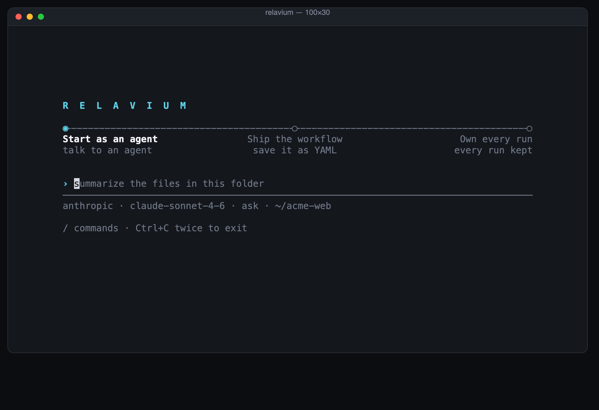

**Populated Home** (something to continue): the **prompt stays where it is and the strip sits below it**, so the empty and the populated Home share one layout. `↓` moves into the strip (down, as the arrow says), `Esc` returns to the prompt, and the hint line changes to match the focus (`↑/↓ select · Enter open the gate · Esc to prompt · Ctrl+C twice to exit`, 71 columns; a hint line may run past the 68-column rail up to the terminal width minus the left margin, 74 at 80 columns). The rail is not drawn on a populated Home; the plain title stays ([OD-8](#72-decisions-od-1-to-od-23) asks whether the populated Home's title is the plain word or the spaced wordmark). A palette over it opens downward and the strip is hidden while it is open, so the block never exceeds `rows − 1`. The exit guard replaces the prompt block exactly as it does today; its position and its measured-frame check are re-verified because the order of the body changes.

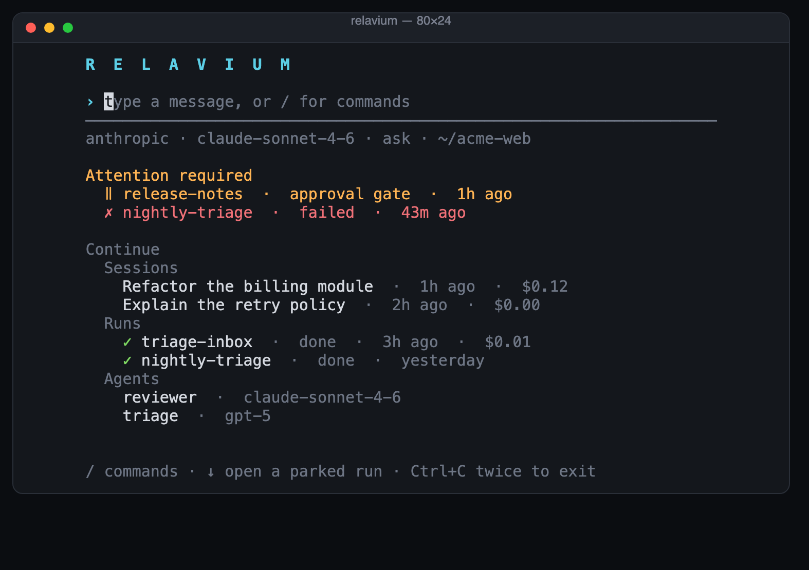

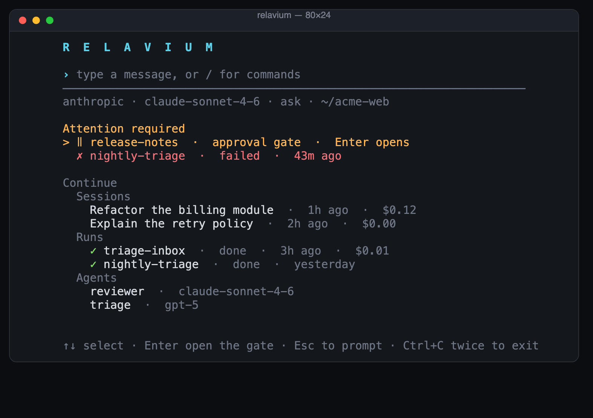

### 4.8 The chat

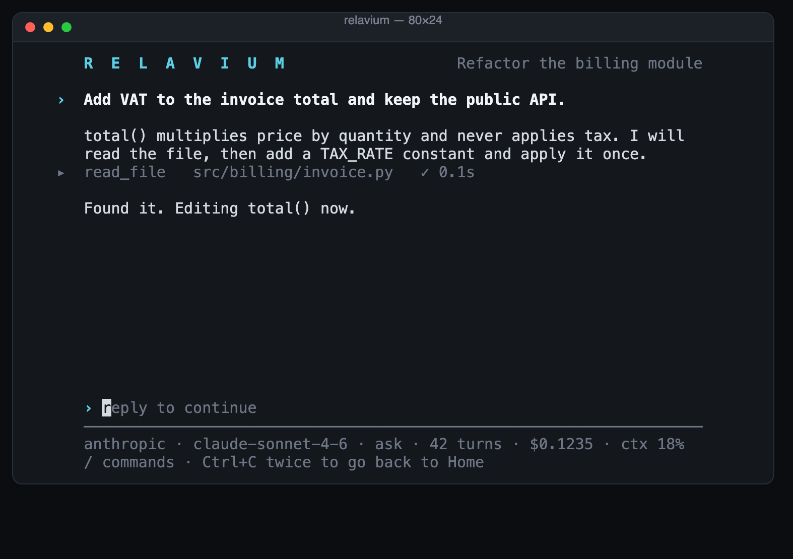

- **Header** (one line plus one blank): the wordmark on the left, the session title on the right. In the alternate screen it is the first child; in the inline renderer it is printed once as the introduction, because inline has no fixed top row. The blank row stays at every supported size, and the budget below assumes it; whether to drop it at the 80×24 floor to give the transcript one more row is [OD-9](#72-decisions-od-1-to-od-23). The header really takes two rows, so the transcript loses two. The session title's source (the user's text or a model summary) is untrusted and persistent text, so it is sanitised and bounded.
**Who spoke: the speaker marker** (R7, [OD-18](#72-decisions-od-1-to-od-23)). No role labels. The margin column carries one glyph per row kind and the text carries the weight:

| Row | Margin | Text | Without colour |
|---|---|---|---|
| Your turn | `›` in the accent, on the first line only | **bold** | `>` and bold |
| The reply | nothing | plain | plain |
| A tool call | `▸`, dim | dim | `>` is not used; `▸` becomes `-` |
| A notice | nothing | dim | dim is dropped; the notice stays on its own row |

A wrapped line hangs under the text (the margin stays empty, the content column is the text's column), and one blank row separates turns, so a long message reads as one block with the marker once. There is no tinted background: a tint is the first thing lost without colour and needs a terminal-background probe, and the calm design does not need it. Because the marker is the **prompt's own glyph**, your turn looks like what you typed. **The margin column belongs to the renderer:** model text is laid out in the content column only and can never occupy the marker's place, which is why a reply that starts with `›` cannot pass for your turn (the same reasoning as the question card's gutter). The text forms keep today's `> ` prefix for your turn in copy, `/edit` and `/scrollback`, so the speaker survives where styling does not. Whether the inline renderer, which is the accessible mode, adds role words is [OD-18](#72-decisions-od-1-to-od-23); a pinned "last prompt" row while you are scrolled up is a possible later addition and is out of scope.
- **The grid.** The margin column holds the markers, line numbers and glyphs of tool lines; the content column holds text. The wordmark, the prompt, the status line, the transcript text and the diff code all start at the same column. A popup is as wide as the content column.
- **Prompt block**, in the Home's order: a blank row, the prompt, a rule, the status line, the hint (5 rows).
- **Status line** in a chat: `provider · model · mode · effort · turns · cost · context%`. The provider is new (it is not in today's footer); the order changes (today: `model · cost · N turns · P% ctx · <mode> mode · effort`); mode, effort and `auto` are never cut; `auto` is spelled out. The truncation order of turns, cost and context is part of [OD-9](#72-decisions-od-1-to-od-23).
- **Hint:** `/ commands · Ctrl+C twice to go back to Home` in a chat the Home opened (key, verb, destination; today it says "to end" and never names the Home), and `/ commands · /exit or Ctrl+C twice to end` in a stand-alone `relavium chat`.
- **Row budget at 80×24:** 23 rows are 1 header, 1 blank, the transcript and the 5-row prompt block. At rest the transcript has 16 rows; with a 12-row sheet open it has 9, above the 8-row floor of ADR-0129.
- **The grid is its own review.** Moving the markers into the margin changes the transcript's wrapping, the inline `TranscriptLine`, the `/edit` and `/copy` document, the live stream's wrapping width and the mouse selection together. It is a separate increment inside Step 7 with its own review and a scoped security sitting ([§6](#6-work-breakdown)).

### 4.9 The key language

**Esc has four classes**, and the key line names the class's effect in words:

| Class | Meaning | Examples |
|---|---|---|
| **Decide** | Reject and stop (something is answered or cancelled) | Approval card: `Esc stops the turn`; the agent's question; the checkpoint |
| **Step** | Go back one level | The inspection popup → the approval; a popup step; tab host detail → list; `/permissions` with a withdrawal armed (the next `Esc` closes) |
| **Close** | Nothing changes | The palette, a picker, a popup's first step |
| **Leave** | The screen closes and the work or the state stays; nothing is decided | The run view (`Esc leaves it running`), a gate card (`Esc leaves it pending`) |

The class belongs to the pair (surface, state), not to the surface alone: `/permissions` is a *Step* while a withdrawal is armed and a *Close* otherwise. The native prompt's `Esc back · Ctrl+C leave` closes the form, which is the *Close* class; the word *leave* is aligned with *close* there or bound to the "work stays" meaning only.

**The legend grammar.** Dim, ` · ` between items; `Ctrl+X` with a plus; lower-case imperative verbs; the key that leaves goes last and its effect is written; **a key that changes state is written in brackets** (`[d] withdraw`, `[Ctrl+Y] Allow`), a key that only moves or leaves is not, which is why `Esc` stays unbracketed even where it decides (it is coloured amber and says what it does); arrows are written `↑/↓`. The existing sheets already follow this grammar ([ADR-0137](../../decisions/0137-permissions-is-a-sheet-and-esc-steps-back-out-of-the-full-view.md) §5). Two places still write `↑↓` (the agent's question card and the call list) and the gate card writes its verbs in the third person (`approves`); both move to the grammar.

**Two-step patterns** (four exist today and keep their constants): a second `Ctrl+C` within 2 s ends the session or leaves the Home; `d` then `Enter` withdraws a permission (the `Enter` is accepted 0.8 to 10 s after the `d`); `Ctrl+G` or `Ctrl+O`, then `Enter`, grants for the session or remembers (0.8 to 5 s); and the exit guard's `Ctrl+Y`. MVP-11 documents them as one family and adds one use of the *arm, then confirm* idea: the doctor's `[d]`, then `Ctrl+Y` ([§4.4](#44-reports-and-settings-as-popups)), which is a consent and therefore uses a chord.

**Unchanged:** the answer chords (`Ctrl+Y`, `Ctrl+G`, `Ctrl+O`, `Ctrl+N`, `Ctrl+R`), the input guards (the dwell, the quiet gap, the typeahead window and the lockout; values in [chat-session.md](../../reference/cli/chat-session.md#mvp-3-interaction-contract)), the interrupt keymap ([ADR-0115](../../decisions/0115-one-interrupt-keymap-for-the-interactive-cli.md)).

### 4.10 The visual language

**One glyph table** (OD-7, accepted 2026-11-24; the cells marked *decide* are settled in Step 3a). A glyph is never the only carrier: a word always stands beside it.

| Role | Glyph | ASCII | Word beside it | Note |
|---|---|---|---|---|
| completed | `✓` | `[v]` | completed | today's ASCII form; `[v]` is also the approval's full-view key, so Step 3a picks another form |
| failed | `✗` | `[x]` | failed | |
| paused | `‖` (`⏸` retires) | `[\|\|]` | paused | two glyphs exist today; one wins. `⏸` is also printed by shell commands (`status`, the gate prompt) and the history list, so the retirement changes that human text as well; machine output is unchanged |
| cancelled | `⊘` | decide | cancelled | |
| running | `◐` | decide | running | |
| starting | `◌` | decide | starting | |
| pending / next step | `○` | `o` | pending | the same role in the step rail |
| current step | `◉` | `*` | (the step's name) | new; added to the CLI's host-glyph set |
| rail line | `╌` | `-` | | already inside the protected box-drawing range |
| heavy rule | `━` | `=` | | the sheet's rule |
| thin rule | `─` | `-` | | |
| selection | `›` | `>` | | one selection marker everywhere; selection is also drawn inverse, because `>` would not tell a selected row from the prompt |
| your turn | `›` | `>` | | the speaker marker of [§4.8](#48-the-chat); the same glyph as the prompt |
| tool call | `▸` | `-` | (the tool's name) | the marker of a tool row in the margin ([§4.8](#48-the-chat)) |

**Widths.** Measured with the width library the renderer uses: `◉ ╌ ◌ ✓ ✗ ⊘ ⚠ ↻ › ▸` are *neutral* and `○ ● ◐ ━ ─ ‖ ▶ ■ ★ ▲ ▼ ◆ • … → █ ▌` are *ambiguous*; all measure one column. The risk is therefore not in the new glyphs but in the ambiguous family the CLI already ships, on a terminal configured for a CJK locale. The retirement of `⏸` (neutral) for `‖` (ambiguous) is an accepted trade.

**Colour rules.** `NO_COLOR` means *no colour*: bold, inverse and underline remain allowed, and `dim` is not relied on (it is dropped without colour today and its reliability is unverified), so hierarchy is also carried by words, position and bold. An empty `NO_COLOR=` is ignored, as the standard says; the Phase 2.6.L acceptance wording that says otherwise is the thing to update, not the code. Bold is gated by one rule in one place (today it is gated in some files and not in others).

**Host glyphs.** The glyphs the host draws (rail, rules, frames, markers) must not be reproducible by model text where model text is drawn next to them. Two sets exist today: the core's rule that *rejects* a question containing one (`[›✎█─-╿]`, a contract every surface shares), and the CLI's wider set that *blanks* them in the run cards. `◉` is in neither. MVP-11 keeps a **minimal base set in the shared package** (the sheet-forging glyphs the core already refuses) and defines **one CLI set that contains the base and every glyph of the table**, with a test that fails when the table gains a glyph the CLI set does not follow. Adding `◉` therefore touches the CLI set only; the core's refusal does not widen and the engine does not change.

### 4.11 Words

- **Approval verbs.** Today there are six families: Allow/Deny (tool card), Approve/Reject (run gate), Continue/Stop here (checkpoint), Yes/No (native prompts), Accept/Reject (the per-hunk review of the planned VS Code extension, [extension-api.md](../../reference/vscode/extension-api.md)), and "stop the run and leave". The proposal is three families by concept (permission: Allow once, Deny, Deny + reason, Allow + remember; gate: Approve, Reject; confirmation: Yes, No) and one class apart for progress (Continue, Stop here) ([OD-5](#72-decisions-od-1-to-od-23)).
- **No shell commands inside the TUI as remedies** ([ADR-0122](../../decisions/0122-the-home-is-the-interactive-product.md) §6 rules what a remedy names) **and no wrong remedy.** Known wrong remedies, three: `relavium doctor` does not exist (only `/doctor`); `chat-export` is a deprecated alias that is still suggested; the pricing flags are printed as `--input` and `--output` where the canonical names are `--input-price` and `--output-price`. One wording problem besides: `provider add` and `provider set-key` are suggested as alternatives of each other although the key is only ever set by `set-key` (both exist and neither is deprecated, so this is a wording problem, not a wrong command). Other text that names a shell command without being a remedy (the `/clear` notice names `relavium chat-resume`, the `/export` notice names `relavium run`) is not covered by that ADR section and is reviewed in Step 2 ([OD-20](#72-decisions-od-1-to-od-23)).
- **Money.** Human output shows USD (`$0.1235`); raw micro-cents appear only in machine output; model prices read `$3 / $15 per M`. The budget gate's amount is shown exactly as frozen: display rounding must never understate an amount being authorised. Time and identifiers each have one helper.
- **Paths** follow the existing rule for transcripts: project-relative or from `~`, never absolute.
- **Descriptions** are written once per surface; a hint is built from the same registry the command runs from.

---

### 4.12 Onboarding: the first run

Onboarding is not a separate feature. It is the first minute of every surface above, with no key, no project and no habits yet. The product promise is that you type `relavium` and it never ends in a dead end ([§2.2](#22-how-the-ux-supports-the-product-promise)); this section checks that promise against the code as it is and against the new language.

**How this was checked.** The first-run path was traced through the source at `ff3e47fb` (2026-11-24), with the MVP-8 review's uncommitted edits as they stand in the working tree. Nothing was run: statements marked *(read, not run)* come from the code and have no runtime or test evidence, and Step 1's baseline run ([§2.5](#25-success-criteria)) is what turns them into observations.

#### What happens today

| # | Moment | What the user meets | Verdict |
|---|---|---|---|
| 1 | Bare `relavium` with no key anywhere | The Home mounts; on its first render the setup flow opens as a native card that **replaces the whole body**. The Home (wordmark, welcome, prompt) is not drawn behind it | Works, but the first screen is a bare card with no context |
| 2 | Card 1, *Which provider?* | Four providers, each with its endpoint; `Esc cancel`. Its first note reads `First-run setup: Connect a model provider to start chatting. Your key is stored in your OS keychain — never on disk.` | Good words; no place says the key is sent to the provider to check it |
| 3 | Card 2, the key | Masked field; `Esc` cancels the **whole** flow; an empty Enter says `A valid value is required.` | `Esc` should step back, not abandon ([§4.9](#49-the-key-language)) |
| 4 | Card 3, the check | `Checking your Anthropic key…` for up to 10 s; a real one-token request | The request is not disclosed |
| 5 | Success | The Home returns with a dim notice (`Connected: Verified and stored your anthropic key in the OS keychain. Your default model is claude-haiku-4-5.`) that **takes the place of the welcome**; the key is in the keychain and a starter default model is written | The result is right; no next step is named and the id is lower-case |
| 6 | Network failure while checking | Options `Save it anyway` (**pre-selected**), `Enter a different key`, `Skip setup` | A reflex Enter stores an unverified key and writes a default model |
| 7 | Skip (`Esc` or `Ctrl+C`) | The Home returns with the yellow line `Connect a provider to start chatting — Enter to set up or /providers.` The "Setup skipped" note is dropped (the flow is aborted before the note is added), and the note that was on the card becomes the Home notice: the first-run sentence if `Esc` was pressed at the provider list, `Provider destination: Official endpoint: …` if at the key. Choosing the explicit `Skip setup` row after a failed check does show its note | The permanent line is right; the notice is wrong |
| 8 | **After skipping, type a message and press Enter** | The Home builds a chat, fails, and shows a red one-row line that is **cut at 80 columns inside the remedy** and names a shell command: `couldn’t start the chat: no API key for provider 'anthropic' — store one with relavium provider set-key anthropic or set RELAVIUM_ANTHROPIC_API_KEY.` The typed text is no longer in the prompt | **The one place the promise breaks** |
| 9 | An environment key exists (`ANTHROPIC_API_KEY`, `OPENAI_API_KEY`, `GEMINI_API_KEY`, `DEEPSEEK_API_KEY`) | A consent card, `ANTHROPIC_API_KEY is available for Anthropic. Allow this source?`, with the cursor on `Use it`; Enter saves the consent to the global config and a starter default model | A bare Enter grants and persists; the card says neither that it persists nor which model it will pick |
| 10 | The OS keychain is locked or missing | A card with `Retry keychain`, `Enter a key`, `Remember this and continue without a key`, `Not now`. `Enter a key` runs the whole flow, validates the key live, and then fails to store it | The user's typed key is checked and lost |
| 11 | Later, `/providers` | A list of the four providers with their key source; a key can be replaced; removal is shell-only | Fine; each row's hint says "open `/providers`" while you are in it |
| 12 | `/init` | Never offered unprompted (a recorded decision of Phase 2.6, kept); a confirm card with the default on **No** when asked for | Good; a connected user is not told it exists |
| 13 | First chat | The model is the configured default, else the first provider with a key; the first chat shows a one-time hint about `ask` mode; the idle hint reads `/ for commands · /exit or Ctrl+C twice to end` | Different default models can result for one provider (below) |
| 14 | The shell route | `relavium provider set-key <name>` takes the key on stdin only (no prompt on a TTY, no live check, no default model); `relavium chat` without a key runs the same native setup first; bare `relavium` without a TTY prints the command help, which never says that `relavium` alone opens the Home (the word appears once, in an option description) | Right for scripts; the README and the CLI tutorial start here and never mention `relavium` alone or `/providers` |

**Three paths, two models.** The setup flow and the consent path write a *starter* model (`claude-haiku-4-5` for Anthropic), and a key from the environment with no configuration gets `claude-sonnet-4-6`; the consent step does not say which. Which should be the default is a product choice that this plan does not make; showing the model wherever a default is chosen is in scope ([OD-23](#72-decisions-od-1-to-od-23)).

#### The target first run

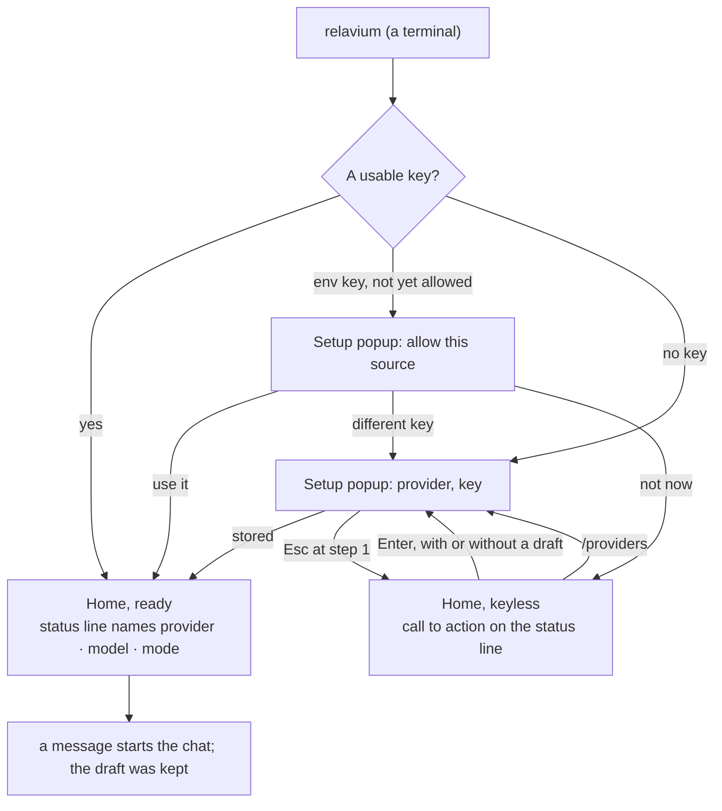

1. **The Home is drawn first, and the setup is a popup over it** (`onboarding-popup-provider-80x24`). It is the first-run exception to "the user started it" ([§4.3](#43-popups), ADR-C2): it opens by itself, but only when no conversation, turn, card or sheet exists, it asks for nothing the agent did, and it can be declined with `Esc`. The user sees where they are and what skipping leads to. Until the popup host is built (Step 4a, with the first-run popup itself in Step 4d) the existing native card stays and only its words change.

   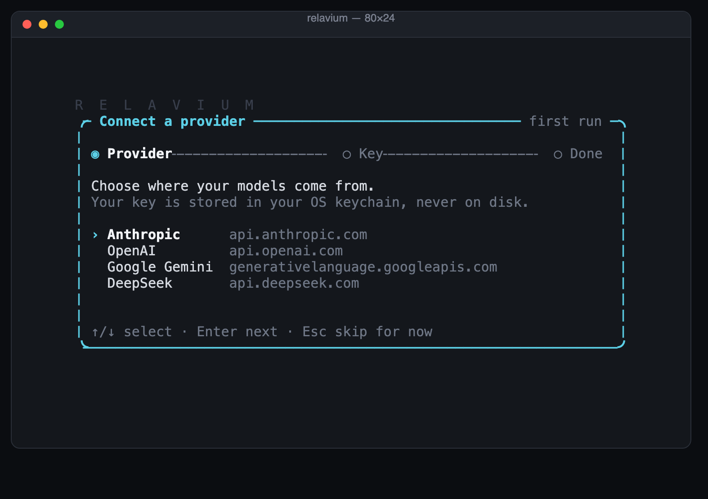

2. **Steps, with `Esc` stepping back.** The rail reads *Provider · Key · Done*; the check is the busy state of the key step. `Esc` at the key returns to the provider list; `Esc` at the first step skips. The exit label reads `skip for now`. A skip says so in one notification (`Setup skipped · /providers connects a provider any time`); the dropped note of today is fixed.
3. **The key step says what happens to the key** (`onboarding-popup-key-80x24`): `Stored in your OS keychain, never on disk. Sent only to api.anthropic.com, once, to check it.` The field is masked, kept out of React state, the transcript and error text, exactly as today, and cleared when the popup closes ([§5.5](#55-security-invariants-the-floor-that-does-not-move) rule 8).

   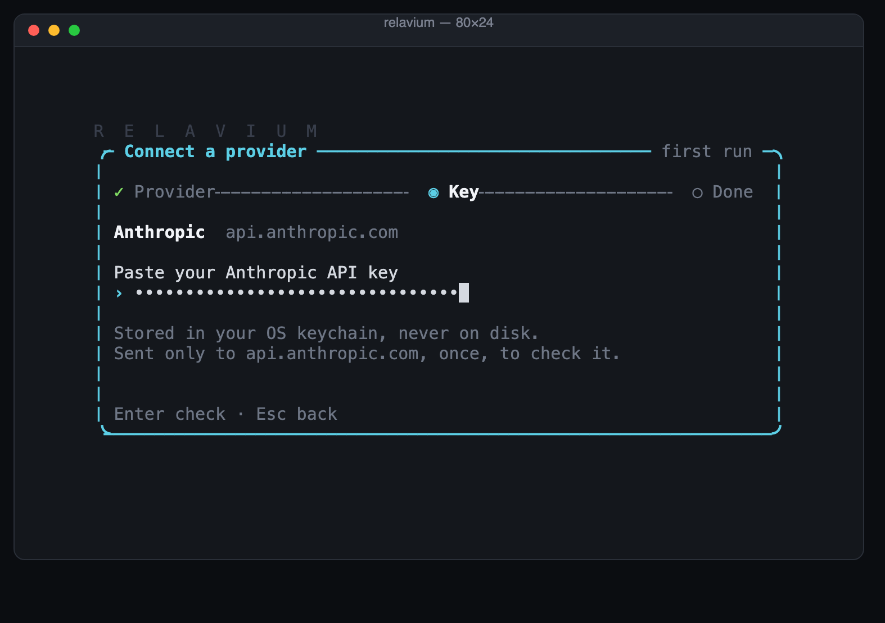

4. **A failed check cannot be answered by reflex.** The cursor starts on `Enter a different key` in every failure case; `Save it anyway` is never pre-selected, and its hint says the key was not verified and how to verify later (`/doctor`, then `d`; true once Step 4b lands, so the wording changes there and not before).
5. **Success shows the result and the next step.** The status line updates (`anthropic · claude-haiku-4-5 · ask · next chat · ~/acme-web`) and the *Done* step of the rail shows `Connected · Anthropic · claude-haiku-4-5 · Type a message to start, or /init to set up this folder` (`Enter` or `Esc` closes it). The empty Home stays as it is; a notification never replaces it. `/init` is **named, not offered**: the recorded decision that no initialization prompt appears unprompted stands.
6. **The keyless Home keeps the draft.** The status line is the call to action (`No provider key yet · Enter to connect · /providers`, [§4.7](#47-the-home)). While keyless the hint reads `Enter to connect a provider · / commands · Ctrl+C twice to exit`; with text typed it reads `Enter to connect a provider · your message is kept`. `Enter` with a draft opens the setup and keeps the draft; when the popup closes the draft is in the prompt and **is not sent** ([OD-19](#72-decisions-od-1-to-od-23)). A message is never built into a chat that cannot start: the red line of row 8 can no longer happen, and a failed build of any other cause restores the draft and shows the line wrapped whole (a notice is wrapped, never cut inside a remedy).
7. **An environment key is a consent, and it says so** (`Use it` stays the first row). The step names the variable, the provider, the model that will be chosen, and that the choice is saved to the global config; `Not now` is one `Enter` away and remembered for the process ([OD-23](#72-decisions-od-1-to-od-23)). This path is an authority widening, so it keeps the session record of [§5.5](#55-security-invariants-the-floor-that-does-not-move) rule 16.
8. **A locked keychain is said first.** When the keychain was found unavailable, `Enter a key` is not offered (the key could be checked and then lost); the step offers `Retry keychain`, the environment-variable route named once (`RELAVIUM_ANTHROPIC_API_KEY`), `Remember this and continue without a key`, and `Not now`.
9. **A key from a shell is still right for scripts.** `provider set-key` keeps its stdin-only contract; a masked TTY prompt for it is MVP-9's, and nothing here changes it.
10. **Below the floor.** At first open under 80×24 the popup waits (it does not spend its once-per-invocation offer) and the resize notice shows the way back; resizing up opens it.

**The keyless Home** (`onboarding-keyless-home-80x24`) is the empty Home of [§4.7](#47-the-home) with the status line replaced; nothing else changes. It is a state of the Home, not a screen of its own.

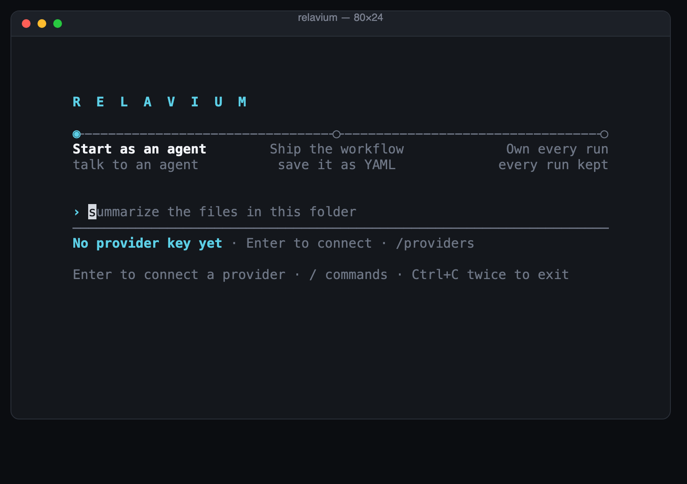

#### Defects found, and where each is fixed

The ids are the trace's. *Fix at* is the step of [§6](#6-work-breakdown).

| Id | Defect | Fix at |
|---|---|---|
| G1 | A keyless message is built into a chat that fails; the hint bar still says "type a message to start a chat" | 2 (the check); 6 (the hint) |
| G2 | The failure line is one row, truncated inside the remedy | 2 |
| G3 | The failure line names a shell command inside the TUI | 2 |
| G4 | The model picker's empty state tells a TUI user to run `relavium provider add` and then `Ctrl+R` (and `provider add` stores no key) | 2 |
| G5 | `/pricing` with no provider says to register one with `relavium provider add` | 2 |
| G6 | The draft is gone from the prompt after a failed build | 2 |
| G7 | Inside `/providers`, a row says "open `/providers` to connect a key" | 2 |
| G8 | Three default models for one provider; the consent notice does not name the model | 4d; ruling in OD-23 |
| G9 | `Pick a anthropic model`; "your anthropic key" next to "Anthropic" | 2 |
| G10 | After `Esc` or `Ctrl+C` the skip note is dropped and whichever note was on the card hides the welcome (the explicit `Skip setup` row is not affected) | 2; 4d |
| G11 | The README and the CLI tutorial are shell-first and disagree with the CLI's own README | 8 (with MVP-10) |
| G12 | `/doctor` is named as the key re-check while the Home's doctor checks no key and refuses `--deep` | 4b |
| G13 | A remedy names `relavium doctor`, which does not exist | 2 |
| G14 | `/` then Enter on the Home runs `/exit` | 2 |
| G15 | The consent step does not say that `Enter` saves the choice to the global config or which model will be used, and its cursor starts on the grant | 4d; OD-23 |
| G16 | On a network failure `Save it anyway` is pre-selected | 2 |
| G17 | The first-run offer reappears on every launch until a key is stored or the keychain reminder is accepted | none; kept, reviewed after the usability run |
| G18 | The success notice names no next step and replaces the welcome | 4d |
| G19 | A typed key is validated and then lost when the keychain is down | 2 |
| G20 | The validation request is not disclosed | 4d |
| G21 | Two labels for one recovery choice (`Use for this invocation only`, `Use this model for this invocation only`), and three for entering another key (`Enter a new key` after an authentication or other failure, `Enter a different key` after a network failure and on the consent and provider cards) | 2 |

**Acceptance statements that the plan of Phase 2.6 made and the code does not fully meet:** "never ends in an error" (row 8); "a locked keychain gets one clear message, not a setup loop" (true only after the user picks the remember option); "a remedy shown inside the TUI names the in-TUI action" (G3, G4, G5, G7, G12, G13). Everything else the trace checked (the setup opening on a keyless Home, the environment key offered and not adopted silently, the persistent keyless line, `relavium chat` offering the same setup, `/providers` with four providers, `/init` with its confirmation, the way back on exit) is implemented.

#### Copy edits

| Where | Today | Target |
|---|---|---|
| Keyless Home, hint | `/ for commands · type a message to start a chat · Ctrl+C twice to exit` | `Enter to connect a provider · / commands · Ctrl+C twice to exit` |
| Keyless Home, status line | `Connect a provider to start chatting — Enter to set up or /providers.` | `No provider key yet · Enter to connect · /providers` |
| Failed chat build (any cause) | one truncated row with a shell command | the cause and the in-TUI remedy, wrapped whole; the draft restored |
| Setup note | `First-run setup: Connect a model provider to start chatting. …` | the popup's title `Connect a provider`, its origin `first run`, and the keychain sentence as its body |
| Key step | `Paste your Anthropic API key` | `Paste your Anthropic API key` plus `Stored in your OS keychain, never on disk. Sent only to api.anthropic.com, once, to check it.` |
| Check | `Checking your Anthropic key…` | `Checking your Anthropic key · one request to api.anthropic.com` |
| Empty key | `A valid value is required.` | `Paste a key to continue, or Esc to go back.` |
| Failed check | `Save it anyway` first on a network failure | `Enter a different key` first; `Save it anyway · not verified` last but one |
| Success | `Connected: Verified and stored your anthropic key in the OS keychain. Your default model is claude-haiku-4-5.` | `Connected · Anthropic · claude-haiku-4-5 · Type a message to start, or /init to set up this folder` |
| Skip | (dropped) | `Setup skipped · /providers connects a provider any time` |
| Copy defects | `Pick a anthropic model` | `Pick an Anthropic model`; provider names are the display name everywhere |
| Recovery labels | two spellings of one choice; `Enter a new key` and `Enter a different key` for one action | `Use for this invocation only`; `Enter a different key` |
| Circular hint | `no API key … open /providers to connect a key or review its source` (inside `/providers`) | `no key yet · Enter to add one` |
| Model picker, empty | `add a provider key with relavium provider add, then Ctrl+R to refresh` | `no provider key yet · /providers connects one` |

#### In the documents

- **README and CLI tutorial** (owned by MVP-10's first-read update; the text is written in Step 8): the quick start becomes `npm install -g relavium`, then `relavium`, then "paste a key in the setup popup", then "type a message". The shell route (`printf '%s\n' "$KEY" | relavium provider set-key anthropic`) moves to a "scripts and CI" section; the redundant `provider add` step is dropped, because `set-key` registers the provider itself. The runbook the tutorial points to for the key is desktop-only and is replaced by a link to [home.md](../../reference/cli/home.md) (a first-run section is added there in Step 6).
- **The command help** that bare `relavium` prints without a terminal gets one line: `Run relavium in a terminal to open the Home.` (to be checked: that the help text is not pinned as a machine contract).
- **[home.md](../../reference/cli/home.md)** and [chat-session.md](../../reference/cli/chat-session.md) gain the first-run flow, the keyless variant and the keyless failure wording (today chat-session.md documents the shell wording as the Home's banner).

#### How it is tested

- A **keyless journey test** drives the Home from a clean home directory through skip, a typed draft, `Enter`, the setup, a kept draft and the first message, with an offline key validator; it asserts the draft is never lost, never sent by the setup, and that no remedy names a shell command.
- The **wording pattern test** of Step 2 covers every onboarding string (no shell command, no wrong remedy, no circular hint).
- The **usability protocol** ([§2.5](#25-success-criteria)) includes a keyless run: a clean machine, no key, observed from `relavium` to the first answer; the repeated first-run popup (G17) is judged there.
- The **security sitting** of Step 4d covers the key step, the consent step and the keychain-down path: the secret is not in state, history, transcript or error text; the consent is a chord-free *choice* but writes configuration, so it keeps its confirmation and its session record.

**What is not verified** (carried to [§11](#11-limits-of-this-plan)): the actual look at 80×24, inline and without colour; whether a Home frame flashes before the first card; the behaviour on Windows terminals; real keychains and real providers (the tests use fakes and an offline validator); the loss of the typed draft after a failed build and the `/` then Enter behaviour (both read from code, not run).

---

## 5. Technical design

Everything here was read from the code at `ff3e47fb` (2026-11-24; the counts of [Appendix D](#appendix-d--measured-baseline) are at `a8b48018`, eight commits earlier; the claims were re-checked at `f2aa2119`, see [§11](#11-limits-of-this-plan)). Files are named, not line-numbered, because the MVP-8 review (PR #102) is still moving them. **No file below is touched until PR #102 is merged**; the registry, the Home controller, the run cards, the tab host and the doctor host are the files it is editing now.

### 5.1 Architecture principles

- **Presentation meaning is data; layout is the adapter.** Words, intents, the glyph table, the `Esc` classes, the palette orders and the command classes are plain data and pure functions. Ink layout, the 6/8-column margin, the popup frame and the banner are the CLI adapter. MVP-11 keeps all of it inside `apps/cli` and adds an import boundary (a lint rule) so the data modules import nothing from `ink`, `react` or `node:`. About two thirds of the TUI's non-test files already satisfy that (73 of 106). A separate package is **not** created now: a package needs a second consumer, and the desktop and VS Code surfaces are not started (see [§10](#10-out-of-scope)); the boundary makes the later extraction mechanical.
- **One active key reader at a time.** Sheets, popups, the tab host and the run view do not open their own `useInput`. Keys reach them from the chat root, the Home root, or the stand-alone native-prompt host, which are the three readers today. In a stand-alone chat two readers coexist in one tree and the chat's is silenced while a native prompt is active, so the rule holds by gating, not by construction; MVP-11 adds no fourth reader and its host contract keeps the gate.
- **Chat lives in two hosts.** A chat is rendered by the stand-alone chat app and by the Home's chat region, with state in two places (the chat app's local state, and the Home controller). Every chat change is made in both, or the Home-hosted chat and the stand-alone chat drift apart.
- **The popup host is the native-prompt channel, extended** ([§5.2](#52-the-popup-host)). The channel already models steps, the `back` and `cancel` escapes and a measured-frame acknowledgement; the host adds a title, an origin, a step list, an exit label, a report kind with controls and a centred overlay presentation.
- **Registries are the source.** The command registry gains the fields that decide class, group, rank, availability and wording ([§5.3](#53-the-command-registry-becomes-the-source-of-surface-order-and-wording)); legends, the palette and `/help` are derived from it, so a key or a word is written once.

### 5.2 The popup host

**The host contract** (a shape to implement, not code; the names are proposals):

| Piece | Contract |
|---|---|
| Spec | `{ id, title, origin, exitLabel, steps[] }`. A step declares its `kind` (`select`, `text`, `password`, `report`, `chord`, `busy`), how it is answered (`Enter`, a chord, text), its `escape` (`back` or `cancel`) and, for a report, its control ids |
| Snapshot | The **identity fields**, which the measured-frame acknowledgement compares: `active, kind, title, origin, stepIndex, stepCount, message, options, selected, error, escape, exitLabel, details`. **Excluded** from identity: the clock digits and the spinner frame |
| Store | One store per host, inside the existing native-prompt channel: the stand-alone chat app's and the Home controller's. Never two writers |
| Opening | `open(spec)` is refused unless no turn runs, no card or sheet is open and no two-step is armed ([§4.3](#43-popups)); a child popup is a `push` to depth two that keeps the opener's snapshot |
| Controls | A report step's controls call back with their id; the command returns the next snapshot. A form step keeps the channel's one-promise-per-step model; no promise is held across a control press |
| A sheet arrives | A popup with a chord, a secret or an armed step is closed unanswered and its buffers cleared; a read-only report may be restored. A sheet's own inspection popup is created by the sheet host (or, for `/details`, by the user's command from a chat), never by a system event ([§4.5](#45-sheets)) |
| Late results | Every async result carries a run id; a result for a closed or replaced run lands nowhere |
| Views | A pure view (frame, rail, rows) and a host (state, keys); the view imports no store |
| Overlay lists | The popup is added to every list that says an overlay owns the keyboard. The Home has a `noOverlay` set and a mouse-capture toggle; the chat host repeats its overlay lists inline in three places (the wheel gate, the interrupt context and the paste flags); the paste gate itself is shared. Step 4a adds the popup to all of them and a test fails if a list is missed |

| Concern | Design |
|---|---|
| Placement | Alternate screen: an absolutely positioned box over the body, offset to be centred, rows padded with spaces to the frame width. Inline: a framed block in the live region, **sized so that the whole live region stays at most `rows − 1` lines** (measured in Step 1: at 24 of 24 rows Ink loses the user's earlier scrollback, at 25 it wipes it while the popup is open), so the inline height is what the live region has left, not a fixed 21 rows |
| Opacity | Colour: the body behind is dimmed by passing the dim style at paint time (not through the wrap cache key, which must not change). No colour: padded rows only |
| Proof | The acknowledgement checks that the frame drawn is the frame the user answered by walking the computed layout against terminal bounds. Step 1's spike must show an absolutely positioned node passes it, and that **no later sibling can occlude** a chord or secret popup's rows (the check verifies bounds, not occlusion, so an occlusion frame test is added). Until that is shown, no chord or secret step moves into a popup **Spike result (2026-11-24, [Step 1](#step-1--decisions-adrs-spike-and-baseline)):** an absolutely positioned popup passes the repository's own bounds check and acknowledgement; the same check rejects a popup past the bottom and one wider than its container; a later sibling is drawn over the popup and the bounds check still passes, and a comparison of the drawn frame with the popup's own rows catches it. The first part of the gate is therefore met in a test; the real-terminal part is open. |
| Resize | Below 80×24 the popup is replaced by a notice with the way back; a resize that would hide a pending chord step closes it unanswered |
| Time | The popup shows elapsed time past 5 s for a run. A wait clock on a sheet is display state only and never feeds a guard ([§4.5](#45-sheets)) |
| Dependence on the renderer | The overlay relies on Ink's absolute-position compositing, which is not used anywhere in the CLI today; a test pins the behaviour across upgrades of the renderer |

### 5.3 The command registry becomes the source of surface, order and wording

Each command declares, in addition to what it declares today (`name`, `description`, `effect`, `availableIn`, arguments), delivered in three steps so no test has to pass before its field is meaningful:

- **Step 2:** `group` and `rank`; the order of groups **per surface**; a description **per surface** where the meaning differs (`/exit`); and an **availability function** returning `{ enabled, reason }` over a small context type `{ surface, hasSession, hasKey, hasSavedSessions, hasWorkflows, turnRunning }`. A pure data module cannot read stores, so the host fills the context. Unavailable rows are drawn dim with the reason ([§4.6](#46-the-palette)).
- **Step 3a:** `exitLabel` for the surfaces a command opens (what `Esc` names).
- **Step 4:** `surface` (`popup`, `screen`, `instant`). Until a command is converted it carries a temporary `legacy` value, which Step 4 retires; the test "every command declares a surface and the matrix opens it" can only be strict at the end of Step 4.

Tests derived from it: every command declares its fields; the default row of each surface is the first enabled row and is neither destructive nor session-ending; `/exit` is last; a command that cannot act is dim with its reason; the palette order equals the Appendix B tables; a command typed on a surface that does not offer it answers with a one-line pointer and opens nothing; each surface opens each of its commands in the matrix. **Non-interactive drivers** (plain chat, `--json`, one-shot) keep running today's handlers; their help text is derived from the registry and so follows its new order, which is accepted and recorded.

The legend builder takes the item `{ keys, verb, role }` it has today plus `exitLabel` and the `Esc` class, and the hand-written hint strings (about 25 places, in the palette, pickers, native prompts, cards, the mention and reverse-search overlays and the chat projection) become calls to it. **The change is made in two steps: first the builder with a test that the produced string equals the old string for every existing legend, then the wording changes.** That keeps the hundreds of pinned strings reviewable.

### 5.4 Change map

Pin counts are word-for-word occurrences in tests at `a8b48018` (the number of lines / test files); they are what each step breaks on purpose and replaces.

| Area | What changes | Main files (by name) | Pins broken on purpose | Step |
|---|---|---|---|---|
| **Registry and palette** | Group, rank, per-surface description, availability; palette orders; dim-with-reason; `/exit` last; `/providers` leads when keyless | `commands/repl-commands.ts`, `render/tui/palette-*.ts`, `palette-view.tsx`, `palette-reducer.ts`, `palette-window.ts` | the palette suites (about 46 tests) and `/ for commands` (17 lines / 8 files) | 2 |
| **Onboarding basics** | A draft kept through setup; the failure line shown whole; the keyless call to action | `home/drive-home.tsx`, `home/provider-setup.ts`, `render/tui/home-controller.ts`, `home-view.tsx` | the keyless-view suites | 2, 6 |
| **Language** | Host-glyph base set and the CLI set (with `◉`); the glyph/ASCII table; the legend builder and `exitLabel`; status vocabulary; money, time, id and path helpers; one bold rule | `render/tui/legend.ts`, `sheet-frame.ts`, a new glyph table, the two host-glyph sets (the core's `ask-user.ts` and the CLI's `run-card-model.ts`), and the status tables in `format.ts`, `history-model.ts`, `run-screen.ts`, `chat/doctor.ts`, `tool-review-screen.ts`, `chat-projection.ts`, `permissions-sheet.ts`, `home-projection.ts` | `Esc stops the turn` (95 / 13), `Esc cancel` (18 / 7), `↑/↓ select` (40 / 17), the glyph tables' tests | 3a, 3b |
| **Popup host** | Spec, snapshot, report kind, overlay and inline presentation, states, stack, overlay lists, acknowledgement | `native-prompt-channel.ts`, `native-prompt-view.tsx`, `native-prompt-host.tsx`, `native-prompt-acknowledgement.ts`, `chat-ink.tsx`, `home-app.tsx`, `measured-frame-acknowledgement.ts` | the native-prompt geometry pins (they assert that a prompt *covers* the body) | 4a |
| **Popup commands** | Each command becomes a popup (report, setting, flow); the doctor's controls, quick-tier row and deep consent | `chat/doctor*.ts`, `chat/mode-settings.ts`, `model-picker-view.tsx`, `effort-tier-list.tsx`, `chat-sheet-view.tsx`, `permissions-sheet*.ts`, `agent-sheet.ts`, `home/provider-setup.ts`, `home/project-init.ts`, `home/session-picker.ts`, `home/run-launch.ts`, `import-card.ts`, `pricing-card.ts`, `export-card.ts`, `home/consent-card.ts` | the picker, mode, effort, permissions and doctor tests | 4b–4d |
| **Sheets** | Heavy rule with a display-only clock; shared anatomy; the busy row retires; row budgets re-derived; the frame inside the Home slot cards; ASCII form of the rule | `sheet-frame.ts` (a new rule function; the existing title rule stays because `agent-sheet.ts` and `permissions-sheet.ts` use it), `tool-review-view.tsx`, `tool-review-card.ts`, `question-card*.ts`, `checkpoint-card*.ts`, `run-card-view.tsx`, `run-card-model.ts`, `chat-projection.ts` | the tool-review host suite (about 120 tests, several index the lines of the card), `Approval needed` (17 lines / 4), `Esc stops the turn` | 5 |
| **Inspection popup** | The full view and `/details` in the large popup frame; the page geometry comes from the popup | `tool-review-view.tsx`, `tool-review-screen.ts`, `tool-review-scroll.ts`, `tool-review-model.ts`, the chat host's screen routing | the full-view and details suites; the geometry pins of ADR-0134 | 5b |
| **Home** | Banner rewrite; status line and its data; prompt example; prompt-first order; hints; keyless variant; the banner's height constant, which is written in three places | `banner.ts`, `home-view.tsx`, `home-notice.ts`, `home-app.tsx`, `home-controller.ts`, `prompt-view.tsx`, `home/drive-home.tsx` | `R E L A V I U M` and `Welcome to Relavium.` pins, `Ctrl+C twice to exit` (13 / 5), `Enter open the gate` (5 / 4), `Esc return to prompt` (5 / 3), the palette-fit suite | 6 |
| **Chat** | Header; status line; the speaker marker; the hint naming the Home; the palette above the prompt; the transcript grid (its own increment) | `chat-ink.tsx`, `home-app.tsx` (the chat region), `chat-projection.ts` (`entryLines`, the user prefix), `projection.ts` (`transcriptStyleProps`), `transcript-viewport.tsx`, `selection.ts`, the transcript document builder, the markdown wrapping width | the footer and hint pins; the transcript, selection and copy suites | 7 |
| **Docs** | Reference, glossary, ADR notes, the README quick start | [§5.7](#57-adrs-and-documentation) | none | 1, 8 |

### 5.5 Security invariants: the floor that does not move

Every pull request of this MVP lists which of these it touches and how it kept them.

1. **An approval is answered only by a Ctrl-chord** (`Ctrl+Y`, `Ctrl+G`, `Ctrl+O`, `Ctrl+N`, `Ctrl+R`). A bare letter, a typed or pasted string, and model text never produce an answer. An egress consent (the doctor's deep check) is answered the same way.
2. **`Esc` and `Ctrl+C` never approve.** They stop, wait, step back or close.
3. **The input guards are unchanged:** the dwell, the quiet gap, the typeahead window and the lockout; the approval's confirmation window; a withdrawal's window; the exit window (values in [chat-session.md](../../reference/cli/chat-session.md#mvp-3-interaction-contract) and [ADR-0115](../../decisions/0115-one-interrupt-keymap-for-the-interactive-cli.md)).
4. **Measured-frame acknowledgement.** An answer counts only if the frame it was drawn in is the frame on the terminal. A new frame, a new snapshot field and a new layout node are covered by it before a chord or secret step uses them, and no later node can occlude such a step's rows.
5. **Permission stays locked until the user has inspected:** a partial view never carries a broad grant. The locks are the ones of ADR-0129 and ADR-0134 (the target on screen, every masked value revealed) and name their cause; they are the same in the inspection popup.
6. **The agent's question** keeps the rule label `Question from the agent · not an approval` and the `│ ` gutter on every row of model text.
7. **Host glyphs cannot be forged.** The CLI's glyph set contains the shared base set and every glyph of the table, including the rail glyph; the core's refusal is not widened and the engine does not change. Model text is laid out in the content column only, so it can never occupy the margin where the host draws its markers (the speaker marker, line numbers, tool glyphs); until Step 7b builds that margin, Step 7a blanks a leading `›` in model text instead. Today only the question card and the run cards blank host glyphs in model text; whether another path puts model-written host glyphs in the transcript is checked by Step 3a's test, not assumed.
8. **Secrets.** The provider key field is masked, kept out of React state, history, the transcript and error text, exactly as today, inside the popup; its buffer is cleared when the popup closes and on resize.
9. **Sanitised text.** The status line, popup titles, session titles, directory names, workflow, agent and MCP server names and everything read from a config or a project file go through the inline sanitiser (control characters, bidirectional-text controls), **host-glyph blanking** (so a cloned project's server named `✓ ok` or a workflow named `━━ Approval needed ━━` cannot forge host chrome) and a length bound.
10. **Machine output is byte-stable.** `--json`, NDJSON and non-TTY output do not change.
11. **Fail closed.** Headless refuses every governed call; a resize never leaves an approval open.
12. **One owner of the chords at a time.** At most one surface owns `Ctrl+Y/N/G/O/R`. A popup opens only between turns and with no card, sheet or armed step open; a system sheet arriving over an open popup closes it unanswered (a read-only report may be restored); a popup is never drawn over a sheet except the sheet's own inspection popup; a user action that would open a popup while a sheet is open is refused. Tested with an injected clock in both orders, plus an occlusion frame test. The existing cross-lockout pins and the recorded stale-card defect are the precedent.
13. **Data that leaves for another provider is said before it leaves:** `/models` with *This chat* selected shows, before Enter, that the conversation (text you sent and bounded content-free tool receipts) goes to the other provider. No surface applies such a move silently.
14. **Egress is a consent.** The doctor's deep tier names what leaves and to whom and is answered by a chord ([§4.4](#44-reports-and-settings-as-popups)); it adds no egress path and never contacts an MCP server.
15. **The wait clock is display state only.** It never feeds a guard. Every guard keeps its existing origin (the first acknowledged frame, the last foreign key). A test shifts the display clock and shows no guard outcome changes.
16. **A record of widened authority.** A change that widens authority keeps a content-free session record even when nothing is drawn.
17. **The inspection popup is the sheet's own view.** It keeps the approval's guards, locks, answer rows and acknowledgement; `Esc` steps back and never rejects.

### 5.6 Test strategy

| Layer | What | Note |
|---|---|---|
| **Equivalence first** | The legend builder reproduces every existing hint string; the wording changes in a second commit | Keeps the pin changes readable |
| **Surface matrix** | Every screen × {alternate screen, inline} × {colour, `NO_COLOR`} × {80×24, 100×30} → at most `rows − 1` lines, the exit key visible, nothing wider than the width. 60×20 is below the floor: the expected output is the "enlarge the terminal" notice | One parameterised test replaces per-screen tests |
| **Registry** | Fields declared, the first enabled row safe, `/exit` last, dim-with-reason, a command typed on a surface that does not offer it, palette order equals Appendix B | |
| **Popup host contract** | Snapshot identity covers every listed field and none of the excluded ones; a late result lands nowhere; one deep run in flight; the doctor never calls an MCP client method; a key-echoing provider error stays out of a row | |
| **Key tables** | Every key table has a test that presses every key it lists (the existing pattern); at the baseline nine of the ten `*_KEYS` tables are referenced by a test and `NODE_KEYS` is not, and this MVP closes the gap | |
| **Mutation** | Each new pin is shown to fail under a mutation of the behaviour it pins | Earlier work shipped hollow tests |
| **Security pins** | The pins that protect [§5.5](#55-security-invariants-the-floor-that-does-not-move) are re-run on the new frames and are not rewritten to pass | |
| **Races and occlusion** | A popup open when a sheet arrives and the reverse; a resize with a chord pending; a frame change during the guard (injected clock); a notification arriving over a chord popup; the display clock shifted | |
| **Speaker marker** | A reply line that starts with `›` cannot pass for your turn (7a: the leading `›` is blanked; 7b: it stays in the content column and is not drawn in the margin) | |
| **Real terminal** | Step 1's spike and Step 8's matrix: Terminal, iTerm2, Windows Terminal, the VS Code terminal, tmux/SSH | The test library cannot show dim, ambiguous-width glyphs or an absolutely positioned overlay on a real terminal |
| **Automation of the real terminal (a spike)** | A pty with a terminal-emulator parser driving the existing tmux capture script | A new development dependency would need an ADR; the first step is to automate the existing script |
| **Documentation ↔ code** | The existing pattern (a test reads a reference page and checks the code against it), extended to the glyph table and the key grammar | |

### 5.7 ADRs and documentation

ADR numbers are taken when the ADR is written (`ls docs/decisions`; the next free number was 0145 on 2026-11-24). Each states its D64 tier and its acceptance evidence.

| ADR | Decides | Amends or supersedes |
|---|---|---|
| **A: the CLI surface language** | The surface classes and the *who started it?* rule; the `Esc` classes; the legend grammar and the bracket rule; the glyph/ASCII table and the host-glyph base set and CLI set; the speaker marker; the approval word families; the registry's class, group, rank and availability and the palette ordering contract; money, time, id and path notation; the accessibility target | Generalises [ADR-0137](../../decisions/0137-permissions-is-a-sheet-and-esc-steps-back-out-of-the-full-view.md) §5; adds a note to [ADR-0115](../../decisions/0115-one-interrupt-keymap-for-the-interactive-cli.md) §3 and implements [ADR-0122](../../decisions/0122-the-home-is-the-interactive-product.md) §9's "disabled with the reason" |
| **B: the Home's presentation and first run** | The calm rail, the example prompt, the status line, the prompt-first populated Home, the width cap, the keyless variant, the first-run content (ADR-C2 owns the exception that lets it open itself as a popup) | Replaces the plaque layout in `banner.ts` and adds a note to the visibility rules of [ADR-0068](../../decisions/0068-full-screen-tui-renderer-ink7-harness.md) (its 2026-07-10 amendment, Phase 2.6.F Step 5g); the prompt-first body order is a change to the Home's layout that [ADR-0140](../../decisions/0140-management-browsers-the-run-drill-down-and-the-durable-run-detail.md) §6 relies on without defining, so ADR-B states it |
| **C1: the sheet frame and the wait clock** | The heavy rule, the shared anatomy, the display-only clock, the retirement of the busy row, the frame inside the Home's slot cards | Amends [ADR-0129](../../decisions/0129-the-approval-card-is-docked-bounded-and-says-only-what-matters.md) §6 (the time arithmetic is unchanged) |
| **C2: the popup** | The centred popup for user-started work, its inline form, its states, stacking, the opening and suspension rules, the residue rule and its exception, the first-run exception, the sheet-owned inspection popup | Supersedes the rejection of a popup in [ADR-0137](../../decisions/0137-permissions-is-a-sheet-and-esc-steps-back-out-of-the-full-view.md) §1; amends the overlay `Esc` and `Ctrl+C` wording in [ADR-0122](../../decisions/0122-the-home-is-the-interactive-product.md) §7.4, the "one screen, two doors" form of the full view in [ADR-0134](../../decisions/0134-the-full-view-and-the-tool-details-are-one-readable-inspection-screen.md) §1 (the same content and doors, drawn as a popup), `Esc` in [ADR-0139](../../decisions/0139-a-workflow-run-is-hosted-inside-the-home.md) §5 where a popup is stepped, and the catalogue refresh line in [ADR-0064](../../decisions/0064-live-model-catalog.md) §5(c). Written **after** Step 1's spike and Accepted before Step 4a |

**Documents updated**, by step: the glossary (Home, parked, attention, chat mode, approval card, gate, checkpoint, palette, popup, sheet, screen, leave; the existing *Sheet* entry says "not a modal in the middle", which C2 changes); a new reference page for the surface language (classes, `Esc` classes, key grammar, glyph table), which becomes the canonical home for those rules; [home.md](../../reference/cli/home.md) (banner, strip, hints, keymap, palette, first run); [chat-session.md](../../reference/cli/chat-session.md) (cards, footer, hint, speaker marker, `/models`, `/mode`, `/doctor`); [accessibility.md](../../reference/cli/accessibility.md) (popups and the inline form, the key grammar, the banner, the colour rule); [config-spec.md](../../reference/contracts/config-spec.md) (`show_banner` currently says "plaque"); the notes on [ADR-0057](../../decisions/0057-cli-chat-modes-and-per-tool-approval.md), the ADRs that still say bare-letter answers, and ADR-0122 §7.4; the README quick start, which still starts at the shell (Step 8, with MVP-10's first-read update); and the "Last updated" lines.

---

## 6. Work breakdown

Eight steps, several split into lettered increments. A step or increment is the unit of acceptance and has its own review. Sizes are relative; there is no calendar in the roadmap, so none is given. **Tier** is D64's: *rigor* means a new complete cumulative review round with no blocker, high or medium finding, plus a separate security sitting; *milestone* is the per-milestone review. `development` is pushed after each accepted increment. Every pull request lists which rules of [§5.5](#55-security-invariants-the-floor-that-does-not-move) it touches and which pins it broke on purpose ([§5.4](#54-change-map)).

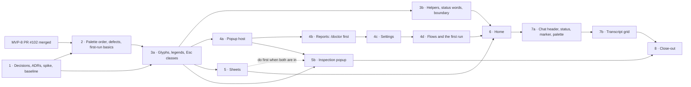

| Increment | Size | Tier | Separate security sitting | What makes it that tier |
|---|---|---|---|---|
| 1 Decisions, ADRs, spike, baseline | M | milestone | no | Documents and a prototype; no product code |
| 2 Palette, defects, first-run basics | M | palette: milestone · key path: **rigor** | for the key path | The keychain-down and consent wording touch the provider-key path |
| 3a Glyphs, legends, `Esc` classes | M | **rigor** | yes | Host glyphs and the approval legends |
| 3b Helpers, status words, boundary | M | milestone | no | Wording and data modules |
| 4a Popup host | L | **rigor** | yes | The measured frame, the overlay, chord ownership |
| 4b Reports | M | **rigor** | yes | The doctor's deep tier is an egress consent |
| 4c Settings | M | **rigor** | yes | Config writes, the data-leaves line, permissions |
| 4d Flows and the first run | L | **rigor** | yes | Secrets, project writes, resume, consent |
| 5 Sheets | L | **rigor** | yes | It reframes the approval path |
| 5b Inspection popup | M | **rigor** | yes | The approval's guards and locks move into a popup |
| 6 Home | L | banner: milestone · layout: **rigor** | for the layout | The exit guard and the measured frame |
| 7a Chat header, status, marker, palette | M | milestone | no | Presentation in two hosts |
| 7b Transcript grid | L | milestone | **scoped** | It changes how untrusted model text is laid out |
| 8 Close-out | M | milestone | no | Evidence and documents |

### The cut line

This is a recommendation; the maintainer rules it at the **Step 3 checkpoint**, with the spike's evidence in hand.

- **v0.2.0 cannot do without:** Steps 1, 2, 3a, 4a, 4b, 4c, 4d and 5b (5b needs the popup host and Step 3a, not Step 5; if Step 5 slips it ships on today's sheet frame). They are what the maintainer asked for on 2026-11-24 (popups, settings out of the chat, the palette order, the `[v]` popup) plus the keyless-start fixes that break the product promise.
- **Should be in:** 3b, 5, 6 and 7a. They finish the language and the chosen Home, and the speaker marker the maintainer asked for.
- **May move to the release after v0.2.0 without breaking anything:** 7b (the grid: the largest risk and its own review; 7a's interim guard keeps rule 7 of [§5.5](#55-security-invariants-the-floor-that-does-not-move) true meanwhile) and the parts of Step 8 that are documents rather than evidence.

If the spike fails ([OD-3](#72-decisions-od-1-to-od-23)), the cut line does not move: the popup is built as a docked panel and the same steps apply.

### The Step 3 checkpoint

After Step 3 the language (one key grammar, one glyph table, one host-glyph set, one legend builder) is done and valuable on its own, and the real-terminal evidence exists. The maintainer re-cuts here: confirms or changes the cut line and weighs the release against the remaining rigor steps ([§8](#8-risks), risk 16).

### Step 1 — Decisions, ADRs, spike and baseline

*Size M; milestone; documents and a prototype. It may start before PR #102 merges because it touches no product code.*

**Where Step 1 stands (2026-11-24): start here.**

| Item | State |
|---|---|
| PR #102 merged; re-read Step 2's defect list against the merged code | **Done.** The PR is merged (`c17e9763`); the re-read found every G-defect still true and nine new ones ([evidence B](mvp-11/step-1-evidence.md#b-the-defect-list-re-read-against-the-merged-code)) |
| The rulings of [§7.2](#72-decisions-od-1-to-od-23) recorded in the ADRs | **Done.** The two sub-questions are ruled (the spaced wordmark; one starter table, Haiku 5.5 for Anthropic) |
| ADR-A, ADR-B, ADR-C1 | **Written and accepted (2026-11-24):** ADR-0145, ADR-0146 and ADR-0147 |
| The spike | **Run in part, and accepted with its gaps:** automated in tmux, by hand in the VS Code terminal and Terminal.app, glyph widths in all three. **Owed (risk accepted by the maintainer, 2026-11-24):** Windows Terminal, iTerm2, SSH and the inline form by hand; they join the Windows runbook and the close-out matrix. The kit: [mvp-11/spike/README.md](mvp-11/spike/README.md) |
| ADR-C2 | **Written and accepted (2026-11-24):** ADR-0148, with the conditions of its §9 |
| The baseline of [§2.5](#25-success-criteria) B | **Taken in part:** the automated first-run observation and the repository measures are in the [evidence file](mvp-11/step-1-evidence.md); the volunteer usability protocol is the maintainer's and is run at close-out |
| Glossary additions; the surface-language reference page's skeleton | Written in the close-out step with the other documents |

**Rules for whoever continues this.**

- **Read in this order:** `CLAUDE.md`; the MVP-11 paragraphs and D79–D82 in [current.md](../current.md); this file's §1–§7 and [§5.5](#55-security-invariants-the-floor-that-does-not-move); the ADRs this file says it amends (0115, 0122, 0129, 0134, 0137, 0139, 0140); then the standards for what you touch.
- **ADRs are written *Proposed*** in the condensed form (the `write-adr` skill) and are accepted by the maintainer, never by the author. An ADR that would change an accepted ruling of [§7.2](#72-decisions-od-1-to-od-23) goes back to the maintainer first. Nothing in Step 2 or later starts before ADR-A, ADR-B and ADR-C1 are Accepted (ADR-C2 before Step 4a).
- **Tracked documents** cite only tracked files (this plan is meant to stand alone) and do not name or link other agent products ([the documentation direction](../../analysis/README.md#maintainer-documentation-direction--2026-11-15)). The frames are drawings, not screenshots.
- **The spike kit is not product code.** Keep it out of `apps/` and `packages/`; its results belong in ADR-C2.
- **Report what you ran and what you did not**, in the style of [§11](#11-limits-of-this-plan). Nothing is committed or pushed unless the maintainer asks.

**Goal:** decide before building, and prove the one assumption the popup rests on.

- Confirm that PR #102 is merged and re-read the defect list of Step 2 against the merged code.
- Record the rulings of [§7.2](#72-decisions-od-1-to-od-23) in the ADRs they belong to, and settle the two open sub-questions (OD-8's title, OD-23's default-model agreement). An ADR that would change an accepted ruling goes back to the maintainer first. OD-3's docked panel applies only if the spike fails.
- Write and accept ADR-A, ADR-B and ADR-C1 ([§5.7](#57-adrs-and-documentation)); write ADR-C2 after the spike.
- **The spike** (real terminals, no product code): an absolutely positioned popup over the alternate screen on Terminal, iTerm2, Windows Terminal, the VS Code terminal and tmux/SSH (resize, ambiguous-width glyphs, focus, `NO_COLOR` opacity by padding); a unit test that an absolutely positioned node passes the measured-frame check; a frame test that **no later sibling occludes** a chord or secret popup's rows; and a try-out of the sheet-owned inspection popup ([§4.5.1](#451-the-inspection-popup-the-full-view-and-details)). The one experiment so far ran in the Ink test library, where an absolutely positioned box composited over the text and was fully opaque once its rows were padded; that is the hypothesis, not the proof.
- **What the spike has shown so far** (2026-11-24; Ink 7.1.0 mounted with the Home's options, tmux 3.7b as the terminal on macOS; the kit is in [mvp-11/spike/](mvp-11/spike/README.md)):
  - **Full screen, 80×24, popup 68×21:** 15 checks compare every captured screen cell with a model of the intended frame. The popup is opaque and its border is straight; the 412 cells outside it are dimmed and none of its own; `Esc` leaves exactly the idle frame; a resize to 100×30 re-centres it with no leftovers; below 80×24 the notice replaces it and 80×24 brings it back; quitting leaves the alternate screen and the shell's text intact. The large 78×23 inspection popup passes the same 15. Three repeated runs gave the same result.
  - **The checks can fail:** a build with no dimming fails only the dimming check, and a build whose popup rows lack their space padding fails six of the fifteen. A popup row one cell short of the frame lets the body show through at its edge, so the padding rule is load-bearing.
  - **Occlusion is real and the bounds check cannot see it:** a later sibling is drawn on top of the popup (z-order is tree order) while `fitsTerminalBounds` still returns true. A comparison of the drawn frame with the popup's rows does catch it, so rule 7's occlusion frame test is feasible as designed.
  - **The inline form is safe only within `rows − 1`:** the popup draws in the flow above the prompt and repeated open and close leave no row and no copy in the scrollback, but with a live region of 23 of 24 rows the user's earlier shell output survives, at 24 it is lost at the next close and at 25 it is wiped while the popup is open. This is Ink's own rule. It is now part of the design (§5.2, Placement) and of Step 4a's acceptance.
  - **Glyph widths:** asked of the terminal itself with a cursor position report, tmux 3.7b, the VS Code terminal (VS Code 1.147.0, 117×27, [the report](mvp-11/spike/widths-vscode.txt)) and Terminal.app (build 488, 120×30, [the report](mvp-11/spike/widths-terminal-app.txt)) all measure all 37 glyphs of the table (including `◉ ⚠ ‖ ⏸ ✎ ╿` and the frame corners) as one column, as the renderer assumes, and a framed line of 16 columns is reported as 16. That is three emulators' answers about the cursor, not the matrix, and it says nothing about how a font draws a glyph that is wider than its cell.
  - **By hand, in two real terminals (the maintainer's report, 2026-11-24; an observer's account, not a capture):** `spike-render.mjs` in the VS Code terminal (VS Code 1.147.0) and in Terminal.app (build 488) was reported clean on the five points of the kit: the popup is straight with no body text inside, the text behind it is dimmed, `Esc` leaves no trace, `⚠` and `◉` do not shift the right border, and a window below 24 rows shows the notice instead.
  - **Colour:** Ink's own colour library does not read `NO_COLOR` (the CLI gates colour with its own flag), so the "no colour" case is the run without dimming, and it passes every check except the dimming one by design.
  - **Not yet run:** iTerm2 (not installed), Windows Terminal and an SSH session; the inline form by hand in the two real terminals (the report covers the full-screen popup); macOS automation is blocked from the session that ran the automated part, so the two real terminals rest on the maintainer's observation. They need a person for two minutes each with the kit; until then no chord or secret step moves into a popup. Also not checked: terminals with the ambiguous-width setting on, focus behaviour, and the Home's own code path (the spike is a prototype app, not the Home).
- Take the **baseline** of [§2.5](#25-success-criteria) B on the current build, including the keyless run ([§4.12](#412-onboarding-the-first-run)).
- Glossary additions; the skeleton of the surface-language reference page.

**Acceptance:** the two open sub-questions are ruled or deferred with a reason, and every ADR is consistent with [§7.2](#72-decisions-od-1-to-od-23); ADR-A, ADR-B and ADR-C1 are Accepted; the spike's evidence is written into ADR-C2, or the docked-panel fallback ([OD-3](#72-decisions-od-1-to-od-23)) is chosen and ADR-C2 is written for it; the baseline report exists.

**Collisions:** none.

### Step 2 — Palette order, defects and first-run basics

*Size M; the palette is milestone, the key path is rigor.*

**Goal:** the cheap, visible wins, and the defects that lose input.

- The registry fields of [§5.3](#53-the-command-registry-becomes-the-source-of-surface-order-and-wording) (group, rank, per-surface description, availability) and the orders of [Appendix B](#appendix-b--palette-orders); `/clear` dim with its reason on the Home; `/exit` last; `/providers` first when there is no key; the chat palette's contents per [OD-2](#72-decisions-od-1-to-od-23).
- **The wrong remedies and every shell command suggested inside the TUI become TUI remedies**, and a pattern test keeps them out (G3, G4, G5, G7, G13 of [§4.12](#412-onboarding-the-first-run)).
- **The keyless path loses nothing:** a keyless submit opens the setup and keeps the draft, a failed chat build restores the draft and shows its failure wrapped whole (G1, G2, G6); the skip note is shown (G10); `Save it anyway` is never pre-selected (G16); a key is not collected when the keychain is known to be unavailable (G19); the copy defects (G9, G21).
- The defects observed on 2026-11-23, re-read against the merged code: the prompt cursor is visible under `NO_COLOR`; the model picker says where a choice applies (a wording fix; the popup's own step is 4c); the cost-cap message names something the user can do in the TUI.
- Palette keys: `/` then Enter never leaves the application (G14).

**Acceptance:** the registry tests of [§5.6](#56-test-strategy); the palette equals Appendix B on each surface; the pattern tests; the keyless journey test of [§4.12](#412-onboarding-the-first-run); a draft is restored in a frame test; `NO_COLOR` shows the cursor. **Collisions:** `repl-commands.ts`, `home-controller.ts` and `provider-setup.ts` are edited by the MVP-8 review; this step starts after the merge.

### Step 3 — Language scaffolding

*Size L, as two increments of size M: 3a rigor, 3b milestone.*

**Goal:** one language underneath, with no visible redesign yet.

**3a — glyphs, legends, `Esc` classes (rigor)**

- The **host-glyph base set** in a package the core can import (the minimal shared set the core's question refusal needs) and the **CLI superset** with the rail glyph and `◉`; the rule that the CLI set contains the base set (a test pins it); the core's refusal and the engine are not changed ([§5.5](#55-security-invariants-the-floor-that-does-not-move) rule 7).
- The glyph/ASCII table; `⏸` retires for `‖`; one selection marker.
- The legend builder with the **equivalence test first**, then the wording changes (`↑/↓`, imperative verbs, the verb forms of the gate card, `exitLabel` required) and the `Esc` classes in the keys.

**3b — helpers, status words, boundary (milestone)**

- The money, time, id and path helpers; `Frozen allowance` and raw micro-cents out of user text.
- Every status table importing the glyph table; one bold rule; the Phase 2.6.L wording about an empty `NO_COLOR` noted for update.
- The import boundary (lint) for the data modules.

**Acceptance:** the equivalence test passes before any wording changes; hint dialects 6 → 1; status tables → 1; host-glyph sets → 2 layered (base, superset); the table test fails if a glyph is added to the table and not to the set; money notations at most 3; no new colour constant outside the table. **Collisions:** `run-card-model.ts` (a host-glyph copy and a status table) and `home-attention.ts` are in the MVP-8 area; after the merge.

### Step 4 — Popups

*Size XL; rigor, in four increments, each with its own review and, where it reaches a secret, a write, an egress or a consent path, a separate security sitting.*

**Goal:** every user-started report, setting and flow is a popup, with `/doctor` first.

- **4a · The host** ([§5.2](#52-the-popup-host)): the spec and snapshot, the report kind, overlay and inline presentation, states, stack, suspension, the overlay lists in both hosts, acknowledgement coverage and the occlusion test.
- **4b · Reports:** `/doctor` with its controls and its deep-tier consent ([§4.4](#44-reports-and-settings-as-popups)), `/agent`, `/cost`, `/workflows` in a chat and `/help` in a chat. Read-only, apart from the deep tier's confirmed network use. The wording that names `/doctor` as the key re-check lands here, when it becomes true (G12).
- **4c · Settings:** `/mode`, `/effort`, `/models` (with the *where it applies* step and the data-leaves line) and `/permissions` in a chat; the residue rule and the durable record of widened authority.
- **4d · Flows:** `/providers` including the **first-run setup** ([§4.12](#412-onboarding-the-first-run)), `/init`, `/import`, `/pricing`, `/resume`, `/run` and, if [OD-10](#72-decisions-od-1-to-od-23) is accepted, `/export`'s confirmation. The Home's tab host, the run view and `/help` stay screens ([OD-21](#72-decisions-od-1-to-od-23)).

**Acceptance (each increment):** the surface matrix includes the new popups; each popup closes with `Esc`; nothing is written to the transcript or a Home notice (frame tests); the secret field's rules hold (the existing secret tests re-run inside the popup); a sheet arriving over a popup suspends it and a popup is refused over a sheet (race tests, both orders); the inline form has the same content and keys, keeps the whole live region at most `rows − 1` lines at 80×24 for every popup (a frame test), and leaves the user's earlier scrollback intact across an open and close (a real-terminal check).

**Gate:** until Step 1's evidence exists, no chord or secret step moves into a popup, which means 4d's key step waits for it and the existing native card stays until then. **State on 2026-11-24:** the evidence covers tmux (automated), the VS Code terminal and Terminal.app (by hand); the Windows Terminal, iTerm2 and SSH rows are still owed, and whether 4d's key step needs them first is the maintainer's call at the Step 3 checkpoint (recommendation: Windows Terminal yes, because MVP-10 owes its runbook rows anyway; iTerm2 and SSH no).

### Step 5 — Sheets

*Size L; rigor, certain: this step reframes the approval path.*

**Goal:** one frame for every system-started question, with the wait clock in the rule.

- A new heavy-rule function in the frame module (the existing title rule stays, because other sheets pin it), the shared anatomy, the clock passed to the three card hosts, the busy row retired, the row budgets re-derived, the ASCII form of the rule.
- Question, checkpoint, gate, budget and consent cards take the frame, and the Home's slot cards wear the same frame. The question's gutter and label stay word for word.
- The clock is display state: it lives outside the snapshot's identity, every guard keeps its existing origin ([§5.5](#55-security-invariants-the-floor-that-does-not-move) rule 15), a test shifts the display clock, and the inline refresh rate is decided (a tick a second on a 12-row region over SSH is costly).

**Acceptance:** every floor pin of [§5.5](#55-security-invariants-the-floor-that-does-not-move) green and not rewritten; nine transcript rows with a 12-row sheet at 80×24; the question's gutter and label tested; the new frame's acknowledgement shown; the `━` and `─` rule distinguishable without colour.

### Step 5b — The inspection popup

*Size M; rigor.*

**Goal:** the approval's full view (`[v]`) and `/details` read as a proper popup ([§4.5.1](#451-the-inspection-popup-the-full-view-and-details)).

- The sheet host opens a large popup (78 × 23) for the diff, the command or the call list, with the sheet's own guards, locks, answer row and acknowledgement; `Esc` steps back to the sheet and never rejects. The page geometry of [ADR-0134](../../decisions/0134-the-full-view-and-the-tool-details-are-one-readable-inspection-screen.md) moves into the popup.
- If the maintainer takes option A or C of §4.5.1 ([OD-17](#72-decisions-od-1-to-od-23)), this step implements that shape instead.

**Acceptance:** the locks of ADR-0129 and ADR-0134 hold in the popup (permission stays locked until inspected); a chord answers from the popup exactly as from the sheet; a partial view carries no broad grant; the full-view and details suites pass on the new geometry. **Collisions:** shares `tool-review-*` files with Step 5; do 5 first when both are in. If Step 5 is cut, 5b runs on today's sheet frame.

### Step 6 — Home

*Size L; banner milestone, layout rigor.*

**Goal:** the chosen Home, including the keyless variant of the first run.

- The banner as pure data (rail, labels, notes, ASCII form, widths), then the Home view: the status line and its data sources (the Home controller does not hold provider, model, mode or directory today), the example prompt and its tests, the keyless variant and its hints ([§4.12](#412-onboarding-the-first-run)), the prompt-first populated layout, the hints, the palette budget and the three places that hold the banner's height.
- Documents: `home.md`, `config-spec.md`, `accessibility.md`.

**Acceptance:** the empty Home at 80×24 and 100×30 matches [§4.7](#47-the-home) frame for frame; the palette open over the populated Home stays within `rows − 1`; inline draws no vertical gap; the exit guard's position and its measured-frame check are re-proved; the example is never sent; the keyless Home shows its call to action and keeps a draft.

### Step 7 — The chat

*Size L–XL; 7a milestone, 7b milestone with a scoped security sitting.*

- **7a:** the chat header, the status line, the hint naming the Home, in both chat hosts; the palette opening upward above a chat's prompt; the **speaker marker** in the existing layout (`›` and bold on the first line of your turn replace the cyan `> `; wrapped lines continue unprefixed, as today), with an **interim guard**: until 7b builds the margin, a leading `›` in model text is blanked with Step 3a's host-glyph blanking, so a reply cannot pass for your turn.
- **7b · the transcript grid**, its own increment and review: the markers move into a margin column, text into a content column with a hanging wrap; the inline line, the `/edit` and `/copy` document, the live stream's wrapping width and the mouse selection change together. It lays out untrusted model text, so a scoped security sitting is added (a reply line that starts with `›` stays in the content column).

**Acceptance:** the Home-hosted chat and the stand-alone chat match; selection and copy suites green; the 80×24 row budget proved; a reply that starts with `›` cannot pass for your turn (blanked in 7a, kept in the content column in 7b).

### Step 8 — Close-out

*Size M; milestone.*

- The surface matrix complete; the usability protocol re-run and compared with the baseline; the terminal-matrix rows written into the evidence runbook that MVP-10 owes; the reference pages, the glossary and the ADR notes finished; the README quick start and CLI tutorial text for MVP-10's first-read update ([§4.12](#412-onboarding-the-first-run)); a note on user-visible key and label changes for the changelog; the three entries of [the deferred-tasks register](../deferred-tasks.md) that name this MVP (the move onto the legend builder and the shared frame, the legend rewording, the glyph-only node rows) closed or re-homed; the phase record and the pull request.

**Acceptance:** [§9](#9-acceptance-and-exit-criteria).

---

## 7. Decisions

### 7.1 Rulings made on 2026-11-24

These are recorded in [current.md](../current.md#wave-gating-decisions) as D79–D82. The table separates what the maintainer **asked for** from what this plan **proposes** to fill it in; only the left column is a ruling.

| # | The maintainer asked for (ruled) | Settled by an accepted decision of §7.2 (2026-11-24) | Still proposed, not ruled |
|---|---|---|---|
| **D79** | **MVP-11** is one MVP phase for the CLI's UI/UX work, started after MVP-8's pull request is merged, part of the v0.2.0 scope. CLI only | none | It runs before MVP-5, MVP-6, MVP-7 and MVP-9, and MVP-10 stays last ([§2.6](#26-release-and-ordering)); Step 1 may start before the merge |
| **D80** | A slash command that produces a report (`/doctor` first), opens a **popup** that `Esc` closes and that carries the controls that make sense there; the same for every similar command | The `[v]` inspection popup ([OD-17](#72-decisions-od-1-to-od-23)); the deep tier's consent ([OD-11](#72-decisions-od-1-to-od-23)); `/workflows`, `/permissions` and `/help` stay screens on the Home ([OD-21](#72-decisions-od-1-to-od-23)) | The surface classes, the sheet for system-started questions and the mechanism in ADR-C2 |
| **D81** | Settings and configuration work does **not** come to the chat menu and stay there | The residue rule and its one exception ([OD-1](#72-decisions-od-1-to-od-23)); the chat palette's contents ([OD-2](#72-decisions-od-1-to-od-23)) | none |
| **D82** | The slash palette on the Home and in a chat gets a sensible order; `/exit` is not at the top, and may be at the bottom | Dim-with-reason, never hidden, and `/providers` first when there is no key ([OD-13](#72-decisions-od-1-to-od-23)) | The groups, the first-row rule and `/exit` last in [Appendix B](#appendix-b--palette-orders) |

Three follow-up requests of the same day are **asks that [§7.2](#72-decisions-od-1-to-od-23) answers, and the answers were accepted the same day**: a speaker marker instead of the `you`/`agent` role labels ([OD-18](#72-decisions-od-1-to-od-23)), the `[v]` preview as a proper popup ([OD-17](#72-decisions-od-1-to-od-23)), and a review of onboarding against the new UI/UX ([OD-19](#72-decisions-od-1-to-od-23), [OD-20](#72-decisions-od-1-to-od-23), [OD-23](#72-decisions-od-1-to-od-23)). The rest of the onboarding trace and its steps ([§4.12](#412-onboarding-the-first-run)) are the plan's proposal.

D80 and D82 fix the direction and the observable behaviour; the ADRs of Step 1 record the mechanism and the evidence. Until those ADRs are Accepted, the Accepted ADRs they amend stand ([§5.7](#57-adrs-and-documentation)).

### 7.2 Decisions OD-1 to OD-23

Each was put to the maintainer with a recommendation, and on 2026-11-24 the maintainer answered that the work goes on with the recommendations. They are therefore **ruled as written**, with these limits. **Round 1** (OD-1, 2, 13, 14, 16, 19, 20, 22) is ruled as written. **Round 2** (the other fourteen except OD-3) is ruled as the direction: the ADRs of Step 1 record the mechanism and the evidence, and may refine a detail with a recorded reason, but an ADR that would reverse a ruling goes back to the maintainer. **Round 3** (OD-3) is ruled as the fallback and applies only if the real-terminal spike fails. **Two sub-questions are still open:** whether the populated Home's title is the plain word or the spaced wordmark (OD-8), and whether the three default-model paths should agree (OD-23). "Needed by" is the step that cannot start without the answer.

| # | Round | Question | Ruling (the recommendation, accepted) | Needed by |
|---|---|---|---|---|
| **OD-1** | 1 | Is anything allowed to stay in the conversation after a settings popup? | Only the model switch marker (and its notice of unresolved external effects), because it describes the conversation, not a setting. A mode change, an effort change, a permission withdrawal and every flow leave only the status line and a transient notification (and the content-free record of a widened authority) | 2 |
| **OD-2** | 1 | Which commands does a chat's palette list? | Commands that act on the live conversation or the session's own settings: `/models`, `/mode`, `/effort`, `/thinking`, `/permissions`, context, inspect, take-away and end commands. Project and environment configuration (`/providers`, `/init`, `/import`, `/pricing`) is Home-only; the Home-hosted chat keeps `/resume`. **Strict reading of the ask:** `/models`, `/mode` and `/permissions` also leave the chat palette and live only in the status line's keys (`Shift+Tab`, `Ctrl+T`) and the Home; it is not taken, because a user in a chat who wants another model would have no visible way | 2 |
| **OD-3** | 3 | If the real-terminal spike fails, what then? | The same anatomy as a **docked panel** (the popup's content in the sheet's place) and a centred overlay only where the spike passed; ADR-C2 is written for whichever holds | after the spike |
| **OD-4** | 2 | The `Esc` classes and the key grammar | Four classes (decide, step, close, leave); the grammar of [§4.9](#49-the-key-language), with `Esc` unbracketed and state-changing keys bracketed | 1 (ADR-A) |
| **OD-5** | 2 | Approval word families | Permission (Allow once, Deny, Deny + reason, Allow + remember), gate (Approve, Reject), confirmation (Yes, No), progress as a class apart (Continue, Stop here) | 1 (ADR-A) |
| **OD-6** | 2 | What "no colour" means | Colour only: bold, inverse and underline stay allowed; `dim` is not relied on | 1 (ADR-A) |
| **OD-7** | 2 | The glyph/ASCII table and the selection marker | [§4.10](#410-the-visual-language): one table, `‖` for paused, `›` plus inverse for selection | 1 (ADR-A) |
| **OD-8** | 2 | The Home's presentation | The calm rail with its width capped at 96; no git branch in the first release; the example prompt as specified; the prompt-first populated Home; **still open:** whether the populated Home's title is the plain word or the spaced wordmark (the frames draw the spaced wordmark) | 1 (ADR-B) |
| **OD-9** | 2 | The status line's contents and order; whether the chat header's blank row is dropped at the 80×24 floor; the truncation order of turns, cost and context | As [§4.7](#47-the-home) and [§4.8](#48-the-chat); keep the blank row (16 transcript rows at rest, 9 with a sheet); cut turns, then cost, then context | 1 (ADR-B) |
| **OD-10** | 2 | Does `/export` get a confirmation popup? | Yes: it shows the target path and whether a file would be overwritten. It is a behaviour change (today it writes without a card) in the safe direction, and it is a file write, so rigor | 1 |
| **OD-11** | 2 | The doctor's deep-tier consent and its row-level remedies | As [§4.4](#44-reports-and-settings-as-popups): `[d]` opens a confirmation line that says what leaves and to whom, answered with `Ctrl+Y`; a remedy offers the matching popup on a surface that has it and text elsewhere; no new egress path; MCP servers are never contacted | 1 |
| **OD-12** | 2 | Where the wait clock lives and how often it redraws | Outside the snapshot's identity, display only, never feeding a guard; one tick a second for the first minute and then every ten seconds in the alternate screen; inline, a static `waiting since HH:MM` with no ticking repaint | 1 (ADR-C1) |
| **OD-13** | 1 | A command that cannot act here: hidden or dim with a reason? | Dim with the reason, never hidden (this is what [ADR-0122](../../decisions/0122-the-home-is-the-interactive-product.md) §9 already says); a command a surface does not offer at all is not listed; `/providers` leads when there is no key | 2 |
| **OD-14** | 1 | Money, time, id and path notation | USD in human text, `$3 / $15 per M`, raw micro-cents only in machine output; one helper each; paths project-relative or from `~` | 3b |
| **OD-15** | 2 | The accessibility target | The inline renderer stays the accessible mode; a measurable CLI subset (readable without colour, 80×24, keyboard only, a glyph never alone); the full-screen mode's exemption from screen readers is documented, not hidden | 1 (ADR-A) |
| **OD-16** | 1 | How are user-visible key and label changes announced before 1.0? | A "UX" heading in the changelog for the release, listing renamed labels and changed keys; `--json` stability stated separately | 8 |
| **OD-17** | 2 | The shape of the approval's full view | **B** (ruled): a large inspection popup, 78 × 23 at 80×24, owned by the sheet. **A:** keep the screen and give it the popup's anatomy (least risk, no overlay). **C:** a standard-size popup (about 8 body rows, too few for a diff). See [§4.5.1](#451-the-inspection-popup-the-full-view-and-details) | 1 (ADR-C2) |
| **OD-18** | 2 | The speaker marker, and whether the inline renderer adds role words | `›` in the margin and bold text for your turn, the reply plain, no tint, no role labels in the full-screen renderer. The inline renderer is the accessible mode and may keep the words `you` / `agent` for screen readers: yes, as a per-renderer rule | 1 (ADR-A) |
| **OD-19** | 1 | A message typed before any key exists | The first `Enter` opens the setup and **keeps the draft**; when setup closes the draft is in the prompt and is **not** sent (the alternative, sending it on success, risks sending to a model the user did not look at) | 2 |
| **OD-20** | 1 | Text that names a shell command without being a remedy (the `/clear` notice names `relavium chat-resume`; the `/export` notice names `relavium run`) | Drop it from in-TUI notices; the exit line printed to the shell after the TUI has closed may keep it | 2 |
| **OD-21** | 2 | Commands that exist on both surfaces but stay a screen on the Home (`/workflows`, `/permissions`, `/help`) | Yes: the tab host, the run view and `/help` are places you work in, not steps you pass through; the chat's versions are popups | 1 (ADR-C2) |
| **OD-22** | 1 | Does `/compact` ask first? | No: it shows what it spent in a notification; revisit if the usability run shows surprise | 4b |
| **OD-23** | 2 | The first-run defaults: the consent card's first row, the default after a network failure, and naming the model | `Use it` stays the first row (the alternative is to start the cursor on `Not now`) but the step says it is saved and which model will be used; no failure case pre-selects `Save it anyway`; the model is named wherever a default is chosen. **Still open:** whether the three default-model paths should agree (`claude-haiku-4-5`, `claude-sonnet-4-6`), a product ruling this plan does not make | 4d |

---

## 8. Risks

| # | Risk | Likelihood / impact | Mitigation |
|---|---|---|---|
| 1 | The measured-frame proof does not cover an absolutely positioned popup, so an old frame could stand as proof of a new one, or a later node could cover a chord's rows | Medium / High | The spike and the occlusion test; the snapshot's identity covers every new field; no chord or secret step moves into a popup before the proof |
| 2 | The popup misbehaves on a real terminal (resize, ambiguous-width glyphs, focus, Windows) | Medium / High | The spike on the matrix of [§2.5](#25-success-criteria) B; the framed inline block as the fallback; OD-3 |
| 3 | The overlay relies on Ink's absolute-position compositing, which nothing in the CLI uses today, and a renderer upgrade could change it | Low–medium / High | A test pins the behaviour across upgrades ([§5.2](#52-the-popup-host)); the docked-panel fallback stays designed |
| 4 | Pin churn: hundreds of word-for-word pins change | Certain / Medium | The equivalence step first, wording second; each pull request lists the pins it broke on purpose |
| 5 | The files this MVP edits are being edited by the MVP-8 review | High / Medium | Product work starts after PR #102 merges; Step 1 touches no product code |
| 6 | A security regression in a reframed approval path or inspection popup | Low / Very high | [§5.5](#55-security-invariants-the-floor-that-does-not-move) in every pull request; the rigor tier with a separate security sitting; the floor pins re-run, never rewritten |
| 7 | The 80×24 row arithmetic is brittle (a palette plus the Home block must total exactly 23 rows; a sheet leaves exactly 9 transcript rows) | Medium / Medium | The surface matrix; every measurement in a real terminal, inline and alternate |
| 8 | A repainting wait clock makes the inline renderer redraw its live region every second (costly over SSH) and could change what a guard measures | Medium / Medium | Display only, outside the snapshot identity ([§5.5](#55-security-invariants-the-floor-that-does-not-move) rule 15); a static `waiting since HH:MM` inline (OD-12); a test shifts the clock |
| 9 | Glyph width differs on some terminals (`○ ━ ‖ ▶ ■` and the rest of the ambiguous family the CLI already ships) | Low–medium / Medium | The ASCII fallback; the CJK-locale terminal check; the width table |
| 10 | The transcript grid is bigger than it looks (selection, copy, `/edit`, the live stream, inline) | High / Medium | A separate increment (7b) with its own review and a scoped security sitting; it can slip past v0.2.0 ([§6](#the-cut-line)) |
| 11 | No users and no usage data to validate against | Certain / Medium | The usability protocol with volunteers; hypotheses labelled; the terminal matrix |
| 12 | The ADRs fragment or fight for numbers | Medium / Low | Numbers taken at writing time; one surface-language ADR for the shared rules; this file as the map |
| 13 | Conflict with Phase 2.6.L (bold tied to colour, three different ASCII schemes) | Medium / Medium | OD-6 and OD-7 are ruled first and 2.6.L's wording is updated |
| 14 | The concept frames mislead (they are drawn, not rendered) | Medium / Medium | Every step's acceptance is a real frame; [Appendix C](#appendix-c--frame-index) lists the known differences |
| 15 | Scope: this is the largest MVP, and it is inside v0.2.0 | Medium / High | Step gates; the rigor increments are named in [§6](#6-work-breakdown); the cut line and the Step 3 checkpoint let the maintainer re-cut without losing the language work |
| 16 | The release moves because of nine rigor increments | Medium / Medium | Not estimated here (the roadmap has no calendar); the maintainer weighs it at the Step 3 checkpoint |
| 17 | Review capacity: nine rigor increments with a security sitting each, and a scoped one for Step 7b | High / Medium | Keep increments small; write the tier at the start of each |
| 18 | CI time: the required coverage job once reached its 45-minute limit; many new pins and a matrix test load it | Medium / Medium | The matrix as its own job or shard; coverage stays scoped to `packages/` |
| 19 | The Windows interactive evidence is still owed: **every** row 1–38 of the runbook (the older figure of 16 predates rows 17–38) | Certain / Medium | New surfaces add rows; they join MVP-10's gate |
| 20 | An accessibility regression in popups or sheets | Medium / Medium | The inline form, the matrix, the ADR-0122 §7 checklist per surface |
| 21 | MVP-5, MVP-6 and MVP-9 add surfaces that must be popups | Medium / Medium | They follow MVP-11; MVP-9's provider and MCP surfaces are written for the popup host from the start |
| 22 | The first-run popup is a system-started popup, an exception to the rule that fixes who opens what | Low / Medium | The exception is written into ADR-C2 with its conditions ([§4.12](#412-onboarding-the-first-run)); an `Esc` skips it |
| 23 | Decision load: twenty-three decisions | Low / Low (was High / Medium) | Accepted as recommended on 2026-11-24; two sub-questions remain ([§7.2](#72-decisions-od-1-to-od-23)) |
| 24 | An inline popup makes the live region as tall as the terminal and Ink wipes the user's earlier scrollback | Medium / High | The inline height is bounded by what the live region has left ([§5.2](#52-the-popup-host)); a frame test at 80×24 and a real-terminal scrollback check (Step 4); measured in the Step 1 spike |

---

## 9. Acceptance and exit criteria

MVP-11 is complete when all of these hold on `development`, with the evidence written into the phase record. Criteria that belong to a step the maintainer cut out of v0.2.0 ([§6](#the-cut-line)) are recorded as deferred with the reason.

1. Every slash command declares a surface class; the registry tests pass; the surface matrix opens every surface of every command.
2. `/doctor`, typed or chosen on the Home and in a chat, opens a popup with the checks and the controls of [§4.4](#44-reports-and-settings-as-popups); `Esc` closes it; nothing is written to the Home's notice area or the transcript (frame tests); the deep tier needs its chord and never contacts an MCP server.
3. `/agent`, `/cost`, the chat's `/workflows` and `/help` are report popups; `/mode`, `/effort`, `/models` and the chat's `/permissions` are settings popups; `/providers`, `/init`, `/import`, `/pricing`, `/resume` and `/run` are flow popups; the screens of [§4.3](#43-popups) are unchanged.
4. A settings or configuration flow leaves no line in the conversation, apart from the exception ruled in OD-1; a change that widens authority keeps its content-free record.
5. Each palette's order equals [Appendix B](#appendix-b--palette-orders) as ruled; `/` then Enter does not leave the application on any surface; `/exit` is last; `/clear` is dim with its reason on the Home.
6. The empty and populated Home match [§4.7](#47-the-home); the keyless variant names `/providers` and keeps a typed draft; an empty prompt's Enter behaves as today.
7. The chat has the header, the status line, the hint and the speaker marker of [§4.8](#48-the-chat) in both hosts.
8. Every system-started question uses the sheet frame; the wait clock is in the rule and feeds no guard; every floor pin of [§5.5](#55-security-invariants-the-floor-that-does-not-move) is green and unchanged; the question's label and gutter are present word for word.
9. The approval's full view and `/details` open as the inspection popup (or the shape ruled in OD-17) with every lock and guard of ADR-0129 and ADR-0134 intact.
10. The first run has no dead end: the keyless journey test passes; no remedy shown in the TUI names a shell command or a command that does not exist; a failed chat build restores the draft and shows its failure whole.
11. One hint builder, one glyph table with an ASCII fallback, one host-glyph base set and one CLI superset; money notations at most 3; no wrong remedy.
12. The surface matrix is green for every screen at 80×24 and 100×30, alternate screen and inline, colour and `NO_COLOR`.
13. The spike and the matrix rows on real terminals are recorded; the Windows rows are added to the runbook that MVP-10 owes.
14. ADR-A, ADR-B, ADR-C1 and ADR-C2 are Accepted; the notes on the ADRs they amend are in; the surface-language reference page, the glossary and the four reference documents are updated; the README quick start text is handed to MVP-10.
15. The usability protocol has been re-run; each of the nine criteria of [§2.5](#25-success-criteria) is recorded as met or not met, with the measured value.
16. Each rigor increment has its separate security sitting recorded, and Step 7b its scoped one; `pnpm gate`, `pnpm coverage:enforced` and the CI run on the final head are green.
17. The machine contracts (`--json`, NDJSON, exit codes) are unchanged: the existing characterisation tests are green.

---

## 10. Out of scope

- **The desktop and VS Code surfaces.** They are not started. What carries over is recorded, not built: intents, labels, state words and the safety rules are shared; chords, geometry, the heavy rule and the dimming are not. In the desktop app a sheet becomes a non-modal panel in the chat tab and a popup becomes a command palette with a stepped dialog; in the VS Code extension an agent-started approval is a card in the chat panel that takes the input's place, with a non-modal notification when the panel is hidden, and no modal dialog for something the user did not start. Those mappings are inputs to Phases 3 and 4 and need their own ADRs.
- **Theme, token catalogue and the locale catalogue** (Phase 2.6.L, Wave 5a, in [the Phase 2.6 plan](phase-2.6-conversational-authoring.md)). MVP-11 builds the CLI-internal tables 2.6.L will consume; it does not add a theme setting or a language setting.
- **Type-ahead (MVP-5), authoring forms and starter workflows (MVP-6), web (MVP-7), MCP and provider management (MVP-9).** They follow this MVP and use its host. That includes the masked key prompt for `provider set-key` on a terminal, in-TUI key removal, and the "turn this session into a workflow" hint.
- **A pinned "last prompt" row while you are scrolled up.** A possible later addition to the chat; not designed here.
- **Publishing the README and the CLI tutorial.** MVP-10 owns the first-read documents; this MVP writes the first-run text for them (Step 8).
- **Product analytics or telemetry.** None, unless a later ruling adds an opt-in design.
- **A git branch in the status line.** Reading `.git` content is a new untrusted terminal input; it needs its own bounded, sanitised design.
- **Engine, tools, configuration schema, data model, new commands.**
- **A public design-language page** (the licence is proprietary; a separate decision).

---

## 11. Limits of this plan

- **The frames are drawings.** They were composed on the real grid and rendered in a browser with a monospace font, not in a terminal, so glyph widths, dimming and overlay behaviour on real terminals are exactly what Step 1 must prove.
- **Code read at `ff3e47fb`** (2026-11-24) with the MVP-8 review's edits still uncommitted in the working tree; names are used instead of line numbers for that reason. The code claims of [§4.12](#412-onboarding-the-first-run), [§5](#5-technical-design) and the appendices were checked again at `f2aa2119`, eleven commits later; they still hold. Some counts of Appendix D drift: at that commit `Esc cancel` has 19 lines in 8 files, `↑/↓ select` 41 in 18, `Enter open the gate` 6 in 5, `Esc return to prompt` 7 in 4, and 20 production files use the sheet frame.
- **Not verified:** the popup on any real terminal except tmux (Terminal, iTerm2, Windows Terminal, the VS Code terminal and SSH are not run; see Step 1); the Home's own code path under a popup; today's behaviour when a sheet arrives over an open overlay (rule 12 is a proposal); the exact transcript lines a few commands leave today (`/mode`, `/effort`); whether `/compact` asks before spending tokens; the doctor's per-row remedies (a design, not an existing feature); the first-run behaviours of [§4.12](#412-onboarding-the-first-run) that were read from code and not run (the lost draft, the dropped skip note, `/` then Enter, whether a Home frame shows before the first card).
- **No users, no usage data and no persona research exist.** Statements about who the users are and what they feel are hypotheses; the protocol in [§2.5](#25-success-criteria) is how they would be tested.
- **Counts** are word-for-word text counts in the repository (lines or occurrences and files); they are accurate to the method, not to the behaviour; [Appendix D](#appendix-d--measured-baseline) gives the commands.

---

## 12. Appendices

### Appendix A — Command classification

`Home` / `chat` say where the command is offered. *Today* is what a user meets now (read from the code, [§11](#11-limits-of-this-plan)).

| Command | Offered in | Today | MVP-11 class |
|---|---|---|---|
| `/help` | chat (typed, not in the palette); the Home has its own | chat: a text list in the transcript; Home: a screen | **popup** (report) in a chat; the Home's stays a screen |
| `/exit` | Home, chat | ends the Home (with the exit guard when a run is hosted), or the Home-hosted chat, or a stand-alone chat | instant; last in every list; the description says which |
| `/cancel` | chat | cancels the turn and ends the resumable session | instant |
| `/clear` | chat; listed in the Home but inert there | ends the conversation and starts a fresh session; on the bare Home it answers "No active conversation to clear — type a message to start one." | instant, with a content-free conversation marker; **dim with its reason** on the Home |
| `/export` | chat | writes the `.relavium.yaml` scaffold without a card | **popup with confirmation** if OD-10 is accepted |
| `/agent` | chat | a docked sheet | **popup** (report) |
| `/workflows` | chat; Home | chat: a list in the transcript; Home: the tab host's Defined tab | chat: **popup** (report); Home: screen (OD-21) |
| `/cost` | chat | a note with the cumulative cost | **popup** (report; per-model breakdown; the release of held estimates is a confirmed control) |
| `/doctor` | Home, chat | Home: the quick tier into a notice under the strip (a typed `--deep` is refused); chat: a note, with `--deep` | **popup** (report with controls and the deep tier's consent) |
| `/mode` | Home, chat | a native picker that replaces the body on the bare Home and in a stand-alone chat; in a Home-hosted chat it shares the screen and shrinks the transcript | **popup** (two steps) |
| `/effort` | chat | an overlay list | **popup** |
| `/thinking` | chat | toggles the reasoning panel | instant |
| `/details` | chat | a screen (the call list, then a call) | **inspection popup** (large; OD-17) |
| `/compact` | chat | immediate; spends tokens | instant (whether it asks first is OD-22) |
| `/permissions` | chat; Home | chat: a docked sheet; Home: the tab host | chat: **popup**; Home: screen (OD-21) |
| `/trim` | chat | immediate | instant, with a content-free conversation marker |
| `/models` | Home, chat | an overlay picker | **popup** (two steps: the model, then *Effort & scope*) |
| `/scrollback`, `/edit` | chat | immediate | instant |
| `/copy` | chat | immediate, with a confirmation toast | instant (notification) |
| `/providers` | Home (and the Home-hosted chat today) | a native flow that replaces the body | **popup** flow, including the first run (OD-2: Home only) |
| `/init` | Home (and the Home-hosted chat today) | a native flow | **popup** flow (OD-2: Home only) |
| `/resume` | Home (and the Home-hosted chat today) | a native picker | **popup** |
| `/run` | Home | a native flow, then the run view | **popup** (three steps); the run view stays a screen |
| `/agents` | Home | the tab host | screen |
| `/import` | Home | a native flow | **popup** flow |
| `/pricing` | Home | a native flow | **popup** flow |

### Appendix B — Palette orders

The order **is** the declared order of groups and ranks ([§4.6](#46-the-palette)). Typing narrows the list; an exact name comes first, then name prefixes, then names containing the text, then descriptions containing it, each tier in the declared order. A dim row stays in its place and is skipped by the default row.

**Home (14 entries)**

| Group | Commands, in order |
|---|---|
| Work | `/resume`, `/run`, `/workflows`, `/agents` |
| Set up | `/providers`, `/models`, `/mode`, `/permissions`, `/pricing`, `/init`, `/import` |
| Check | `/doctor` |
| End | `/clear` (dim: no conversation to clear), `/exit` |

With no provider key, `/providers` leads the whole list. The default row is the first enabled row, which is `/resume` when there is something to resume and otherwise `/run`, or the first row of *Set up* when neither is available.

**Chat (19 entries in a stand-alone chat; 20 in the Home-hosted chat)**

| Group | Commands, in order |
|---|---|
| Model and behaviour | `/models`, `/mode`, `/effort`, `/thinking`, `/permissions` |
| Context | `/trim`, `/compact` |
| Inspect | `/cost`, `/details`, `/agent`, `/workflows`, `/doctor` |
| Take away | `/copy`, `/export`, `/edit`, `/scrollback` |
| End | `/resume` (Home-hosted chat only), `/clear`, `/cancel`, `/exit` |

The default row is `/models`; its popup opens on the current model, so a bare `Enter` changes nothing. If OD-2 is declined, the Home-hosted chat also lists `/providers` and `/init` after `/mode`. `/help` is not in the palette, as today. The list opens above a chat's prompt and reads top to bottom, so `/exit` is its bottom row.

**Today, for comparison.** Home: `exit`, `doctor`, `mode`, `clear`, `models`, `providers`, `init`, `permissions`, `resume`, `run`, `workflows`, `agents`, `import`, `pricing`. Chat: `exit`, `cancel`, `export`, `agent`, `workflows`, `cost`, `doctor`, `mode`, `effort`, `thinking`, `details`, `compact`, `permissions`, `trim`, `clear`, `models`, `scrollback`, `edit`, `copy`. The Home-hosted chat's list today has 22 rows (the 19 plus `providers`, `init` and `resume`); Appendix B's 20 is the target after OD-2.

### Appendix C — Frame index

All frames are in [`mvp-11/`](mvp-11/README.md). They are concept drawings; the text of [§4](#4-the-target-experience) governs. Every chat frame uses the speaker marker.

**Known differences between a frame and the specification**

- The four Home frames (`home-empty-*`, `home-populated-80x24`, `home-parked-focus-80x24`) were drawn before the key grammar and the status line were settled: their status line reads `ask · ~/acme-web` where the specification is `ask · next chat · ~/acme-web` ([§4.7](#47-the-home)), their legends read `↑↓` where the grammar is `↑/↓` ([§4.9](#49-the-key-language)), and the populated Home shows the spaced wordmark as the title (OD-8 asks whether it stays). Every other frame was drawn with the final grammar.
- `palette-chat-80x24` shows the first eight of nineteen rows and `▼ 11 more`; `/exit` is the last row, reached by scrolling.
- The doctor's detail strings, the model prices, the run inputs and the times are placeholders.
- The frames draw the vertical frame edge as a plain bar and the step rail's line with dashes.
- The dimmed body behind a popup is drawn in a darker tone, because a drawing cannot show a terminal's dim attribute; without colour a real terminal shows padded, opaque rows instead.
- Frames drawn in a browser cannot show how a terminal draws `○ ━ ‖ ▶ ■` (ambiguous width); Step 1's spike and Step 8's matrix do.

| Frame | Shows | Section |
|---|---|---|
| `home-empty-80x24`, `home-empty-100x30` | The empty Home | 4.7 |
| `home-populated-80x24`, `home-parked-focus-80x24` | The populated Home; focus in the strip | 4.7 |
| `onboarding-keyless-home-80x24` | The Home with no provider key | 4.12 |
| `onboarding-popup-provider-80x24`, `onboarding-popup-key-80x24` | The first-run setup popup, steps 1 and 2 | 4.12 |
| `palette-landing-80x24` | The Home palette in its new order | 4.6 |
| `palette-chat-80x24` | A chat's palette, opening above the prompt | 4.6 |
| `chat-idle-80x24` | A chat at rest, with the speaker marker | 4.8 |
| `sheet-file-approval-80x24`, `sheet-command-approval-80x24` | The two approval sheets | 4.5 |
| `sheet-question-80x24` | The agent's question with its rule label and gutter | 4.5 |
| `sheet-checkpoint-80x24`, `sheet-gate-home-80x24` | The continue checkpoint; a run gate on the Home | 4.5 |
| `popup-inspect-diff-80x24`, `popup-details-list-80x24` | The approval's full diff and `/details` as the inspection popup | 4.5.1 |
| `popup-doctor-landing-80x24` | `/doctor` from the Home | 4.3, 4.4 |
| `popup-doctor-consent-80x24` | The deep check's consent line | 4.4 |
| `popup-mode-chat-80x24` | `/mode` in a chat | 4.4 |
| `popup-models-step1-80x24`, `popup-models-step2-80x24` | `/models`, both steps | 4.3 |
| `popup-permissions-chat-80x24` | `/permissions` in a chat | 4.4 |
| `popup-resume-home-80x24` | `/resume` over the Home | 4.4 |
| `popup-run-step2-80x24` | `/run`, step 2 of 3 | 4.4 |
| `popup-wide-120x36` | A popup keeps its width on a large terminal | 4.3 |
| `popup-inline-fallback-80x24` | The inline form of a popup | 4.3 |

### Appendix D — Measured baseline

Measured on 2026-11-24 with read-only commands against `a8b48018` (eight commits before the `ff3e47fb` the code was read at), and for the earlier column against `13a79431` (2026-11-17). Every "now" figure uses that one anchor commit and can be reproduced with the command in its row.

| Measure | Earlier | Now | Command |
|---|---|---|---|
| CLI source, test files excluded (`apps/cli/src`, `.ts` and `.tsx`) | 80,993 lines (78.7k without the `fixtures` folders) | 110,408 lines (108.2k without) | `git ls-files apps/cli/src \| grep -E '\.(ts\|tsx)$' \| grep -v '\.test\.' \| xargs cat \| wc -l` |
| Commits between the two | | 266 | `git rev-list --count 13a79431..a8b48018` |
| Test files | 510 | 681 | `git ls-files apps/cli/src \| grep -E '\.test\.(ts\|tsx\|mjs)$' \| wc -l` |
| Test files that mention `Esc` or `Ctrl` | 63 | 135 | `git grep -l -E 'Esc\|Ctrl'` over the test files |
| Word-for-word key and label pins | 13 files, 130 lines | 51 files, 334 lines | `git grep -c` of assertions on those strings |
| `Esc stops the turn` | | 95 lines, 13 test files | `git grep` |
| `/ for commands` | | 17 lines, 8 files | `git grep` |
| `Esc cancel` | | 18 lines, 7 files | `git grep` |
| `↑/↓ select` | | 40 lines, 17 files | `git grep` |
| `Ctrl+C twice to exit` | | 13 lines, 5 files | `git grep` |
| `Approval needed` | | 17 lines, 4 files | `git grep` |
| `Enter open the gate`; `Esc return to prompt` | | 5 / 4; 5 / 3 (lines / files) | `git grep` |
| Registry | | 20 commands in the chat registry; 9 Home-only entries (`/permissions` and `/workflows` share their names with chat commands); 27 distinct names | the command registry |
| Key tables (`*_KEYS` exports) | | 10; 9 are referenced by a test, `NODE_KEYS` by none | `git grep -w` for each constant |
| Hint dialects | | 6, and about 25 hand-written hint places | read and counted |
| Status-to-glyph tables | | at least 9 | read and counted |
| Host-glyph sets | | 2 | the core's refusal pattern and the CLI's blanking set |
| The legend builder | | used by 12 production files; the sheet frame by 19 | `git grep` |
| ADRs | 134 | 144 (next free number 0145) | `ls docs/decisions` |
