# MVP-11 unit 8 — sheets, the inspection popup and the Home's management popups: the plan

> Last updated: 2026-11-27. Status: **built 2026-11-27** (units 1–8 are built; see [the implementation log](implementation-log.md), "Unit 8", for what was built, what differs from this plan and what is owed). This file was the **resume point** for unit 8: everything decided about it, with the evidence, is here or linked from here, so that the work can continue from the repository alone. It refines [mvp-11.md](../mvp-11.md) Steps 5 and 5b and adds the scope the maintainer ruled on 2026-11-26 and 27; where this file and the plan differ, this file is newer and the plan gets a dated note (see [what to update](#7-documents-to-write-or-update)).

## 1. What unit 8 is

**One implementation increment with one review cycle** (maintainer, 2026-11-26: split work only when it truly must be split, because every slice drags its own review rounds; see the working method in [the contract](#8-how-to-run-it)). Plan steps **5** (sheets, [ADR-0147](../../../decisions/0147-a-system-started-question-is-a-sheet-with-a-frame-and-a-wait-clock.md)) and **5b** (the inspection popup, [ADR-0148](../../../decisions/0148-a-user-started-report-setting-or-flow-is-a-centred-popup.md) §7) plus three additions ruled after the plan was written:

| Part | What | Source of the decision | Tier |
|---|---|---|---|
| **A** | One **sheet frame** and a **wait clock** for the seven system-started questions; the busy row retires | ADR-0147 (accepted 2026-11-24) | rigor + separate security sitting (it reframes the approval path) |
| **B** | The approval's full view (`[v]`) and `/details` become the **large inspection popup**, owned by the sheet | ADR-0148 §7, OD-17 (accepted 2026-11-24) | rigor (shares the approval's guards) |
| **C** | `/workflows`, `/agents`, `/permissions` and `/help` on the Home become **popups** (they are screens today) | **OD-24** (ruled 2026-11-26, [below](#4-part-c--the-homes-management-commands-as-popups)) | rigor for `/permissions` (withdraw) and the stacked `/run`; M–L |
| **D** | The tab host narrows to a **Runs screen** (Active, History) and the catalogue and permissions tabs leave it | OD-24 (D2–D4) | M |
| **E** | **`/mode`** (Home and chat) stops asking for a decision that changes nothing: one screen, two actions | **OD-25, ACCEPTED** (2026-11-27, "proceed with the recommendations") | S–M; the persistent write keeps its guards |
| **F** | The same rule for `/models` (a confirmation step in which nothing changed closes) | OD-25 (accepted) | S |

The cut line of the plan stands: 5b is on the "cannot do without" list, Step 5 is "should be in"; the maintainer ruled both in on 2026-11-24 (unit 8 = 5 + 5b). Parts C–F are additions, not a replacement.

**Why unit 8 comes after unit 7** (ruled 2026-11-24, ten review units): a sheet takes the place of the prompt block (the prompt, its rule, the status line and the hint), and unit 7 rewrote that block; building the sheet first would have placed it and then rewritten it. 5b does not depend on Step 5.

## 2. Part A — the sheet frame and the wait clock (Step 5)

The seven places where the system asks: the approval card (file edit and command), the agent's question, the continue checkpoint, the run gate, the budget gate, the MCP consent card and the exit guard. Today each draws its own rule or none; the approval's amber `Approval needed` rule, the question's label in its own place, third-person verbs on the gate cards, and a separate busy row (`Waiting for your answer <time> · Esc stops the turn`, `render/tui/chat-projection.ts`) that costs a row and keeps a 12.5 Hz repaint.

**What is built** (the full rules are in ADR-0147 §1–§3; this is the build list):

1. **A heavy-rule function** in `render/tui/sheet-frame.ts` (the existing `titleRule` stays: other sheets pin it): `━━ <label> ━━━ waiting 0:41 ━━`, amber for a decision and cyan for the agent's question, open sides (a tray, no box), the ASCII form `=` against the thin rule `-`. A **title line** (what it is left, the numbers right: `+3 −1 · 214 bytes`), the body (line numbers and signs in the margin column, text in the content column), **two key lines** with the real labels (allow green, deny red, the rest cyan, `Esc` amber; `Esc`'s effect always written).
2. **While a sheet is open the status line and the hint are not drawn** (its key lines are the legend, its rule the label); it takes at most 12 rows at 80×24 and the floor of **eight transcript rows** stays (nine with the clock's row gained). The row budgets are **re-derived from the live-region constants the code uses** (`LIVE_REGION_ROWS`, the card's row budget), not from prose.
3. **The wait clock is display state in no snapshot.** A separate value read by the one row that draws it, with a reserved width so a tick never changes the geometry; derived at render from the current time, quantised to the unit it shows (alternate screen: seconds for the first minute, then minutes, `waiting 2m`; inline: a static `waiting since HH:MM`, nothing repaints on a timer). **No guard reads it**: every guard keeps its origin (the dwell from the first acknowledged frame, the quiet gap from the last foreign key); a gate parked an hour ago shows `waiting 1h 07m` and still waits out its dwell. The turn's time still excludes the wait.
4. **The store's tick is gated** (it flushes only when something changed or the turn runs and is not blocked on the person); one unref'd one-second timer owned by the sheet host (cleared on close and on unmount; a late tick is a no-op) calls the flush while a sheet is open, skipped when the quantised text did not change. The Home's gate, budget and MCP cards (no store tick) each own one such timer.
5. **Every card takes the frame**; **on the Home** the run gate, budget and MCP consent cards stay in the slot [ADR-0139](../../../decisions/0139-a-workflow-run-is-hosted-inside-the-home.md) and [ADR-0140](../../../decisions/0140-management-browsers-the-run-drill-down-and-the-durable-run-detail.md) give them and wear the frame *inside* it (`Esc` leaves the card and decides nothing); the exit guard takes the prompt block's place on the Home. A consent that belongs to a flow the user started (the MCP consent of a run launched from `/run`) is a step of that popup, not a second sheet.
6. **Words that survive word for word:** `Question from the agent · not an approval` in the question's rule and the `│ ` gutter on every row of model text; the approval's `(Allow is locked until you inspect the change)`, `(Allow is locked until you read the whole command)`, `Allow stays locked until you do.`, `⚠ Allow is locked until the required content has been inspected ([v]).`

**Floor (do not move):** [mvp-11.md §5.5](../mvp-11.md#55-security-invariants-the-floor-that-does-not-move) rules 1–6, 11, 12, 15 and 17: answers are Ctrl-chords only; `Esc`/`Ctrl+C` never approve; the guards and their constants; the measured-frame acknowledgement (now also over the new frame); the locks; the question's label and gutter; the wait clock is display state only (a test shifts the display clock and shows no guard outcome changes). The approval-host suites (about 120 tests, several index the card's lines), `Approval needed` (17 lines in 4 files) and `Esc stops the turn` change on purpose: **each commit lists the pins it broke deliberately; the floor pins are re-run and never rewritten to pass.**

**Owed to this unit by earlier units** (from the implementation log and the unit-7 rounds; each needs a decision in this increment or a recorded reason):

- `(wait)` on the run, gate, budget and exit cards and on the chat store's approval, command, question and checkpoint cards: unit 6 gave the popups their `(wait)`; the cards' own legend builders have none, and a deliberate first `Ctrl+Y` on a Home gate card counts about 2 s after the card appeared (the human gate's `Ctrl+N` waits too) without the card saying so (unit 7, round 1).
- **The exit guard's held `Ctrl+Y`** ("stop the run and leave", ADR-0139 §6): registered in unit 7's first round for this unit.
- The guarded settings forms' 2 s wait is silent (unit 5, owed item 2): the recommended design (the legend replaces `Enter apply` with a dim wait text and flips when ready) is the same `(wait)` rule.
- A node page at 78 columns drops `[Ctrl+C] close`, and the tab-host legends are fitted to a fixed 80 columns (unit 4's log).
- The Home's gate card says `overdue` and a raw ISO time where the rows and page 1 say `expired` (unit 7's cleanup aligns the words if it lands; verify).
- The held-key class: a **budget gate's `Ctrl+Y`** is pinned only since unit 7's test-gap wave (`run-card-budget-lockout.test.ts`); re-run it on the new frames.

**Acceptance (ADR-0147's evidence list):** the floor pins re-run and unchanged on the new frames; the question's label and gutter pinned word for word; the byte-count test (a pending sheet writes nothing inline and at most one frame a second in the alternate screen); the acknowledgement test (a thousand ticks leave it valid and the dwell untouched; the mutation that puts the elapsed text in a snapshot fails it); the row budget derived from the code's constants (nine transcript rows with a 12-row sheet at 80×24); the `━` and `─` rules distinguishable without colour; the new frame's acknowledgement shown; a separate security sitting.

## 3. Part B — the inspection popup (Step 5b)

[ADR-0148](../../../decisions/0148-a-user-started-report-setting-or-flow-is-a-centred-popup.md) §7 and [mvp-11.md §4.5.1](../mvp-11.md#451-the-inspection-popup-the-full-view-and-details) are the design; the build list:

- The sheet host opens a **large popup** (78 × 23 at 80×24, `rows − 1` tall and two columns narrower than the terminal) for the diff, the command or the call list. It **belongs to the sheet**: opening it does not suspend the sheet, no other popup may be drawn over it, and the sheet's guards keep running from their existing origins. The page geometry of [ADR-0134](../../../decisions/0134-the-full-view-and-the-tool-details-are-one-readable-inspection-screen.md) moves into it (the page is already projected from the geometry it is given: `fullChrome` and the row limit).
- **Keys unchanged:** `↑/↓`, `PgUp/PgDn`, `Home/End`, `Tab` next change, `/` search, `[p]` Unicode codes, `[r]` reveal when something is masked, `[c]` copy. **`Esc` and `[b]` step back to the approval and never reject** ([ADR-0137](../../../decisions/0137-permissions-is-a-sheet-and-esc-steps-back-out-of-the-full-view.md) §4); `Ctrl+C` stops the turn. The approval's answers stay Ctrl-chords in the popup's two answer rows with the card's guards.
- **Locks unchanged and named:** Allow stays locked until the whole target has been on screen and every masked value has been revealed; a partial view earns no broad grant; every row fitted by the whole-row width measure; copy stays the masked companion of the exact page drawn. The measured-frame acknowledgement covers the popup's frame.
- **`/details`** opens on the newest call; `Enter` opens a call (the same container), `Esc` steps back to the list and then closes; no approval is pending there, so no answer rows. **Inline:** the same page as a framed block in the live region.
- **Acceptance:** the locks of ADR-0129 and ADR-0134 hold in the popup (permission stays locked until inspected); a chord answers from the popup exactly as from the sheet; a partial view carries no broad grant; the full-view and details suites pass on the new geometry. **Collision:** it shares the `tool-review-*` files (about 4,500 lines) with Part A: do A first inside the increment.

## 4. Part C — the Home's management commands as popups

**Ruling (maintainer, 2026-11-26, "öneriler ile ilerleyelim" on the popup study): OD-24, amending OD-21.** On the Home `/workflows`, `/agents`, `/permissions` and `/help` were screens ("longer than a popup's 21 rows and places you work in"). Re-examined with the real screens captured from the built CLI, the premise is true only for the History browser (a run's detail and node page); the four commands' frequent jobs are short. **The rule that decides the class:** a **popup** is what you do in at most three keys and then return to what you were doing (pick, inspect, change one thing); a **screen** is what you browse and work in for a while. Under it all four commands are popups and only the run browser stays a screen. The six decisions:

| # | Decision | Ruled |
|---|---|---|
| **D1** | `/workflows` is a **catalogue popup** (a detail step; `[r]` stacks the `/run` popup; `[x]` export; `[p]` pin) with `[h]` opening the **Runs screen**. The rejected alternative B (one large three-tab popup) is drawn in the mock-ups: a 76 × 21 popup has at most 18 body rows, History's node table and events do not fit, three tabs plus a detail plus a node page is three depths, and History's filter and pin keys do not fit the 66-column legend | A |
| **D2** | The tab host keeps only **Active | History** (the "Runs" screen); the Defined and Permissions tabs and the agents host's Sessions tab leave it | yes |
| **D3** | **No new `/runs` command**: the Runs screen opens from `[h]` in the catalogue popup and from the work page's run rows (`Enter`); revisit when use is seen (the Home palette would grow to fifteen entries) | no command |
| **D4** | **Active and History default to this directory** (`[a] all` for the rest), the same rule the work page follows since unit 7; today the Active tab still lists other projects' paused runs (`another project`) | this directory |
| **D5** | `/agents` is a list and a detail popup (`[c] chat` starts a chat with the agent); the Sessions tab goes: saved conversations are `/resume` | yes |
| **D6** | `/help` is **Keys + Commands only** (14 rows, no scroll), commands grouped as the palette and listed by name only (the descriptions are in the palette) | yes |

**Anatomy.** Every popup uses the existing frame ([ADR-0148](../../../decisions/0148-a-user-started-report-setting-or-flow-is-a-centred-popup.md) §1): the top edge (`/cmd` left, the origin right: `from Home`, or `from /workflows` for a stacked popup), the step rail only for more than one step, the body, the legend ending with the way back. 68 columns at 80×24 (76 at 100 and above), as tall as its content up to 21 rows (3 frame rows, +1 for a rail: at most 18 body rows). **No new language element is needed** ("peer pages" are not introduced). Keys, the same in every one: `↑/↓` and `PgUp/PgDn` select and page (a windowed list: `▲/▼ N more`), `Enter` goes to the detail step, `Esc` steps back and closes on the first step, `Ctrl+C` closes without arming an exit window; action letters (`r x p d c h`) are bracketed in the legend and act only where the legend names them. States to draw and test for each: loading, empty, error (the next action inside the TUI), overflow, below 80×24 (a note), inline (a framed block, at most `rows − 1` lines), no-colour (opaque by padding, ASCII glyphs).

**`/help`** — one report popup. *Keys* (`Enter` start a chat with what you typed or open the row; `↓` down to the work page and `Esc` back; `/` the commands from an empty prompt; `Ctrl+J` a line; `Ctrl+D` and `Ctrl+C` twice exit) then *Commands* (Work: `/resume /run /workflows /agents`; Set up: `/providers /models /mode /permissions /pricing /init /import`; Check: `/doctor`; End: `/clear /exit`). The chat's `/help` popup already exists (`popups/help-popup.ts`): the same generator with the Home's registry. The Home's current `/help` screen cuts rows at 80 columns (a registered limit); the popup removes it.

**`/permissions`** — the chat popup's Home variant (`popups/permissions-popup.ts`, `permissions-session.ts`): *This project · remembered (n)* (command shape, date), *This repository · allowlist, read-only*, and the one-line note that only auto mode runs a remembered command unasked; no *This session* section on the Home. **`[d]` withdraw is the two-step guarded form of [ADR-0137](../../../decisions/0137-permissions-is-a-sheet-and-esc-steps-back-out-of-the-full-view.md) unchanged** (`d`, then `Enter` between 0.8 and 10 s later; the lock and dwell). Empty state: nothing remembered and how a command becomes remembered (`Ctrl+O` then Enter on a card in a chat). No new authority path.

**`/agents`** — step 1 *Agents* (`commit-reviewer  Commit reviewer  ✓ ready`, `✗ invalid` with its reason in the detail), step 2 *Detail* (model, provider, temperature, reasoning effort, tools, the first characters of the system prompt: the content of today's screen) with **`[c] chat`** (starts a chat with this agent: the popup closes, the chat opens; no egress until the first message) and a dim line pointing to `/resume` for its conversations. Empty: "No agents in this project. Add one under .relavium/agents (see /init)."

**`/workflows`** — step 1 *Workflows*: `release-notes  3 nodes  ‖ waiting 5m` rows (the last run's status as a word and a glyph, `pinned` as a word), the selected row's path dim under the list, legend `↑/↓ select · Enter details · [r] run · [h] runs · Esc back to Home` (`[x]` and `[p]` live in the detail's legend: the list's 66 columns cannot hold them). Step 2 *Detail*: description (the YAML's `description`), inputs (name, type, required), the node chain, the file, and **the workflow's last three runs** (`listRunSummaries({projectRoot, workflowId, limit})` already filters by workflow) with `Enter` opening that run's detail in the Runs screen (the popup closes: the work moves to a screen). **`[r]` stacks the existing `/run` popup** starting at this workflow (its picker skipped once; the form, the `Ctrl+Y` confirmation and the single start are the flow's own); `Esc` returns to the catalogue; when the run starts everything closes and the run view opens. `[x]` is the stacked export confirmation (the existing `exportDefined` flow), `[p]` toggles the pin in place. Depth never exceeds two ([ADR-0148](../../../decisions/0148-a-user-started-report-setting-or-flow-is-a-centred-popup.md) §5).

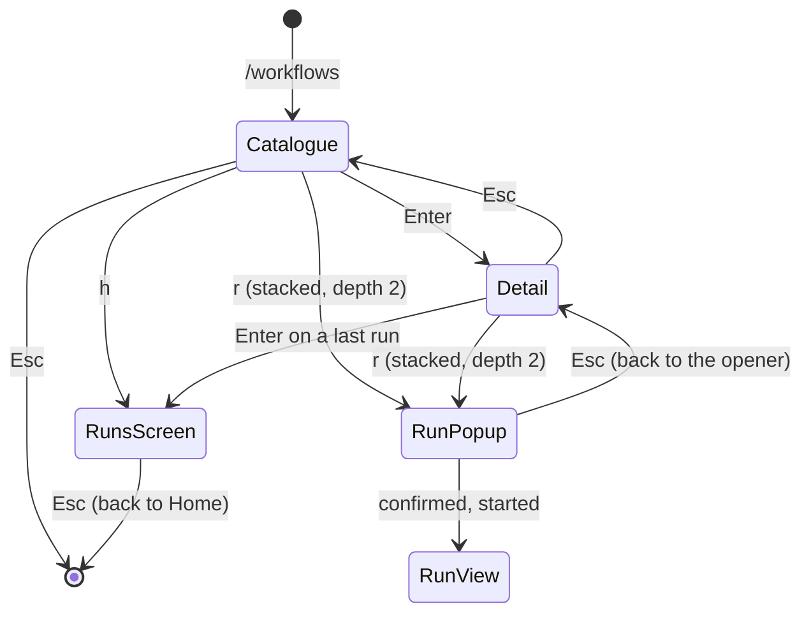

**Security and limits (unchanged):** the `/run` flow's `Ctrl+Y` confirmation, locks and measured-frame proof; the withdraw's two-step guard; `r` and `x` open no new authority path (they stack flows that exist); `Esc` confirms nothing; one chord owner at a time; stored text (workflow, agent and directory names, remembered commands) goes through the Home's row scrub ([unit 7](implementation-log.md): `flowLine`, marker triangles, key-like brackets); `[c] chat` only starts a session.

## 5. Part D — the Runs screen

The tab host (`render/tui/tab-host*.ts`, `tab-host-active.ts`, `tab-host-history.ts`, `tab-host-node.ts`; opened by `openTabHost` in `render/tui/home-controller.ts`) keeps **Active** and **History** and is renamed the **Runs** screen: tab strip `Active │ › History`, `Esc back to Home`. Reached from `[h]` in the catalogue popup and from the work page's run rows (`Enter` opens that run's detail, as today); the History detail keeps `[r] run again` (unit 7). **Both tabs default to this directory** (D4): no `another project` rows; `[a] all` shows the rest read-only. Removed from the host: the Defined (workflows) and Permissions tabs and the agents host's Sessions tab; the agents host itself disappears with `/agents` becoming a popup. The History legend arithmetic of unit 7 (the detail drops `↑/↓ scroll` or `[n] first failed` where `[r]` is offered) is unchanged. The node page's legend at 78 columns and the host's fixed-80 legend fit (owed above) are fixed here.

## 6. Parts E and F — `/mode` stops asking for a decision that changes nothing

> **Status: ACCEPTED (2026-11-27), OD-25 / D84.** The maintainer reviewed the mock-ups and ruled "proceed with the recommendations": all four decisions below are taken as recommended (1: in a chat `Enter` applies to this chat at once and the persistent write is `[s]`; 2: the letter `[s]`; 3: on the Home `Enter` on the saved value closes with a one-line notification; 4: the "nothing changed closes" rule joins `/models`). The three design issues found while drawing are resolved as written under them (the lead's resolutions on the same instruction: they are implementation rules, not new product decisions).

**The problem (verified on the built CLI, 2026-11-27).** In a chat `/mode` → step 1 (the mode in force highlighted and marked `current`) → `Enter` → step 2 *Apply to* (*This chat* / *New chats*) → `Enter` → "ask mode · every action asks first": three keys and two screens that change nothing. On the Home, with the startup default already `ask`, `Enter` opens a *Confirm* step for a persistent write of the value already stored. Root cause: the popup joins two jobs of different risk into one sequential flow and enters step 2 on every selection without asking whether the selection changes anything. The design intent of 2026-11-25 ("open on the current mode so a bare `Enter` chain changes nothing") was right; the chain still showed two useless screens.

**The principle:** *a popup never asks for a decision that changes nothing; friction is proportional to risk* (this chat's mode: one key; the persistent startup default: one confirmation; `auto` as the default: the extra admission).

**Chat — one screen, two actions.** No step rail on the list. Each row carries state words: `this chat` (the mode in force) and `startup` (the saved default), possibly both. The highlighted mode's whole effect stays under the list (amber for `accept-edits` and `auto`: they approve without a card), so the effect is read **before** the key, not after it. State-aware keys:

| Highlighted | `Enter` | `[s]` | Legend |
|---|---|---|---|
| a mode other than this chat's | use it in this chat now; the popup closes; the notification states the mode | save as the startup default (if it differs from it) | `↑/↓ select · Enter use in this chat · [s] startup default · Esc close` |
| this chat's mode | `keep`: close, nothing changes (the same one-line notification as today) | save as the startup default (if it differs) | `↑/↓ select · Enter keep · [s] startup default · Esc close` |
| already the startup default | as above | **leaves the legend** | no `[s]` |

`[s]` opens the **only** second screen: the confirmation of the persistent write (what is written: `default_mode = <mode>`; the file; "saving rewrites the file: its comments and ordering are not kept"; for `auto` the risk sentence and the extra admission), answered by `Ctrl+Y` with today's chord guard, lockout and default *No*, then the persistent *Done* step naming the file; `Esc` steps back. The *Apply to* radio screen is removed; "New chats" becomes **startup default** everywhere (the status line and the documents already say so). A typed argument (`/mode plan`) applies directly as today.

**Home — the same list without `this chat`.** `Enter` on the highlighted mode that **is** the startup default closes and says "Startup default is already ask" (one notification, no screen); on another mode it opens the same confirmation component and Done step as the chat's `[s]`. One component, one wording, two entry points.

**Part F.** `/models`: a second step in which nothing changed (same model, same effort, same scope) closes with "Already …"; the same-model path stays valid because changing the effort for the same model is a real job (so no "skip if same model"). `/effort`: confirm that the current tier closes without a second step.

**Design issues found while drawing the mock-ups (2026-11-27) and how the build settles them:** (a) **the legend at 80 columns.** `↑/↓ select · Enter use in this chat · [s] startup default · Esc close` is 69 columns against a 66-column inner width, and the product's fit rule would drop `[s]`, which defeats the point. **Rule:** the `Enter` verb and `Esc close` never drop; `[s]` is written `[s] startup default` where it fits and `[s] startup` (61 columns) where it does not; `↑/↓ select` is the first item to go when even that does not fit (as the palette's legend does). (b) **state words overflowing a row.** With both `this chat` and `startup` on one row, `accept-edits` needs 68 columns and `auto` 78 against 66. **Rule:** the state words are right-aligned and **never cut or dropped** (they are the point of the row); the short effect text is cut with `…` to make room (the highlighted mode's whole effect is under the list anyway); the name column is the width of the longest mode name plus two. (c) **at 100 columns** the chat popup (76 wide) sits over the 84-column chat rail and backdrop fragments show beside its left edge: that is the real geometry of every popup and is accepted, as unit 4's log records. The Tab-toggle alternative and the silent close have no frames because both were rejected; `/models` has none (the pair frames show the same principle).

**Unchanged:** the startup-default writer (`chat/mode-settings.ts` `runModeSettings`), its disclosure and revoke rules, `auto`'s admission, the content-free session record of a widening, the refusal while a turn runs, the `startup-writer-*` secrets controls (run them after the change). **The four decisions (ruled as recommended):** (1) in a chat `Enter` applies to this chat immediately and the persistent write is `[s]` (rejected: keep the two steps and only skip step 2 when the choice equals the current mode); (2) the letter `[s]` (rejected: a `Tab` kind toggle); (3) on the Home, `Enter` on the already-saved value closes with a notification (rejected: closes silently); (4) the "nothing changed closes" rule joins `/models`. **Code:** `popups/mode-popup.ts` (spec: one step, state words, state-aware legend, `[s]` as an action), `popups/settings-session.ts` (the answerer), `popups/mode-home.ts` (the Home variant over the shared confirmation), the surface matrix and legend golden rows. **ADR:** the dated note on [ADR-0148](../../../decisions/0148-a-user-started-report-setting-or-flow-is-a-centred-popup.md) records the ruling and replaces the two-step sentence of §3.

## 7. Documents to write or update

At unit 8's close (the implementation log's *Unit 8* section, written as the unit lands) and in the docs pass of unit 10:

- **ADR-0148** — a dated note at §10 ("What stays a screen"): `/workflows`, `/agents`, `/permissions`, `/help` are popups on the Home (OD-24); only the Runs screen and the run view stay screens; a dated note at §3 for `/mode` (written 2026-11-27 with the ruling). **ADR-0140** — a dated note at §6/§4: the tab host narrows to Active and History and both default to this directory. **ADR-0147** — "Accepted evidence" filled as the unit lands.
- **mvp-11.md** — dated notes at §4.3 ("Screens that stay screens"), Appendix A (the four Home rows, `/mode`), §6 Steps 5 and 5b (the scope and a pointer to this file); §7.2: **OD-24** and **OD-25** (both accepted), and OD-21 marked amended.
- **current.md** — decision-register rows **D83** (OD-24) and **D84** (OD-25) and this unit in the MVP-11 status.
- **Reference pages:** `docs/reference/cli/home.md` (the four popups, the Runs screen, the key tables), `docs/reference/cli/chat-session.md` (the sheet frame and the wait clock, the inspection popup, `/mode`), `docs/reference/cli/accessibility.md` (the heavy/thin rule without colour; the clock inline), the glossary (sheet, popup, wait clock, Runs screen).
- The unit-6 and unit-7 "documents that now lie" lists are owed to unit 10 as before.

## 8. How to run it

**Working contract** (maintainer, 2026-11-24, restated 2026-11-26): the implement-task loop; **one increment and one review cycle** for this unit (implement in a few parallel agents by file ownership; commit; **review round 1 with five NEW agents** (correctness, security (opus), observation by driving the built CLI with a keychain stub and a fake provider, test-quality mutation on a private copy, architecture and docs-truth); fix the verified findings in few wide waves; **round 2 with NEW agents**; a focused security sitting on the last fix wave; a test-gap wave); never the `fable` model for a sub-agent; commit with explicit paths; stay on `development`; no new branch. Run `pnpm run ci` (not turbo alone) and the controls on a still, committed tree: `node tools/secrets-controls/check.mjs --mechanism <id>` for the `startup-writer-*`, `export-live-*`, `startup-live-config-observation`, `provider-header-dormant-wire` and `startup-doctor-config-observation` mechanisms; `node tools/fs-policy-controls/check.mjs --mechanism resume-grants` and `workspace-admission`; the cycle check; the provenance test; the fence (`node tools/lint-fixtures/assert-fence.mjs`).

**Pins that must not move without a recorded reason:** `commands/chat.test.ts` 185, `commands/run.test.ts` 85, `popups/lazy-load.test.ts` 36, the usage cohort 583 (`tools/usage-coverage-controls`: put new `home-projection` or `session-view-model` cases in NEW files), the data-module fence (two lists that must stay equal: `eslint.config.mjs` `CLI_DATA_MODULES` and `tools/lint-fixtures/assert-fence.mjs` `EXPECTED_DATA_MODULES`). The legend golden and the surface matrix are regenerated by the lead only, with the diff read (`UPDATE_LEGEND_GOLDEN=1`).

**Where the evidence is** (the first two folders are git-ignored, on the maintainer's disk only): `docs/analysis/private/home-mockups/popup-komutlari-2026-11-26/` (the analysis `ANALIZ.md`, the real captures of today's screens `qa1.txt`…`qa4.txt`, 30 frames and 5 GIFs, the toolchain `_src`); `docs/analysis/private/home-mockups/mode-popup-2026-11-27/` (the `/mode` analysis, 21 frames and 5 GIFs); the key frames are **copied into this repository** under [unit-8/](unit-8/) so the design survives without them.

## 9. The designs (frames)

The mock-ups are drawn, not rendered by the real application. They follow the real frame (an open-sided tray: a rule edge, no side bars).

| Frame | What it shows |
|---|---|
| 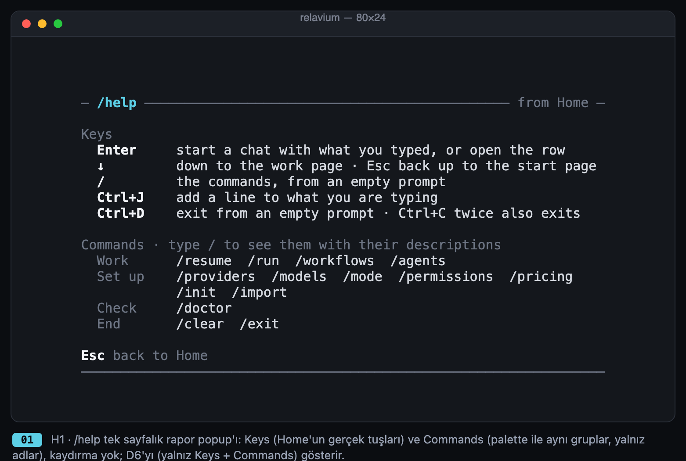 | `/help` from the Home: Keys and Commands, one page (D6) |
| 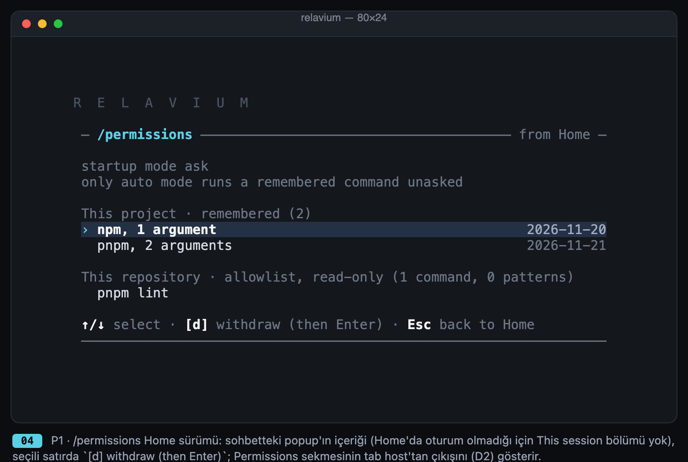 | `/permissions` on the Home: remembered commands and the read-only allowlist |
| 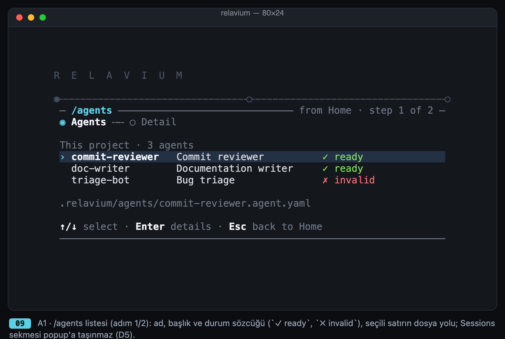 | `/agents` step 1 (D5) |
| 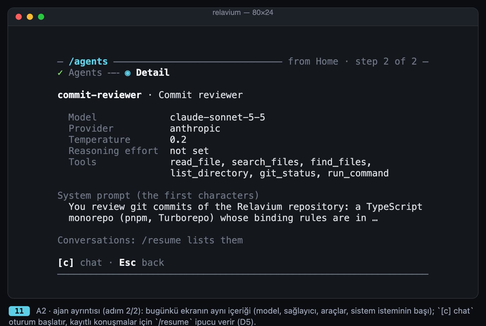 | `/agents` step 2: the detail and `[c] chat` |
| 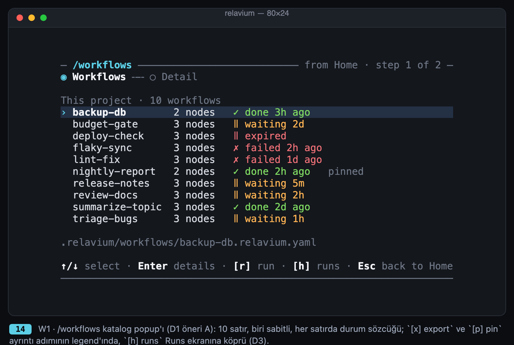 | `/workflows` catalogue (D1) |
| 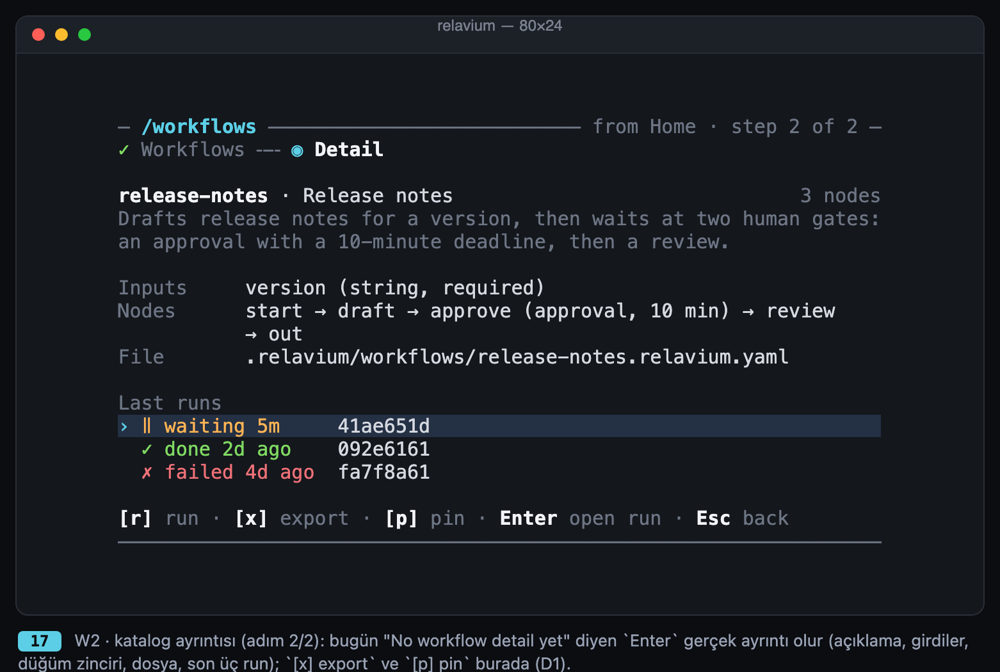 | `/workflows` detail: inputs, nodes, last runs, `[r] [x] [p]` |
| 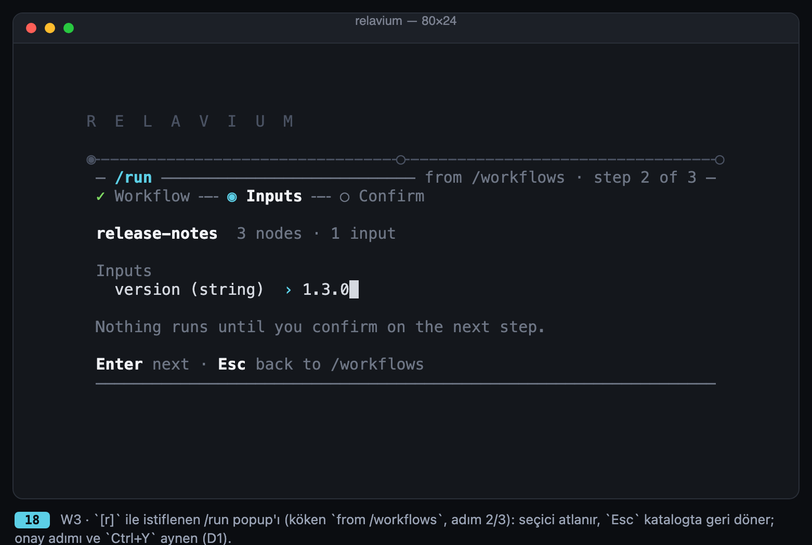 | `[r]` stacks the `/run` popup (depth two; `Esc` returns) |
| 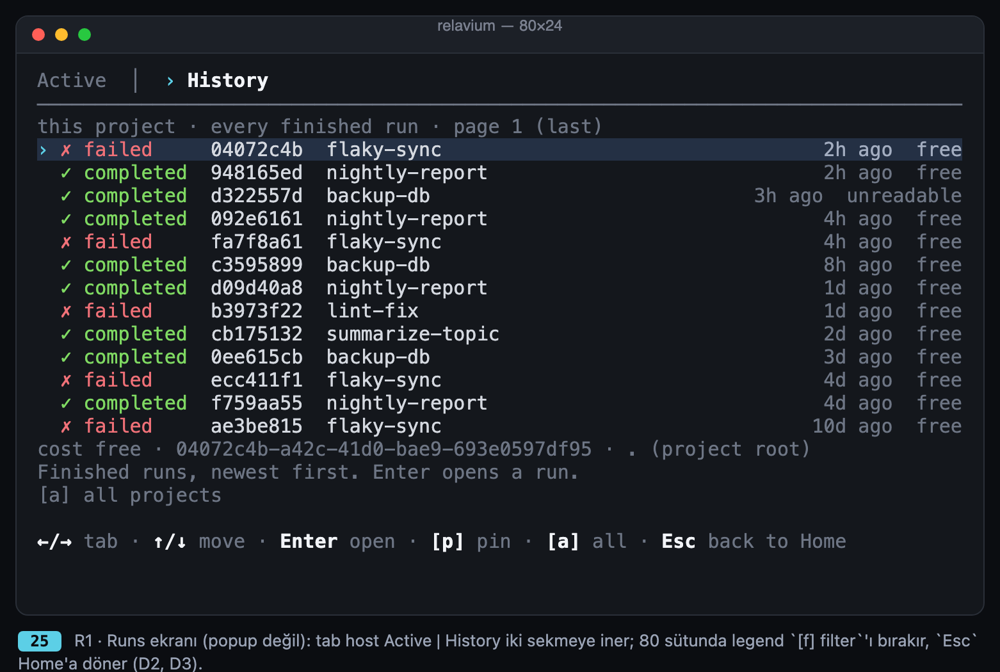 | the Runs screen (D2): History, this directory, `[a] all` |
| 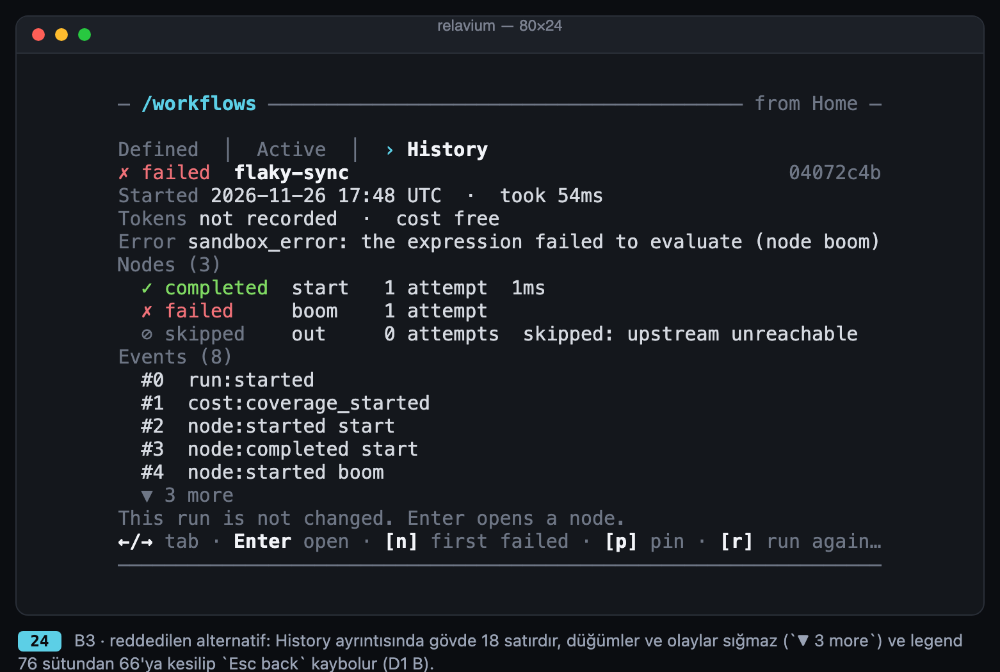 | the rejected alternative B: History detail in a popup, too cramped |

**`/mode` (OD-25, accepted 2026-11-27; the frames the maintainer reviewed):**

| Frame | What it shows |
|---|---|
| 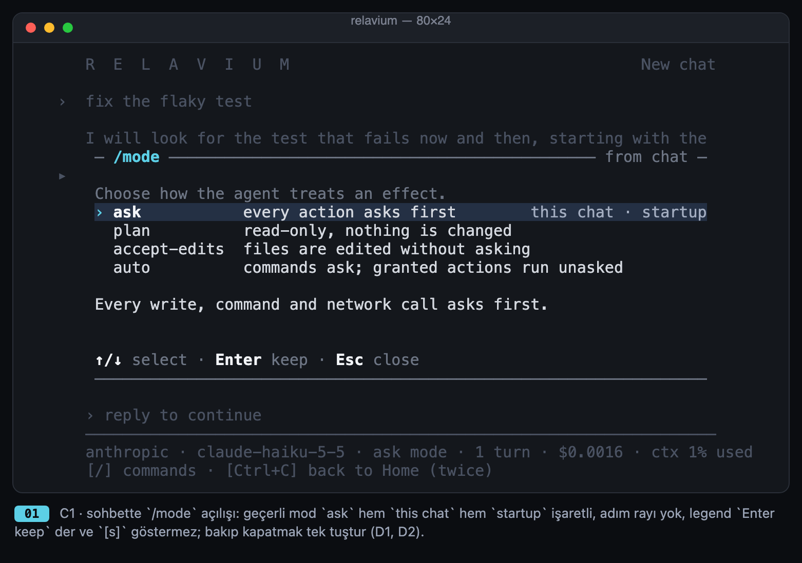 | the mode in force highlighted: `Enter keep` closes, no second screen, no `[s]` (it is already the startup default) |
| 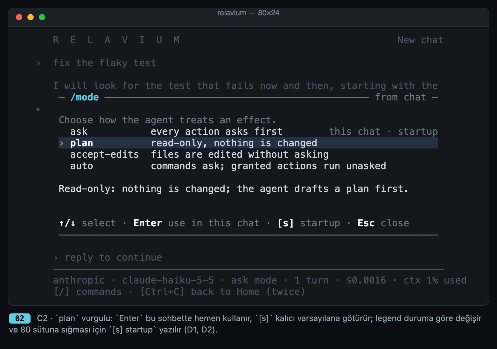 | another mode highlighted: `Enter` uses it in this chat now, `[s]` saves the startup default; the effect is read before the key |
| 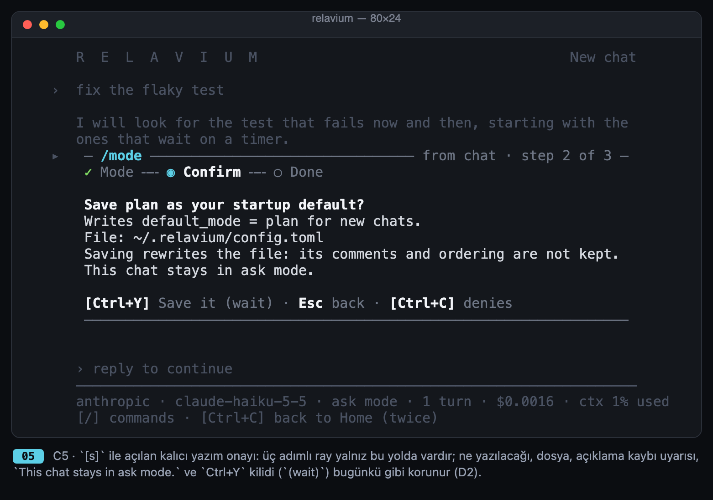 | `[s]`: the only second screen, the persistent write's confirmation (`Ctrl+Y`, the file, the lost comments) |
| 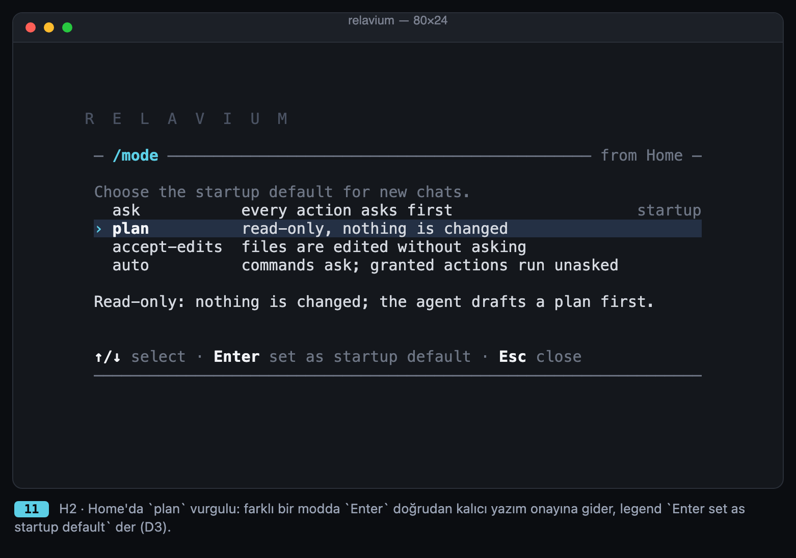 | the Home: the same list without `this chat`; `Enter` saves behind the confirmation |
| 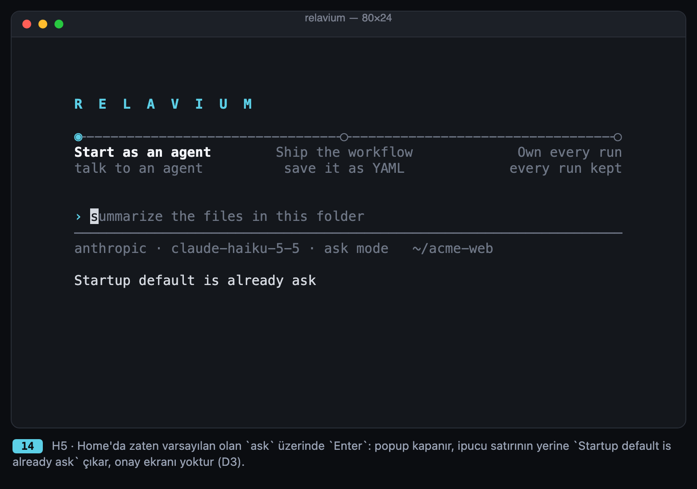 | `Enter` on the saved value closes with a one-line notification |
| 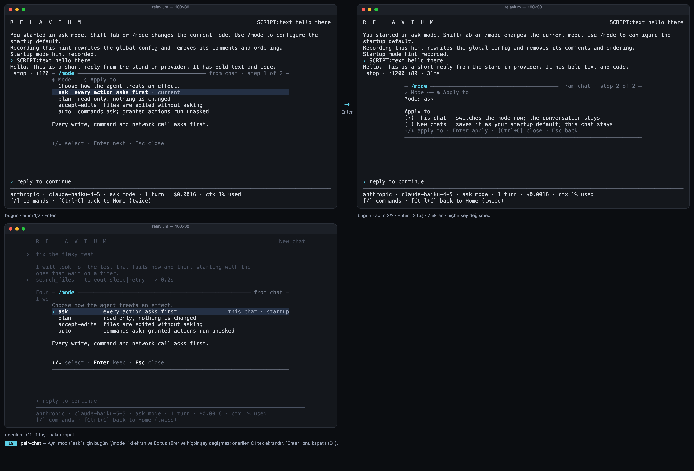 | today's three keys and two screens that change nothing, against one key |
