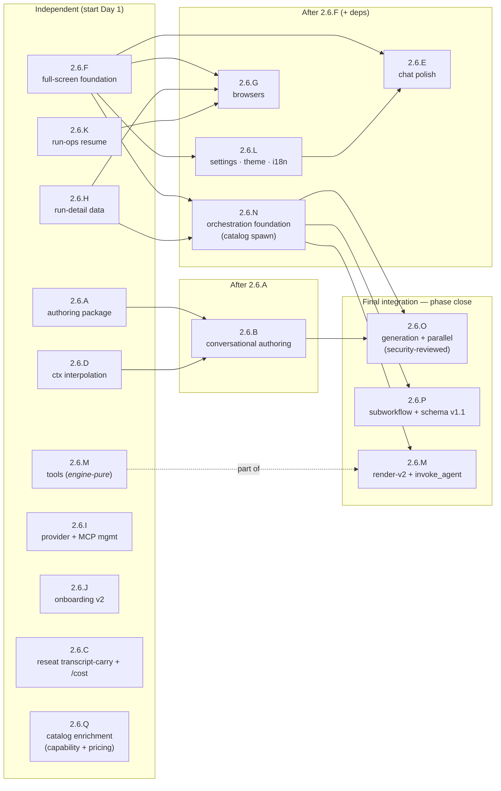

# Phase 2.6 — Conversational Authoring and the First-Class CLI

> Status: **In progress** — **2.6.F** (platform floor + full-screen TUI, PR #74) and **2.6.C** (reseat
> transcript-carry + `/cost`, PR #75) are ✅ **Done**, and **2.6.Q P1–P5** landed with PR #76 (2026-07-26).
> Joint Wave 2 prerequisites and corrections merged in PR #94 (2026-10-15); the [merge checkpoint](phase-2.5.5-hardening-and-remediation.md#wave-2-merge-checkpoint--2026-10-15) records their exact scope. Full M/N lifecycle and remaining workstreams stay open.
> **CLI MVP first (2026-11-04):** the MVP order in [../current.md](../current.md#next-work--the-cli-mvp) takes slices of
> 2.6.A/B/D/E/G/H/I/J/K/M/Q ahead of the rest of the phase; new MVP items are defined under
> [CLI MVP additions](#cli-mvp-additions--2026-11-04). The phase scope, exit criteria and milestones are unchanged.
> Live progress is canonical in [../current.md](../current.md); the rest of the phase follows. Depends on the Phase 2.5
> spine (the wired tool-environment and the per-tool approval / mode system), which is **complete** (M2.5-4,
> PR #69, 2026-07-08), so this phase is unblocked.
>
> **Rewritten 2026-07-08**, last revised **2026-07-09** (child-session orchestration split into
> **2.6.N / 2.6.O / 2.6.P** along a safety gradient; the artifact-directory two-root model + the
> `schema_version` 1.1 additive-migration decision finalized; UX polish, syntax highlighting, expanded
> locales, Home mockup — after the Phase-2.5 close), expanding the original authoring-and-parity scope
> into the phase that makes the CLI a **first-class, Home-centric product**. The rewrite folds three
> inputs: the maintainer's CLI-experience findings, a competitor research pass (opencode, Claude Code,
> Codex CLI, Gemini CLI, Temporal/`gh run`-class run tooling, Aider/Goose/Amp/Cursor/Copilot), and a
> line-by-line triage of [../deferred-tasks.md](../deferred-tasks.md) (the now-doable items are pulled in
> below, each mapped to a workstream). Workstreams **2.6.A–E keep their original identities** (they are
> referenced by ADR-0058/0059/0060 and the deferred-tasks doc); **2.6.F–P were added**
> (child-session orchestration moved from Phase 3 by maintainer decision 2026-07-08, then split N/O/P
> on 2026-07-09).
>
> **Note (2026-07-07):** **2.6.C**'s mid-session `/models` model **reseat shipped early in 2.5.G** (ADR-0059,
> PR #66, merged 2026-07-07); 2.6.C is retained for the residual per-model cost-breakdown read and as the
> cross-reference home.

> **Authority (until Phase 2.5.5 and Phase 2.6 close):** [`current.md`](../current.md) is canonical for
> live progress and execution order; the phase documents stay canonical for scope and acceptance. Ordering
> differences between the two are deliberate. `current.md` may override recommended ordering — it may **not**
> redefine a security boundary, a scope line, or a milestone acceptance criterion.

- **Related**: [../README.md](../README.md), [phase-2.5-cli-consolidation.md](phase-2.5-cli-consolidation.md), [phase-2-cli.md](phase-2-cli.md), [phase-3-desktop.md](phase-3-desktop.md), [phase-5-managed-inference.md](phase-5-managed-inference.md), [node-runtime-upgrade.md](node-runtime-upgrade.md), [../deferred-tasks.md](../deferred-tasks.md), [../../reference/cli/commands.md](../../reference/cli/commands.md), [../../reference/cli/home.md](../../reference/cli/home.md), [../../reference/cli/chat-session.md](../../reference/cli/chat-session.md), [../../reference/shared-core/built-in-tools.md](../../reference/shared-core/built-in-tools.md), [../../reference/contracts/config-spec.md](../../reference/contracts/config-spec.md), [../../reference/contracts/workflow-yaml-spec.md](../../reference/contracts/workflow-yaml-spec.md), [../../reference/contracts/agent-yaml-spec.md](../../reference/contracts/agent-yaml-spec.md), [../../decisions/README.md](../../decisions/README.md) (ADR-0058–0060 + the new ADRs below)

The second half of the consolidation work begun in
[phase-2.5-cli-consolidation.md](phase-2.5-cli-consolidation.md), now widened into the phase that finishes
the CLI as a product. It realizes the tagline — *"Start as an agent. Ship the workflow. Own every run."* —
**entirely inside the terminal**: a conversation authors a standards-valid workflow, agents spawn sub-agents
and invoke workflows for complex tasks, the Home starts and monitors runs, the run history is drillable to
per-node detail. Every management task (providers, models, MCP, settings, gates) is doable from the Home
without dropping to a shell subcommand. The chat renders syntax-highlighted code blocks; the CLI ships in
English and Turkish over an n-locale catalog. When this phase closes, `relavium` in a terminal is a first-class experience on par with the
best agentic CLIs — while keeping the postures they lack: OS-keychain-only secrets, a fail-closed approval
floor, and git-committable YAML artifacts.

## TL;DR

Phase 2.6 makes bare `relavium` a **full-screen, Home-centric** product. Key outcomes in 7 milestones:

- **Conversational authoring** — a free-text request produces a strict-valid `.relavium.yaml`,
  authored and run from the Home; `{{ctx.*}}` interpolation and `agent run --input` land.
- **Everything managed from the Home** — providers, MCP servers, agents, workflows, runs, and
  run-ops (budget/gate resume) with no shell subcommand required.
- **Drillable, attributed run history** — list → run → node drill-down with per-node model/agent/cost
  attribution, bounded tool traces, and cross-process live watch.
- **Competitor-toolbelt parity** — `edit_file`, `search_files`, `find_files`, `todo`, `ask_user`,
  working `web_search`, wired `invoke_agent`; syntax-highlighted code blocks in chat — each
  YAML-selectable and mode-gated.
- **Agent orchestration** — chat agents autonomously spawn sub-agents and invoke workflows for
  complex sub-tasks; workflows call workflows via `subworkflow` nodes; standardized I/O contracts;
  parent-child lineage tracking; auto-cleaned artifacts.
- **Settings, theming, localization** — `/settings` over the config-write contract; three built-in
  themes (default / high-contrast / colorblind-safe); i18n shipping **`en` + `tr`** with CI key-parity, the
  catalog architected for n locales (`es`, `fr`, `de` staged).
- **Onboarding v2** — two auth paths: BYOK (live) + Relavium-account stub (disabled, Phase 5).
- **17 workstreams** (2.6.A–Q), substrate-first: 2.6.F (full-screen TUI + Node 22 floor) runs first;
  agent orchestration is split by safety gradient into 2.6.N (safe mechanism) → 2.6.O (model-generated
  execution, own security review) + 2.6.P (`subworkflow` node + schema v1.1).

## Goal

Make the bare `relavium` invocation a **full-screen, Home-centric** surface from which the entire product
is used and managed; close the **tool-breadth gap** against competitor CLIs (edit, search, find, todo,
ask-user, working web search) under the existing governance floor; land **conversational authoring** on the
shared `@relavium/authoring` core; give runs a **three-level drill-down** (list → run → node) over durable,
attributed history; enable **agent orchestration** — chat agents spawning sub-agents, workflows invoking
workflows, standardized I/O, and on-the-fly agent generation; and ship **settings, theming, localization,
and syntax-highlighted rendering** — all without breaking the `--json` / CI / non-TTY contract
([ADR-0049](../../decisions/0049-cli-machine-output-contract.md)) or any existing subcommand.

## Outcomes (Definition of Done)

- `relavium` on a TTY opens a **full-screen** (alternate-screen) Home with a scroll/auto-follow viewport;
  the inline renderer remains as an escape hatch; `--json` / `CI` / non-TTY behavior is byte-identical to
  today (regression-harness proven).
- **Everything is manageable from the Home**: provider + key CRUD, model picking, MCP server CRUD +
  status, settings (theme/language/preferences), workflow start/monitor/history with node-level
  drill-down, agent start (any catalog agent) + session resume, gate resolution (human **and** budget),
  and authoring (wizard + conversational). No routine task requires a shell subcommand; subcommands stay
  first-class for scripting/CI and are never removed.
- A `@relavium/authoring` package is the shared authoring core; a conversational request produces a
  strict-valid, catalog-validated `.relavium.yaml`, written only under approval, offered to run it in-place.
- The **toolbelt** reaches competitor breadth — `edit_file`, `search_files`, `find_files`, todo/plan,
  `ask_user`, an actually-working `web_search`, and `invoke_agent` (wired for chat) — each engine-pure,
  YAML-selectable, mode-gated, and rendered first-class (collapsible detail, diffs at the approval
  prompt, syntax-highlighted code blocks) behind a security-reviewed render contract.
- Session `{{ctx.*}}` interpolation lands (ADR-0060) and `agent run --input` is unblocked.
- Run history is **attributed and drillable**: per-node model/agent/cost durable, a bounded secret-free
  tool trace, gate-resolve TOCTOU closed at the store, crashed runs reconciled, cross-process runs
  watchable live at node granularity.
- The CLI speaks **`en` and `tr`** over an n-locale string catalog with CI key-parity (`es`, `fr`, `de`
  staged behind the same catalog, not shipped this phase), and ships a real theme system
  (default + high-contrast + colorblind-safe) with the color-free path staying legible.
- An agent in a chat session can **autonomously spawn sub-agents and invoke workflows** for complex
  sub-tasks, with standardized I/O contracts, parent-child lineage tracking, hierarchical cost
  attribution, and auto-cleaned temporary artifacts in `~/.relavium/artifacts/` — closing the
  largest deliberate parity gap. Workflows can invoke other workflows via `subworkflow` nodes.
- The onboarding wizard offers **two auth paths** — BYOK (live) and *Sign in with a Relavium account*
  (visible, disabled, honestly labeled as coming with managed inference) — behind an Accepted
  forward-design ADR.

## Scope

### In scope

The workstreams below: the authoring spine (2.6.A/B/D), the platform + full-screen TUI foundation (2.6.F),
the Home management surfaces (2.6.G/H/I/J/K), the experience arms (2.6.C residual, 2.6.E, 2.6.L, 2.6.M),
the **child-session and nested execution spine** (2.6.N foundation / 2.6.O generation + parallel /
2.6.P `subworkflow` node + schema v1.1),
and the deferred-tasks items each workstream absorbs (mapped in the
[pull-in table](#deferred-tasks-pulled-into-this-phase)).

### Explicitly out of scope (→ Phase 3 / later)

- The **`read_media` D12 cluster** (host `MediaReadAccess`, scope population, the result-shape contract)
  and `@`-mention of media files — the dedicated, security-reviewed follow-up stands.
- **Full-fidelity reseat tool-context** (the 1.X/1.Z persister/schema extension) — the reseat keeps its
  text-only-transcript notice.
- **File-snapshot undo** (opencode-style revert of a message *and its file changes*) — 2.6.E ships
  conversation-level `/rewind`/`/fork` only.
- **retry-from-node** ([ADR-0040](../../decisions/0040-node-retry-budget-above-the-chain.md) Part B — needs the
  run-attempt model). The 2.6.G run-detail browser must be designed so a later "retry from this node"
  action slots in without rework, but the engine work is Phase 3.
- The **workflow-run `egress`/`os` arms** stay unwired (the recorded 2.5.E design boundary:
  `build-engine.ts` wires `fs`+`process` only). Revisiting that boundary requires its own ADR — it is not
  quietly reopened here.
- A multi-pane dashboard (desktop canvas territory), `output_schema` deep JSON-Schema conformance (new
  validator dependency), the `plugin` ToolSource loader, and cursor pagination for the read commands
  (scale-gated). Tracked in [../deferred-tasks.md](../deferred-tasks.md).

### In-window maintenance obligations (not workstreams)

Two items from [deferred-tasks.md](../deferred-tasks.md) fall inside the likely phase window and should be
actioned during it (maintainer calls, not workstreams): the **OpenAI Sora 2 shutdown (2026-09-24)** —
retarget or disable the 1.AH A3 Sora adapter arm before the date — and **enabling the live-nightly
conformance lane** (CI provider keys), which also unblocks the deferred media-in conformance fixtures.
Both stay tracked in their canonical [deferred-tasks.md](../deferred-tasks.md) entries.

## Work breakdown

### 2.6.A — `@relavium/authoring` package promotion + catalog-aware pre-flight

Unchanged from the original plan. The authoring core exists in-tree (`apps/cli/src/authoring/authoring.ts`,
landed with 2.J) and is promoted to a shared `@relavium/authoring` package so desktop
([phase-3-desktop.md](phase-3-desktop.md)) and VS Code ([phase-4-vscode.md](phase-4-vscode.md)) can consume
the same core.

**Tasks:**

- Scaffold `packages/authoring` — pure TS, platform-free — and **extract-and-decouple** the existing core
  (it is **not** a free move: `CliError`, `discoverCatalog`, and `findProjectConfigDir` are `apps/cli`
  imports a package may not take — a forbidden `packages → apps` back-edge). Replace `CliError` with a
  platform-free typed error the CLI maps to exit codes at the boundary; keep catalog **discovery** and
  `findProjectConfigDir` CLI-side and pass the catalog **in**. Add an import-zone lint fence banning
  `packages/authoring → apps/cli`. Follow
  [.claude/skills/add-package/SKILL.md](../../../.claude/skills/add-package/SKILL.md).
- Expose a single `validateAuthoredWorkflow(yaml, catalog)` = `parseWorkflow` **+**
  `validateWorkflowWithCatalog`, and **back-port** it into `create`/`import`/`export` (today those are
  parse-only; only the run path catalog-validates), so `create` can never accept a model/modality the run
  path rejects. Confirmed as a live gap by the review — `create`/`import`/`export` still parse-only today.
  Also expose the agent-shaped sibling **`validateAuthoredAgent(yaml, catalog, parentGrants?)`** =
  `parseAgent` **+** model/catalog validation **+** tool-ID validity **+** a caller-supplied parent-grant
  clamp. The authoring *commands* do not need it (they author for a human to review), but **2.6.O's
  model-generated agents execute behind it** — parse success proves none of catalog compatibility, tool
  validity, or permission containment, and 2.6.O's clamp cannot live only at spawn if the artifact is
  persisted. Unit-test its reject paths.
  *(L · `apps/cli/src/authoring/`; #2)*
- **`nodeCatalogIssue` never resolves the agent's own model, only a node-level override** *(review
  finding, pre-existing bug in the function this workstream promotes):* `validate-catalog.ts`'s
  `nodeCatalogIssue` reads a node-level model *override* but never the resolved agent's own `model:`, so
  the catalog pre-flight is silently dead for the canonical, documented authoring pattern — declaring the
  model once on the `agents:` block. Fix early in this workstream, since the acceptance criterion
  ("`create`, `import` and `export` all run the same run-equivalent catalog pre-flight") depends on this
  function being correct.
  *(M · `packages/core/src/validate-catalog.ts`; #88)*
- **Run-path tool pre-flight for the unwired egress/os arms:** `build-engine.ts` always assembles the tool
  host at `profile: 'workflow-read-write'`, and `assemble.ts`'s `wireEgressOs` only wires
  `host.egress`/`host.os` when `profile === 'chat-read-write'` — so a workflow agent node granted
  `web_search`, `http_request`, `read_clipboard`, or `notify` is a permanent, by-design `tool_unavailable`
  on `relavium run`, with nothing validating the authored `tools:` grants against this before the run
  starts. Add a sibling check inside `validateAuthoredWorkflow`'s catalog pre-flight, and correct
  [`built-in-tools.md`](../../reference/shared-core/built-in-tools.md) /
  [`workflow-yaml-spec.md`](../../reference/contracts/workflow-yaml-spec.md), which currently document
  these tools as unconditionally available. Does **not** wire the arms themselves — that stays out of
  scope per the recorded 2.5.E design boundary (Phase 3+). **Ruled 2026-11-05 (maintainer, MVP-1):** the
  pre-flight refuses such a workflow before the run starts (exit `2`), naming the tool; MCP-discovered tools are
  exempt. Until MVP-6 back-ports `validateAuthoredWorkflow`, the check is `validateWorkflowToolArms`, beside
  `validateWorkflowWithCatalog`, and `relavium run` calls it before any key is read. **Landed 2026-11-05 (MVP-1
  1a)**; its limits ($ref grants, `mcp_call` without a server, resumes) are in
  [built-in-tools.md](../../reference/shared-core/built-in-tools.md#the-built-in-tools).
  *(M · `apps/cli/src/engine/build-engine.ts`, `apps/cli/src/engine/tool-host/assemble.ts`; #37, G29)*
- **Catalog-aware `max_tokens` pre-flight** *(manual-test finding 2026-07-11):* extend
  `validateWorkflowWithCatalog` so `create`/`import`/`export` reject-or-clamp a `max_tokens` that exceeds the
  target model's known **output ceiling** (`MODEL_PRICING[model].maxOutputTokens` today; the live-catalog
  `limit.output` once **2.6.Q** lands) — the authoring-surface complement to 2.6.Q's run-path clamp, since
  today `max_tokens` is validated
  only as a bare positive int and an over-ceiling value 400s opaquely at the wire. Leave an unknown-ceiling
  model (custom `base_url`) as pass-through. No new ADR (rides ADR-0058).
- Add direct unit tests for `detectAndParse` / `buildAuthored` — today only their command wrappers are
  tested — and for the new `validateAuthoredWorkflow` this workstream introduces (it does not exist yet;
  only its `validateWorkflowWithCatalog` half ships today). Confirmed by the review as a real coverage gap
  in the core this workstream extracts. *(M · `apps/cli/src/authoring/authoring.ts`; #6)*

**Acceptance:** `@relavium/authoring` builds and imports **only** `@relavium/core` + `@relavium/shared`
(lint-fence enforced); the CLI consumes it with `create`/`import`/`export` round-tripping **unchanged**
(regression-tested); **all three of `create`, `import` and `export`** run the same run-equivalent catalog
pre-flight (`validateAuthoredWorkflow`, defined in the task above) that `relavium run` uses, so no authoring
entrypoint can accept a **workflow** the run path would reject; the core is directly unit-tested. (All three
commands also accept `.agent.yaml` via `detectAndParse` → `parseAgent`; the authoring *commands* keep the
workflow-shaped pre-flight, but the package also exports the agent-shaped `validateAuthoredAgent`,
unit-tested on its reject paths — it is 2.6.O's execution gate, not a command-surface one.) **Required ADR:** [ADR-0058](../../decisions/0058-relavium-authoring-package-and-conversational-authoring.md)
(Proposed → Accepted when this workstream begins).

### 2.6.B — Conversational + wizard authoring in the Home

The original conversational-authoring workstream, plus the in-Home wizard surface and two absorbed
deferred items.

**Tasks:**

- **Conversational authoring** (unchanged): an authoring agent (an `--agent` profile or a `/author` mode)
  whose system prompt references a **product-side knowledge pack derived — never restated** — from
  [node-types.md](../../reference/shared-core/node-types.md),
  [workflow-yaml-spec.md](../../reference/contracts/workflow-yaml-spec.md),
  [agent-yaml-spec.md](../../reference/contracts/agent-yaml-spec.md) and the Zod schemas (one minimal
  example per node type; a no-duplication check gates acceptance; never under `.claude/` — the product
  agent does not read repo-development skills). Self-correct loop: model → YAML → `detectAndParse` /
  `validateAuthoredWorkflow` → field-named, secret-free error → model fixes. The artifact is written only
  under accept-edits/auto with the scope-tiered host, then the surface offers *"Run it now?"* — closing
  author → run on one screen.
- **In-Home authoring wizards**: bring `relavium create`'s wizard into the Home/chat palette (`/create` →
  an ink-native agent/workflow wizard over the same injectable prompter seam), so authoring starts from
  the Home, not only from a shell command.
- **Wizard TTY prompts don't normalize input** *(review finding):* `create-prompter.ts`'s free-text prompts
  return the typed value verbatim, so accidental leading/trailing whitespace reaches `CreateSpec`. Fix per
  field rather than blanket-trimming, in the same prompter seam this task brings into the Home's `/create`
  wizard. `gather()` collects `kind`, `name`, `provider`, `model`, `systemPrompt` and `tools`; the three
  free-text fields are:
  - **`model`** — the material case: trim, and **reject** a value still containing interior whitespace, since
    a model id is a single token. A trailing space breaks catalog lookup and currently 400s at the wire.
  - **`name`** — trim. It feeds both the display name and `toSlug()`.
  - **`systemPrompt`** — trim leading/trailing, preserve interior formatting so a multi-line prompt
    round-trips unchanged.

  Two guarantees already hold and must not be re-implemented: `required()` rejects whitespace-only input for
  every field, and `tools` is already trimmed per element. `toSlug()` also already normalizes whitespace
  (`my agent` → `my-agent`), so there is no slug prompt to police. Cover each policy with a prompter test,
  with interior whitespace in `model` and a multi-line `systemPrompt` as the boundary cases.
  *(S · `apps/cli/src/authoring/create-prompter.ts`; #5)*
- **`AgentParseError` reaches the chat surfaces** *(deferred pull-in)*: a malformed `.agent.yaml` on
  `chat --agent` / `agent run` currently collapses to a generic exit-1 internal error; resolve the design
  call (wrap into `CliError('invalid_invocation')` at `resolveChatAgent`, or teach the top-level renderer
  to render a typed `AgentParseError` as an exit-2 invocation fault), revise the pinned test deliberately,
  and relativize the echoed source path. The conversational self-correct loop depends on these diagnostics
  being visible.
- ~~**Import consent gate**~~ — **moved and re-scoped.** The consent half landed in **2.6.5 `CR-16`**
  ([ADR-0084](../../decisions/0084-consent-before-a-local-mcp-spawn.md)), and provenance turned out to be the
  wrong axis: a `git pull` changes a committed artifact with no import step, so the gate covers **every**
  stdio server on every path, not an imported one. The `npx` version/integrity pinning half stays open with
  its own scheduling in [deferred-tasks.md](../deferred-tasks.md). Nothing is owed here.
- **Discoverability of the UVP** (unchanged): the proactive, dismissible, config-opt-out *"turn this
  session into a workflow with `/export`"* hint.

**Acceptance:** a free-text request yields a strict-valid `.relavium.yaml` passing the same pre-flight as
`relavium run`; an invalid draft is corrected via the secret-free loop; files are written only with
approval; `/create` works from the Home; a malformed agent YAML surfaces its field-named, positioned
diagnostic on every surface; the untrusted-import consent gate holds; a security review of the write
surface + the secret-taint gate + the import gate passes. **Required ADR:** shared with 2.6.A (ADR-0058).

### 2.6.C — Mid-session model reseat — residual + transcript-carry fix — ✅ **Done (PR #75, merged 2026-07-13)**

> **Shipped early in 2.5.G** (ADR-0059, PR #66, 2026-07-07): the `/models` mid-chat reseat, per-message
> `modelId` attribution, and the context-loss notice. Retained for the residual below and as the
> cross-reference home.
>
> **Status:** ✅ **Done — merged to `main` 2026-07-13 (PR #75)**. Both tasks shipped, plus the residual that turned
> out to need its own ADR.
> The reseat now carries the rendered conversation (F1), with the switch marker landing beneath it; and `/cost` shows
> a per-model breakdown backed by a new durable `session_costs` table
> ([ADR-0070](../../decisions/0070-durable-per-model-session-cost-attribution.md) — the per-message `model_id` this
> ADR originally planned to derive it from **cannot** represent a turn whose tool loop billed two models). Two
> append-only notes were added to [ADR-0068](../../decisions/0068-full-screen-tui-renderer-ink7-harness.md) (the
> limitation its own alt-screen default created) and [ADR-0059](../../decisions/0059-cli-mid-session-model-reseat.md)
> (the notice's new shape; and the perf harness it claimed existed, which did not — now delivered).

**Tasks:**

- **Preserve the on-screen transcript across a reseat** *(manual-test finding 2026-07-11, HIGH —
  near-hotfix, do not wait for M2.6-5).* A `/models` mid-session switch builds a **fresh view store seeded
  header-only**, so the prior conversation **vanishes** from the full-screen alt-screen viewport — which
  2.6.F made the default (`render-mode.ts` `DEFAULT_ALT_SCREEN = true`) and whose alt buffer has **no native
  scrollback** to fall back on, unlike the inline `<Static>` path (which is unaffected). The durable DB
  transcript and the switched model's context are **intact** — only the *rendered* scrollback is dropped, so
  it reads as catastrophic data loss on a headline feature. Fix: extend `SessionViewSeed`
  (`session-view-model.ts`) with an optional `transcript`, seed `initialSessionViewState` from it instead of
  the hardcoded `[]`, and thread the OLD store's rendered transcript
  (`old.store.getSnapshot().state.transcript`) through `deps.reseatChat` into the reseat store construction
  on **both** the Home (`drive-home.tsx`) and standalone (`chat.ts` `seedResumedWiring`) paths; append the
  switch notice **after** the carried transcript as an inline "model changed X → Y" marker (the maintainer's
  requested shape). Keep the inline `<Static>` path byte-identical. Regression test: the reseated store's
  initial transcript equals the prior turns followed by the notice (today the reseat tests assert only
  turn-count / cost / notice). Carried entries are already-sanitized rendered projections — no key/secret and
  no [ADR-0030](../../decisions/0030-llm-seam-shape-amendment-reasoning-response-format-provider-executed.md)
  reasoning signature enters the store. **No new ADR** (store-construction fix under the Accepted ADR-0059).
- The per-model **cost breakdown** read (`/cost` gains a per-model section over the shipped attribution
  columns); verify the context-loss notice covers the whole `chat-resume` family.

**Acceptance:** a mid-session reseat keeps the full prior conversation **visible** in the alt-screen
viewport with an inline switch marker (regression-tested on both the Home and standalone paths); `/cost`
shows per-model spend for a reseated session; the notice is asserted on resume surfaces. **Required ADR:**
none (ADR-0059 is Accepted).

#### Implementation record (moved from current.md on 2026-11-04)

Driven by two maintainer manual-test findings. **F1:** a mid-session `/models` reseat **blanked the alt-screen
viewport** — the reseat builds a fresh view store, and on the full-screen renderer (the TTY default since 2.6.F, with
no native scrollback behind it) that store *is* the scrollback, so the whole conversation vanished the moment a user
switched models. The durable transcript and the new model's context were never at risk; the loss was the view. The
reseat now carries the rendered conversation, gated to full-screen (a seeded **inline** store would re-print the
conversation over the copy ink's `<Static>` already put in the terminal's scrollback), and the switch notice lands
**beneath** it as an inline `⇄ model changed <old> → <new>` marker, keeping ADR-0059's bound disclosure clause.

**`/cost`** now shows where the money went, behind a new
[ADR-0070](../../decisions/0070-durable-per-model-session-cost-attribution.md): a durable `session_costs` table with the
invariant **`SUM(rows) == agent_sessions.total_cost_microcents`**, true by construction. ADR-0059 had planned to
derive the breakdown from the per-message `model_id`, which **cannot work** — one row holds one model, but a turn
whose tool loop fails over bills two. Along the way it closed a **live bug**: `total_cost_microcents` was being SET
blindly by five writers, so two `chat-resume` processes could permanently corrupt a session's total. It now has a
single owner. `session_messages`' never-written token/cost columns were dropped rather than left as a second, wrong,
zero-valued source.

Four adversarial review rounds ran over the work and each found something real — including that a tripwire I shipped
was **armed in production** and **swallowed by ink** (so it could never fail), that a perf harness measured a
**pointer assignment** while its ADR note claimed it verified an O(n) bound, and that the `/cost` DB read — the
step's central change — had **zero test coverage** at any layer. All folded, each with a break-verified regression.

**Open obligations carried out of 2.6.C:**

- **`chat-resume` opens on an empty viewport** — it has never repainted prior turns, in any mode or version (nothing
  projects `session_messages` into rendered entries). Not a 2.6.F regression; tracked in
  [deferred-tasks.md](../deferred-tasks.md).
- **Reported spend is a systematic under-estimate of the provider's invoice** — an egress that streamed content but
  ended without a usage chunk, and a mid-stream failure, are recorded as 0 on *both* sides of the invariant. That is
  a usage-capture gap in the seam, filed against **2.6.Q** (ADR-0070 §3) as its
  [usage-capture item](#26q--dynamic-model-catalog-enrichment-modelsdev-per-model-capability-matrix--pricing-long-tail---p1p5-landed-pr-76-2026-07-26-p6-and-the-settings--models-toggle-open).
- **Cross-turn tool-call memory** — a "the reseat forgets tool calls" report turned out to be an *engine* property,
  not a reseat one: tool pairs never cross **any** turn boundary (ADR-0062 §6). Deferred behind a default-off toggle,
  but **three already-live bugs gate it** (no pre-egress context-window check; overflow is a fatal, non-retryable
  `bad_request`; the budget gate prices only output tokens) — see [deferred-tasks.md](../deferred-tasks.md).
- **The CLI e2e suite migrates the developer's real `~/.relavium/history.db`** — verified, and it is what let a
  broken migration reach real data while staying invisible to CI. Tracked in [deferred-tasks.md](../deferred-tasks.md).

### 2.6.D — Session `{{ctx.*}}` prompt interpolation

Unchanged in intent; one absorbed deferred item makes the security mandate explicit.

**Tasks:** resolve `{{ctx.*}}` in the session system prompt per
[ADR-0060](../../decisions/0060-session-ctx-prompt-interpolation.md) — template substitution only, with the
**per-variable provenance/taint marker** on `SessionContext` (`--input`-derived values are untrusted by
provenance and never resolve in system position); unblock `agent run --input k=v`. *(Deferred pull-in:)*
land the **parse-time gate on system-bound fields** — when trusted `{{inputs}}`/`{{ctx}}` are admitted into
system positions, untrusted `run.outputs`/`read_file` references there are rejected at parse (the analyze/
collect gate), preserving the existing secret-taint protection.

**Acceptance:** `{{ctx.*}}` resolves in a session prompt with the taint rule enforced and tested;
`agent run --input` is accepted and reaches the prompt; the ADR-0060 mandatory security review passes.
**Required ADR:** ADR-0060 (Proposed → Accepted).

### 2.6.E — Chat & input parity polish

The competitor-parity chat ergonomics (the theme system moved to 2.6.L; tool-call rendering moved to
2.6.M). Everything here is TTY-interactive-only; the non-interactive contract is untouched.

**Tasks:**

- **Markdown + code-block rendering + syntax highlighting** in the transcript: a minimal in-house
  markdown renderer (code fences, inline code, bold/italic, headings, lists, blockquotes) with
  **`ink-syntax-highlight`** for first-class syntax highlighting in code blocks. `ink-syntax-highlight`
  is a thin ink-native wrapper around `highlight.js` + `cli-highlight` — it outputs native ink
  `<Text color>` elements (integrates with the 2.6.L theme system), supports 190+ languages with
  automatic detection, and tree-shakes to specific languages for bundle control. This requires a
  dedicated ADR (new dependency — `highlight.js` + `cli-highlight`; evaluated over the in-house
  alternative on breadth, maintenance burden, and bundle impact), a catalog entry in
  `pnpm-workspace.yaml`, and a tree-shaken language set (a curated default set for the built-in
  agent; additional languages load on demand). The
  markdown-to-ink component maps rendered nodes to ink's `<Text>` / `<Box>` primitives under the
  existing `stripTerminalControls` sanitization floor.
- **Advanced `@`-injection**: glob / directory expansion respecting ignore files (the ADR-0061 follow-up;
  the in-house matcher from the 2.5 close is the substrate).
- **`/rewind` + `/fork`** at conversation level: rewind truncates to a chosen prior message and continues
  (via the `/clear`-style host-swap + `reconstructSessionState` machinery); fork branches a session into a
  new `sessionId` preserving the original. File-change revert is explicitly out (see out-of-scope).
  **Analysis gate:** the interaction with child sessions must be decided during implementation —
  (a) `/rewind` past a point where sub-agents were spawned: are in-flight children cancelled? are
  completed children's results retained in the truncated transcript? (b) `/fork` of a session that
  spawned children: does the fork include the child lineage or start clean? The answer affects the
  `reconstructSessionState` machinery and the parent-child DB model; a dedicated design spike during
  2.6.E implementation will resolve both cases before the feature lands.
- **Type-ahead message queue**: messages typed while a turn runs are queued (navigate/edit the queue), sent
  on turn end — with a steer-now affordance considered (send-as-interrupt).
- **Input history search**: `Ctrl+R` reverse search over per-project prompt history.
- **`$EDITOR` compose** (`Ctrl+G`): edit the pending prompt in the external editor.
- **`/copy`**: copy the last assistant reply to the system clipboard. Additionally,
  **copy-on-select**: text selected with the mouse in the terminal copies to the clipboard
  automatically when the terminal supports it; no explicit command needed. The `/copy` command
  remains for keyboard-only workflows and terminals without clipboard support.
- **`/help` v2**: a full-screen, sectioned help screen (commands, keybindings, modes) replacing the flat
  text list, once 2.6.F's renderer lands. Supplemented by a **quick-reference cheat sheet** overlay
  (`Ctrl+O` or `?` — a half-screen modal summarizing current-context keybindings: the mode-aware
  approval keys, the browser nav keys, the chat input keys — dismissible with any key). The footer
  hint-bar remains the primary discoverability surface; the cheat sheet is the deliberate-lookup
  companion.
- **Transcript search** (`Ctrl+F` / `/find`): incremental text search within the visible chat
  transcript — type to jump to the first matching assistant turn, Enter for next match, Esc to
  dismiss. Scoped to the loaded transcript viewport (not a DB query); a full-history search is
  deferred (scale-gated, needs the transcript-index follow-up).

**Acceptance:** each affordance works in chat and the in-Home chat; `--json`/plain surfaces reject or
ignore them exactly as the ADR-0049 contract requires; the message queue and rewind have reducer-level
tests. **Required ADR:** `ink-syntax-highlight` dependency + markdown rendering architecture.

### 2.6.F — Platform floor + the full-screen TUI foundation — ✅ **Done (PR #74, 2026-07-11)**

> **Status:** ✅ **Done (PR #74, 2026-07-11)** — merged to `main` behind
> [ADR-0067](../../decisions/0067-node-supported-floor-22-reaffirm-better-sqlite3.md) (Node `>=22` floor,
> `better-sqlite3` re-affirmed), [ADR-0068](../../decisions/0068-full-screen-tui-renderer-ink7-harness.md)
> (ink 7 + the hand-built alt-screen renderer + the `ink-testing-library` harness) and
> [ADR-0069](../../decisions/0069-string-width-for-the-cli-renderer.md) (`string-width`, Accepted on the merge).
> The shipped inventory (incl. the `✓ Copied` copy-on-select toast), the two adversarial review rounds, and the
> open obligations carried out (short-terminal Home overflow → 2.6.G; `relavium run` stays inline; themes → 2.6.L)
> are in the implementation record at the end of this section, moved from current.md on 2026-11-04. Its release
> clause (v0.2.0) is still open: it lands with the CLI MVP's MVP-10 ([current.md](../current.md#next-work--the-cli-mvp)).

The substrate workstream — it runs **first** because the browsers (2.6.G), settings screens (2.6.L), and
render-v2 (2.6.M) all build on it.

**Tasks:**

- **Node dev/CI bump now**: `.nvmrc` 22 → 24 (Active LTS) — one line, non-breaking, no ADR.
- **Supported-floor decision** *(maintainer decision, recommended: take it early in-phase)*: raise the
  published floor 20.12 → `>=22` — a breaking release for `relavium` (pre-1.0 → a 0.x MINOR bump, e.g. `0.2.0`, per [ADR-0067](../../decisions/0067-node-supported-floor-22-reaffirm-better-sqlite3.md)) that restores `better-sqlite3` prebuild
  coverage (Node 20 is EOL) and unlocks ink 7 / `node:sqlite` / eslint 10 / vitest 5. Full analysis:
  [node-runtime-upgrade.md](node-runtime-upgrade.md). This **supersedes
  [ADR-0021](../../decisions/0021-node-sqlite-driver-better-sqlite3.md)** → its own governed PR behind a
  superseding ADR. Ink 7 is evaluated in the same governed PR but adopted only if the floor is raised to
  `>=22`; otherwise the renderer ships on the current ink major.
- **Full-screen renderer**: an alternate-screen (DECSET 1049) mode for the Home + chat with a real
  viewport — scrollback inside the app (PgUp/PgDn, wheel where supported), **auto-follow** that pauses when
  the user scrolls up and resumes at bottom, and the input pinned to the bottom row. This structurally
  fixes the current bug where long responses clip/truncate content beyond the terminal height — scrolling
  up must reveal the full response from the beginning without top-truncation. The inline (scrollback)
  renderer is **retained** and byte-identical for non-TTY/CI; an explicit escape hatch (`--no-alt-screen`
  or a config key) keeps the inline mode available on a TTY. If the full-screen renderer is deferred or
  the inline mode is active, a separate inline-viewport fix must backfill the scrollback-preservation
  behavior for long responses so that content above the visible area is never lost. Renderer choice is
  orthogonal to session state (switching relaunches the view in place, conversation intact). The run TUI's
  persistent plain-text exit summary is preserved on unmount.
- **Branded Home banner** — ✅ **shipped in 2.6.F Step 5g**. `show_banner` is spec'd in
  [config-spec.md](../../reference/contracts/config-spec.md) and its behaviour in
  [home.md](../../reference/cli/home.md); this entry does not restate them. Two deviations from the plan
  above, recorded in [ADR-0068](../../decisions/0068-full-screen-tui-renderer-ink7-harness.md)'s dated
  amendments: the **"first five Home opens"** counter became an **empty-Home** trigger (a durable counter
  would need a `history.db` migration or a `config.toml` auto-write per open — the wrong trade for a
  cosmetic element), and **themes** moved to **2.6.L**, so 5g ships colour + `NO_COLOR` only.
- **TUI component test harness** *(deferred pull-in)*: the first CLI component-render harness (a new
  devDependency — part of this workstream's ADR), so render-cadence bugs (the 2.5.H frozen-clock class)
  get regression tests; add performance regression thresholds (frame time / render count) for the
  full-screen frame loop.
- Resize/degrade behavior and the documented screen-reader constraint (raw-mode TUI) with the non-TTY
  fallback — carried from the original 2.6.E and owned here. The full-screen alternate-screen mode
  (DECSET 1049) is inherently inaccessible to screen readers; the **`--no-alt-screen`** escape hatch
  and the config key `[preferences].alt_screen` provide an explicit path back to the inline renderer
  where the terminal emulator's own accessibility support applies. A dedicated accessibility note in
  the user-facing docs will document this trade-off and the escape hatch.

**Acceptance:** bare `relavium` on a TTY opens the full-screen Home; scroll + auto-follow work; the
`--json` / CI / non-TTY paths are byte-identical to today (harness-proven); the floor-bump ADR is Accepted
and released as a breaking 0.x MINOR bump (e.g. `0.2.0`, per ADR-0067) with migration notes; the component harness runs in CI with at least the
frozen-clock regression pinned. **Required ADRs:** the ADR-0021-superseding floor ADR + a full-screen
renderer & TUI-harness ADR.

#### Implementation record (moved from current.md on 2026-11-04)

The first 2.6 workstream. Behind [ADR-0067](../../decisions/0067-node-supported-floor-22-reaffirm-better-sqlite3.md)
(Node `>=22` published floor, `>=22.13.0` dev-install floor; `better-sqlite3` re-affirmed),
[ADR-0068](../../decisions/0068-full-screen-tui-renderer-ink7-harness.md) (`ink` 7 + a hand-built alternate-screen
renderer + the `ink-testing-library` harness), and
[ADR-0069](../../decisions/0069-string-width-for-the-cli-renderer.md) (`string-width` for display width — **Accepted**
on the PR #74 merge, the CLAUDE.md rule-2 approval it gated).

Shipped: `ink` 6→7 and the component-render harness; the alt-screen lifecycle with restore nets on every
termination path; a hand-built transcript **viewport** (grapheme-aware wrapping, windowing, scroll + auto-follow, a
per-entry wrap cache) and the inter-session alt-buffer **hoist**; the **`/scrollback`**, **`/edit`** and **`/copy`**
copy-and-search hatches over a `suspendFullScreen` primitive; **in-app mouse text selection with copy-on-select over
OSC 52** on both surfaces, with edge auto-scroll, a frozen auto-follow and a transient **`✓ Copied` toast** so the
otherwise-silent copy is confirmed; `--no-mouse` /
`[preferences].{alt_screen,mouse,copy_on_select,show_banner}`; a branded Home banner; and DEC-2026 synchronized
output — which `ink` 7 turned out to already emit, so the step **pins** it rather than building the planned
`stdout` Proxy.

The full-screen renderer is now the **default on a TTY**; `--no-alt-screen` and a machine / non-TTY / `--json` / CI
path stay on the byte-identical inline renderer.

Two adversarial review rounds (one per step, one over the whole phase) drove the last third of the work. The
whole-phase round found that **the caps-lift ADR-0068 exists to deliver was never implemented** — a name collision
with the Step-4b-3 wrap cache — so a >4000-character answer was still clipped in the very viewport built to scroll
it; that `displayWidth` under-counted 8 539 code points against `ink`'s own width function; and that a keyboard
Ctrl-C during a Home hatch stranded mouse reporting on the user's shell. All folded, each with a break-verified
regression test.

**Open obligations carried out of 2.6.F:**

- **The Home landing can overflow a short terminal** — a populated "Attention required" section pushes the top off,
  and the alt buffer has no scrollback to recover it. Predates 2.6.F (the strip is 2.5.B); **2.6.G**'s management
  browsers replace the strip wholesale, which is the right place to fix it.
- **`relavium run`'s TUI stays inline** (a deliberate 2.6.F scope cut); its retained-scrollable-history is tracked.
- **Themes** (beyond colour / `NO_COLOR`) are deferred to **2.6.L**, per the maintainer's Step-5 decision.
- Real-TTY signal paths (double-Ctrl-C, `kill -TERM`/`-HUP`/`-QUIT`, a hatch under `tmux`) remain a **manual PR-time
  check** — the unit tests pin the orchestration around injected seams, not the kernel.

### 2.6.G — Home management browsers: workflows, runs, agents

The interactive browsers that make the Home the management center. The interaction model follows the
proven three-level drill-down (list → detail → step detail) with `gh run`-style progressive disclosure
(every screen hints the next action) and picker-on-omitted-id semantics. The maintainer's separate-command
sketch (`/active-workflows`, `/workflow-run-history`, …) is **deliberately simplified** into two tabbed
browsers with argument deep-links — same reach, fewer commands.

The post-2.6 full-screen Home renders with the branded banner, the management strip, and the chat prompt
in a single viewport:

```text
╔══════════════════════════════════════════════════════════════╗
║  relavium                                v0.2.0 · en · ask  ║  ← banner (dismissed after 5 opens)
╚══════════════════════════════════════════════════════════════╝

  /workflows  /agents  /providers  /mcp  /settings  /permissions   ← tab bar (^T / click)

  ═══ Defined ─── Active ─── History ────────────────────────────
  ▶ deploy · last run 3h ago · ✓ completed                [Run] [Export]
    code-review · last run 1d ago · ✗ failed — Node 3     [Run] [Detach]
    nightly-build · invalid — unknown model "claude-5"          [Fix]

  ⭐ Pinned ─────────────────────────────────────────────────────
  ★ deploy · completed 3h ago · $0.04

  —————————————————————————————————————————————————————————————
  Enter drill-down · p pin · q Home · /filter · ↑↓ navigate
```

The **tab bar** provides one-key access to every management surface — `/workflows`, `/agents`,
`/providers`, `/mcp`, `/settings`, `/permissions`. `Ctrl+T` cycles tabs; each tab remembers its
last drill-down position.

> **Design note:** the ASCII mockup above illustrates the `/workflows` browser as a representative
> example. Every management tab (`/workflows`, `/agents`, `/providers`, `/mcp`, `/settings`,
> `/permissions`) will be designed with the same interaction model (drill-down navigation, breadcrumb
> header, loading states, pinned items where applicable) but with surface-specific content and
> actions. The exact visual design — layout, column widths, color assignments, status glyphs,
> action-button placement — will be developed during implementation through a multi-alternative
> evaluation (ASCII-art vs Unicode box-drawing, compact vs spacious, light vs dark, etc.) across
> the three built-in themes, with the chosen design applied uniformly to all tabs. The mockup
> above is a design *direction*, not a pixel-accurate spec.

**Tasks:**

- **`/workflows` browser** (Home + chat): tabs **Defined | Active | History**, deep-linkable as
  `/workflows [defined|active|history]`.
  - *Defined*: the disk catalog (slug, name, node count, last-run status/age; invalid files flagged) with
    actions — **Run** (foreground: graduate into the live run view), **Run detached** (print the runId,
    stay in Home), **Export**, reveal path. Starting a run from the Home is new — `run` stays shell-first
    for scripting, but the Home can now launch.
  - *Active*: live runs (status, current node, attempt, elapsed, cost) — including runs owned by **other
    processes** via a poll-based `run_events` tail (seq + WAL make this feasible today), disclosed as
    node-boundary granularity; a gate-/budget-blocked run shows the resolve affordance inline. Esc detaches
    without killing; cancel is offered with its cooperative semantics.
  - *History*: finished runs (status glyph, short id, workflow, relative start, duration, **cost** — the
    differentiator no competitor CLI lists) with keystroke filters (status/workflow) — no query DSL. Enter
    → **run detail**: header (status, timing, totals, entry point) + node table (per-node status, duration,
    attempt, tokens, cost) + a "jump to first failed node" key. Enter on a node → **node detail**: the
    input / output / duration / tokens / error quintet plus the bounded tool-trace and event timeline
    (Scheduled/Started/Completed triplets collapsed into one expandable row).
  - **Navigation**: Enter drills down (list → run detail → node detail); **Backspace** or **Esc**
    returns to the previous level; `q` returns to the Home strip from any level. The current
    level and parent breadcrumb are shown in the header row of every screen. The browser
    **preserves drill-down position** — returning from the Home to the browser restores the
    last-viewed screen rather than resetting to the top-level list.
  - **Loading states**: drill-down reads from `history.db` may encounter cold-cache latency;
    each navigation shows a bounded `Loading…` spinner (with Esc to cancel). A read that exceeds
    2s shows the elapsed time; a failed read surfaces a one-line error notice rather than a
    white screen.
  - **Bookmarking**: any run or workflow can be **pinned** from its detail screen (`p` key —
    persisted to `history.db`). Pinned items appear in a **⭐ Pinned** section at the top of the
    History tab, above the chronological list. Un-pin with `p` again. Pins survive across
    sessions.
- **`/agents` browser** (Home + chat): tabs **Defined | Sessions**. *Defined*: the agent catalog with
  **"start a chat with this agent"** (closing the Home's built-in-agent-only gap). *Sessions*: recent +
  in-progress sessions — Enter resumes **in place**, **with the prior transcript repainted** — the `session_messages` →
    `TranscriptEntry` projection into the 2.6.C view seed, including the policy for rows a `/compact`/`/trim`
    dropped and the decision on whether the inline renderer repaints too (the in-Home chat machinery), with a detail view
  (transcript summary, cost, model attribution). Child sessions spawned by a parent agent are shown
  **indented beneath their parent** with a `└─` tree-drawing prefix and the sub-agent's name; a
  collapsed parent hides its children (toggle with `Space`). A filter (`/sessions --roots`) shows
  only root (user-initiated) sessions, hiding children.
- **Actionable Home strip**: the Attention/Continue rows become focusable — a gate row opens an inline
  resolve card (approve / reject / input, via 2.6.K's shared resume core), a failed run opens its detail,
  a session row resumes, a run row opens detail. The strip refreshes on an idle tick while the Home is
  open (today it is snapshot-static).
- **Permission management** *(new — script execution + tool grants via slash commands)*: when an agent
  issues a `run_command` for a not-yet-allowlisted command (e.g. `python analyze.py`, `node build.js`,
  `curl -s https://...`), the interactive surface prompts the user with a typed, informative approval
  card — not a generic allow/deny, but one that names the exact command and offers three grant scopes:
  **(a) once** (this turn only), **(b) this session** (in-memory, gone on `/exit`), **(c) this project**
  (writes to `.relavium/project.toml` `[chat].allowed_commands` via the ADR-0063 config-write contract).
  A **global grant** (writes to `~/.relavium/config.toml`) is available via an explicit `/permissions`
  slash command in the Home and chat. The `/permissions` command opens a management screen listing all
  active grants (command allowlist, domain allowlist, MCP servers, egress endpoints) with add/remove
  actions — the single pane for the user to audit and revoke what an agent has been granted. A
  **`once`-granted** command is never persisted; a **session/project/global** grant writes the
  appropriate config layer atomically. An allowlist whose *only* entry is default-approved (like the
  curl/wget research item in 2.6.M) is surfaced here as a built-in grant that can be revoked.
- **Liveness**: wire `engine.reconcile()` (never invoked today) on Home open and the browser/status reads,
  so crashed runs settle `run:failed{internal}` instead of showing as zombie `running` rows; expired gates
  settle per their timeout policy via 2.6.K's re-arm. Confirmed live by the review — `engine.reconcile()`
  is tested in `packages/core` but called from nowhere in `apps/cli` today, so a killed/crashed run stays
  `'running'` forever. *(S · `packages/core/src/engine/engine.ts` (`reconcile`), `apps/cli`; #229)*
  **Wired 2026-11-05 (MVP-1 1b):** `run`, `gate` and `budget resume` call `engine.reconcile()` at start, and the
  Home calls it on open, before its first read of the runs; `status` stays read-only, and the browser reads come
  with the browsers. Wiring it exposed a second-terminal race (a reconcile between a run's `run:started` and its
  lease acquire), so the store now refuses a second terminal
  ([database-schema.md](../../reference/shared-core/database-schema.md#concurrency--transaction-behavior)).
  Expired gates settling through 2.6.K's re-arm remain open.
- Non-interactive parity: extend the read *commands* minimally (`relavium list --runs`, `status <runId>`
  for finished runs, `logs --follow/--failed`) so scripting keeps pace with the TUI —
  [ADR-0049](../../decisions/0049-cli-machine-output-contract.md)-conformant. **`list --runs` and `status <runId>`
  landed 2026-11-05 (MVP-1 1a)**; `logs --follow/--failed` remain open.
- **Detached-run notification**: when a run is started as "Run detached" from the Home and completes
  (or fails), surface a notification on the Home's next idle tick — an `Attention required` row with
  the outcome, linked to the run detail. For a chat that remains open with a detached run in the
  background, surface a one-line `notice` in the transcript on completion. This hooks into the
  existing `notify` tool's desktop-notification path only when the OS-native notifier is configured;
  the Home-side notice is the reliable default.

**Acceptance:** every action above works from the Home without a shell command; the three-level drill-down
is complete over 2.6.H's data; a run started in another terminal is watchable live at node granularity;
zombie runs reconcile; the browsers degrade at <80×24; the machine-output contract is untouched
(harness-proven). **Required ADR:** management browsers + run drill-down contract (shared with 2.6.H). A session resumed from the browser or `chat-resume` opens with its prior transcript **visible** (or the inline renderer's behaviour is documented as a deliberate difference), restores its agent/model identity and continues — asserted by extending the existing resume chain in `apps/cli/src/harness/session-chain.e2e.test.ts`, with a long-transcript and an alt-screen case.

### 2.6.H — Durable run detail: the history data layer

The store/engine half that 2.6.G's browsers read. Today the durable record is node-boundary-only and
unattributed (step rows never carry agent/model/input; `run_costs.modelId` is always NULL; the firehose is
never persisted; several consistency gaps are recorded in the deferred doc). This workstream makes the
durable record complete enough for a first-class drill-down — additively.

**Tasks:**

- **Step attribution**: populate `step_executions.agentId/agentSnapshot/modelId/inputJson` and
  `run_costs.modelId` from the events the engine already has — `run_costs.modelId` is a **shipped dead column**
  (never written), the workflow-side twin of the session-side gap [ADR-0070](../../decisions/0070-durable-per-model-session-cost-attribution.md)
  closes; that ADR deliberately leaves it here rather than widening its own scope; give `node:skipped` a step row (thread
  `nodeType` additively); widen the `StepRecord` projection (output/error/tokens) + a step-detail read.
- **Exact per-node cost**: an optional `nodeCostMicrocents` on `node:completed` — an additive run-event
  schema field amending [ADR-0036](../../decisions/0036-run-loop-substrate-event-bus-and-execution-host.md)
  append-only (optional for backward-compat with existing `--json` consumers; when present, the per-node
  cost is exact, not a cumulative-delta approximation) — so parallel fan-out attributes exactly instead of
  via cumulative deltas; carry final totals on `run:failed` / `run:cancelled` (closing the documented
  undercount). Confirmed independently by two review rounds: today `runs.total_cost_microcents` for a
  failed/cancelled run falls back to the last `node:completed` cumulative cost because `RunFailedEvent`/
  `RunCancelledEvent` carry no total-cost field of their own — `sum(run_costs) == total` only holds because
  both sides undercount together. *(M · `packages/core/src/engine/engine.ts`, run-event schema; #118, #232)*
- **Exhaustiveness guard on `applyDerived`'s `RunEvent` switch** *(review finding):* `run-history-store.ts`'s
  `applyDerived` switch over `RunEvent` has no `const exhaustive: never` guard, unlike the identical pattern
  already added to `engine.ts` after the EA6 `agent:reasoning`-omission bug — a new `RunEvent` variant could
  silently fail to update `runs.status`/`total_cost_microcents`. Add the same guard `engine.ts` already
  uses. *(S · `packages/db/src/run-history-store.ts`; #114)*
- **Resilient parse for a corrupted `history.db` event row** *(review finding, HIGH):* `loadRunStateEvents`
  (bare-invocation Home) and `loadRunEvents` (`relavium logs`/`status`) both do an unguarded
  `RunEventSchema.parse(JSON.parse(...))` with no try/catch — a single corrupted row anywhere in
  `history.db` crashes the entire read with a generic internal error. Fix once at the
  `run-history-store.ts` choke point with a `safeParse` + skip-and-report posture so both call sites
  benefit. *(M · `packages/db/src/run-history-store.ts`; #277, #282)*
- **Batch `loadRunEvents` instead of one query per run** *(review finding):* `relavium gate list` issues
  one `loadRunEvents(runId)` call per paused run instead of a single batched query, and
  `commands/status.ts` independently N+1s the full unbounded token-event firehose per active run instead
  of using the lighter `loadRunStateEvents` API that `home-store.ts` already established for
  `pendingHumanGates()`. Apply the same batching fix to both call sites.
  *(S · `apps/cli/src/commands/gate.ts`, `apps/cli/src/commands/status.ts`; G12, #273)*
- **Bounded durable tool trace** *(ADR decision)*: persist secret-free per-step tool **summaries** —
  toolId, the sanitized approval-preview target, outcome (ok/denied/failed), duration — never args or
  result bytes; the token/reasoning firehose stays unpersisted (the ADR-0036 posture holds). This is what
  the node-detail screen shows as "tool activity".
- **Store-level gate uniqueness** *(deferred pull-in)*: a uniqueness constraint on `human_gate:resumed`
  per `(runId, gateId)`, closing the cross-process gate-resolve TOCTOU window at the store.
- **Consistency fixes** *(deferred pull-ins)*: wrap the run-resume reconstruction reads
  (`loadRun` + `loadRunEvents` + `loadStepExecutions`) in one read transaction; make the chat persister's
  per-turn writes atomic (`BEGIN IMMEDIATE` per turn); the **content-level workflow-identity guard** on
  resume over the frozen `runs.workflow_definition_snapshot`.
- **Run-submission idempotency** *(deferred pull-in)*: a dedup guard for Home-launched runs (double-Enter
  must not start two runs).

**Acceptance:** a finished run's detail (attribution, exact per-node cost, tool summaries, skipped nodes)
is fully reconstructable from `history.db`; a failed/cancelled run's persisted total cost matches actual
spend incurred through its last event; the TOCTOU constraint holds under a concurrent two-process
test; a corrupted `history.db` event row degrades to a skip-and-report notice instead of crashing
`loadRunStateEvents`/`loadRunEvents`; the schema/event changes are additive and `--json` consumers are
unaffected; migration provided. **Required ADR:** shared with 2.6.G (browsers + durable run-detail; amends
ADR-0036 additively).

### 2.6.I — Provider & MCP management from the Home

Closing the two biggest "must drop to shell / must hand-edit TOML" gaps: provider/key CRUD outside the
onboarding wizard, and MCP servers, which today are managed **only** by hand-editing `[[mcp_servers]]`
config (there is no `relavium mcp` command at all; the only runtime visibility is `/doctor --deep`).

**Tasks:**

- **`/providers`** (Home + chat palette): list providers with key status + redacted live verify; add a
  provider (SSRF-validated base URL rules unchanged); set key (masked, keychain-only — the wizard's tested
  `set-key` path); remove key (confirmed destructive); test. All over the existing `runProviderCommand`
  cores — no new key-handling code paths.
- **New-provider model-visibility default** *(manual-test finding 2026-07-11):* settle what a freshly-added
  provider contributes to the curated **`models_in_use`** set (2.6.L). Recommended policy: while the set is
  **empty/unset**, `/models` shows all (nothing to do); once the user **has** curated, a newly-added
  provider's models are **not** auto-added to the curated view — instead `/providers add` surfaces a hint
  ("N new models from `<provider>` — curate via `/settings`"), so the picker never silently re-floods after
  the user has deliberately narrowed it. Decide here, since `/providers add` is where a provider's live
  model list first lands.
- **`/mcp`** (Home + chat palette): list registered servers with a **read-only** status report (the
  `/doctor --deep` machinery — never connects/spawns on open); add / edit / remove server registrations
  (stdio + `http`/`sse`/`websocket` behind the existing SSRF floor); named secrets set via a masked prompt
  into the isolated `mcp-secret:*` keychain namespace — **never** into TOML (env placeholders only).
- **`relavium mcp list/add/remove/test`** shell family for scripting parity (`--json`-conformant).
- **Config-write extension** *(ADR)*: extend the
  [ADR-0063](../../decisions/0063-cli-config-write-contract.md) typed-setter contract to structured
  `[[mcp_servers]]` writes (which config file owns a tool-written registration, the comment-loss caveat,
  atomicity, secret-incapability by construction).
- **Deferred MCP cluster** *(pull-ins)*: the durable cross-invocation **tool-list cache** (~1h TTL,
  transport-covering key — startup latency); **network header auth**
  (`Authorization: Bearer {{secrets.<name>}}` via the SDK transport's headers, resolved from
  `mcp-secret:*`, never logged/serialized — [ADR-0052](../../decisions/0052-inbound-mcp-client-package-lifecycle-registration.md) §6);
  **mid-call abort propagation** (the engine's `AbortSignalLike` forwarded to the in-flight `tools/call`,
  so a mid-turn Esc cancels an MCP call instead of only tearing down); optionally the generalized
  `SecretResolver` seam alongside header auth.

**Acceptance:** providers and MCP servers are fully manageable from the Home and the shell; a network
server with header auth connects with its secret resolved from the keychain; discovery startup is
measurably faster with the cache; Esc aborts an in-flight MCP call; the mandatory security review of the
secret handling + config-write surface passes. **Required ADR:** MCP management surface + config-write
extension (extends ADR-0063; sits on ADR-0052/0053).

### 2.6.J — Onboarding v2: two auth paths + the Relavium-account stub

The first-run wizard gains the product's future shape without pulling Phase 5 forward.

**Tasks:**

- **Auth-path select** as the wizard's first step:
  - **(a) Connect a provider (bring your own API key)** — the existing, live flow (provider select →
    masked key → live validation with cause-aware retry → keychain → starter default model), unchanged.
  - **(b) Sign in with a Relavium account** — **visible but disabled** ("coming with managed inference"),
    rendered dimmed with an honest one-line note. Discoverable from day one, selectable never (this
    phase).
- **The account-auth forward-design ADR** (Accepted in this phase; **implemented in Phase 5**,
  [phase-5-managed-inference.md](phase-5-managed-inference.md), riding
  [ADR-0012](../../decisions/0012-managed-inference-dual-mode.md)–[ADR-0015](../../decisions/0015-managed-mode-data-handling-and-compliance.md)).
  It records the decided shape so the stub is honest:
  - The account API key **determines entitlement server-side** — an individual subscription or an
    organization membership activates automatically from what the key is provisioned for; the user never
    picks at login.
  - **No-subscription UX is a first-class state, never a dead end**: a typed, actionable message with the
    BYOK path offered on the same screen.
  - **BYOK always coexists**: a signed-in user with no (or an exhausted) subscription keeps full BYOK
    provider use; at-limit degrades gracefully (finish the turn → wait/upgrade → BYOK fallback).
  - Mechanics reserved for Phase 5: key-paste first (copy from the account portal), browser OAuth +
    device-code later; keychain storage; plan-gated features; org-forced login method.
- Optional wizard polish once 2.6.L lands: a theme step; the outro points at `/help` + `/models`.

**Acceptance:** a keyless first run shows both paths with (b) disabled and honestly labeled; path (a) is
regression-proven unchanged; the forward-design ADR is Accepted with Phase-5 ownership explicit.
**Required ADR:** onboarding auth paths + Relavium-account forward design.

### 2.6.K — Run-ops: the resume-path follow-up (secret re-provide, gate lifecycle; budget resume moved to 2.6.5 `W7`)

The focused follow-up the 2.5 close deliberately deferred — both headline items refactor the
security-sensitive `gate.ts` cross-process resume path, so they land together with fresh context.

**Tasks:**

- **Extract a shared cross-process resume core** from `gate.ts` (snapshot reload → checkpoint reconstruct →
  `resumeFromCheckpoint` → drive) that the gate command, the budget command, and 2.6.G's inline resolve
  card all consume.
- **Validate the gate decision shape against `gateType` before resume** *(review finding, HIGH):*
  `decisionFromFlags` (`apps/cli/src/gate/decision.ts`) and `gateCommand` build a `GateDecision` purely
  from `--approve`/`--reject`/`--input` before the pending gate's `gateType` is even looked up, and
  `WorkflowEngine#resume` never cross-checks the decision kind against `gate.gateType` either —
  `relavium gate <runId> --input` against an `approval` gate silently writes the wrong decision shape with
  no error. Add `assertDecisionMatchesGateType` in `gate/decision.ts`, with `WorkflowEngine#resume` gaining
  the same check as defense-in-depth, as part of the shared resume core this task extracts.
  *(M · `apps/cli/src/gate/decision.ts`, `packages/core/src/engine/engine.ts` (`resume`); #0)*
  **Ruled 2026-11-05 (maintainer, MVP-1):** an `approval` or `review` gate accepts `approved` or `rejected`; an
  `input` gate accepts `input_provided` or `rejected`. The engine reads the gate type from the workflow
  definition's `gate_type`, since the checkpoint does not carry it.
- **`relavium budget resume`** — **MOVED to Phase 2.6.5 `W7` on 2026-09-18.**
  [ADR-0097](../../decisions/0097-a-budget-approval-is-an-allowance-not-an-exemption.md) makes an approval a
  shown, frozen allowance, and the inline `run` prompter is the only way to approve a budget gate today — so
  without this command the ADR's shown-amount and cross-process guarantees have no surface a script or a
  non-TTY run can reach. It lands with the rendering code `W7` writes anyway, as
  `relavium budget resume <runId> --approve-amount <microcents> | --abort`. What stays here: the **Home
  affordance** on budget-paused rows, which reuses the same amount rendering.
- **Secret re-provide on resume** *(deferred pull-in, security)*: let the operator re-supply a
  `secret`-typed input on a cross-process resume (stdin-only, `provider set-key` discipline; or keychain
  re-resolution keyed by the input `ref` (its stable identifier in the workflow YAML)),
  relaxing today's fail-closed `MaskedSecret` exit-2 — behind a
  **mandatory security review** (this deliberately relaxes a fail-closed guarantee into
  allow-with-re-provisioning).
- ✅ **DONE — closed in Phase 2.6.5 `CR-22` (2026-08-27), ahead of this workstream.** **Gate timeout re-arm on rehydration** *(deferred pull-in)*: re-arm a still-pending gate's persisted
  `expiresAt`/`timeoutAction` against a real clock on reconcile/resume, so a crash-while-paused run's
  deadline is honored.
- **Exit-code fidelity** *(deferred pull-in)*: distinguish a gate park from a media-only park on
  `run:paused` (media parks are reachable since 2.S) in the human message and, if decided, the exit code —
  documented in [commands.md](../../reference/cli/commands.md).
- **Session budget pause/resume** *(deferred pull-in, engine)*: the chat cost-cap `pause_for_approval`
  rides the EA4 pause/resume machine (today it settles the turn loudly) — the ADR-0028 session arm.

**Acceptance:** a budget-paused run is resumable from the CLI and the Home; a secret-bearing run is
resumable via re-provide with the security review passed; timers re-arm; a chat hitting its cost cap can
pause-and-approve instead of failing the turn; a decision whose kind mismatches the pending gate's
`gateType` is rejected (CLI + `WorkflowEngine#resume` both enforce it), never silently written; the shared
resume core is the only resume path (no duplication). **Required ADR:** none new (rides ADR-0028/ADR-0006);
the security review is the gate.

### 2.6.L — `/settings`, the theme system, and localization

The personalization arm: a settings surface over an extended config-write contract, a real theme system,
and the first localized agentic CLI (a genuine differentiator — competitor i18n is white space).

**Tasks:**

- **Theme system**: a palette abstraction replacing the hardcoded literal ink colors; named built-ins —
  `default`, `high-contrast`, `colorblind-safe` (the accessibility pair carried from the original 2.6.E),
  and a terminal-respecting `ansi` theme (`NO_COLOR`/`--no-color` overrides every theme identically: all
  color codes dropped, semantic markers degraded — the `ansi` theme is not a color-free bypass);
  `[preferences].theme` (schema-present, read by nothing today) finally read; **`/theme`** switcher with
  live preview. Semantic markers (`✓`/`✗`/`⏸`) survive `--no-color`/`NO_COLOR` and degrade to ASCII
  (`[v]`/`[x]`/`[||]`) without Unicode.
- **Close five `NO_COLOR`/ASCII-degrade gating gaps in the render layer** *(review findings):* `bold` (an
  SGR code) is never gated by the `color` flag at 5 call sites, unlike every other style prop (the
  `colorProps`/`dimProps` pattern) — add a shared `boldProps()` helper alongside them (#68, high). Status/
  warning glyphs have no ASCII fallback under `NO_COLOR`, unlike `banner.ts`'s already-solved pattern
  (#70). An attachment-bar pictographic emoji renders unconditionally, contradicting the render layer's
  own documented no-pictographic-emoji rule (#59, near-duplicate #71). `NO_COLOR=''` (present-but-empty)
  is treated as absent, diverging from the no-color.org contract (#72).
  *(M · render-layer style helpers (`colorProps`/`dimProps`), `banner.ts`, the attachment-bar component;
  #59, #68, #70, #71, #72)*
- **`/doctor`'s glyph constants have no ASCII fallback** *(review finding):* `/doctor`'s `GLYPH` constants
  render Unicode check/cross marks unconditionally, with no ASCII-degrade path when `NO_COLOR`/non-ANSI
  output is active — unlike the semantic-marker degrade this workstream is standardizing everywhere else.
  Fix `/doctor`'s glyph rendering as part of the same rollout. *(S · `apps/cli/src/chat/doctor.ts`; #9)*
- **`/settings`** (Home + chat): a sectioned screen (appearance / language / chat defaults / models in use
  / update channel) over the **extended** [ADR-0063](../../decisions/0063-cli-config-write-contract.md)
  typed-setter (new keys: `theme`, `language`, `models_in_use`, `show_pricing`; still
  global-preferences-only, atomic, secret-incapable by construction — project files stay hand-authored).
- **Curated "models in use" list** *(manual-test finding 2026-07-11):* a `/settings` section where the user
  picks which catalog models are "in use", so **`/models` shows only the curated set** instead of the whole
  merged catalog — today `/models` lists **every** reachable model from **every** provider and only a live
  text filter narrows it, so adding a provider **floods** the picker (choice overload). Persist the set as
  the new `[preferences].models_in_use` key; the picker reads it purely as a **display filter**, never a
  capability gate — an uncurated model stays reachable by exact id / `--model`, and an **empty/unset set
  shows everything** (back-compatible, so nothing hard-blocks). The **default for a newly-connected
  provider** (seed all / none / a starter subset) is owned by **2.6.I** (see there). No new ADR beyond the
  ADR-0063 key addition.
- **Price-visibility toggle** *(picker display preference, same shape as "models in use"):* a `/settings`
  switch for whether the `/models` picker renders each model's `$/MTok` badge
  (`formatModelPrice`, `apps/cli/src/render/tui/model-picker.ts:357`). **Default OFF** — a user picking a
  default model has not spent anything yet, so a wall of per-token prices up front reads as sticker shock
  rather than useful information; showing it is a deliberate ask, not the first thing a new user sees.
  Persisted as `[preferences].show_pricing` (boolean, default `false`) via the same extended ADR-0063
  setter as `models_in_use`/`theme`. Scope precisely, so this stays cosmetic and never safety-relevant:
  - Gates the **picker's** price column only — never `/cost` (a session's *already-incurred* spend) or
    `models pricing` (an explicit, user-requested price lookup): those are post-commitment or
    explicitly-asked-for moments, not the "before I've tried this" moment the toggle protects.
  - A model with **no known price at all** (`priceKnown: false` — the ADR-0028 cost cap will not apply to
    it) keeps that warning visible regardless of the toggle: it is a safety disclosure, not a price
    display, and hiding it would let a user select an unprotected model without knowing.
  - Interactive-only, mirroring the i18n stance below: `--json`/machine output is unaffected either way
    ([ADR-0049](../../decisions/0049-cli-machine-output-contract.md)) — a script always gets full data.
  - The onboarding wizard's first model pick (2.6.J) reuses this same picker, so default-OFF applies there
    too with no extra wiring — the exact moment the sticker-shock concern is about.

  No new ADR beyond the ADR-0063 key addition.
- **i18n foundation**: an in-house string catalog (data ≠ code — zero conditional logic in translation
  data; no runtime dependency expected, else ADR); `[preferences].language`; the catalog is architected for
  **n locales** but only **`en` + `tr`** ship in-phase (maintainer ruling, 2026-07-26 — `es`, `fr`, `de` are
  staged: their key files may land empty/partial, they are not offered in `/settings` until complete);
  a CI **key-parity test** (fails on missing/extra keys across the shipped locales)
  + a dead-string lint — landing the deferred i18n standard as a `docs/standards/` entry. Both shipped
  locales are **Latin-script**, so in-phase rendering needs only accent-safe (valid Unicode, no special
  handling) and combining-character-safe layout; full **IME composition** and **wide-character / bidi**
  handling are **not** in-phase acceptance gates. The catalog architecture stays CJK/RTL-ready (data ≠ code,
  no hardcoded width assumptions) so a future CJK or RTL locale needs no re-architecture — a deliberate
  forward-compat posture, not an in-phase deliverable.
  - **`tr` is the locale that actually exercises the seams**, and it is in acceptance scope: Turkish takes
    **no plural suffix after a numeral** ("3 çalıştırma", never "3 çalıştırmalar"), so the pluralization
    helper must select by locale rule rather than assume the English count-based form; and Turkish's
    dotless/dotted `ı`/`i` makes any locale-sensitive `toLowerCase`/`toUpperCase` or `localeCompare` on an
    identifier a live defect — the same hazard 2.5.5.G's `compareIdentifiers` sweep (`#258`, `#259`) closes
    for sorting. Neither needs new architecture; both need a test.
  - **`es`, `fr`, `de` are staged, not acceptance scope.** Their accented characters are valid Unicode and
    need no special handling, and German/French plural forms are already expressible in the same
    count-variant helper — so completing them later is catalogue work, not a re-design.
- **i18n-foundation scope inputs — hand-rolled `Intl` formatting and the cost-locale question** *(review
  findings, planning inputs for the task above, not separate work):* onboarding and the Home chrome
  currently hand-roll `toLocaleString('en-US')`/relative-time/pluralization strings (~228 unindirected
  literals) instead of `Intl.NumberFormat`/`Intl.RelativeTimeFormat`/`Intl.PluralRules`, and
  `[preferences].language` does not exist in config yet — both fold directly into the i18n foundation task
  above. Decide and record in the i18n architecture ADR whether `$`/period cost formatting stays fixed
  (English/US) under a `tr`/`es`/`fr`/`de` locale, or localizes too.
  *(S · onboarding + Home chrome string literals, `config-spec.md`; #73, #261, #262, #263)*
- Diagnostics/`--json` output stays English-stable (machine contract); localization applies to the
  interactive surfaces.

**Acceptance:** `/settings` edits persist atomically and round-trip; the curated `models_in_use` set
filters `/models` to the chosen models (unset ⇒ all, back-compatible); `show_pricing` defaults off and
hides only the picker's `$/MTok` badge (never `/cost`, never `models pricing`, never an unpriced-model
safety warning, never `--json` output); themes switch live incl. the
accessibility pair; the color-free path stays legible; `NO_COLOR` gating is consistent across every style
prop including `bold`, `NO_COLOR=''` is honored as set, every status/warning glyph (including `/doctor`'s)
has an ASCII-degrade form, and no pictographic emoji renders unconditionally; interactive surfaces run
fully in the shipped locales (`en`, `tr`) with CI-enforced key parity across every catalog key; diagnostics and `--json` remain English-stable per
[ADR-0049](../../decisions/0049-cli-machine-output-contract.md); the machine-output contract is
character-for-character unaffected. **Required ADR:** i18n +
theming architecture.

### 2.6.M — The first-class toolbelt: breadth + rendering

Closing the tool gap against competitor CLIs. Today the registry has 13 built-ins with **no** file
edit/patch, **no** content search, **no** find, **no** todo, **no** ask-user, and a dormant `web_search`
(needs an unwired credential resolver). Every addition is engine-pure (Zod args, `llmVisibleParams`,
policy class, bounded results), documented in
[built-in-tools.md](../../reference/shared-core/built-in-tools.md), selectable in agent/workflow YAML, and
sits under the existing governance floor (advertise-filter + fail-closed approval + protected-path/
sensitive-read floors).

**Tasks:**

- **`edit_file`** — exact old→new string replacement (+ `replace_all`, uniqueness guard, read-before-edit
  safety), `fs_write`-governed with a **diff preview** at the approval prompt. The single biggest gap.
- **`search_files`** — bounded in-house content search (workspace-jailed, sensitive-read floor,
  ignore-file-respecting; linear matcher — no regex-DoS surface), idempotent.
- **`find_files`** — glob file finding across the tree (mtime-sorted, bounded), idempotent — promoting the
  current read_file/list_directory glob options into a first-class discovery tool.
- **Todo/plan tool** — a structured, session-scoped task list the model maintains, rendered as a live TUI
  checklist (persists across compaction); ungoverned (no host arm).
- **`ask_user`** — a structured mid-turn question (options + free text) on interactive surfaces via a
  keyboard-owning overlay; typed `tool_unavailable` on non-interactive surfaces; workflows keep
  `human_gate`. When the agent emits `ask_user` mid-turn, the engine **pauses the turn** (stops
  streaming, holds the in-flight state), renders the overlay, waits for user input, then **resumes**
  the turn with the user's answer injected as the tool result — so there is no keyboard-ownership
  race between streaming tokens and the overlay. A turn paused on `ask_user` shows
  `Waiting for your input…` in the transcript; a timeout (configurable, default 5min) auto-dismisses
  the overlay with a `timed_out` error the agent can handle.
- **`web_search` activation** *(deferred pull-in)*: wire the `egressCredentialResolver` from the keychain
  (today a configured search 401s) and document the config-pinned provider contract; `http_request`
  unchanged.
  - **Architecture note:** `web_search` is a **Relavium-engine-side HTTPS GET** to a config-pinned search
    API endpoint (Brave Search / SearXNG / etc.). It does **not** use the LLM provider's built-in web
    search feature — no provider SDK call, no model-side quota consumption. Search API credentials are
    resolved from the OS keychain via the same `egressCredentialResolver` seam as `http_request`, never
    stored in config files or YAML. The credential resolver plumbing already exists in
    `apps/cli/src/engine/tool-host/egress.ts` but is **not wired** by any production caller (no
    `egressCredentialResolver` is passed in `session-host.ts` or `build-engine.ts`). The Phase 2.6 task
    is to: (a) add a per-provider search-API key store (keychain namespace `search:*`), (b) wire the
    resolver in the **chat-session and Home-chat** tool-environment factories **only** — the workflow-run
    factory (`build-engine.ts`) keeps its `fs`+`process` boundary, which
    [Explicitly out of scope](#explicitly-out-of-scope--phase-3--later) and `build-engine.ts`'s own comment
    both call permanent and ADR-gated, so wiring it here would breach it silently, (c) surface search-provider
    configuration in `/providers` and the onboarding wizard, and (d) document the config-pinned provider
    contract in `built-in-tools.md`.
- **`http_request` has no config path to ever populate `allowedDomains` for chat** *(review finding,
  structurally the same gap as the `web_search` activation above):* `http_request` is advertised to chat
  agents (`wireEgressOs=true` for `chat-read-write`), but only `allowed_commands`/`allowed_command_globs`
  are threaded into `chatToolPolicy` (`session-host.ts`) — there is no config path to ever populate
  `allowedDomains`, so every `http_request` call deterministically fails `domain_not_allowed` before the
  approval prompt even renders, defeating the ADR-0057 approval-floor investment. Wire an `allowed_domains`
  config path alongside the credential-resolver activation above — the same fix pattern.
  *(S · `apps/cli/src/chat/session-host.ts` (`chatToolPolicy`); G30)*
  *(pulled forward, 2026-10-19)*: G30 is not 2.6.M work any more. The approved Wave 3 plan lands it in
  [Phase 2.5.5 execution row 13](phase-2.5.5-hardening-and-remediation.md#proposed-implementation-increments) under
  Accepted [ADR-0112](../../decisions/0112-chat-network-grants-and-onboarding-state-are-operator-owned.md): a
  global-only `[chat_http].allowed_domains` with live narrowing authority, explicitly **not** coupled to the
  credential-resolver or `web_search` activation above. The prescription in this bullet is historical.
- **`extra_roots`** *(pulled forward, 2026-10-12)*: invocation grants and committed narrowing selectors are accepted in [Wave 2 Step 2](phase-2.5.5-hardening-and-remediation.md#step-2-acceptance--2026-10-12). Config never grants authority.
- **Tool-call rendering v2** (with 2.6.F's renderer): keep the collapsed one-line annotation as the
  default, add a **details view** (a `/details` toggle or transcript overlay) revealing *sanitized,
  bounded* target/arg previews and result summaries, and **diff rendering** (width-adaptive stacked /
  side-by-side) for `edit_file`/`write_file` at the approval prompt and in details. This deliberately
  revises 2.5's never-render-args posture — it is sanctioned only via the ADR + a security review (every
  string through the shared sanitize floor; secrets structurally excluded; bounded).
  - **`write_file`'s approval flow has no diff/preview and is silent in `auto` mode** *(review finding,
    high — a real blind spot on the highest-consequence built-in tool)*: `write_file`'s approval card
    shows no diff or content preview of what will be written, produces no post-write trace event, and is
    silent end-to-end when running in `auto` accept-edits mode. Close it as part of render v2's diff
    rendering, even though `write_file` predates this workstream.
    *(M · built-in tool registry (`write_file`), the render-v2 diff component; #305)*
- **Target-scoped approval cache** *(deferred pull-in)*: key `[a]lways` grants by `(toolId, target class)`
  (path prefix / host / MCP server) instead of tool id alone, and give `mcp_call`/`web_search` a structured
  `{server, tool}`/query preview so their blank-preview once-only downgrade becomes a real reviewable
  grant.
- **Dynamic `invoke_workflow` from within a workflow agent node** — **not a 2.6.M deliverable, and not a
  2.6.P one either.** It is tracked *alongside* 2.6.P (workflow composition), whose `subworkflow` node and
  nested-run event namespace are its natural home, but the capability itself is **deferred past Phase 2.6**
  (D57): 2.6.P's ADR records the deferral and its rationale rather than implementing it. (`invoke_agent` is
  wired for chat in 2.6.N — agent spawning is separate from workflow composition.)
- **Default chat agent grant review**: widen the built-in agent's grant to the new idempotent read tools
  (search/find/todo); write/exec/egress stay opt-in via mode + approval.
  *Direction set 2026-11-04 (D62, see [MVP-A14](#cli-mvp-additions--2026-11-04)):* the built-in agent also gets
  `write_file`/`edit_file` and `run_command` under the approval card; this lands only with its ADR-0057 amendment and
  security review.
- **Curl/wget as web-search substrate** *(research item)*: evaluate whether `curl` / `wget` / `httpie` /
  `xh` should be **default-allowed** in the built-in chat agent's `allowed_commands` as an alternative
  web-search path — the model can already use `web_search` (once credential-resolved), but a
  `run_command`-backed `curl` gives the model raw HTTP access under the existing `shell: false`,
  allowlist-exact-match, and mode-gated approval floor. The research must weigh: (a) the UX benefit of a
  no-config web path vs (b) the security implications of a default-allowlisted network command (even
  with `shell: false`, arg injection through the model is a concern), and (c) whether the answer differs
  for the built-in agent vs explicitly-authored agents. Record the decision as an amendment to 2.6.M's
  acceptance criteria or as a deferred Phase 2.6 follow-up.

**Acceptance:** the toolbelt covers read / edit / search / find / exec / web / todo / ask-user /
`invoke_agent` (now wired for chat — 2.6.N); each tool
is YAML-selectable and correctly mode-gated on every **surface that wires its capability arm** — egress/OS
tools on the chat surfaces only, with 2.6.A's pre-flight rejecting an egress/OS grant in an authored workflow
rather than shipping a permanent `tool_unavailable`; render v2 ships with diffs and the details
toggle behind a passed security review, including `write_file`'s approval card (content diff/preview, a
post-write trace event, and visibility in `auto` mode); a chat `http_request` call reaches the approval
prompt instead of deterministically failing `domain_not_allowed`; the approval cache is target-scoped; the
tool-gap table in the research record is closed or explicitly deferred per item. **Required ADR:** toolbelt
additions + tool-render/approval-preview contract (extends ADR-0029/ADR-0057 posture).

### 2.6.N — Child-session foundation: catalog spawn, standardized I/O, lineage

Close the largest deliberate parity gap — in three workstreams (**2.6.N / 2.6.O / 2.6.P**, split from a
single over-large 2.6.N on 2026-07-09 along a safety gradient: **N is the safe mechanism**, **O the
high-risk model-generated-and-executed half** with its own security review, **P the schema-versioned
workflow-composition half**). 2.6.N is the foundation: let a chat session spawn a **catalog-resolved**
sub-agent — user-initiated or model-driven — with a standardized I/O contract, parent-child lineage, cost
roll-up, abort propagation, and the host artifact-store substrate. **On-the-fly generation is deliberately
NOT here** (2.6.O); **the authored `subworkflow` node is NOT here** (2.6.P). Requires a dedicated ADR
before implementation.

**Tasks:**

- **Child-session ADR (foundation)**: record the architecture for parent-child execution relationships —
  the child spawn lifecycle (start → run → collect → cleanup), the `parentSessionId` / `parentRunId`
  schema additions to `agent_sessions` and `runs`, the cost-attribution model (child costs roll up to the
  parent), the abort/cancel propagation contract (parent cancel cascades to children; child failure
  surfaces in parent without killing the parent), and the context-sharing model (a child agent receives the
  parent's task description as a system prompt, never the full transcript). Extends ADR-0024 (AgentSession)
  and ADR-0036 (event bus); amends the database schema additively.
  **Analysis gate:** the child's intermediate steps (tool calls, reasoning, partial outputs) must be
  visible to the parent in some form — the ADR must decide whether the parent sees a real-time stream of
  child events (inline in the parent transcript), a terminal summary only, or a collapsible detail panel.
  The trade-off is UX richness vs transcript noise.
- **Standardized agent/workflow I/O contract**: define a canonical I/O contract that every agent and
  workflow honors — a structured input (task description + optional context and file references) and a
  structured output (result text + optional artifact references + optional error). The exact schema is
  authored once in `@relavium/shared`, consumed by the engine's `invokeAgent` delegate, and documented in
  its **one canonical reference spec** under `docs/reference/` (the phase doc never restates it). Existing
  workflow `inputs`/`outputs` map to this contract: a workflow's declared `inputs` schema is the validation
  gate; its `output_mapping` shapes the result. Agents without declared schemas get a free-form text
  contract. Standardized I/O means any agent can invoke any other without ad-hoc prompt engineering — the
  contract is the interop surface, and it is the seam 2.6.O's generation and 2.6.P's `subworkflow` node both
  target.
- **Engine: `invokeAgent` delegate wired for chat — catalog-resolved only**: inject `ctx.invokeAgent` into
  the `AgentSession`'s tool dispatch context. When an agent calls `invoke_agent` (or the model emits it
  autonomously for a complex sub-task) naming an agent slug/path in the catalog (`.relavium/agents/` or the
  built-in set), the engine: (1) resolves the catalog agent; (2) creates a child `AgentSession` (or child
  `WorkflowEngine` run) with `parentSessionId`/`parentRunId` set; (3) injects the standardized input as the
  child's first message; (4) runs the child to completion, collecting its output; (5) returns the
  standardized result to the parent turn as a tool result; (6) records the child in `history.db` with full
  lineage. The parent sees structured output and continues. **Generation of a NEW one-off agent when no
  catalog agent matches is 2.6.O** — in 2.6.N a no-match is a clean typed error, never a silent generation.
  Spawn in 2.6.N is **sequential** (one child at a time); parallel fan-out is 2.6.O.
- **Ephemeral artifact management — the two-root model + the host artifact-store port** *(resolved
  2026-07-09 by the artifact-directory analysis; foundational infra 2.6.O/2.6.P build on)*: Relavium keeps
  **two distinct artifact roots**, split by ownership, not convenience:
  - **Project `.relavium/`** (walk-up-discovered) — the **user-facing, committable** artifacts (authored
    workflows/agents the user reviews and commits). Unchanged.
  - **A central device-level ephemeral root** under `~/.relavium/` — the **machine-scoped agent-harness**
    artifacts (per-session memory, tool/agent intermediate outputs, harness scratch; and, in 2.6.O,
    model-generated one-off YAML). Per-session isolation (`<parentSessionId>/`), `0700`, cleaned up on
    parent session end (`/exit` / `/cancel` / process exit); a crashed session's dir is aged out by a GC
    pass on the `engine.reconcile()` path (2.6.F). **Never** in the project directory.
  - **Core-purity (rule #5):** `packages/core` cannot know `~/.relavium/` or do filesystem I/O. The engine
    defines an **artifact-store port** (write/read/list/cleanup keyed by `parentSessionId`); the **CLI
    host** implements it against the central root, injected like the `MediaStore` / `Checkpointer` ports.
    "Relavium-core's central dir" is therefore a host-provided port, not an engine path.
  - **fs-floor prerequisite (L605; pulled forward 2026-10-12):** the [Wave 2 Step 2 acceptance](phase-2.5.5-hardening-and-remediation.md#step-2-acceptance--2026-10-12) records the exact host-issued private scratch descriptor/factory and removes automatic global tmp provisioning. It replaces the historical inert `FsHostConfig.tmpDir` prerequisite; no basename or general home-anchor exemption is granted. Lexical/canonical containment, pinned identities, POSIX private-directory checks and nested floors apply; Windows retains the owner-controlled profile/ACL assumption. Independent Step 2 review and platform gates are accepted. This supplies no ordinary-chat allocator or child lifecycle: production provisioning, per-parent isolation, join, cleanup and recovery remain 2.6.N obligations.

- **Chat UX for sub-agent spawn (foundation)**:
  - **Model-driven spawn**: the agent autonomously calls `invoke_agent` — the transcript shows an inline
    status indicator: `→ delegated to "code-reviewer" · running… (12s)` then
    `✓ code-reviewer · completed (23s, $0.04)` or `✗ code-reviewer · failed — type mismatch in output`.
  - **User-driven spawn**: `/spawn <agent> <task>` — manually start a catalog sub-agent from the chat
    prompt; its result returns as a notice in the transcript.
  - **Child result panel**: the child's full output is available in a collapsible detail panel (the
    `/details` toggle from 2.6.M's render v2); the parent transcript carries a one-line summary.
  - **Permission model + hard guardrails (bind everything, incl. 2.6.O)**: an auto-spawned sub-agent
    inherits the parent's mode and approval cache — a child never escalates beyond the parent's grant (a
    child whose parent denied `run_command` cannot run commands; a child cannot switch to `auto` if the
    parent is in `ask`). A user `/spawn` runs under the current chat mode. Two engine-enforced limits, one fixed and one
    tunable: maximum nesting depth is **3** (parent → child → grandchild; a grandchild cannot spawn further)
    and is **not configurable**; maximum concurrent children per turn is a **configurable ceiling**
    (default **5**). Fixing the depth bound — and giving the concurrency ceiling a known default — lets
    downstream UX (error messages, history tree views, cost indentation) design against stable limits from day one.
    **Analysis gate:** stress-test the inheritance model — (a) a child switching modes via its own `/mode`
    (denied — mode is inherited, not child-ownable); (b) a child requesting escalation, surfaced to the
    parent's approval prompt **with the child's identity** so the user knows who is asking. The ADR records
    the resolved policy per case. *(The generated-agent self-grant case is 2.6.O.)*
- **Cost attribution**: child run costs (tokens, tool usage) roll up to the parent's `cost:updated` event
  with a `childRunId` discriminator. `/cost` shows a hierarchical breakdown (parent total, then per-child
  contributions indented); the 2.6.H run-history drill-down includes child runs as expandable rows.
- **Child abort / partial output**: when a child is cancelled (parent `/cancel`, `Esc`, or timeout), the
  engine captures the child's **partial output** (tool results + intermediate text before the abort) and
  returns it to the parent as `{ result: "<partial>", error: { code: "cancelled", message: "child was
  aborted" } }`. The parent can inspect the partial work and retry, continue differently, or report.
  Partial output is bounded (the standard tool-result ceiling) and sanitized.

**Acceptance:** a chat agent resolves a complex request by spawning a **catalog** sub-agent and
incorporates its result; `/spawn code-reviewer "review the last change"` works inline; child session/run
records carry full parent lineage in `history.db`; a parent cancel propagates to children; child cost
rolls up to the parent; the artifact-store port + central ephemeral root are wired (host-side) with the
fs-floor home-anchoring fix landed; the depth-3 / concurrency-ceiling guardrails hold. On-the-fly
generation and parallel fan-out are explicitly out (2.6.O). **Required ADR:** child-session foundation
(new — extends ADR-0024/ADR-0036; the artifact-store port + standardized I/O + lineage schema).

### 2.6.O — On-the-fly generation + parallel orchestration (highest-risk)

The two highest-value, highest-risk orchestration capabilities, split out of the foundation because each
carries a security surface the safe mechanism does not: the model **generating and immediately executing**
a one-off agent/workflow, and **parallel** sub-agent fan-out. Gated behind 2.6.N (the spawn mechanism) and
2.6.B (the authoring loop generation reuses), and behind a **dedicated security review** before the
generation capability ships.

**Tasks:**

- **On-the-fly agent/workflow generation**: extend 2.6.N's `invokeAgent`/`invokeWorkflow` so that when the
  model describes a task with **no matching catalog agent** (e.g. "analyze this CSV and find outliers"),
  the engine uses the 2.6.B conversational-authoring infrastructure to generate a valid `.agent.yaml` (or
  one-off `.relavium.yaml`) on the fly — written to the central ephemeral root (2.6.N's artifact-store
  port, `<parentSessionId>/agents/<uuid>.agent.yaml`), **validated before it can execute** —
  `validateAuthoredAgent` for a generated `.agent.yaml`, `validateAuthoredWorkflow` for a one-off
  `.relavium.yaml` (both from 2.6.A), with the parent-grant clamp enforced **inside the validator**, not
  only at spawn — then spawned. The model is not limited to
  pre-existing catalog agents — it **composes tooling on demand**.
- **Generation security review (mandatory, dedicated — the plan's highest-risk surface):** generating and
  running model-authored agents is a **prompt-injection → code-execution** path. Untrusted content in the
  parent's context (a tool result, a fetched web page, a read file) can steer the model to generate an
  agent whose **system prompt itself** — model-controlled persistent instruction text — becomes a new
  injection surface, beyond "is the YAML schema-valid." The review must cover: (a) schema validity is
  necessary but not sufficient; (b) a generated agent's `tools:` list is **clamped to the parent's granted
  set** (narrow-only, never escalated — validator-enforced); (c) generated agents **never** carry secrets;
  (d) the generated system-prompt-as-injection-vector explicitly, with the untrusted-content provenance
  boundary (ADR-0060's taint model is the relevant precedent). This is the gate the capability ships behind.
  **Analysis gate:** measure (a) generation success rate on a representative task corpus, (b) that
  malformed generated YAML never reaches execution (the pre-flight is the gate), (c) generation latency
  acceptable for an interactive turn.
- **Parallel sub-agent spawn**: when the parent issues multiple `invoke_agent` calls in one turn (e.g.
  "review frontend" + "review backend" + "audit db schema"), the engine runs them **concurrently** — each
  child starts independently, streams status into the parent transcript as parallel inline indicators
  (`⏳ 3 agents running · code-reviewer (12s) · security-audit (8s) · db-check (15s)`), and the turn
  completes when the last finishes (or per the error policy). The concurrency ceiling (2.6.N's guardrail,
  default 5) bounds fan-out. This is the primary orchestration differentiator over sequential spawn.
  **Analysis gate:** the exact `fail_fast` semantics (cancel in-flight siblings? wait-but-discard? expose
  partial sibling results?) and the `error_policy` surface (`fail_fast` vs `collect_all` vs
  `timeout_per_child`) are decided during implementation.

**Acceptance:** a chat agent with no suitable catalog agent **generates** a valid one-off agent, which
passes the pre-flight and runs, its result folded into the parent turn — with the generation security
review passed; a generated agent never escalates tools or carries a secret; **a generated agent naming an
unknown tool, an uncatalogued model, or a grant wider than its parent's is rejected by
`validateAuthoredAgent` before spawn, reject-path tested**; a parent fans out to multiple
children concurrently under an explicit error policy and collects their results in one turn. **Required
ADR:** on-the-fly generation + parallel orchestration security (new — the generation-as-codegen threat
model, tool-grant clamping, the parallel error-policy contract; sits on ADR-0060's taint precedent).

### 2.6.P — Workflow composition: the `subworkflow` node + `schema_version` 1.1

Authored **workflow-in-workflow** composition — a workflow invokes another as a sub-graph via the
`subworkflow` node — plus the additive schema-version bump that makes it authorable. Separable from the
chat-side orchestration (N/O) because it is a **YAML-surface, schema-versioned** change with its own
migration story; depends on 2.6.N for the parent-child lineage substrate.

**Tasks:**

- **Wire the `subworkflow` node + `schema_version` 1.1** *(mechanics + decision finalized 2026-07-09 by
  the schema-version analysis)*: the `subworkflow` engine node type is **already reserved**
  ([node-types.md](../../reference/shared-core/node-types.md) — `subworkflow_config` =
  `{workflow_id, input_mapping, output_mapping}` is spec'd; it is in `ENGINE_NODE_TYPES` but not the
  authored `WORKFLOW_NODE_TYPES`). Promote it to the authored surface behind **`schema_version` 1.1** — a
  **first-of-its-kind, additive, opt-in** bump. **Finalized decisions:**
  - **Additive / opt-in, never force-migrated.** `WorkflowSchema.schema_version` (`z.literal('1.0')` today)
    becomes version-aware (accepts `'1.0'` **or** `'1.1'`); `subworkflow` authoring gates on `>= 1.1`. **1.1
    is a strict superset of 1.0** (adds an authorable type, changes nothing existing) — so **existing 1.0
    files stay valid as 1.0 and are NOT force-migrated**; a file declares 1.1 only when it uses a 1.1
    feature. This is the only design consistent with "workflows are versioned, git-committable public-API
    objects" — old files must keep working (the `workflow.ts` comment already anticipates "evolution across
    `schema_version`s … via the version literal and a migration path"). A 1.0 file using `subworkflow` is
    **rejected** (must declare 1.1) — the strict-validation contract (ADR-0023) holds.
  - **1.1 promotes `subworkflow` ONLY — NOT `loop`.** The invariant is **authored surface == executable
    surface**: a reserved engine slot graduates to authorable only in the version that **also ships its
    handler**. `subworkflow` ships an executable handler here, so it graduates; `loop` has no handler in
    Phase 2.6, so promoting it would create a "parses under 1.1 but fails at runtime" trap — exactly the
    anti-pattern reserved-rejected-at-parse avoids. `loop` stays a reserved engine slot, promoted to
    authorable only in the future version that ships its handler (a later 1.2). This keeps `schema_version`
    an honest capability marker.
  - Establishes the **first version-migration path** in the codebase (there is none today): the parser
    accepts both versions, the [workflow-yaml-spec](../../reference/contracts/workflow-yaml-spec.md) grows a
    v1.1 section, and a migration note documents "1.0 files need no change."
- **The `subworkflow` handler + nested-run events**: a `subworkflow` node references another `.relavium.yaml`
  by path or catalog id, passes mapped inputs, and collects mapped outputs — like a `tool` node routes
  data, but executing a full nested workflow DAG. The child run is recorded with `parentRunId` (2.6.N's
  lineage); its `run:*` events nest under a `run:child_*` namespace (or the bus carries a `parentRunId`
  discriminator — decided in the ADR). This enables **arbitrary workflow composition** — pipelines built
  from smaller, independently testable units without the engine knowing any workflow's domain.
- **Dynamic `invoke_workflow` from a workflow agent node — DEFERRED past Phase 2.6** *(decision D57,
  recorded in [current.md](../current.md#wave-gating-decisions))*: a running workflow's agent node selecting
  a sub-workflow at runtime by model judgment is exactly the unauthored composition that 2.6.P's
  *authored surface == executable surface* invariant exists to prevent, and it has no cost-governance
  boundary yet. **2.6.P ships the authored `subworkflow` node only.** Its ADR records the deferral and the
  rationale rather than deciding the design; reopening it needs its own ADR + security review covering
  (a) target selection, (b) the nested-run event namespace, and (c) cost/resource governance. Tracked in
  [../deferred-tasks.md](../deferred-tasks.md).

**Acceptance:** a workflow invokes another via an authored `subworkflow` node under `schema_version: '1.1'`;
existing `schema_version: '1.0'` files parse **unchanged** (no forced migration); a 1.0 file using
`subworkflow` is rejected with a version-hint error; the child run carries `parentRunId` lineage and its
events attribute to the parent; the parser/spec/migration-note establish the reusable version-migration
path. **Required ADR:** `subworkflow` node + `schema_version` 1.1 additive migration (new — the
first versioned-schema bump; the nested-run event namespace; the recorded deferral of dynamic `invoke_workflow`).

### 2.6.Q — Dynamic model-catalog enrichment (models.dev): per-model capability matrix + pricing long-tail — 🟡 **P1–P5 landed (PR #76, 2026-07-26); P6 and the `/settings` → `/models` toggle open**

Added **2026-07-11** from three maintainer manual-test findings that share one root cause — **Relavium has no
per-model economics or capability data beyond a ~12-entry hand-maintained registry**, and no provider API
returns either. The full design analysis (five alternatives, the recommended hybrid, the security surface, and
six open ADR questions) is in
[models-dev-dynamic-catalog-enrichment-2026-07-11.md](../../analysis/models-dev-dynamic-catalog-enrichment-2026-07-11.md);
this workstream is its execution. Scope is **enrichment, not extensibility** — it attaches richer data to the
models the four shipped adapters can **already** call and to ADR-0065 custom endpoints; it adds **no**
`ProviderId` (the enum stays closed). The three findings resolve into **two separable payloads**:

- **Capability matrix** (fixes findings **F3 + F4**, near-zero risk — *ship first*): today reasoning-effort
  capability is a provider-global **binary** (does the model reason at all?), never a per-model set of
  *accepted* tiers, so the `/effort` picker offers all five tiers to every reasoning model and the adapter
  attaches the chosen tier with **no clamp** — a model that rejects it returns an HTTP 400 that collapses to an
  opaque `error: validation` on the chat surface. The same blind spot leaves `max_tokens` unclamped against any
  per-model output ceiling. models.dev supplies `reasoning_options.values` (accepted tiers), `limit.output`,
  `temperature`, `structured_output`, `modalities` — the data to **clamp-or-reject before the wire**.
- **Pricing long-tail** (fixes finding **F5**, HIGH safety — *guardrailed, second*): any live-listed id absent
  from the static `MODEL_PRICING` gets `priceKnown: false`, and the pre-egress budget governor then **catches
  `UnknownModelError` and returns `{ kind: 'allow' }`** — so `max_cost_microcents`, a *safety* control, is
  **silently skipped on every check** for a reachable-but-unpriced model, and realized cost is swallowed too.
  models.dev's `cost.*` fills the long tail so the cap can enforce.

**Tasks:**

- **Cost-cap safety hardening** *(F5, data-source-INDEPENDENT — ship FIRST, before any fetch).* At the
  pre-egress governor (`packages/core/src/engine/budget-governor.ts`), distinguish a genuinely-unpriced
  self-hosted model (custom `base_url` — keep the deliberate allow-degrade, H4: never hard-fail a valid run)
  from a **reachable first-party** model the registry simply hasn't caught up to, and gate the latter behind a
  **strict-cap mode** so the blanket `UnknownModelError → allow` is not the only guard; re-enable realized-cost
  visibility (`fallback-chain.ts` no longer swallows the record once the id is priced). This closes the safety
  hole even before the models.dev tier lands.
- **Per-model capability payload** *(F3 + F4 — ONE work item).* Widen `ModelCatalogEntry` / `ModelPricing` and
  `modelSupportsReasoning` from a boolean to an **accepted-effort-tier set** plus `limit.output` and the
  temperature/structured-output/modality flags. Clamp-or-reject **before the wire**: the OpenAI adapter
  (`OPENAI_REASONING_EFFORT` / `buildCommonBody`) and the engine gate (`packages/core/src/engine/reasoning-effort.ts`)
  coerce/drop a tier the target model does not accept; `resolveGenKnobs` (`agent-runner.ts`) and the session
  path (`agent-session.ts`) clamp `max_tokens` to the model's output ceiling (mirroring the adjacent
  `gateReasoningEffort`), leaving an unknown ceiling as provider-default. Fix the OpenAI adapter to emit
  `max_completion_tokens` (not legacy `max_tokens`) for reasoning-capable ids. The `/effort` picker
  (`effort-picker.ts`) offers only the model's accepted tiers.
- **Non-opaque param errors** *(F3, near-term).* Before the full matrix lands, add a static accepted-tier
  bridge table for the known OpenAI reasoning ids to clamp, **and** stop rendering a bare `error: validation`
  for a param-400 (`chat-projection.ts`) — a static actionable hint mirroring `looksLikeContextOverflow`
  ("this model rejected the reasoning-effort tier — pick another via `/effort`"), weighing the deliberate
  privacy exclusion of provider `validation` text.
- **The models.dev pricing tier** *(F5).* Add a `'models-dev'` `PricingSource` and tier to the **pure**
  `mergeModelCatalog` (`packages/llm/src/model-catalog.ts`) with precedence **`registry > user > models-dev >
  none`** — the tier may fill unknowns but must **never** lower `priceKnown` or override a verified/user price.
  Surface a "community price — verify" provenance annotation in the picker.
- **Host-side fetch + bundled floor** *(F5).* Fetch `https://models.dev/api.json` **host-side**, extending
  `ModelRefreshService` (`apps/cli/src/engine/model-refresh.ts`) — **never** in `packages/core` or the pure
  parts of `packages/llm` ([CLAUDE.md](../../../CLAUDE.md) #5); TLS-only, unauthenticated GET carrying **no**
  keychain secret / prompt / model selection; the JSON normalized to Relavium types **before** the pure merge
  (no vendor type crosses the [ADR-0011](../../decisions/0011-internal-llm-abstraction.md) seam). Bundle a
  pinned snapshot floor (+ a committed CI regeneration script) as the offline/first-run default and the
  integrity fallback; integrity-validate the payload (reject non-object / empty / below-floor-count /
  shrank-past-ratio → last-known-good); ship a **disable-able** egress switch (local-first honesty).
- **The ADR** *(extends [ADR-0064](../../decisions/0064-live-model-catalog.md)).* Record the hybrid
  (bundled-floor + host-side runtime fetch), capability-first / pricing-second, the precedence + integrity
  rules, the disable-able egress, the SSRF floor if the URL is ever made configurable (rides
  [ADR-0065](../../decisions/0065-provider-economics-and-extensibility.md)), the new capability fields' canonical
  home, and resolve the six open questions — chiefly the **default egress posture** (on-by-default *fresh* vs
  opt-in *local-first*) and **clamp vs reject**. It closes the `error: validation` gap in
  [ADR-0066](../../decisions/0066-normalized-reasoning-effort-control.md). A **mandatory security review** of
  untrusted-community-pricing-into-a-safety-control is a co-gate.
- **Usage capture for streams that end without usage** *(added 2026-11-04, after the MVP; 2.6.C's open
  obligation, [ADR-0070](../../decisions/0070-durable-per-model-session-cost-attribution.md) §3 exceptions
  1–2).* Since W8, an egress that streamed content but ended without a usage chunk, and a mid-stream
  failure, carry `missing` or `partial` usage evidence
  ([ADR-0104](../../decisions/0104-unknown-provider-usage-is-durable-cost-uncertainty.md)): their realized
  money stays 0, and the money surfaces already qualify the total ("usage unknown for N calls") without
  inventing a quantity. What remains is capture: where a provider does report usage that an adapter still
  drops, if any, read it at the seam so the realized total stops under-reporting, and ADR-0070 §3's
  exceptions narrow with it. An estimate is out of scope here: it would need an ADR amending ADR-0104's
  rule that missing evidence contains no invented quantities. A PR #96 review found 2.6.C's "filed against
  2.6.Q" with no item here; the maintainer ruled this phase owns it, and the D64 round-1 review narrowed it
  to what W8 left (2026-11-04).
- **Tests:** an over-ceiling `max_tokens` is clamped per model; an OpenAI reasoning id uses
  `max_completion_tokens`; an out-of-range effort never reaches the wire and the picker offers only accepted
  tiers; a reachable-but-unpriced id gets a models-dev price so the cap applies (or is refused under
  strict-cap); a param-400 renders a non-opaque chat line; integrity validation rejects a shrunk/empty payload
  and falls back to last-known-good; a lint-fence + purity test prove the fetch never enters the pure packages.

**Acceptance:** a live-listed but registry-absent first-party model gets a models-dev price so
`max_cost_microcents` enforces (or is refused under strict-cap) — **F5 closed**; selecting **any** listed model
with **any** offered effort tier never produces an opaque `error: validation` (the picker offers only accepted
tiers; the adapter/engine clamps-or-rejects before the wire with a legible message) — **F3 closed**; an
over-ceiling `max_tokens` is clamped per model and OpenAI reasoning ids use `max_completion_tokens` — **F4
closed**; the fetch runs host-side in `apps/cli` only (proven by lint-fence + purity test), is disable-able,
integrity-validated, with a bundled snapshot floor; `ProviderId` stays the four adapters; no vendor type
crosses the `@relavium/llm` seam; precedence never lowers `priceKnown` or overrides a verified/user price; the
mandatory security review passes. **Required ADR:** Dynamic model-catalog enrichment (models.dev) — **new**,
extends ADR-0064; rides ADR-0065 (SSRF / user-pricing precedent) and ADR-0066 (the effort-capability payload);
[ADR-0011](../../decisions/0011-internal-llm-abstraction.md)-respecting (host-side data source, not a
`listModels` call). Mandatory security review is a co-gate.

## CLI MVP additions — 2026-11-04

The CLI MVP (decision D58, milestone M3.5, v0.2.0) is ordered in [current.md](../current.md#next-work--the-cli-mvp).
Most of its items already have a home in a workstream above. This section is the one home for the items that had
none, found by the 2026-11-04 review of the code at `5a328bca` and ruled by the maintainer
([priority reset](phase-2.5.5-hardening-and-remediation.md#mvp-priority-reset--2026-11-04)). Each belongs to the
workstream named in its row and follows that workstream's ADR and security gates. MVP-A24 to MVP-A30 were added
on 2026-11-08, when MVP-2 was re-planned around the Home
([ADR-0122](../../decisions/0122-the-home-is-the-interactive-product.md),
[MVP-2 plan](#mvp-2-plan--home-first-2026-11-08)).

| ID | Workstream | Item and acceptance |
|---|---|---|
| MVP-A1 | 2.6.G | **Human run output.** `relavium run` and `logs` print the workflow's outputs on the human surfaces, bounded and through the shared sanitize floor; `--json` is unchanged. |
| MVP-A2 | 2.6.G | **The run id is visible.** The TTY run view and its final summary show the run id that `logs`, `status` and `gate` accept. |
| MVP-A3 | 2.6.B | **`/export` writes where workflows live.** It writes into `.relavium/workflows/` with a slug from the session title (no UUID file in the working directory) and offers to run the result. |
| MVP-A4 | 2.6.J | **The default model follows the stored key.** With no configured default, the chat model comes from a provider that has a key, and a missing key yields the actionable "no API key … `provider set-key`" error instead of an opaque credential failure. |
| MVP-A5 | 2.6.J | **`relavium chat` offers onboarding** when no key exists, without re-running the wizard on every launch when the keychain is unavailable (#55's loop stays fixed in its own row). **Home-first (2026-11-08):** the offer is the Home's in-TUI setup (MVP-A28), and the keychain-unavailable case is handled by MVP-A27 in MVP-2 itself ([MVP-2 plan](#mvp-2-plan--home-first-2026-11-08)). |
| MVP-A6 | 2.6.J | **Standard provider environment variables** (`ANTHROPIC_API_KEY`, `OPENAI_API_KEY`, `GEMINI_API_KEY`, `DEEPSEEK_API_KEY`) are read after the `RELAVIUM_*` variables, never logged or echoed; [config-spec.md](../../reference/contracts/config-spec.md) is updated with the code. Key-custody review. **Settled 2026-11-08:** a standard variable is never applied to a provider with a custom `base_url`; interactive surfaces ask once before using one, and non-interactive paths use it directly ([MVP-2 plan](#mvp-2-plan--home-first-2026-11-08), decision 2). |
| MVP-A7 | 2.6.Q | **Interactive output budget.** No implicit 4,096-token cap on interactive Anthropic chat: the default is the catalog ceiling (not clamped: the chat's per-attempt deadline scales with it instead, ADR-0101 2026-11-06; chat surfaces only), with a `[chat].max_tokens` key; the budget estimate's interplay (ADR-0101) is checked. Recorded as a dated amendment to ADR-0101 (maintainer, 2026-11-05). |
| MVP-A8 | 2.6.M | **Truthful tool rows.** A failed tool call shows a failure mark, not ✓, and the assistant's text between tool calls stays visible. **Split 2026-11-08:** MVP-2 ships the mark; the text between tool calls lands with MVP-3's tool-call rendering v2. |
| MVP-A9 | 2.6.M | **Ranged reads.** `read_file` takes line or byte ranges and bounded output spills to a wired `ToolHost.outputStore`; its model-visible description matches the CLI's binary refusal. |
| MVP-A10 | 2.6.M | **Denials reach the model.** A user or guardrail denial returns to the model as a `tool_result` instead of ending the turn (ADR-0057 amendment, D67). |
| MVP-A11 | 2.6.M | **Configurable, finite ceilings.** Tool rounds, correction attempts and the session turn limit are configurable with conservative defaults and stay finite (ADR-0086). |
| MVP-A12 | 2.6.E | **One keymap.** Ctrl+C interrupts the running turn, a second Ctrl+C ends the session, and Ctrl+C at a pending approval rejects it before anything else (keymap ADR, D68; supersedes the 2026-10-19 `/cancel` wording; approval-path sitting). |
| MVP-A13 | 2.6.M | **`[chat].default_mode`.** The starting mode is configurable (default `ask`), with a one-time hint that Shift+Tab changes it (ADR-0057 amendment, D62). |
| MVP-A14 | 2.6.M | **Default grant (D62).** The built-in agent gets the read, search and find tools, `write_file` and `edit_file` (hidden in ask/plan, per-call diff approval in accept-edits) and `run_command` under MVP-A15; egress stays opt-in. Lands only after the approval diff; ADR-0057 amendment and security review. |
| MVP-A15 | 2.6.G | **`run_command` approval card (D63).** A non-allowlisted command prompts once / for the session / to remember; remembered grants live outside the repository, in operator-owned configuration keyed by project root; accept-edits keeps prompting for allowlisted commands; headless paths stay fail-closed; `!` uses the same card. New ADR amending ADR-0029(a)/0061/0063, and a security sitting. |
| MVP-A16 | 2.6.D | **Project instructions.** A project instructions file (`AGENTS.md`) and an environment block enter the system prompt under explicit provenance rules (new ADR; independent of ADR-0060's `{{ctx.*}}`). |
| MVP-A17 | 2.6.E | **Session entry flags.** `relavium chat --model/--provider` and a one-shot prompt mode; headless stays fail-closed; both follow ADR-0110's compatibility rules. |
| MVP-A18 | 2.6.B | **A minimal `relavium init`** scaffolds `.relavium/` instead of being a dead command. **Home-first (2026-11-08):** `/init` in the Home shares its core and shows what it will create before writing; the search for a project's `.relavium/` stops treating the global `~/.relavium` as a project folder ([MVP-2 plan](#mvp-2-plan--home-first-2026-11-08), decision 9). |
| MVP-A19 | 2.6.B | **Starter content.** Two or three starter workflows and agents a new user can run unchanged. |
| MVP-A20 | 2.6.I | **Masked `provider set-key` on a TTY** instead of refusing an interactive terminal. Secret-input sitting. |
| MVP-A21 | 2.6.I | **Registered MCP servers reach the default agent**, under ADR-0084 spawn consent and ADR-0088's untrusted tool definitions. |
| MVP-A22 | 2.6.F | **Upgrade from `0.1.1`.** A populated `0.1.1` home (history.db with migrations 0000–0004, config.toml, keychain entries) upgrades through v0.2.0, with a seeded-then-migrated test. |
| MVP-A23 | 2.6.F | **Release prerequisites for v0.2.0.** The D59 release ADR and guard change; version and CHANGELOG including the Node ≥22 break; npm token, 2FA, provenance and the `v*` ruleset verified; the publish credential scoped to the release job, either npm trusted publishing (OIDC, no long-lived token) or the `release` deployment environment with a `v*`-tag deployment policy and a required reviewer holding `NPM_TOKEN`, with the repository-level secret deleted (PR #96 review, 2026-11-04; chosen in the D59 release ADR); the interactive Home and chat checked on a real Windows terminal; a manual three-provider end-to-end turn; first-read docs (README, npm README, tutorials, runbooks) describing what ships. |
| MVP-A24 | 2.6.G | **Actionable Continue rows (first slice of the actionable strip).** At an empty Home prompt, Down moves focus into the recent sessions; Up and Down move, Enter resumes, Esc returns to the prompt. Run and gate rows stay display-only until the hub milestone. A row from another directory shows that directory and, on Enter, how to open it there. The focused row and the keyless row always stay on screen at 80×24, until MVP-3's row budget replaces this rule. Keyboard-first, inline parity ([ADR-0122](../../decisions/0122-the-home-is-the-interactive-product.md) §4). |
| MVP-A25 | 2.6.G | **`/resume` session picker.** In the Home and the in-Home chat: this directory's sessions by default, one key for every directory, type to filter, rows show title and age (and directory when widened). `relavium chat resume` without an id on a TTY shows the same picker before the chat host mounts, then resumes the chosen session as `chat resume <id>` does; `relavium chat --continue` resumes this directory's latest session; non-TTY still requires an id. The standalone `relavium chat` palette does not list `/resume` ([MVP-2 plan](#mvp-2-plan--home-first-2026-11-08), decision 14). |
| MVP-A26 | 2.6.I | **`/providers`, keys slice.** Lists the four providers with key status and key source (keychain, `RELAVIUM_*` variable or a standard variable, never the value), and connects or replaces a key through MVP-A28's masked field. Its description names connecting, logging in and API keys, so the palette (which matches descriptions) finds it by any of those words; the slash set stays alias-free (ADR-0056). Removing and testing keys, custom providers and MCP stay with MVP-9. Key-custody sitting. |
| MVP-A27 | 2.6.J | **Typed key availability** (ADR-0112's approved observation, pulled out of row 16b). A provider's key is usable, missing, unavailable, or found only in a standard variable that the TUI has not been allowed to use (MVP-A6). A locked keychain therefore shows guidance once instead of re-running setup on every launch (#55). Availability is computed when the Home opens and after a key change, never on each strip read. |
| MVP-A28 | 2.6.E | **A native in-TUI prompt host.** Select, confirm, text and masked fields inside the ink tree, abortable, with [ADR-0122](../../decisions/0122-the-home-is-the-interactive-product.md) §7's overlay keys. It can also run on its own before a standalone host mounts. A secret never enters React state, input history, the transcript, the copy hatches or error text. The first-run setup moves onto it from clack-before-mount; its flow logic is unchanged. |
| MVP-A29 | 2.6.E | **In-TUI discoverability and remedies.** Every command MVP-2 adds is in the Home palette with a description and an argument hint; a remedy shown inside the TUI names the in-TUI action, while plain, `--json` and shell output keep the subcommand ([ADR-0122](../../decisions/0122-the-home-is-the-interactive-product.md) §6, §9). |
| MVP-A30 | 2.6.E | **The way back on exit.** When the process exits after a session with at least one turn, it prints that session's resume line. |

**Done:** MVP-A1, MVP-A2, MVP-A3, MVP-A4 and MVP-A7 shipped with MVP-1, accepted 2026-11-06 and on `main` since
PR #97 (merged 2026-11-07); the acceptance record is [current.md](../current.md#next-work--the-cli-mvp) item 1.

## MVP-2 plan — Home-first (2026-11-08)

On 2026-11-08 the maintainer set the CLI's direction (D73): the user types `relavium`, lands in the full-screen
Home and does everything there; subcommands stay for scripts.
[ADR-0122](../../decisions/0122-the-home-is-the-interactive-product.md) records it. This section is the one home
for MVP-2's scope, slices, decisions and acceptance under that direction.

The plan rests on three pieces of research:

- the [terminal agent CLI UX benchmark](../../analysis/cli-ux-benchmark-2026-11-08.md) of eleven current products;
- a map of what the Home can reach today: 3 of 25 leaf subcommands fully, 8 partly;
- a technical read of every MVP-2 item against the code at `0ef53496`.

The maintainer delegated the non-major decisions on 2026-11-08. Those taken are listed below with their evidence,
and the major ones are D74 and D75 in [current.md](../current.md#wave-gating-decisions).

### What a user gets

1. **A first run that never ends in an error.**
   - With no key, `relavium` opens setup inside the TUI.
   - A provider key found in the environment is offered, not adopted silently.
   - Skipping setup leaves a persistent line on the Home that opens setup again.
   - A locked keychain gets one clear message, not a setup loop.
2. **Keys managed inside the TUI.** `/providers` shows each provider's key status and where the key comes from, and
   connects or replaces a key through a masked field.
3. **Sessions resumed inside the TUI.**
   - The Home's recent sessions can be opened with the keyboard.
   - `/resume` opens a picker for this directory.
   - A resumed session shows its conversation.
   - Leaving prints the way back.
4. **A project set up inside the TUI.** `/init` shows exactly what it will create and creates `.relavium/`.
5. **A readable transcript.** Markdown with tables, word wrap, tabs that keep the layout, and tool rows that show
   failure.
6. **Shell hygiene.** Extra arguments are refused, and `agent run` says when it is waiting for stdin.

### Scope

| Item | In-TUI form | Shell form | Slice |
|---|---|---|---|
| Typed key availability (MVP-A27) | One-time guidance when the keychain is unavailable | Same | 2b |
| Standard env-var keys (MVP-A6) | Ask-once card; source shown in `/providers` and `/doctor` | Used directly | 2b |
| Native prompt host (MVP-A28) | Select, confirm, text and masked fields | — | 2b |
| First-run setup (MVP-A5) | Setup on the prompt host, inside the Home | Interactive `relavium chat` with no key runs the same setup before the chat mounts | 2b |
| `/providers` keys slice (MVP-A26) | `/providers`, found in the palette by "connect", "login" or "key" | `provider` unchanged | 2b |
| Keyless nudge (#51, row 16b) | A row on the Home; Enter opens setup | — | 2b |
| Project init (MVP-A18) | `/init` with a confirm card | `relavium init` | 2b |
| Resume repaint (deferred `chat-resume` entry) | The resumed chat shows its conversation | `chat resume <id>` too | 2c |
| Session picker and continue (MVP-A25) | `/resume` | `chat resume` without an id shows the same picker before the chat mounts; `chat --continue` | 2c |
| Actionable Continue rows (MVP-A24) | Down, Enter on a recent session | — | 2c |
| Way back on exit (MVP-A30) | — | One resume line on exit | 2c |
| Markdown rendering (2.6.E, [ADR-0114](../../decisions/0114-in-house-markdown-rendering-for-the-chat-transcript.md)) | Transcript | — | 2a |
| Full-screen word wrap (#61) | Transcript | — | 2a |
| Tab expansion (#65, row 15a) | Transcript | — | 2a |
| Failure mark (MVP-A8, the mark only) | Tool rows | — | 2a |
| Excess positional arguments refused (row 10b) | — | Every non-variadic command | 2a |
| `agent run` stdin hint (#24, row 17a) | — | One stderr line on a TTY | 2a |
| Discoverability and remedies (MVP-A29) | Palette entries; messages name in-TUI actions | Unchanged | each slice |

### Slices and order

- **2a — A readable transcript.** The order is #65, then #61, then MVP-A8, then markdown, plus row 10b, #24 and
  the copy toast (decision 13).
  - #65 and #61 come first because ADR-0114's layout reuses their tab rule and word wrap.
  - Markdown starts only after ADR-0114 is Accepted.
  - **Tier:** D64's milestone review, plus a scoped security sitting on the markdown parser's bounds, link display
    and sanitize order. That sitting is stricter than D64's letter, chosen because the parser handles untrusted
    model text on every frame.
- **2b — First run in the Home.** The order is MVP-A27, MVP-A28, setup moved onto MVP-A28, MVP-A6, MVP-A26, #51,
  MVP-A5, then MVP-A18 with the project-folder fix (decision 9).
  - MVP-A6 comes after the prompt host, so no state on `development` ever adopts a standard variable silently.
  - **Tier:** D64's security tier (keys and secrets, filesystem writes), with one key-custody sitting covering
    both.
- **2c — Sessions in the Home.** The order is the transcript projection and repaint, MVP-A25, MVP-A24, then MVP-A30.
  - **Tier:** D64's security tier (the resume path).

2a has no dependency on 2b or 2c and goes first. 2b precedes 2c because a first run comes before a resume in the
user's journey.

### Decisions taken (2026-11-08)

1. **Every MVP-2 item gets an in-TUI form, re-hosting the same core** ([ADR-0122](../../decisions/0122-the-home-is-the-interactive-product.md)).
   One-shot scripting commands (`agent run`) keep a shell-only fix.
2. **Credentials.**
   - **Order.** The resolution order stays as ruled: keychain, then `RELAVIUM_<PROVIDER>_API_KEY`, then the
     standard variable.
   - **Names.** Only the four names in MVP-A6 are read. `GOOGLE_API_KEY` is not read, because it commonly holds
     non-Gemini Google keys.
   - **Custom endpoints.** A standard variable is never applied to a provider configured with a custom
     `base_url`. Otherwise an ambient key could be sent to an arbitrary gateway.
   - **The TUI asks once** before using a standard variable. "The TUI" means the Home and an interactive chat
     session.
     - **The card.** It reads, for example: "Found ANTHROPIC_API_KEY in your environment. Use it for Anthropic?",
       with the choices use it, enter a different key, or not now.
     - **Where the rule is enforced.** In the key resolver, not only at the card. The TUI's resolver returns no key
       for a provider whose standard variable has not been allowed; MVP-A27 reports that provider as "found in the
       environment, not yet allowed". Every egress inside the TUI shares that resolver: chat, the `/models`
       refresh and `/doctor --deep`.
     - **The answer.** It is a global-only preference per provider, written through ADR-0063's config-write
       contract. It is never read from project or workspace configuration, so a cloned repository cannot grant
       it. It stores the variable's name, never its value. Extending ADR-0112's operator-owned onboarding state
       this way gets a dated note on ADR-0112 in slice 2b.
     - **Evidence.** Codex CLI and Gemini CLI pre-fill instead of authenticating silently, and Claude Code asks
       once. Codex and Claude Code were re-checked against source and docs; Gemini comes from a source read. A community issue on Claude Code's tracker reports users surprised
       by env-key billing (#9699).
   - **Subcommands use a standard variable directly.** That covers `run`, `agent run`, `models refresh`,
     `provider test`, and plain and `--json` chat: these are the scripting surface. `RELAVIUM_*` variables keep
     their direct use everywhere.
   - **Source shown.** `/providers` and `/doctor` show each key's source by name, never its value.
3. **Setup lives inside the TUI.**
   - The first-run wizard's flow logic stays as it is. It moves from clack-before-mount onto the native prompt host
     (MVP-A28).
   - That gives one look, works in the inline renderer, and lets `/providers` and the keyless row re-enter it.
   - The alternative, running clack under a suspended screen, was rejected. It is unproven on Windows, and the
     screen flips away and back.
4. **Key management in MVP-2 is a slice of `/providers`:** status, source, connect and replace. Removing and
   testing keys, custom providers and MCP stay in MVP-9; until then, `/doctor --deep` inside a chat tests keys.
   - **Name.** The command is `/providers`, and the slash set stays alias-free (ADR-0056).
   - **Discovery.** Its palette description names connecting, logging in and API keys. The palette filter already
     matches descriptions, so a user typing "connect", "login" or "key" finds it.
5. **Session scope.**
   - **Scope.** The picker shows sessions whose working directory is this directory, the default in Claude Code,
     Codex CLI, Kimi and Grok Build. One key widens to every directory. Typing filters titles.
   - **Rows** show the title and age, plus the directory when widened.
   - **`--continue`** resumes this directory's latest session. With none, it says so and exits 2.
   - **Non-TTY.** `chat resume` without an id still exits 2.
   - **Other directories.** Resuming another directory's session from inside the Home is not in MVP-2, because
     the Home's filesystem authority is anchored at launch. Applies to the picker and to the Home's Continue rows
     (MVP-A24), which list recent sessions from every directory.
     - Such a row shows its directory. On Enter, it shows how to open the session there.
     - `relavium chat resume` without an id is different: its picker runs before the standalone host mounts, and
       that host re-derives the session's own workspace authority, as `chat resume <id>` does today. Every
       directory's sessions can therefore be resumed from the shell.
     - In-Home re-anchoring is a recorded follow-up.
6. **Repaint.**
   - **Both renderers repaint.** The inline renderer gets a first-mount restore, because its `<Static>` cannot take
     the seed the full-screen renderer uses.
   - **What is shown:**
     - user prompts in their displayed form, where an attachment appears as its marker and never as the attached
       content;
     - assistant answers;
     - a divider where the model's context starts. After `/compact` it says the earlier turns were compacted and
       the model sees a summary of them; after `/trim` it says the earlier turns were trimmed and the model no
       longer sees them. Earlier turns stay visible, so the user keeps their own history.
   - **What is not shown:**
     - restored turns carry no per-turn usage line, because none is stored;
     - tool rows are not repainted until MVP-3 stores them.
   - **Bounds.** A resume restores at most the last 500 entries into the full-screen renderer and at most the last
     200 into the inline renderer. opencode's inline mode uses the same 200.
     - The first restored line counts the entries left out. They stay in `history.db`, and the model's context
       follows the existing restore rules, so nothing is lost.
     - Paging older entries in on scroll, as Codex does, is a follow-up.
     - The caps bound the working set: the store holds at most the cap, and the wrap cache holds at most the cap's
       entries.
   - **One projection.** It is display-only, built from the same stored turns as the model's restore
     (`completedSessionTurns`). Two tests tie them together, because Gemini CLI shipped a resume that replayed tool
     results twice when its two transcripts diverged:
     - the projection equals every stored turn (`completedSessionTurns(messages, false)`), within the cap;
     - its part after the divider equals the restored model context (`completedSessionTurns(messages, true)`).
7. **Actionable rows (MVP-A24).**
   - Down at an empty Home prompt focuses the recent sessions, Enter resumes, and Esc returns. The footer shows the
     key.
   - It is keyboard-first: mouse capture stays off on the landing, as [home.md](../../reference/cli/home.md) records.
   - Only session rows are actionable in MVP-2. The rows carry the session's working directory, so a row from
     another directory follows decision 5.
   - **Small terminals.** MVP-3 owns the strip's row budget at 80×24. Until it lands, MVP-2's provisional rule
     keeps the prompt, the keyless row (#51) and the focused row on screen: the Continue list trims and scrolls
     first. It meets [home.md](../../reference/cli/home.md)'s known tall-landing limit head-on instead of adding to
     it.
8. **The way back (MVP-A30).** On exit after a session with at least one turn, one line names both ways back: run
   `relavium` and use `/resume`, or `relavium chat resume <id>`. Crush and Gemini CLI print the same kind of line.
9. **Project init.**
   - **One core.** `/init` and `relavium init` share one core. It creates `.relavium/workflows/` and
     `.relavium/agents/` in the working directory.
   - **No files.** It writes no config file, because an empty `project.toml` has no effect.
   - **Safety.** It never overwrites, refuses a symlinked `.relavium`, and reports "already initialised" when the
     folder exists (exit 0).
   - **Confirm card.** In the TUI a card lists exactly what will be created before anything is written. The shell
     command is explicit, so it prints what it created.
   - **Nested projects.** Inside an existing project, `init` names that project's folder instead of nesting
     another.
   - **Pre-existing defect fixed here.** The upward search for a project's `.relavium/` reaches the global
     `~/.relavium` from any directory under the home folder that has no project folder of its own. It was
     verified on 2026-11-08 against `findProjectConfigDir`. The effects:
     - `/export`, `create` and `import` write workflows into the global folder;
     - `relavium list` shows them from every such directory;
     - a `workspace.toml` or `project.toml` there would load as project config everywhere.

     **The fix: the global configuration folder is never a project folder.**
     - The upward search stops before it.
     - The fallback that names `<cwd>/.relavium` does not apply when the working directory is the home folder
       itself. That fallback is used by `resolveProjectConfigDir` and the chat's `/export`.
     - At the home folder, `init`, `create`, `import` and `/export` refuse with a remedy: run them in a project
       directory.
     - Workflows and agents already authored into `~/.relavium/workflows/` or `agents/` are left in place and are
       no longer discovered from projects. `relavium list` and `/doctor` name the folder and say how to move its
       files into a project with `relavium import`, while it holds any. The product has no users yet (D72's
       reasoning), so no migration is built.

     Recorded in [deferred-tasks.md](../deferred-tasks.md).
   - **Not in MVP-2.** Writing an `AGENTS.md`, which most products' `/init` does with the model, belongs to MVP-5's
     project instructions (MVP-A16), which can extend `/init`. No unsolicited "initialise this project?" prompt:
     Relavium users often chat in directories that are not projects.
10. **Tool rows.** A success shows `✓` and a failure `✗`, by glyph as well as colour. The `agent:tool_result` event
    already carries `success`; the view ignores it today. An interrupted state needs persisted tool rows (MVP-3).
11. **Markdown** follows [ADR-0114](../../decisions/0114-in-house-markdown-rendering-for-the-chat-transcript.md)
    as revised on 2026-11-08. Tables render as a grid when they fit, and a streaming table is held back until it
    ends.
12. **Shell hygiene.**
    - **Excess arguments.** Every non-variadic command refuses extra positional arguments, and Commander's message
      names counts, not values. A mistyped subcommand keeps its error and never opens the Home.
    - **`agent run`.** With a TTY on stdin it writes one stderr line: "reading the prompt from stdin — finish with
      Ctrl-D (Ctrl-Z, Enter on Windows); for an interactive session run `relavium`".
13. **The copy toast tells the truth** ([ADR-0122](../../decisions/0122-the-home-is-the-interactive-product.md)
    §8). Copying goes to the clipboard over OSC 52, which a terminal can drop without telling anyone. Today's
    `✓ Copied` toast therefore claims more than Relavium knows.
    - In 2a the toast wording says the copy was sent to the terminal's clipboard, not that it arrived.
    - A local write failure is reported as a failure.
    - Using a platform clipboard tool first, which can confirm the write (Kiro does this), is a follow-up.
14. **Where the new commands live.**
    - `/resume`, `/providers` and `/init` are Home-tree commands: they run in the Home and in a chat started from
      it.
    - The standalone `relavium chat` host does not list them. The registry gains a surface value that tells the
      in-Home chat from the standalone host. The research flagged this two-host risk: building every overlay twice
      is the cost the Home-first direction avoids.
    - The two shell entries that need these screens run the shared components before the standalone host mounts:
      setup for a keyless `relavium chat`, and the picker for `chat resume` without an id.
    - Whether the standalone host should become an entry into the Home tree is ADR-0122 §5's open consolidation.
      MVP-2 records the measured cost of keeping it: three commands missing from its palette.

### Contract changes in MVP-2

[ADR-0122](../../decisions/0122-the-home-is-the-interactive-product.md) §2 keeps every invocation a subcommand
accepts today byte-identical on its machine surface (`--json` and plain stdout, non-TTY behaviour, exit codes). MVP-2
changes the following, each under [ADR-0110](../../decisions/0110-cli-diagnostics-and-discovery-have-explicit-compatibility.md)'s
compatibility rules. "TTY" means an interactive terminal on both stdin and stdout, without `--json` and outside CI:
the same gate that opens the Home.

| Change | Today | TTY | Non-TTY or CI | `--json` | Basis |
|---|---|---|---|---|---|
| `chat resume` without an id | Exit 2, missing argument | Shows the session picker, then resumes the chosen session as `chat resume <id>` does, with its exit codes | Unchanged: exit 2 | Unchanged: exit 2 | ADR-0122 §5 |
| `chat --continue` (new flag) | Unknown option, exit 2 | Resumes this directory's latest session | Same as `chat resume <id>` with the resolved id; exit 2 when none exists | Same as `chat resume <id> --json`; exit 2 when none exists | Additive |
| `relavium chat` with no usable key | Exit 2 with the MVP-A4 remedy | Runs setup before the chat mounts, then the chat; cancelling setup exits 2 with the same remedy | Unchanged | Unchanged | MVP-A5 |
| Extra positional arguments on a non-variadic command | Silently ignored, except `run` and `media prune-temporaries` | Exit 2 invocation error naming counts, not values | Same | Same | ADR-0110, "invalid grammar refuses" (row 10b, D65). **The one deliberate break for invocations accepted today** |
| `agent run` with a TTY on stdin | Waits silently | One stderr hint line, kept under `--quiet` (the Step 17 ruling) | No change: stdin is piped | Stdout unchanged; the hint is stderr | #24 |
| `relavium init` | "Not available yet" | Creates `.relavium/` and prints what it created; refuses at the home folder | Same | Its result shape is defined in commands.md with the code | MVP-A18 |
| `create`, `import`, `/export` with no project folder | Write into the global `~/.relavium/` when run under the home folder | Write into `<cwd>/.relavium/`; refuse at the home folder itself | Same | Same | Decision 9 (a defect fix) |
| The way back on exit | Nothing | One line after an interactive session ends | Never printed | Never printed | MVP-A30 |
| Remedies shown inside the TUI | Name subcommands | Name in-TUI actions | Unchanged | Unchanged | ADR-0122 §6 |

### Acceptance

**Every slice:**

- [ADR-0122](../../decisions/0122-the-home-is-the-interactive-product.md) §7: inline parity, colour off, 80×24,
  the overlay keys (Ctrl-C and Esc close and never confirm), the sanitize floor, bounded work, and secret safety
  for any screen that takes a secret. The full ADR-0115 keymap is MVP-4's, and MVP-2 does not depend on it.
- `pnpm run ci` and `pnpm coverage:enforced` green.
- The canonical docs updated in the same slice: [commands.md](../../reference/cli/commands.md),
  [home.md](../../reference/cli/home.md), [chat-session.md](../../reference/cli/chat-session.md),
  [config-spec.md](../../reference/contracts/config-spec.md), and a new `docs/reference/cli/markdown-rendering.md`
  for 2a.
- **Pinned test files.** Before adding a test to any file, run `grep -rln <file> tools/`. A `tools/` control that
  pins a file's test count or a witness title breaks CI when the file changes.
  - Pinned today, among others: `commands/chat.test.ts`, both `run.test.ts` files, `dispatch.test.ts`,
    `specs-forwarding.test.ts`, `fs-invocation.test.ts`, `chat-export.test.ts`, `create.test.ts`, `import.test.ts`,
    `gate.test.ts`, `format.test.ts` (by witness title) and `sanitize.test.ts`.
  - New tests go in new files. Implementing `init` replaces the three `init`-stub tests in `apps/cli/src/run.test.ts`
    one for one, keeping its count.
- Plain, `--json` and non-TTY output stay byte-identical for every invocation accepted today, except the
  [contract changes](#contract-changes-in-mvp-2) listed above, each tested in all three modes. The packaged chat
  smoke and the Windows headless smoke drive these paths.

**2a:**

- Every construct in ADR-0114's subset is tested, including adversarial and pathological input.
- Parsing stays linear.
- The one-row invariant holds with tabs, wide characters and tables.
- The cold-wrap performance guard still passes.
- A failed tool call shows `✗` in both renderers.
- The copy toast never claims a copy arrived.

**2b:**

- A key typed into the masked field never reaches React state, input history, the transcript, the hatches or any
  error text.
- A locked keychain never loops setup.
- A standard variable is never sent to a custom `base_url`.
- A standard variable the TUI has not been allowed to use reaches no egress inside the TUI: chat, the `/models`
  refresh and `/doctor --deep`.
- The ask-once answer survives a restart, stores no value, and is ignored in project and workspace configuration.
- `init` refuses a symlinked folder and never overwrites.
- The global folder is never treated as a project folder, including when the working directory is the home
  folder.

**2c:**

- The repaint shows no attachment content.
- The projection equals every stored turn within the cap, and its part after the divider equals the restored model
  context.
- A Continue row from another directory never resumes inside the Home.
- At 80×24 the focused row and the keyless row stay on screen.
- A 5,000-turn session resumes with at most 500 restored entries (full-screen) and 200 (inline), and the
  left-out count is right.
- The cold-wrap performance guard covers a 500-entry restore.
- The picker pages instead of loading every session.
- The picker's scope and widening work.
- A picker that cannot read `history.db` shows the error and stays usable.

### Not in MVP-2 (recorded)

- **Resuming another directory's session inside the Home.** It needs in-Home re-anchoring.
- **Running a workflow, answering a gate, and reading status or logs inside the Home.** These belong to the hub
  milestone and its run-hosting ADR ([ADR-0122](../../decisions/0122-the-home-is-the-interactive-product.md) §10).
- **Transcript search, and reprinting the transcript to the normal screen on exit.** Candidates under ADR-0122 §8.
- **The rest of `/providers`:** removing and testing keys, custom providers, and `/mcp`. These stay in MVP-9.
- **Picker extras:** preview, rename and delete.
- **Writing an `AGENTS.md` from `/init`.** This is MVP-A16.
- **Consolidating the standalone `relavium chat` host into the Home tree** ([ADR-0122](../../decisions/0122-the-home-is-the-interactive-product.md) §5).
- **An "interrupted" tool-row state.** This is MVP-3.

## Deferred-tasks pulled into this phase

The [deferred-tasks.md](../deferred-tasks.md) triage (2026-07-08) mapped these confirmed-open items into
workstreams — each stays checked off **only** in the PR that lands it:

| Deferred item (deferred-tasks.md) | Lands in |
|---|---|
| Node floor: dev/CI bump + supported-floor decision (EOL Node 20) | 2.6.F |
| CLI render-layer (ink component) test harness | 2.6.F |
| `AgentParseError` invisible on `chat --agent` / `agent run` | 2.6.B |
| MCP `stdio` consent gate ([ADR-0084](../../decisions/0084-consent-before-a-local-mcp-spawn.md)) — **closed in 2.6.5 `CR-16`**; the `npx` pinning half stays in [deferred-tasks.md](../deferred-tasks.md) | ~~2.6.B~~ → 2.6.5 |
| Parse-time gate on system-bound fields (trusted `{{ctx}}`) | 2.6.D |
| `@`-glob / directory expansion (ADR-0061) | 2.6.E |
| `chat-resume` opens on an empty viewport (`session_messages` → `TranscriptEntry` projection) | 2.6.G |
| Cross-process gate-resolve TOCTOU (store uniqueness) | 2.6.H |
| Run-resume torn-read wrap · chat-persister turn atomicity | 2.6.H |
| Content-level workflow-identity guard on resume | 2.6.H |
| Run-submission idempotency / double-submit dedup | 2.6.H |
| MCP tool-list cache · network header auth (§6) · mid-call abort | 2.6.I |
| `relavium budget resume` command — implemented and merged in PR #90 | Phase 2.6.5 `W7` (moved from 2.6.K, 2026-09-18) |
| Re-provide `secret`-typed inputs on cross-process resume | 2.6.K |
| Re-arm a still-pending gate's timeout on rehydration | ~~2.6.K~~ → 2.6.5 (closed in 2.6.5 `CR-22`, 2026-08-27) |
| `run:paused` gate-park vs media-park exit distinction | 2.6.K |
| Session budget pause/resume (EA4 ride; 1.V follow-up) | 2.6.K |
| i18n CI key-parity + data/code separation standard | 2.6.L |
| Live `web_search`/`http_request` egress credential resolver | 2.6.M |
| `project`-tier invocation roots/config selectors — complete on main (PR #94) | [Wave 2 Step 2 acceptance](phase-2.5.5-hardening-and-remediation.md#step-2-acceptance--2026-10-12) |
| Exact host-issued scratch floor prerequisite — complete on main (PR #94); production lifecycle remains 2.6.N | [Wave 2 Step 2 acceptance](phase-2.5.5-hardening-and-remediation.md#step-2-acceptance--2026-10-12) / 2.6.N |
| Target-scoped approval cache + structured MCP preview | 2.6.M |
| Approval-consent-line zero-width hardening · shared `[c]` reducer | 2.6.M (with render v2) |

Items evaluated and **kept deferred** (Phase-3/1.AH homes, SDK-blocked, accepted residuals, or
scale-gated) remain in [deferred-tasks.md](../deferred-tasks.md) with their reasons — notably the
`read_media` D12 cluster, retry-from-node, the desktop tool host, and the media/seam 1.AH cluster.

## Review findings folded into this phase (2026-07-19)

A 377-finding multi-agent code review of `HEAD f88b0e8` (373 findings survived two-lens adversarial
verification, against a green toolchain throughout) triaged 27 confirmed findings — 16 work items, one per row
below — into this phase's still-open workstreams, folded directly into the `**Tasks:**`/`**Acceptance:**` text
above. Listed here for traceability; each row's fix is already merged into its workstream's task list, not a
separate backlog.

| Finding(s) | Issue | Lands in |
|---|---|---|
| #2 | `create`/`import`/`export` run parse-only validation while `relavium run` additionally runs the catalog pre-flight (`validateWorkflowWithCatalog`), so an authored file can pass `create` and still be rejected at `run`. | 2.6.A |
| #6 | The in-tree authoring core (`apps/cli/src/authoring/authoring.ts`) that this phase extracts into `packages/authoring` has no direct unit tests for `detectAndParse`/`buildAuthored`/`validateAuthoredWorkflow` — coverage today is incidental, via command-level integration tests only. | 2.6.A |
| #88 | `nodeCatalogIssue` (`packages/core/src/validate-catalog.ts`) only reads a node-level model *override*, never the resolved agent's own `model:`, so the catalog pre-flight is silently dead for the canonical pattern of declaring a model once on the `agents:` block. | 2.6.A |
| #37, G29 | A workflow agent node granted `web_search`, `http_request`, `read_clipboard`, or `notify` is a permanent, silent `tool_unavailable` on `relavium run` — `build-engine.ts` never wires the egress/os host arms for the `workflow-read-write` profile, nothing validates the authored `tools:` grants against that fact before the run starts, and the docs claim these tools are unconditionally available. | 2.6.A |
| #5 | The onboarding/`create` wizard's TTY prompts (`create-prompter.ts`) never `.trim()` typed input, so accidental leading/trailing whitespace silently corrupts an authored value. | 2.6.B |
| #229 | `engine.reconcile()` is tested in `packages/core` but is called from nowhere in `apps/cli` — a killed or crashed run's `runs` row stays `'running'` forever, with no PID/heartbeat mechanism to detect it. | 2.6.G |
| #118, #232 | A failed or cancelled run's persisted `total_cost_microcents` silently undercounts real spend, because `RunFailedEvent`/`RunCancelledEvent` carry no total-cost field of their own and fall back to the last `node:completed` cumulative figure. Found independently by two review rounds. | 2.6.H |
| #114 | `run-history-store.ts`'s `applyDerived` switch over `RunEvent` has no `const exhaustive: never` guard, unlike the identical pattern already added to `engine.ts` — a new `RunEvent` variant could silently fail to update `runs.status`/`total_cost_microcents`. | 2.6.H |
| #277, #282 | `loadRunStateEvents` (bare-invocation Home) and `loadRunEvents` (`relavium logs`/`status`) both do an unguarded `RunEventSchema.parse(JSON.parse(...))` with no try/catch — a single corrupted row anywhere in `history.db` crashes the entire read with a generic internal error. | 2.6.H |
| G12, #273 | `relavium gate list` issues one `loadRunEvents(runId)` query per paused run instead of a single batched query, and `commands/status.ts` independently N+1s the full unbounded token-event firehose per active run instead of the lighter `loadRunStateEvents` API `home-store.ts` already established. | 2.6.H |
| #0 | `decisionFromFlags`/`gateCommand` (`apps/cli/src/gate/decision.ts`) build a `GateDecision` purely from `--approve`/`--reject`/`--input` before the pending gate's `gateType` is even looked up, and `WorkflowEngine#resume` never cross-checks the decision kind against it either — `relavium gate <runId> --input` against an `approval` gate silently writes the wrong decision shape with no error. | 2.6.K |
| #9 | `/doctor`'s `GLYPH` constants render Unicode check/cross marks unconditionally, with no ASCII-degrade path when `NO_COLOR`/non-ANSI output is active. | 2.6.L |
| #73, #261, #262, #263 | Onboarding and the Home chrome hand-roll `toLocaleString('en-US')`/relative-time/pluralization strings (~228 unindirected literals) instead of `Intl.NumberFormat`/`Intl.RelativeTimeFormat`/`Intl.PluralRules`, and `[preferences].language` does not exist in config yet; an open design question on cost-formatting-under-locale needs a recorded decision. | 2.6.L |
| #59, #68, #70, #71, #72 | Five `NO_COLOR`/ASCII-degrade gating gaps in the render layer: `bold` is never gated by the `color` flag at 5 call sites (unlike every other style prop); status/warning glyphs have no ASCII fallback under `NO_COLOR`; an attachment-bar pictographic emoji renders unconditionally; `NO_COLOR=''` (present-but-empty) is treated as absent. | 2.6.L |
| #305 | `write_file`'s approval card shows no content diff/preview of what will be written, produces no post-write trace event, and is silent end-to-end when running in `auto` accept-edits mode — a blind spot on the highest-consequence built-in tool. | 2.6.M |
| G30 | `http_request` is advertised to chat agents (`wireEgressOs=true` for `chat-read-write`), but no config path ever populates `allowedDomains` for chat — every call deterministically fails `domain_not_allowed` before the approval prompt renders. | 2.6.M |

## Milestones

| In-phase | Completed by | Outcome |
|----------|--------------|---------|
| M2.6-1 Foundation | 2.6.F | Node floor decided/shipped; full-screen renderer + TUI harness — the substrate for every arm *(met except the v0.2.0 release clause, which closes with the CLI MVP's MVP-10)* |
| M2.6-2 Authoring core shared | 2.6.A | `@relavium/authoring` + catalog-aware pre-flight |
| M2.6-3 Conversational authoring | 2.6.B + 2.6.D | "define a workflow…" → valid YAML in the Home; `{{ctx.*}}` lands |
| M2.6-4 The Home-managed CLI | 2.6.G + 2.6.H + 2.6.I + 2.6.J + 2.6.K | Every management task doable from Home; drillable, attributed run history; onboarding v2 |
| M2.6-5 First-class experience | 2.6.C + 2.6.E + 2.6.L + 2.6.M + 2.6.Q | Toolbelt parity + settings/theme/i18n + chat polish + per-model capability matrix (effort/output-limit clamp) & models.dev pricing long-tail closing the cost-cap safety hole and the opaque `error: validation` |
| M2.6-6 Orchestration foundation | 2.6.N | Catalog child-session spawn + standardized I/O + lineage + the artifact-store substrate |
| M2.6-7 Nested execution & generation | 2.6.O + 2.6.P | On-the-fly generation (security-reviewed) + parallel fan-out + the authored `subworkflow` node (schema v1.1) — **phase close** |

> The **F5 cost-cap safety subset** of **2.6.Q** (the data-source-independent budget-governor hardening) is a
> candidate to pull earlier into **M2.6-4** given its severity — a safety control silently off, and it needs
> no models.dev fetch. The full capability-matrix + pricing enrichment stays in M2.6-5.

## Sequencing & parallelization

### Dependency matrix

→ = "must land before"; empty = independent (can start immediately).

| Workstream | Depends on | Blocks |
|------------|-----------|--------|
| **2.6.A** | — | 2.6.B |
| **2.6.B** | 2.6.A, 2.6.D | 2.6.O (generation path) |
| **2.6.C** | — | — (residual, any time) |
| **2.6.D** | — | 2.6.B |
| **2.6.E** | 2.6.F, 2.6.L (theme) | — |
| **2.6.F** | — | 2.6.E, 2.6.G, 2.6.L, 2.6.M (render-v2), 2.6.N (chat UX) |
| **2.6.G** | 2.6.F, 2.6.H, 2.6.K | — |
| **2.6.H** | — | 2.6.G, 2.6.N (lineage), 2.6.P (lineage) |
| **2.6.I** | — | — |
| **2.6.J** | — | — |
| **2.6.K** | — | 2.6.G (shared resume core) |
| **2.6.L** | 2.6.F | 2.6.E (theme integration) |
| **2.6.M** | 2.6.F (render-v2), 2.6.N (invoke_agent wiring) | — |
| **2.6.N** | 2.6.H (lineage), 2.6.F (chat UX) | 2.6.O, 2.6.P, 2.6.M (invoke_agent acceptance) |
| **2.6.O** | 2.6.N (spawn mechanism), 2.6.B (generation) | — (phase close) |
| **2.6.P** | 2.6.N (lineage) | — (phase close) |
| **2.6.Q** | — | — |

2.6.Q (model-catalog enrichment) is **Day-1 independent** — the pure `mergeModelCatalog` and the host
`ModelRefreshService` it extends already exist, and it does **not** need 2.6.F. It **soft-enhances** 2.6.C
(the reseat `/effort` sub-step), 2.6.I (`/providers` per-model annotations), 2.6.L (`/settings` "models in
use"), and 2.6.E's effort UX, but **hard-gates none** of them; the F5 cost-cap safety subset is standalone.

### Critical path

```text
2.6.F ──────────────────────────────→ 2.6.M (render-v2) ──────────────→ phase close
   │                                                                       ↑
   ├─→ 2.6.L → 2.6.E                                                       │
   ├─→ 2.6.G (via H + K)                                                   │
   └─→ 2.6.N (chat UX) ┐                                                   │
                       ├─→ 2.6.N (foundation) ─→ 2.6.O (generation+parallel) ┤
2.6.H (lineage) ───────┘                     └─→ 2.6.P (subworkflow + v1.1) ─┘
2.6.A → 2.6.D → 2.6.B ─────────────────────────→ 2.6.O (generation path) ───┘
```

**2.6.F is the bottleneck** — the full-screen renderer gates 5 workstreams (E, G, L, M render-v2, N chat UX). Ship it first, unblock the rest. The **orchestration spine is now three-stage along a safety gradient**: 2.6.N (foundation — needs only F + H) → 2.6.O (generation + parallel — needs N + B) **and** 2.6.P (`subworkflow` + schema v1.1 — needs N), the two closing the phase (M2.6-7). The **authoring spine** (A → D+B) feeds 2.6.O's generation, and the **data spine** (H → G) runs in parallel with F. **2.6.M (render-v2)** depends only on F (the details view / diff rendering need the viewport, not the browser data); **2.6.M (invoke_agent acceptance)** gates on 2.6.N (catalog invoke_agent), not on O/P.

### Parallelization tracks

Eight independent streams (2.6.Q joins as Day-1 independent — it does not need 2.6.F):

| Track | Workstreams | Starts when | Produces |
|-------|------------|-------------|----------|
| **Substrate** | 2.6.F | Day 1 | Full-screen Home, Node 22 floor, TUI harness |
| **Data** | 2.6.H | Day 1 | Attributed run history, tool traces, gate uniqueness |
| **Authoring core** | 2.6.A | Day 1 | `@relavium/authoring` package |
| **Run-ops** | 2.6.K | Day 1 | Shared resume core, secret re-provide (budget resume moved to 2.6.5 `W7`) |
| **Ctx** | 2.6.D | Day 1 | `{{ctx.*}}` interpolation, `agent run --input` |
| **Toolbelt engine** | 2.6.M (tools only) | Day 1 | `edit_file`, `search_files`, `find_files`, `todo`, `ask_user`, `web_search` |
| **Catalog enrichment** | 2.6.Q | Day 1 | models.dev capability matrix + pricing long-tail; cost-cap safety; effort/`max_tokens` clamp |
| **Management** | 2.6.I, 2.6.J | Any time | Provider/MCP mgmt, onboarding v2 |

Once their deps land:

| Track | Workstream | Starts when | Produces |
|-------|------------|-------------|----------|
| **Authoring** | 2.6.B | A + D landed | Conversational YAML authoring, /create wizard |
| **Browsers** | 2.6.G | F + H + K landed | /workflows, /agents, actionable strip, permissions |
| **Orchestration foundation** | 2.6.N | F + H landed | Catalog child-session spawn, standardized I/O, artifact-store port + central root, lineage, cost roll-up, guardrails |
| **Chat UX** | 2.6.E | F + L landed | Syntax highlighting, rewind/fork, message queue, /copy, cheat sheet |
| **Theme/i18n** | 2.6.L | F landed | Theme system, /settings, n-locale catalog (`en`+`tr` shipped) |
| **M render-v2** | 2.6.M (render half) | F landed | Tool-call details view, diff rendering |

Final integration (last to land — **phase close**):

| Track | Workstream | Depends on | Produces |
|-------|------------|-----------|----------|
| **Generation + parallel** | 2.6.O | N + B landed | Model-generated agents/workflows (**security-reviewed**), parallel fan-out + error policy |
| **Workflow composition** | 2.6.P | N landed | Authored `subworkflow` node, `schema_version` 1.1 (additive), nested-run events |
| **Toolbelt final** | 2.6.M (invoke_agent) | N landed | invoke_agent acceptance |
| **Residual** | 2.6.C | Any time | /cost per-model breakdown |



## Dependencies

- **Phase 2.5** complete — specifically 2.5.A (the wired tool-environment), 2.5.E (per-tool approval /
  modes), 2.5.B/C (the Home + the two-registry command model), and ADR-0063 (config-write) — all met.
- **2.J** (the in-tree authoring core 2.6.A promotes) — landed.
- **2.6.N** (orchestration foundation) needs only **2.6.F** (chat UX) + **2.6.H** (lineage) — catalog-only
  spawn does **not** depend on the authoring package. **2.6.O** (on-the-fly generation) additionally
  requires **2.6.B**'s authoring loop; **2.6.P** (`subworkflow` node) requires **2.6.N**'s lineage
  substrate. So the orchestration spine is F+H → N → {O (with B), P}.
- **2.6.H** (durable run detail) — required by 2.6.N/2.6.P for parent-child lineage in `history.db`.
- The Node supported-floor decision (2.6.F) gates the ink-7 evaluation but **not** the rest of the phase
  (every workstream must land on the current floor if the maintainer defers the bump).

## Exit criteria (go / no-go → Phase 3)

1. `relavium` on a TTY opens the **full-screen Home**; `--json` / CI / non-TTY behavior is byte-identical
   (regression-harness proven); the inline renderer remains available.
2. **The Home manages everything**: providers/keys, models, MCP servers, settings, workflow
   start/monitor/history with node-level drill-down, agent start/resume (a resumed session repaints its transcript, restores its agent/model identity, and continues), gate + budget resolution, and
   authoring — no routine task requires a shell subcommand. (Subcommands and the ADR-0049 machine surface
   are untouched and permanent; whether to de-emphasize interactive duplicates in `--help` is a phase-end
   review decision, never a removal.)
3. A conversational request produces a strict-valid, catalog-validated `.relavium.yaml`
   (pre-flight-proven, security-reviewed); the knowledge pack is derived, not restated; `{{ctx.*}}` lands
   and `agent run --input` is unblocked.
4. The **toolbelt** ships (`edit_file`, `search_files`, `find_files`, todo, `ask_user`, working
   `web_search`, `invoke_agent` wired for chat) — YAML-selectable, mode-gated, rendered with diffs,
   details, and syntax-highlighted code blocks behind a passed security review.
5. Run history is attributed and drillable (list → run → node with the quintet + tool summaries); the
   gate TOCTOU is store-closed; crashed runs reconcile; cross-process live watch works.
6. `/settings`, the theme system (incl. the accessibility pair), and **`en` + `tr`** localization ship with
   CI key-parity.
7. **Orchestration ships across the safety gradient**: (2.6.N) a chat agent spawns a **catalog** sub-agent
   — `/spawn <agent> <task>` and model-driven — with standardized I/O, full parent lineage in `history.db`,
   cost roll-up, and parent-cancel propagation, over the host artifact-store port + central ephemeral root
   (the fs-floor home-anchoring fix landed); (2.6.O) the model **generates and runs** a one-off agent when
   no catalog agent matches — **behind a passed dedicated generation security review** (tool-grants clamped
   to the parent, secrets excluded) — and fans out to parallel children under an explicit error policy;
   (2.6.P) a workflow calls another via an authored `subworkflow` node under `schema_version: '1.1'` while
   existing `1.0` files parse unchanged. Auto-generated artifacts live in the central ephemeral root under
   `~/.relavium/`, **never** in the project directory.
8. The required ADRs are Accepted, and every touched spec's canonical home
   ([commands.md](../../reference/cli/commands.md), [home.md](../../reference/cli/home.md),
   [chat-session.md](../../reference/cli/chat-session.md),
   [built-in-tools.md](../../reference/shared-core/built-in-tools.md),
   [config-spec.md](../../reference/contracts/config-spec.md),
   [database-schema.md](../../reference/shared-core/database-schema.md)) is updated — no docs-debt carried
   out of the phase.

## Required ADRs

> **This table is the canonical tracker for ADR status, owning workstream, and disposition across
> the phase.** Workstream sections reference it rather than restating ADR details.

| # | ADR | Topic | Status | Workstream |
|---|-----|-------|--------|------------|
| 1 | [ADR-0058][] | `@relavium/authoring` + conversational authoring | Proposed | 2.6.A / 2.6.B |
| 2 | [ADR-0059][] | Mid-session model reseat | **Accepted** (shipped 2.5.G) | 2.6.C (residual) |
| 2b | [ADR-0070][] | Durable per-model session cost attribution | **Accepted** | 2.6.C |
| 3 | [ADR-0060][] | Session `{{ctx.*}}` interpolation | Proposed | 2.6.D |
| 4 | [ADR-0067][] | Node supported-floor `>=22` (supersedes ADR-0021) | **Accepted** | 2.6.F |
| 5 | [ADR-0068][] | Full-screen TUI renderer + component test harness | **Accepted** | 2.6.F |
| 5b | [ADR-0069][] | `string-width` for the CLI renderer | **Accepted** | 2.6.F |
| 6 | *(new)* | Management browsers + durable run detail (amends ADR-0036) | Drafted when 2.6.G starts | 2.6.G / 2.6.H |
| 7 | *(new)* | MCP management surface + config-write extension (extends ADR-0063) | Drafted when 2.6.I starts | 2.6.I |
| 8 | *(new)* | Onboarding auth paths + Relavium-account forward design (rides ADR-0012–0015) | Drafted when 2.6.J starts | 2.6.J |
| 9 | *(new)* | Toolbelt additions + tool-render/approval-preview contract + the `ask_user` mid-turn pause/resume **engine** interaction (rides the EA4 pause machine; a turn-level pause distinct from the approval pause) (extends ADR-0029/ADR-0057) | Drafted when 2.6.M starts *Split 2026-11-04 for the MVP: the toolbelt and the tool-render/approval-preview contract first (MVP-3), the `ask_user` pause later.* | 2.6.M |
| 10 | *(new)* | i18n + theming architecture | Drafted when 2.6.L starts | 2.6.L |
| 11 | *(new)* | Syntax highlighting dependency (`highlight.js` + `cli-highlight` via `ink-syntax-highlight`) + markdown rendering architecture | Drafted when 2.6.E starts *Split 2026-11-04 for the MVP: part 1 is an in-house markdown/code-block renderer with no dependency (MVP-2); the highlighter decision follows the MVP.* | 2.6.E |
| 12 | *(new)* | Child-session **foundation** (extends ADR-0024/ADR-0036; parent-child lineage schema, standardized I/O contract, the **host artifact-store port** + central ephemeral root + fs-floor home-anchoring, catalog spawn, cost roll-up, abort propagation, depth/concurrency guardrails) | Drafted when 2.6.N starts | 2.6.N |
| 13 | *(new)* | On-the-fly **generation + parallel orchestration security** (the generation-as-codegen threat model, schema-valid≠safe, tool-grant clamping, the parallel error-policy contract; sits on ADR-0060's taint precedent) — **mandatory security review is the ship-gate** | Drafted when 2.6.O starts | 2.6.O |
| 14 | *(new)* | `subworkflow` node + **`schema_version` 1.1** additive migration (the first versioned-schema bump — additive/opt-in, subworkflow-only not `loop`; the nested-run event namespace; the recorded deferral of dynamic `invoke_workflow`) | Drafted when 2.6.P starts | 2.6.P |
| 15 | [ADR-0071][] | models.dev as the model-metadata source | **Accepted** | 2.6.Q |
| 15b | [ADR-0072][] | Model metadata in the DB behind a generated offline floor | **Accepted** | 2.6.Q |

[ADR-0058]: ../../decisions/0058-relavium-authoring-package-and-conversational-authoring.md
[ADR-0059]: ../../decisions/0059-cli-mid-session-model-reseat.md
[ADR-0060]: ../../decisions/0060-session-ctx-prompt-interpolation.md
[ADR-0067]: ../../decisions/0067-node-supported-floor-22-reaffirm-better-sqlite3.md
[ADR-0068]: ../../decisions/0068-full-screen-tui-renderer-ink7-harness.md
[ADR-0069]: ../../decisions/0069-string-width-for-the-cli-renderer.md
[ADR-0070]: ../../decisions/0070-durable-per-model-session-cost-attribution.md
[ADR-0071]: ../../decisions/0071-models-dev-as-the-model-metadata-source.md
[ADR-0072]: ../../decisions/0072-model-metadata-in-the-db-behind-a-generated-offline-floor.md

> **Deferred:** A future validator-dependency ADR will be needed for `output_schema` deep JSON-Schema
> conformance (currently out of scope for this phase; tracked in
> [deferred-tasks.md](../deferred-tasks.md)).

## Risks & mitigations

| Risk | Mitigation |
|------|------------|
| **Scope breadth** — seventeen workstreams invite drift | Milestone gating (M2.6-1..7); the additive arms (E/L parts, M render-v2, 2.6.Q enrichment) can defer individual items without breaking the spine; the pull-in table keeps deferred-tasks as the single overflow home |
| **Generation-as-codegen** — the model authors and runs agents (2.6.O) | Split out of the safe foundation (2.6.N) with its **own dedicated security review** as a ship-gate; schema-valid ≠ safe (the generated system-prompt is an injection surface); tool grants clamped to the parent's set, never escalated; secrets structurally excluded; sits on ADR-0060's taint precedent |
| Full-screen renderer performance/fragility on ink | The floor bump unlocks ink 7; the component harness carries performance regression thresholds; the inline renderer is retained as a first-class fallback, and non-TTY paths never change |
| Child-session cascade failure — a sub-agent failure kills the parent turn | Child failure surfaces as a structured error in the parent's tool result, never a crash; the parent agent can recover (retry with a different agent, rephrase the task, report to user); the `tool_failed` recovery path (2.5.H) handles the child-error class explicitly |
| Rendering args/diffs leaks sensitive data (reverses a 2.5 posture) | Sanctioned only by the toolbelt-additions ADR + a mandatory security review; every string passes the shared sanitize floor; bounded previews; secrets structurally excluded (keychain-only, never in tool args by construction) |
| Secret re-provide relaxes a fail-closed guarantee | stdin-only discipline, keychain re-resolution preferred, mandatory security review, and the shared resume core keeps one audited path |
| Authoring knowledge drifts from the specs (restate) | Derived from the Zod schemas / reference docs; a no-duplication check is an acceptance gate |
| Authored YAML smuggles secrets | The `parseWorkflow` secret-taint gate + the write-surface security review |
| Browser complexity balloons | Hard cap at the three-level drill-down; keystroke filters, no query DSL; tabs + deep-links instead of six commands; the desktop canvas stays the rich escape hatch |
| i18n churn destabilizes strings | Data ≠ code catalog; CI key-parity + dead-string lint land **with** the first locale, not after |
| Syntax highlighting bundle size (highlight.js is large untrimmed) | Tree-shake to the built-in agent's curated default set; lazy-load the rest on first use; the `ink-syntax-highlight` ADR gates the cost decision |
| ADR load stalls the phase | ADRs are drafted per-workstream as Proposed when the workstream starts (the 2.5 pattern), not all up front |
| Competitor-copy erodes Relavium's posture | Patterns are stolen, postures are not: keychain-only secrets, fail-closed approval, YAML-first artifacts, and the ADR-0049 machine contract are non-negotiable filters on every borrowed idea |

Part of [roadmap/](../README.md). Carry-over hardening lives in [../deferred-tasks.md](../deferred-tasks.md).
## Status record moved from current.md — 2026-11-04

> Moved verbatim from `docs/roadmap/current.md` as it stood at `5a328bca` by the
> [PR #96 review correction](phase-2.5.5-hardening-and-remediation.md#moved-by-the-pr-96-review-correction--2026-11-04).
> Only relative links were rewritten for this directory and heading levels lowered by one.

### Not started yet

The rest of **Phase 2.6 — Conversational Authoring and the First-Class CLI**
([phase-2.6-conversational-authoring.md](phase-2.6-conversational-authoring.md), in progress —
**2.6.F is done**,
unblocked by the 2.5 close and **re-scoped 2026-07-08** from maintainer UX findings + a competitor
research pass + the deferred-tasks triage): a full-screen, Home-managed CLI (browsers for
workflows/runs/agents, provider + MCP + settings management, onboarding v2 with the Relavium-account
stub), competitor-breadth tools under the governance floor, settings/theming/`en`+`tr` localization,
the run-ops resume follow-up — plus the original spine: the shared `@relavium/authoring` package and
a chat that **authors** standards-valid `.relavium.yaml`. Then the surfaces and the cloud —
everything after the engine critical path: the desktop app (Phase 3) and the VS Code extension (Phase 4), then **Product Phase 2** — first **managed
inference** ([phase-5-managed-inference.md](phase-5-managed-inference.md), the opt-in
`managed` gateway, engine still local), then the **cloud execution layer and web portal**
([phase-6-cloud-execution-portal.md](phase-6-cloud-execution-portal.md)), the two
decoupled per Option B. See the [phase index](../README.md#phase-index) and the
[milestone spine](../README.md#global-milestone-spine) (M3 onward).
